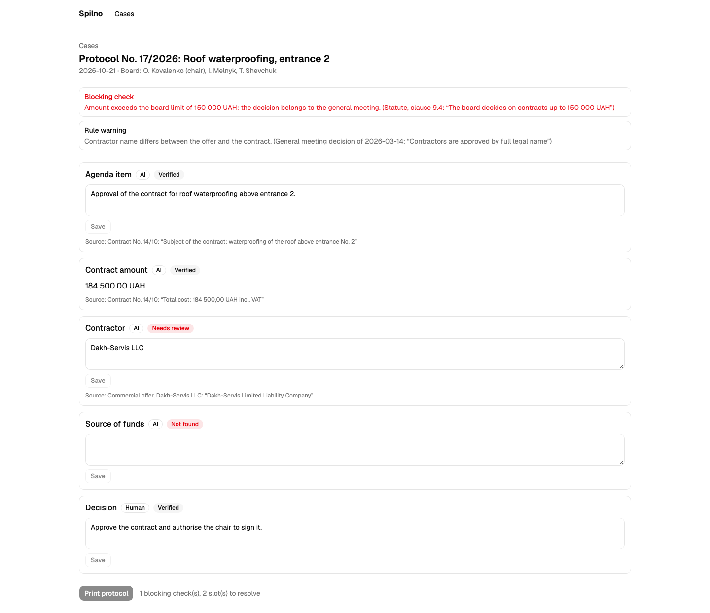
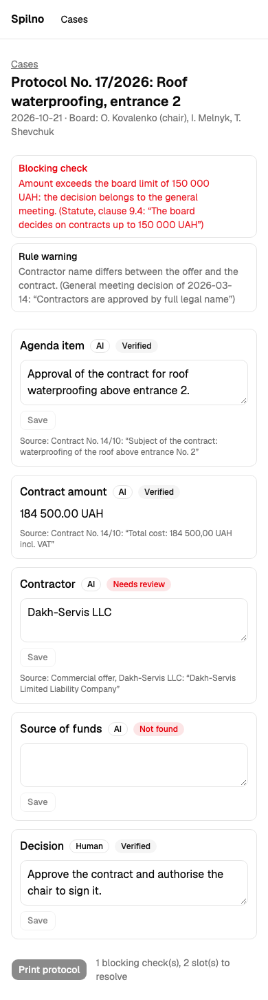
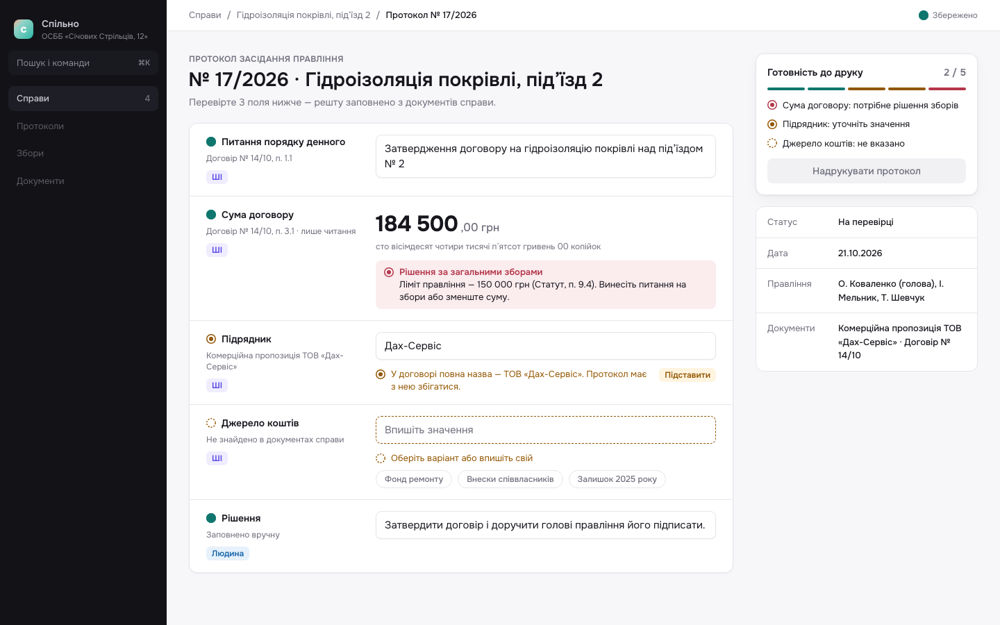
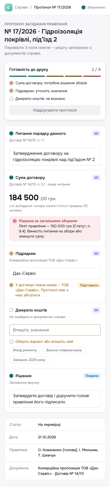
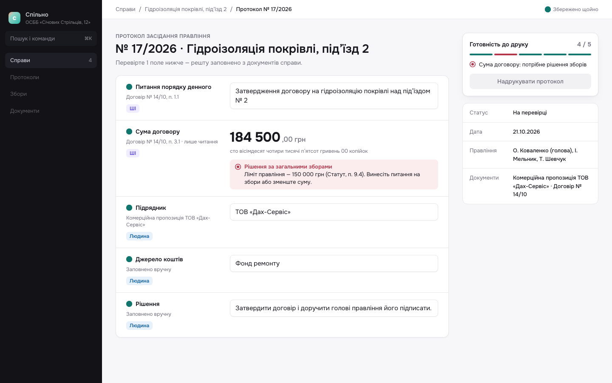
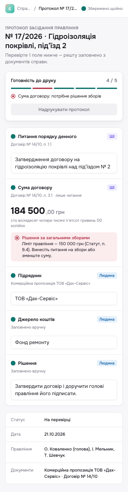

# First screen: protocol draft

The first screen of the board-protocol module is the **protocol draft editor**. Every Stage 1
flow passes through it: a draft is created into it (SAD Flow 1), frozen for the poll or for
signing from it (Flows 2, 4), returned to it (Flow 3) and withdrawn from it (Flow 9). The cases
list (`/cases`) only leads here.

- Route: `/cases/$caseId/protocol` → `apps/web/src/routes/cases.$caseId.protocol.tsx`, which renders
  `ProtocolScreen` keyed by `caseId`.
- Screen: `apps/web/src/features/governance/protocol-screen.tsx`.
- Local URL: http://localhost:5180/cases/c-101/protocol (`c-101` is the only draft in
  `features/governance/mock-data.ts`; any other id, e.g. `c-102`, shows the error state).
- Brief: [../protocol-brief.md](../protocol-brief.md). Design system: [../design-system.md](../design-system.md).
- Data: in-memory stand-in `features/governance/api.ts` (`getProtocol`, `updateSlot`, 350 ms latency)
  until the governance OpenAPI contract is generated; the screen does not need the core API yet.

Other routes today: `/` (health card), `/cases` (cases list), `/cases/$caseId/protocol`.

## What it shows

- **Top bar** with breadcrumbs (Справи → case title → protocol number) and a "saved / saved just now" indicator.
- **Header**: protocol number and case title; a properties block (date via `formatDate`, etc.) sits in the side panel / below the slots on mobile.
- **Slot rows**, one per decision value: label column (220px from `md`), value, `OriginTag`
  (system / AI / human / editing), `StatusGlyph` (verified / needs review / not found), source
  reference (document title + fragment), amounts with the sum in words.
- **Editing** an editable slot: `Textarea`, Save / Cancel, `⌘ Enter` / `Esc` (`Kbd`), live
  validation through `InlineHint` (one-click "Підставити", example chips, "Поле потрібне для
  протоколу"); saving makes the slot `origin: human`.
- **Warnings**: tier-2 advisory and tier-3 blocking `LimitNote`s attached to their slot.
- **Readiness card** (side panel at `lg`, above the slots on mobile): blocking checks, unresolved
  slots and "Надрукувати протокол", disabled until nothing blocks.
- **States**: loading skeleton (`aria-busy`), error (`role="alert"` with a link back to Cases),
  ready (Print enabled).

## Design-system pieces used

| Piece | From |
|---|---|
| `Button` (primary, secondary, outline `asChild` link) | `components/ui/button.tsx` |
| `Textarea`, `Kbd`, `Skeleton` | `components/ui/` |
| `TopBar` | `components/app-shell.tsx` |
| `SlotRow`, `OriginTag`, `StatusGlyph`, `InlineHint`, `LimitNote`, `ReadinessCard` | `features/governance/` |
| Tokens: `origin-*`, `warning`/`warning-subtle`, `destructive`/`destructive-subtle`, `success`, `card`, `border`, `ring`; radius `md`/`lg` | `apps/web/src/index.css` |

What the Stage 1 version of this screen will additionally need (state badge, lifecycle stepper,
dialogs, upload, toast) is listed in [Gaps](../design-system.md#gaps).

## Screenshots

From the design iteration (commit `b7a5d21`), 1440px desktop and 390px mobile:

| | Desktop | Mobile |
|---|---|---|
| Before (prototype) |  |  |
| After (approved design) |  |  |
| After, with edits |  |  |

## Lifecycle design (Figma, 2026-10-28)

Spec: [`../design-spec.md`](../design-spec.md) (BR-07…BR-14). Drawn on page `05 Lifecycle` of the
[Figma file](https://www.figma.com/design/D06IijJnLn8WEgU85fnD84?node-id=31-3) through the Figma MCP:
`ProtocolStateBadge`, `LifecycleStepper`, `PollRoundPanel`, `TransitionActions`, `InlineAlert`, the
`color/success-subtle` token, and frames per state at 1440 and 390 (node ids in spec §13).

| Frame | Export |
|---|---|
| чернетка · desktop | [figma/draft-desktop.png](figma/draft-desktop.png) |
| готовий до голосування · desktop | [figma/ready-for-vote-desktop.png](figma/ready-for-vote-desktop.png) |
| готовий до голосування · mobile | [figma/ready-for-vote-mobile.png](figma/ready-for-vote-mobile.png) |
| готовий до підпису · desktop | [figma/ready-for-signing-desktop.png](figma/ready-for-signing-desktop.png) |
| Components | [figma/lifecycle-components.png](figma/lifecycle-components.png) |

## verify-ui results

Run 2026-10-28 with `/sdlc:verify-ui` (playwright-cli 0.1.22, bundled Chromium, linux arm64) against
`http://localhost:5180`, checking DOD-04…DOD-10 of [`../design-spec.md`](../design-spec.md) §16. Every
verdict is read from the live DOM (`snapshot` / `eval`), not from the screenshot.

| Check | Verdict | Expected vs actual | Evidence |
|---|---|---|---|
| DOD-04 States | PASS | 6 routes reach their state: `c-101` чернетка, `c-102` `role="alert"` «Чернетки протоколу ще немає» + «До справ», `c-103` готовий до голосування (step 2, poll panel), `c-104` готовий до підпису (step 3), `c-105` підписаний (step 4, no actions), `c-106` знятий з розгляду (reason + date, no actions) | `vui-c-10{1..6}-desktop.png` |
| DOD-04 Pending | PASS | after the click, 60 ms in: «Позначення…» and both actions `disabled`; 900 ms later the next state's actions | eval on `c-101` |
| DOD-04 Disabled with reason | PASS | «Позначити готовим до підпису» `disabled`, visible text «Підтвердіть: Підрядник, Джерело коштів» → «Підтвердіть: Джерело коштів» after the first confirm → enabled after the second | eval + `vui-c-101-draft-desktop.png` |
| DOD-04 Transition error | PASS (story only) | the UI prevents invalid transitions, so the `InlineAlert` path is unreachable from clicks; covered by story `TransitionActions/Error` (a11y `error`) | `pnpm test:stories` |
| DOD-05 Preserved behaviour | PASS | «Підставити» sets `ТОВ «Дах-Сервіс»`, `Ctrl+Enter` saves, origin tag becomes «Людина», «Збережено щойно»; chip «Фонд ремонту» fills the empty slot; amount stays `184 500 ,00 грн` + words | eval on `c-101` |
| DOD-06 Lifecycle | PASS | чернетка → готовий до голосування → чернетка → готовий до підпису by clicks; each step updates badge, `ol [aria-current=step]` (1 → 2 → 1 → 3), live region «Стан протоколу: …», «Збережено щойно»; textareas 4 → 0 → 4 → 0; focus moves to the first action | `vui-c-101-after-poll-desktop.png`, `vui-c-101-ready-for-signing-desktop.png` |
| DOD-07 Gate | PASS | blocked only by unconfirmed `origin: ai` slots; tier-3 «Сума договору: потрібне рішення зборів (порада)» stays visible and does not block | ReadinessCard text + enabled action |
| DOD-08 Responsive | PASS | `scrollWidth <= innerWidth` on all 6 routes at 1440 and on `c-101/103/104` at 390; at 390 order is readiness (y≈301) → actions (y≈497) → slots (y≈642), actions full width (358 px), stepper shows «Крок N з 4 · …» while the `ol` stays `sr-only` | `vui-c-10{1,3,4}-mobile.png` |
| DOD-09 Accessibility | PASS | one `h1`; stepper `ol` with `aria-current="step"`; polite live region; Tab order sidebar → crumbs → actions → slots, disabled action skipped, focus visible (outline / ring); contrast light 5.02–18.00, dark 6.43–17.99 on badge, poll note, actions, poll meta (AA ≥ 4.5) | eval + `vui-c-103-desktop-dark.png` |
| DOD-10 Gates | PASS | `pnpm --filter @spilno/web lint`, `typecheck`, `test` (43), `test:stories` (11 files, 43 tests, a11y `error`), `build` — all exit 0 | command output |
| DOD-11 Scope | PASS | `git diff main..HEAD` touches `apps/web/src/**` and `docs/design/**` only; no `services/`, `openapi.yaml`, `package.json` | `git diff --name-only` |

Summary: **PASS (11/11)**. Notes outside the DoD: `favicon.ico` answers 404 (the only console error;
fixed after the run: `apps/web/public/favicon.svg`, guarded by `apps/web/e2e/favicon.spec.ts`);
the Figma `ReadinessCard` component still paints tier-3 red — update it to the amber advisory used in
code (spec §14). Screenshots: `docs/design/first-screen/screenshots/vui-*.png`.
