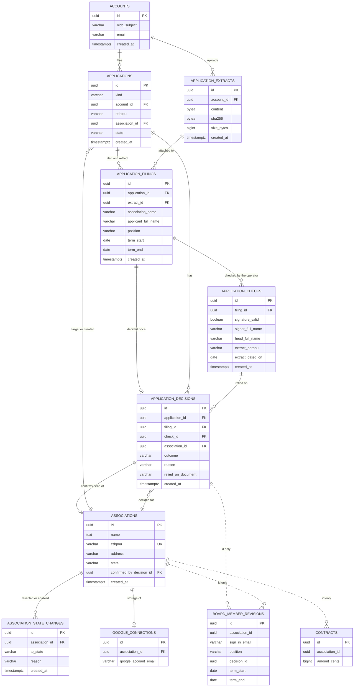

# Data model - association-onboarding

<!-- ao-data-model. Migrations are STAGED in ./migrations/ with the placeholder prefix NNNNN_ and an
     ordered MANIFEST.md; they are renumbered into services/core/migrations/ only at promote time.
     Rules: .claude/rules/migrations.md wins over the skill's defaults (see Deviations and the audit). -->

> **Inputs:** [PRD](./PRD.md) · [SAD](./sad.md) · [ADRs](./adr/) · [CONTEXT](./CONTEXT.md) · rules
> [`.claude/rules/migrations.md`](../../../.claude/rules/migrations.md) · repo ADRs [`docs/adr/`](../../adr/) ·
> staged [migrations](./migrations/MANIFEST.md) · [audit](./_audit/data-model-2026-11-05.md)

Repo conventions applied (from `.claude/rules/migrations.md` and live migrations `00009`–`00027`): UUID
primary keys generated in Go (UUID v7, no column default); `VARCHAR(N)` bounded strings; `TIMESTAMPTZ
NOT NULL DEFAULT now()` and `created_at` only; no business `CHECK`, no triggers, no business `DEFAULT`;
closed sets (`state`, `kind`) validated in Go; `IF NOT EXISTS` on `CREATE TABLE` / `CREATE INDEX`;
names `idx_<table>_<cols>`, `uq_<table>_<cols>`.

Closed sets used below (Go constants in `identity/domain`, `governance/domain`):
`applications.kind` ∈ {`connection`, `transfer`}; `applications.state` ∈ {`pending`, `approved`, `rejected`};
`application_decisions.outcome` ∈ {`approved`, `rejected`}; `associations.state` and
`association_state_changes.to_state` ∈ {`connected`, `disabled`}; `application_filings.position` and
`board_member_revisions.position` ∈ {`head`, `member`}.

## ER diagram

## Context ownership

| Table | Owning context | Aggregate root | New / existing | Referenced by (id only) |
|---|---|---|---|---|
| `associations` | identity | association | existing (+ `edrpou`, `address`, `state`, `confirmed_by_decision_id`) | governance, finance (`association_id`) |
| `association_state_changes` | identity | association | new | - |
| `accounts` | identity | account | existing (− `association_id`) | - |
| `applications` | identity | application | new | - |
| `application_extracts` | identity | application | new | - |
| `application_filings` | identity | application | new | - |
| `application_checks` | identity | application | new | - |
| `application_decisions` | identity | application | new | governance (`board_member_revisions.decision_id`) |
| `google_connections` | identity | association | existing (RLS added) | - |
| `board_member_revisions` | governance | board member | existing (+ `position`, `decision_id`; RLS) | - |
| `contracts` | finance | contract | existing (+ `association_id`; RLS) | - |
| every other `governance` table with `association_id` (26) | governance | per board-protocol | existing (RLS added) | - |

Matches SAD §5. `sessions` is untouched (no association; the association is in the path, ADR-0002).

## Entities

### `associations` (identity) — existing, altered

| Column | Type | Constraints | Origin | Notes |
|---|---|---|---|---|
| `edrpou` | `VARCHAR(8)` | NULL; partial UNIQUE where not null | AC-04, AC-19c | NULL only for the association set up by hand until its запит |
| `address` | `VARCHAR(500)` | NULL | PRD §9 | entered by the board (settings) or from the approved заявка |
| `state` | `VARCHAR(32)` | NOT NULL after 3 steps | AC-21, AC-23 | `connected` / `disabled`; transitions in Go |
| `confirmed_by_decision_id` | `UUID` | NULL, FK → `application_decisions(id)` | AC-29 | NULL = «підключено вручну, без витягу» |

**Mutability:** mutable (`state`, `address`, `confirmed_by_decision_id` change); history of `state` in `association_state_changes`. The legacy `name text CHECK` and `id` without default stay as they are (debt, audit).
**Unique keys:** `uq_associations_edrpou` — serves `identity.association_already_connected`.

### `association_state_changes` (identity) — new, insert-only

| Column | Type | Constraints | Origin | Notes |
|---|---|---|---|---|
| `id` | `UUID` | PK | - | UUID v7 from Go |
| `association_id` | `UUID` | NOT NULL, FK → `associations(id)` | AC-21 | indexed |
| `to_state` | `VARCHAR(32)` | NOT NULL | AC-21, AC-23 | `connected` / `disabled` |
| `reason` | `VARCHAR(1000)` | NULL | AC-21, AC-22 | required for `disabled` in Go (`identity.reason_required`) |
| `changed_by_email` | `VARCHAR(320)` | NOT NULL | PRD §6.1 | the оператор's sign-in address |
| `created_at` | `TIMESTAMPTZ` | NOT NULL `DEFAULT now()` | - | |

**Mutability:** insert-only — `spilno_app` has `SELECT, INSERT` only (ADR-0007). Row-level security by `association_id` (ADR-0003, file 21): the оператор writes and reads it inside `InAssociation` for that association.

### `applications` (identity) — new

| Column | Type | Constraints | Origin | Notes |
|---|---|---|---|---|
| `id` | `UUID` | PK | - | |
| `kind` | `VARCHAR(32)` | NOT NULL | PRD §10 | `connection` / `transfer` |
| `account_id` | `UUID` | NOT NULL, FK → `accounts(id)` | AC-01 | the applicant |
| `edrpou` | `VARCHAR(8)` | NOT NULL | AC-01, AC-02 | 8 digits checked in Go; fixed for the application |
| `association_id` | `UUID` | NULL, FK → `associations(id)` | AC-08, AC-17 | transfer: the target; connection: set on approval |
| `state` | `VARCHAR(32)` | NOT NULL | PRD §10 | `pending` / `approved` / `rejected`; the only column that changes |
| `created_at` | `TIMESTAMPTZ` | NOT NULL `DEFAULT now()` | - | |

**Mutability:** `state` and `association_id` change; every change is also a filing or a decision row.
**Unique keys:** `uq_applications_account_edrpou_pending` on `(account_id, edrpou) WHERE state = 'pending'` — serves `identity.application_already_open` (AC-04b); another person's pending заявка for the code is allowed (AC-04c). Same partial-unique pattern as `uq_protocols_meeting_not_withdrawn`.

### `application_extracts` (identity) — new, insert-only

| Column | Type | Constraints | Origin | Notes |
|---|---|---|---|---|
| `id` | `UUID` | PK | - | |
| `account_id` | `UUID` | NOT NULL, FK → `accounts(id)` | AC-01 | uploader; indexed |
| `content` | `BYTEA` | NOT NULL | ADR-0005 | the file as uploaded, ≤ 5 MB (checked in Go, PRD §6) |
| `sha256` | `BYTEA` | NOT NULL | ADR-0005, SAD QG-4 | compared on every download |
| `size_bytes` | `BIGINT` | NOT NULL | PRD §6 | |
| `media_type` | `VARCHAR(100)` | NOT NULL | PRD §6 | content-sniffed |
| `original_name` | `VARCHAR(255)` | NOT NULL | - | |
| `created_at` | `TIMESTAMPTZ` | NOT NULL `DEFAULT now()` | - | |

**Mutability:** insert-only by privilege (ADR-0005); retention ≥ 5 years (PRD §6), never deleted.

### `application_filings` (identity) — new, insert-only

| Column | Type | Constraints | Origin | Notes |
|---|---|---|---|---|
| `id` | `UUID` | PK | - | |
| `application_id` | `UUID` | NOT NULL, FK → `applications(id)` | AC-06 | one row per filing and refiling |
| `extract_id` | `UUID` | NOT NULL, FK → `application_extracts(id)` | AC-01, AC-06 | indexed |
| `association_name` | `VARCHAR(200)` | NOT NULL | AC-01 | same bound as `associations.name` |
| `association_address` | `VARCHAR(500)` | NOT NULL | AC-01 | |
| `applicant_full_name` | `VARCHAR(200)` | NOT NULL | AC-01, AC-11 | same bound as the roster's `full_name` |
| `position` | `VARCHAR(32)` | NOT NULL | AC-01 | `head` |
| `term_start` | `DATE` | NOT NULL | AC-01, AC-19 | calendar date |
| `term_end` | `DATE` | NULL | AC-30 | |
| `created_at` | `TIMESTAMPTZ` | NOT NULL `DEFAULT now()` | - | the filing date (AC-05) |

**Mutability:** insert-only; the latest filing is current (AC-06 keeps the rejected version).

### `application_checks` (identity) — new, insert-only

| Column | Type | Constraints | Origin | Notes |
|---|---|---|---|---|
| `id` | `UUID` | PK | - | |
| `filing_id` | `UUID` | NOT NULL, FK → `application_filings(id)` | AC-03 | indexed |
| `signature_valid` | `BOOLEAN` | NOT NULL | AC-03 | the оператор's finding; no default |
| `signer_full_name` | `VARCHAR(200)` | NOT NULL | AC-10, AC-11 | from the КЕП, entered by the оператор |
| `signed_on` | `DATE` | NOT NULL | AC-10 | |
| `head_full_name` | `VARCHAR(200)` | NOT NULL | AC-10, AC-11 | керівник named in the extract |
| `extract_edrpou` | `VARCHAR(8)` | NOT NULL | AC-03b | compared with `applications.edrpou` in Go |
| `extract_dated_on` | `DATE` | NOT NULL | AC-11b | age warning in Go |
| `checked_by_email` | `VARCHAR(320)` | NOT NULL | AC-10 | |
| `created_at` | `TIMESTAMPTZ` | NOT NULL `DEFAULT now()` | - | «перевірено оператором <дата>» |

**Mutability:** insert-only; a corrected check is a new row, the latest per filing counts.

### `application_decisions` (identity) — new, insert-only

| Column | Type | Constraints | Origin | Notes |
|---|---|---|---|---|
| `id` | `UUID` | PK | - | |
| `application_id` | `UUID` | NOT NULL, FK → `applications(id)` | AC-08, AC-14 | indexed |
| `filing_id` | `UUID` | NOT NULL, FK → `application_filings(id)`, UNIQUE | AC-15 | one decision per filing |
| `check_id` | `UUID` | NULL, FK → `application_checks(id)` | AC-03, AC-12 | required for `approved` in Go; a rejection may come before any check |
| `association_id` | `UUID` | NULL, FK → `associations(id)` | AC-08, AC-19, AC-29 | the association created or transferred |
| `outcome` | `VARCHAR(32)` | NOT NULL | PRD §10 | `approved` / `rejected` |
| `reason` | `VARCHAR(1000)` | NULL | AC-13, AC-14 | required for `rejected` in Go |
| `relied_on_document` | `VARCHAR(500)` | NULL | AC-12 | required over an open розбіжність імен |
| `decided_by_email` | `VARCHAR(320)` | NOT NULL | PRD §6.1 | |
| `created_at` | `TIMESTAMPTZ` | NOT NULL `DEFAULT now()` | - | |

**Mutability:** insert-only.

### `accounts` (identity) — existing, column dropped

`association_id` and `idx_accounts_association_id` are dropped after the release that stops reading them (ADR-0004).

### `board_member_revisions` (governance) — existing, altered

| Column | Type | Constraints | Origin | Notes |
|---|---|---|---|---|
| `position` | `VARCHAR(32)` | NOT NULL after 3 steps | AC-08, AC-19, AC-19c | `head` / `member`; backfill `member` |
| `decision_id` | `UUID` | NULL | AC-20 | id of `identity.application_decisions`, no FK (ADR 0002) |

Row-level security with the own-entry clause (ADR-0003). `idx_board_member_revisions_sign_in_email` serves `MembershipsOf`.

### `contracts` (finance) — existing, altered

| Column | Type | Constraints | Origin | Notes |
|---|---|---|---|---|
| `association_id` | `UUID` | NOT NULL after 3 steps | ADR-0003 | id of `identity.associations`, no FK; backfill to the seeded association |

## Indexes

| Index | Table | Columns | Kind | Query it serves |
|---|---|---|---|---|
| `uq_applications_account_edrpou_pending` | `applications` | `(account_id, edrpou) WHERE state = 'pending'` | unique partial | `FindOpenApplicationOfAccount` |
| `idx_applications_account_created` | `applications` | `(account_id, created_at DESC, id DESC)` | btree | `ListApplicationsOfAccount`; FK `account_id` |
| `idx_applications_state_created` | `applications` | `(state, created_at, id)` | btree | `ListPendingApplications` |
| `idx_applications_edrpou_state` | `applications` | `(edrpou, state)` | btree | `ListCompetingApplications` |
| `idx_applications_association_id` | `applications` | `(association_id)` | btree | FK; `ListTransferRequestsOfAssociation` |
| `idx_application_extracts_account_id` | `application_extracts` | `(account_id)` | btree | FK |
| `idx_application_filings_application_created` | `application_filings` | `(application_id, created_at DESC, id DESC)` | btree | `GetLatestFiling`, `ListFilings`; FK |
| `idx_application_filings_extract_id` | `application_filings` | `(extract_id)` | btree | FK |
| `idx_application_checks_filing_created` | `application_checks` | `(filing_id, created_at DESC, id DESC)` | btree | `GetLatestCheck`; FK |
| `uq_application_decisions_filing_id` | `application_decisions` | `(filing_id)` | unique | `GetDecisionOfFiling`; FK |
| `idx_application_decisions_application_id` | `application_decisions` | `(application_id)` | btree | FK; `ListDecisionsOfApplication` |
| `idx_application_decisions_check_id` | `application_decisions` | `(check_id)` | btree | FK |
| `idx_application_decisions_association_created` | `application_decisions` | `(association_id, created_at DESC, id DESC)` | btree | `ListDecisionsOfAssociation` (AC-29); FK |
| `uq_associations_edrpou` | `associations` | `(edrpou) WHERE edrpou IS NOT NULL` | unique partial, CONCURRENTLY | `GetAssociationByEdrpou` |
| `idx_associations_confirmed_by_decision` | `associations` | `(confirmed_by_decision_id)` | btree, CONCURRENTLY | FK |
| `idx_association_state_changes_association_created` | `association_state_changes` | `(association_id, created_at DESC, id DESC)` | btree | `ListStateChanges`; FK |
| `idx_board_member_revisions_sign_in_email` | `board_member_revisions` | `(sign_in_email)` | btree, CONCURRENTLY | `MembershipsOf` |
| `idx_contracts_association_created` | `contracts` | `(association_id, created_at DESC, id DESC)` | btree, CONCURRENTLY | `ListContracts` |

## Query -> index map

| Query (sqlc name) | Context | Flow / AC | WHERE / ORDER BY | Served by |
|---|---|---|---|---|
| `CreateExtract`, `CreateApplication`, `CreateFiling` | identity | SAD §6 Flow 1 / AC-01 | insert | PK |
| `GetAssociationByEdrpou` | identity | Flow 1 / AC-04, AC-17, AC-18 | `edrpou = $1` | `uq_associations_edrpou` |
| `FindOpenApplicationOfAccount` | identity | Flow 1 / AC-04b | `account_id = $1 AND edrpou = $2 AND state = 'pending'` | `uq_applications_account_edrpou_pending` |
| `ListApplicationsOfAccount` | identity | AC-05 | `account_id = $1 ORDER BY created_at DESC, id DESC` | `idx_applications_account_created` |
| `GetApplicationOfAccount` | identity | AC-05, AC-07 | `id = $1 AND account_id = $2` | PK |
| `GetApplication` | identity | Flows 2, 3 (оператор) | `id = $1` | PK |
| `ListPendingApplications` | identity | оператор queue / AC-16 | `state = 'pending' ORDER BY created_at, id` | `idx_applications_state_created` |
| `ListCompetingApplications` | identity | AC-04c, AC-19b | `edrpou = $1 AND state = 'pending'` | `idx_applications_edrpou_state` |
| `ListTransferRequestsOfAssociation` | identity | AC-19b | `association_id = $1 AND kind = 'transfer'` | `idx_applications_association_id` |
| `UpdateApplicationState` | identity | Flows 2, 3 | `id = $1` | PK |
| `GetLatestFiling` | identity | Flows 2, 3 / AC-06 | `application_id = $1 ORDER BY created_at DESC, id DESC LIMIT 1` | `idx_application_filings_application_created` |
| `ListFilings` | identity | AC-06 history | `application_id = $1 ORDER BY created_at DESC, id DESC` | `idx_application_filings_application_created` |
| `GetExtract` | identity | оператор download | `id = $1` | PK |
| `CreateCheck`, `GetLatestCheck` | identity | Flow 2 / AC-03, AC-10 | `filing_id = $1 ORDER BY created_at DESC, id DESC LIMIT 1` | `idx_application_checks_filing_created` |
| `CreateDecision`, `GetDecisionOfFiling` | identity | Flows 2, 3 / AC-15 | `filing_id = $1` | `uq_application_decisions_filing_id` |
| `ListDecisionsOfAssociation` | identity | AC-29 card | `association_id = $1 ORDER BY created_at DESC, id DESC` | `idx_application_decisions_association_created` |
| `CreateAssociation`, `GetAssociation`, `UpdateAssociationState`, `SetAssociationConfirmation` | identity | Flow 2, Flow 4 / AC-08, AC-21 | `id = $1` | PK |
| `ListAssociations` | identity | оператор list | none, `ORDER BY name` | seq scan accepted: < 100 rows |
| `CreateStateChange`, `ListStateChanges` | identity | AC-21, AC-23, AC-29 | `association_id = $1 ORDER BY created_at DESC, id DESC` | `idx_association_state_changes_association_created` |
| `GetGoogleConnection` | identity | ADR-0008 / AC-27, AC-28b | `association_id = $1` | existing `uq_google_connections_association_id` |
| `CurrentMember` | governance | Flow 4 / AC-07 | `association_id = $1 AND sign_in_email = $2` (latest revision, term covers today) | existing `idx_board_member_revisions_association_email` |
| `MembershipsOf` | governance | AC-04d | `sign_in_email = $1` (own entries via RLS) | `idx_board_member_revisions_sign_in_email` |
| `MemberSignInAddresses` | governance | AC-28b | `association_id = $1` | existing `idx_board_member_revisions_association_email` |
| `SeatHead`, `EndTerm` | governance | Flows 2, 3 / AC-08, AC-19 | insert revision | PK; existing `idx_board_member_revisions_member_created` for the latest revision |
| `ListContracts` | finance | ADR-0002 path move | `association_id = $1 ORDER BY created_at DESC, id DESC` | `idx_contracts_association_created` |

## Error catalogue -> constraints

| Code | Kind | Backed by | Notes |
|---|---|---|---|
| `identity.association_already_connected` | conflict | `uq_associations_edrpou` | approve of a competing заявка hits the same key (AC-04c) |
| `identity.application_already_open` | conflict | `uq_applications_account_edrpou_pending` | |
| `identity.application_not_pending` | conflict | `uq_application_decisions_filing_id` + state check in Go | |
| `identity.association_state_unchanged` | conflict | app only | compares `associations.state` |
| `identity.application_invalid` | validation | app only | `VARCHAR` bounds back the lengths |
| `identity.signature_not_checked` | invariant | app only | needs a check row with `signature_valid = true` |
| `identity.extract_code_mismatch` | invariant | app only | `application_checks.extract_edrpou` vs `applications.edrpou` |
| `identity.mismatch_needs_document` | invariant | app only | `relied_on_document` NOT NULL when a mismatch is open |
| `identity.reason_required` | validation | app only | `reason` NULL allowed in the table for approvals and enabling |
| `identity.term_ended` | invariant | app only | date comparison on filing |
| `identity.association_not_connected` | invariant | app only | lookup by `edrpou` |
| `identity.storage_account_personal` | invariant | app only | cross-context (governance addresses) |
| `identity.association_disabled`, `identity.not_operator`, `identity.not_current_member` | authorization | app only + RLS | RLS hides rows of other associations (ADR-0003) |
| `governance.drive_not_connected` | invariant | app only | no `google_connections` row |

## Migration plan / expand-contract map

| Order | Staged file | Change | Phase | Ships in | Down | Backfill note |
|---|---|---|---|---|---|---|
| 1 | `NNNNN_create_applications.sql` | 5 new identity tables | - | PR 1 | drop tables | - |
| 2 | `NNNNN_add_associations_onboarding_columns.sql` | `edrpou`, `address`, `state`, `confirmed_by_decision_id` nullable | expand | PR 1 | drop columns | - |
| 3 | `NNNNN_index_associations_edrpou.sql` | unique partial, concurrently | - | PR 1 | drop index | - |
| 4 | `NNNNN_index_associations_confirmed_by_decision.sql` | FK index, concurrently | - | PR 1 | drop index | - |
| 5 | `NNNNN_create_association_state_changes.sql` | new table | - | PR 1 | drop table | - |
| 6 | `NNNNN_add_board_member_revisions_position.sql` | `position`, `decision_id` nullable | expand | PR 1 | drop columns | - |
| 7 | `NNNNN_index_board_member_revisions_sign_in_email.sql` | index, concurrently | - | PR 1 | drop index | - |
| 8 | `NNNNN_add_contracts_association_id.sql` | nullable column | expand | PR 1 | drop column | - |
| 9 | `NNNNN_create_app_role.sql` | `spilno_app` role, grants, insert-only revokes | - | PR 1 | revoke (role kept) | - |
| 10 | `NNNNN_drop_accounts_association_id.sql` | drop column + index | contract | PR 4 | re-add NOT NULL FK + index, filled with the seeded association | - |
| 11 | `NNNNN_backfill_associations_state.sql` | `connected` | backfill | PR 2 | no-op | [note](./migrations/backfill-associations-state.md) |
| 12 | `NNNNN_backfill_board_member_revisions_position.sql` | `member` | backfill | PR 2 | no-op | [note](./migrations/backfill-board-member-revisions-position.md) |
| 13 | `NNNNN_backfill_contracts_association_id.sql` | seeded association | backfill | PR 2 | no-op | [note](./migrations/backfill-contracts-association-id.md) |
| 14 | `NNNNN_contract_associations_state.sql` | NOT NULL | contract | PR 3 | drop NOT NULL | - |
| 15 | `NNNNN_contract_board_member_revisions_position.sql` | NOT NULL | contract | PR 3 | drop NOT NULL | - |
| 16 | `NNNNN_contract_contracts_association_id.sql` | NOT NULL | contract | PR 3 | drop NOT NULL | - |
| 17 | `NNNNN_index_contracts_association_created.sql` | index, concurrently | - | PR 3 | drop index | - |
| 18 | `NNNNN_enable_rls_governance.sql` | RLS on 27 tables | - | PR 3 | drop policies, disable | - |
| 19 | `NNNNN_enable_rls_finance.sql` | RLS on `contracts` | - | PR 3 | drop policy, disable | - |
| 20 | `NNNNN_enable_rls_identity.sql` | RLS on `google_connections` | - | PR 3 | drop policy, disable | - |
| 21 | `NNNNN_enable_rls_identity_state_changes.sql` | RLS on `association_state_changes` (added in T20) | - | PR 3 | drop policy, disable | - |

**Reversibility:** a rollback keeps every application, extract, check and decision (PRD §9); after real filings, the tables of file 1 are not dropped. Rolling back RLS (18–21) returns to explicit filters only (ADR-0015). File 10's Down (promoted early, was 20: AC-05 needs accounts without an association, and sign-in, the middleware and RLS all follow from it) is exact only while the one seeded association is the only one an account belonged to (audit).

## Deviations from the rules

| Rule | Deviation | Where | ADR |
|---|---|---|---|
| none of the rules file covers row-level security, roles or grants | RLS policies with `FORCE`, a `spilno_app` role created in a `DO` block, `ALTER DEFAULT PRIVILEGES` | files 9, 17–19 | [ADR-0003](./adr/0003-enforce-association-isolation-with-postgres-row-level-security.md) |
| append-only by convention | insert-only enforced by `REVOKE UPDATE, DELETE` instead of a trigger | file 9 | [ADR-0005](./adr/0005-check-the-signed-extract-manually-and-keep-the-uploaded-file-in-identity.md), [ADR-0007](./adr/0007-enforce-a-disabled-association-as-read-only-in-the-identity-middleware.md) |
| `TEXT` only for URLs / long descriptions | `BYTEA` file content in Postgres | `application_extracts.content` | [ADR-0005](./adr/0005-check-the-signed-extract-manually-and-keep-the-uploaded-file-in-identity.md) |
| no `CHECK` on business invariants | helper `CHECK (... IS NOT NULL) NOT VALID` in contract files, dropped in the same file | files 13–15 | technical, per `expand-contract.md`; no business rule |

## Seeds

None. The one association already exists (`00004`, fixed id `00000000-0000-7000-8000-000000000001`); the backfills use that id.

## Test fixtures

Go helpers next to `internal/platform/testdb`, never migrations; `example.test` addresses, made-up names:

- `testdb.NewTwoAssociations(t)` — a fresh migrated database with associations A and B, a login role in `spilno_app`, and a pool connected as it (the isolation test must not run as the superuser, which bypasses RLS).
- `governancetest.Member(t, tx, association, "member-<uuid>@example.test", position)` — a roster entry with a term covering today; the same address in both associations gives the «person on both rosters» of SAD QG-1.
- `identitytest.PendingApplication(t, tx, kind, edrpou)` — account + extract (a few bytes) + application + filing.
- `identitytest.Check(t, tx, filing, valid)` — an оператор's check with matching names and code.

## Drift

- Schema vs source: `identity/domain` has no application or association-state types yet and `identity/adapters/postgres/queries/identity.sql` has only `CountAccounts` — expected, the feature builds them; no `_drift/` proposal. `governance/domain.BoardMemberEntry` has no `Position` and no `DecisionID` → add with file 6 (column-without-field once promoted).
- Model vs spec: every PRD §5.1 code has a home above; every SAD §5 table is here; every new table cites a PRD AC or ADR. `sessions` needs no change (ADR-0002 puts the association in the path).
