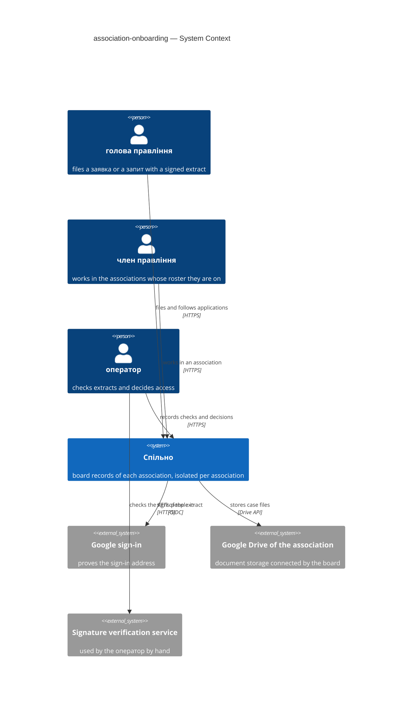
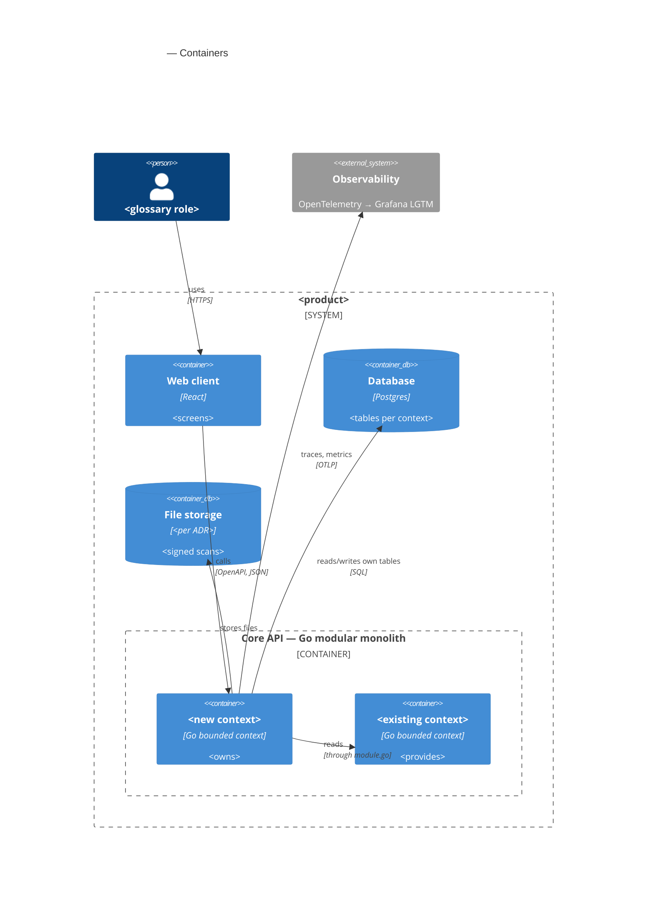
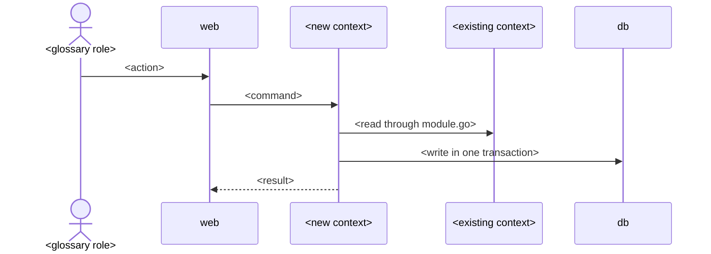

# Software Architecture Document — association-onboarding

> **Inputs:** [PRD](./PRD.md) (Approved 2026-11-05, ao-prd, amended at this pass: manual extract check) · [CONTEXT](./CONTEXT.md) · [board-protocol CONTEXT](../board-protocol/CONTEXT.md) · repo ADRs [`docs/adr/`](../../adr/) · board-protocol [SAD](../board-protocol/sad.md) and [ADRs](../board-protocol/adr/) · reference contexts `services/core/internal/identity`, `services/core/internal/governance`

## 1. Introduction and goals

**Intent.** A голова правління connects their association to Спільно, or takes it over after an election, without the developer: they sign in, file a заявка на підключення or a запит на передачу with a КЕП-signed витяг з ЄДР, and the оператор checks the extract outside Спільно and decides with a reason. The оператор can disable and enable an association; the board connects its own document storage. With a second association the data of each association becomes visible only to the people on its roster, and one person may sit on several rosters (PRD §1, §2).

**Top-3 quality goals** (full scenarios in §10):

1. **Isolation** — 0 records of association B readable by a person not on B's roster, enforced by the database and by a release-blocking check (PRD §6 Isolation).
2. **Immediate effect of access decisions** — a disabling or a transfer is in force from the next request (PRD §6).
3. **Traceability of office** — every голова in Спільно links to the stored extract and the оператор's recorded check and decision, kept ≥ 5 years (PRD §6 Retention, AC-29).

**Stakeholders.**

| Role (glossary) | Interest | Sign-off? |
|---|---|---|
| голова правління | files, follows and refiles a заявка or a запит; becomes the first член правління | No |
| оператор | checks extracts, decides, disables and enables associations | Yes (product owner) |
| член правління | works in one or several associations; connects the storage; reads the registry of a вимкнене ОСББ | No |
| ревізійна комісія | later reads the chain from Спільно to ЄДР (no access in this feature) | No |
| Tech lead | SAD approval | Yes |

Product-owner decisions at this pass (2026-11-05): the extract and the КЕП are checked by hand outside Спільно («вся перевірка — ручна і за кадром», PRD amended); the association id is part of the path («хоч рут різний з айді осбб»); row-level security now.

<!-- Decision overrides from the critic: «- Decision override: <headline> — rationale: <reason>» -->

## 2. Constraints

**Technical** (versions from `mise.toml`, `infra/compose.yaml`, board-protocol SAD §2):
- Go 1.27.3, chi v5, oapi-codegen strict server over one OpenAPI 3.1 contract `services/core/api/openapi.yaml`; every operation has one context tag and a `/<context>/` path (repo [ADR 0001](../../adr/0001-stack.md), [ADR 0003](../../adr/0003-spec-first-codegen.md)).
- Postgres 18.6 (`postgres:18.6-alpine`), pgx/v5 + sqlc, goose migrations in `services/core/migrations/` applied on start (repo [ADR 0004](../../adr/0004-migrations-and-queries.md)); next migration `00028`. Today one database role owns the schema and serves the app.
- Web: React 19.3, TypeScript 6.0, Vite 8, TanStack Router + Query, orval hooks per tag, shadcn/ui, Storybook 10; routes today `index`, `cases.index`, `cases.$caseId.protocol`.
- Existing contexts: `identity` (stub handler: session, sign-in, callback, sign-out; tables `associations` with one seeded row, `accounts` with `association_id NOT NULL`, `sessions`, `google_connections`), `governance` (roster `board_members` + `board_member_revisions` with term and no position; ~30 operations under `/governance/...`; `association_id` + explicit filter per board-protocol ADR-0015), `finance` (`contracts` **without** `association_id`), `system`, `platform` (`httpapi`, `testdb`).
- Background work is River (board-protocol ADR-0006); this feature adds no job.

**Repo ADRs that bind this feature:** 0001 stack · 0002 bounded contexts · 0003 spec-first codegen · 0004 migrations and queries.

**Feature ADRs of board-protocol it changes:** [ADR-0003](../board-protocol/adr/0003-sign-in-with-oidc-and-postgres-sessions.md) (sign-in refuses a person off the roster → superseded in part by ADR-0004), [ADR-0005](../board-protocol/adr/0005-store-files-in-association-owned-google-drive-folder.md) (storage authorized once by a developer command → ADR-0008), [ADR-0015](../board-protocol/adr/0015-scope-owned-rows-to-one-association-with-explicit-query-filters.md) (RLS deferred until a second association → ADR-0003), tasks T08 and T12 (replaced).

**Conventions** (`CLAUDE.md`, `.claude/rules/openapi.md`, `.claude/rules/migrations.md`): one OpenAPI contract, one tag per context, paths `/<context>/`; contexts import each other only through `module.go`; RFC 9457 problem+json with `code`; `r.Group`, never `r.Mount`; generated files never edited; new tables without business `CHECK`, triggers or stored procedures; zero-downtime 3-step for a new NOT NULL column and for a dropped column.

**Organisational:** one developer with coding agents; effort ~3 person-weeks, Dec 2026 – Jan 2027, after board-protocol Stage 1 (brief §12). The path change of ADR-0002 touches operations that board-protocol Stage 1 tasks are building (§11).

**Regulatory / legal:** Law «On personal data protection» — the applicant's name, address, position and term; the РНОКПП inside the КЕП certificate of the stored extract (shown to nobody, kept only in the file); classification Confidential (PRD §6.1). The оператор decides access to Спільно, never who heads an association (brief §18, AC-12). Security review required before release (PRD §6.1).

## 3. Context and scope

Спільно is one web application in which each association works in its own space. People reach it with their sign-in account; the trust boundary is the session plus the association's roster: nothing of an association is served to a person who is not on its roster in force today. The КЕП and the ЄДР extract are checked by the оператор with public services outside Спільно; Спільно only stores the file and what the оператор recorded.

| Actor or system | Type | Interaction |
|---|---|---|
| голова правління | Person | signs in, files a заявка на підключення or a запит на передачу with the signed extract, follows it |
| член правління | Person | works in each association whose roster they are on; connects the storage |
| оператор | Person | checks extracts outside Спільно, records the check, decides, disables and enables |
| Google sign-in | System (external) | proves the person's sign-in address (OIDC) |
| Google Drive of the association | System (external) | the association's document storage, connected by the board |
| Public signature verification service (ЦЗО) | System (external) | used by the оператор by hand to check the КЕП; Спільно does not call it |



## 4. Solution strategy

**Target surface(s):** `[backend-service, web-frontend]` — the core API and the existing SPA; no worker, CLI or new process (the extract check is manual, ADR-0005).

**Strategic pillars:**

1. **The association is explicit in every association-scoped path** — `/<context>/associations/{association_id}/...` in the API and `/o/{association_id}/...` in the web app; the identity middleware checks the person against that association's roster before any context runs ([ADR-0002](./adr/0002-put-the-association-id-in-every-association-scoped-path.md)). Constraint: repo ADR 0003 (`/<context>/` prefix kept), AC-04d.
2. **The database enforces isolation** — row-level security on every association-owned table, the app connects as a role without `BYPASSRLS`, each association-scoped request runs in a transaction with the association set; the explicit filters of board-protocol ADR-0015 stay as a second line, and a release-blocking test seeds two associations and a person on both ([ADR-0003](./adr/0003-enforce-association-isolation-with-postgres-row-level-security.md)). Constraint: PRD §6 Isolation; brief §10 top risk.
3. **People are not bound to one association** — any verified person holds a session; which associations they may open comes from the rosters in force today; an applicant has a session and no association ([ADR-0004](./adr/0004-let-any-verified-person-sign-in-and-derive-memberships-from-rosters.md)). Constraint: PRD §1 ¶4 (several associations per person), board-protocol ADR-0003.
4. **Proof of office is a document a person checked** — Спільно keeps the uploaded extract unchanged and the оператор's recorded check; approval is refused without it; Спільно parses or verifies nothing ([ADR-0005](./adr/0005-check-the-signed-extract-manually-and-keep-the-uploaded-file-in-identity.md)). Constraint: PRD AC-03, AC-29; product owner 2026-11-05.
5. **UI architecture** — the same SPA: association routes under `/o/{association_id}/`, an association picker after sign-in, the applicant's pages under `/applications`, and the оператор's back office under `/operator/` shown only to the оператор; reuses the shadcn components and the Stage 1 Figma frames (BR-21) ([ADR-0001](./adr/0001-serve-the-operator-back-office-as-an-operator-only-section-of-the-web-app.md)). Constraint: PRD §8 back-office question, `docs/design/stage1-screens-spec.md` §14.

## 5. Building block view

<one paragraph: hexagonal per context, why the feature extends or adds a context>

**Context ownership** (fills frontmatter `contexts`):

| Context | New? | Owns (aggregates, tables) | Provides to others via module.go | Uses from others |
|---|---|---|---|---|
| <protocols> | new | <protocol, agenda item, vote> | <...> | <governance: meetings, roster> |
| <governance> | existing | <meeting, board term> | <meeting by id, roster on date> | — |

**Layout of the new context:**

```
services/core/internal/<bc>/
├── domain/              <entities, sentinel errors; stdlib only>
├── app/                 <use cases; authorization against the board term on the action date>
├── ports/               <repositories, other contexts' ports>
├── adapters/http/       <StrictServerInterface; problem+json>
├── adapters/postgres/   <queries/ → sqlcgen/>
└── module.go            <wiring>
```

New-context wiring (CLAUDE.md): spec tag · `adapters/http/gen/oapi-codegen.yaml` · `sqlc.yaml` entry ·
`<bc>-private` depguard rule · `cmd/api/main.go`.



## 6. Runtime view

<!-- Seed the primary flows here; complete-sequence-diagrams adds the rest. Participants are §5
     container aliases. Messages are semantic — no HTTP verbs, paths or status codes.
     With an ao-prd PRD: one flow per critical §10 transition (e.g. mark ready, sign and lock,
     refused edit after lock) and name the PRD AC each flow covers. -->

**Flow 1: <happy path> — covers AC-<NN>**



**Flow 2: <refused transition / failure mode> — covers AC-<NN>**

## 7. Deployment view

<!-- Usually N/A for a feature inside the core process: <!-- N/A: reuses the core deployment unit -->
     plus one line of scaling numbers. Fill when the feature adds a process, a queue or storage. -->

<topology; storage for files; backup and restore numbers from PRD §6>

## 8. Crosscutting concepts

| Concept | Convention for this feature | Where defined |
|---|---|---|
| Errors | problem+json; codes from PRD §5.1 (`<context>.<error_name>`) | `internal/platform/httpapi`, PRD §5.1 |
| Authorization | <roles × actions from PRD §10, checked in `app/`> | PRD §10 |
| Validation | OpenAPI validator (422) + domain `Validate()` | CLAUDE.md |
| IDs | UUID | repo convention |
| Migrations | goose; <what this feature migrates, link ADR> | ADR 0004 |
| Audit / immutability | <how locked records are protected> | ADR <NNNN> |
| Files | <where scans live, size limit from PRD §6> | ADR <NNNN> |
| Observability | OTel spans + request-duration histogram | repo convention |
| i18n | UI in Ukrainian | — |

## 9. Architecture decisions

| # | Decision | Status | Section | Blast radius (I / C / A / D) |
|---|---|---|---|---|
| <NNNN> | <decision as a sentence> | accepted | §<N> | <✓ / – / ✓ / ✓> |

ADR files: `docs/features/<slug>/adr/NNNN-<decision>.md`. Repo-level ADRs stay in `docs/adr/`.

## 10. Quality requirements

**QG-1. <quality>**
- **When:** <trigger>
- **Then:** <PRD §6 number verbatim>
- **How verify:** <testdb integration test / Playwright e2e / k6 / OTel metric name>

**QG-2. <quality>** — <...>

**QG-3. <quality>** — <...>

## 11. Risks and technical debt

| Risk / debt | Severity | Mitigation | Owner |
|---|---|---|---|
| <migration of existing records (PRD §9)> | <Low/Medium/High> | <...> | <...> |
| Open architectural decision: <headline> | Open question | Resolve before <stage or date>; <reason> | <owner> |

**Accepted debt:** <...>

## 12. Glossary

<!-- Terms from CONTEXT.md used in this SAD + technical terms of this feature. New domain terms go
     to CONTEXT.md first. -->

| Term | Meaning |
|---|---|
| <term> | <meaning> |
