# Software Architecture Document — association-onboarding

> **Inputs:** [PRD](./PRD.md) (Approved 2026-11-05, ao-prd; amended at the first SAD pass: manual extract check; clarified 2026-11-10 by clarify-prd and reconciled here the same day) · [CONTEXT](./CONTEXT.md) · [board-protocol CONTEXT](../board-protocol/CONTEXT.md) · repo ADRs [`docs/adr/`](../../adr/) · board-protocol [SAD](../board-protocol/sad.md) and [ADRs](../board-protocol/adr/) · reference contexts `services/core/internal/identity`, `services/core/internal/governance`

## 1. Introduction and goals

**Intent.** A голова правління connects their association to Спільно, or takes it over after an election, without the developer: they sign in, file a заявка на підключення or a запит на передачу with a КЕП-signed витяг з ЄДР, and the оператор checks the extract outside Спільно and decides with a reason. The оператор can disable and enable an association; the board connects its own document storage. With a second association the data of each association becomes visible only to the people on its roster, and one person may sit on several rosters (PRD §1, §2). The оператор role may sit on the account of a член правління: it opens no association's records and decides nothing its holder filed (AC-16b, AC-16c).

**Top-3 quality goals** (full scenarios in §10):

1. **Isolation** — 0 records of association B readable by a person not on B's roster, enforced by the database and by a release-blocking check (PRD §6 Isolation).
2. **Immediate effect of access decisions** — a disabling or a transfer is in force from the next request (PRD §6).
3. **Traceability of office** — every голова in Спільно links to the stored extract and the оператор's recorded check and decision, kept ≥ 5 years (PRD §6 Retention, AC-29).

**Stakeholders.**

| Role (glossary) | Interest | Sign-off? |
|---|---|---|
| голова правління | files, follows and refiles a заявка or a запит, on the roster or not; becomes the first член правління of a new association or the голова on an existing roster | No |
| оператор | checks extracts, decides (never their own filing), disables and enables associations; may also be a член правління on the same account | Yes (product owner) |
| член правління | works in one or several associations; connects the storage; reads the registry of a вимкнене ОСББ | No |
| ревізійна комісія | later reads the chain from Спільно to ЄДР (no access in this feature) | No |
| Tech lead | SAD approval | Yes |

Product-owner decisions at this pass (2026-11-05): the extract and the КЕП are checked by hand outside Спільно («вся перевірка — ручна і за кадром», PRD amended); the association id is part of the path («хоч рут різний з айді осбб»); row-level security now.

Reconcile pass 2026-11-10 (PRD §1 ¶4 «Clarified 2026-11-10»): the оператор role and a roster membership are independent grants on one sign-in account, and the оператор's own filing is refused ([ADR-0009](./adr/0009-treat-the-operator-role-and-a-roster-membership-as-independent-grants-on-one-account.md), AC-16b, AC-16c); a запит на передачу may come from a person already on the roster, whose entry is re-seated instead of doubled ([ADR-0006](./adr/0006-apply-approvals-to-the-roster-through-a-governance-facade-in-one-transaction.md) amended, AC-17, AC-19); a competing запит stays decidable after another was approved (AC-19b); a term start later than the filing date is refused (AC-02); the three names are compared after levelling their spelling (AC-11). The C4 diagrams of §3 and §5 did not change.

<!-- Decision overrides from the critic: «- Decision override: <headline> — rationale: <reason>» -->

## 2. Constraints

**Technical** (versions from `mise.toml`, `infra/compose.yaml`, board-protocol SAD §2):
- Go 1.27.3, chi v5, oapi-codegen strict server over one OpenAPI 3.1 contract `services/core/api/openapi.yaml`; every operation has one context tag and a `/<context>/` path (repo [ADR 0001](../../adr/0001-stack.md), [ADR 0003](../../adr/0003-spec-first-codegen.md)).
- Postgres 18.6 (`postgres:18.6-alpine`), pgx/v5 + sqlc, goose migrations in `services/core/migrations/` applied on start (repo [ADR 0004](../../adr/0004-migrations-and-queries.md)); next migration `00028`. Today one database role owns the schema and serves the app.
- Web: React 19.3, TypeScript 6.0, Vite 8, TanStack Router + Query, orval hooks per tag, shadcn/ui, Storybook 10; routes today `index`, `cases.index`, `cases.$caseId.protocol`.
- Existing contexts: `identity` (stub handler: session, sign-in, callback, sign-out; `app/token_cipher.go` seals the storage refresh token — board-protocol T12a, merged 2026-11-09; tables `associations` with one seeded row, `accounts` with `association_id NOT NULL`, `sessions`, `google_connections`), `governance` (roster `board_members` + `board_member_revisions` with term and no position; ~30 operations under `/governance/...`; `association_id` + explicit filter per board-protocol ADR-0015), `finance` (`contracts` **without** `association_id`), `system`, `platform` (`httpapi`, `testdb`).
- Background work is River (board-protocol ADR-0006); this feature adds no job.

**Repo ADRs that bind this feature:** 0001 stack · 0002 bounded contexts · 0003 spec-first codegen · 0004 migrations and queries.

**Feature ADRs of board-protocol it changes:** [ADR-0003](../board-protocol/adr/0003-sign-in-with-oidc-and-postgres-sessions.md) (sign-in refuses a person off the roster → superseded in part by ADR-0004), [ADR-0005](../board-protocol/adr/0005-store-files-in-association-owned-google-drive-folder.md) (storage authorized once by a developer command → ADR-0008), [ADR-0015](../board-protocol/adr/0015-scope-owned-rows-to-one-association-with-explicit-query-filters.md) (RLS deferred until a second association → ADR-0003), tasks T08 and T12 (replaced).

**Conventions** (`CLAUDE.md`, `.claude/rules/openapi.md`, `.claude/rules/migrations.md`): one OpenAPI contract, one tag per context, paths `/<context>/`; contexts import each other only through `module.go`; RFC 9457 problem+json with `code`; `r.Group`, never `r.Mount`; generated files never edited; new tables without business `CHECK`, triggers or stored procedures; zero-downtime 3-step for a new NOT NULL column and for a dropped column.

**Organisational:** one developer with coding agents; effort ~4.5 person-weeks — 3 from the brief (§11 RICE) + ~1 for row-level security (ADR-0003) + ~0.5 for the path move (ADR-0002) — Dec 2026 – Feb 2027, after board-protocol Stage 1; size class stays M (no new context). The path change of ADR-0002 touches operations that board-protocol Stage 1 tasks are building (§11).

**Regulatory / legal:** Law «On personal data protection» — the applicant's name, address, position and term; the РНОКПП inside the КЕП certificate of the stored extract (shown to nobody, kept only in the file); classification Confidential (PRD §6.1). The оператор decides access to Спільно, never who heads an association (brief §18, AC-12). Security review required before release (PRD §6.1).

## 3. Context and scope

Спільно is one web application in which each association works in its own space. People reach it with their sign-in account; the trust boundary is the session plus the association's roster: nothing of an association is served to a person who is not on its roster in force today. The КЕП and the ЄДР extract are checked by the оператор with public services outside Спільно; Спільно only stores the file and what the оператор recorded.

| Actor or system | Type | Interaction |
|---|---|---|
| голова правління | Person | signs in, files a заявка на підключення or a запит на передачу with the signed extract, follows it |
| член правління | Person | works in each association whose roster they are on; connects the storage |
| оператор | Person | checks extracts outside Спільно, records the check, decides, disables and enables; the same person may be a член правління and then enters that association as its member, not as the оператор |
| Google sign-in | System (external) | proves the person's sign-in address (OIDC) |
| Google Drive of the association | System (external) | the association's document storage, connected by the board |
| Public signature verification service (ЦЗО) | System (external) | used by the оператор by hand to check the КЕП; Спільно does not call it |

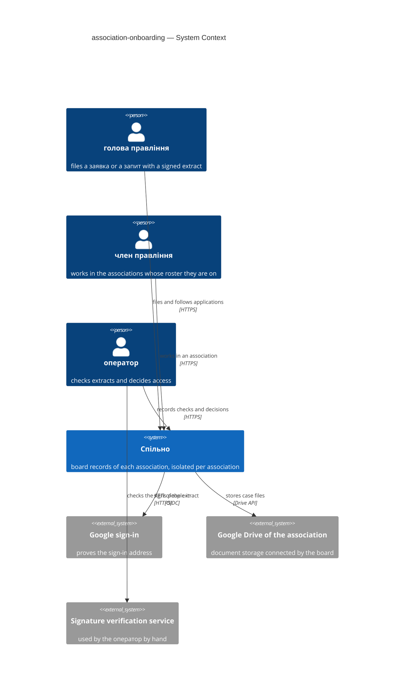

## 4. Solution strategy

**Target surface(s):** `[backend-service, web-frontend]` — the core API and the existing SPA; no worker, CLI or new process (the extract check is manual, ADR-0005).

**Strategic pillars:**

1. **The association is explicit in every association-scoped path** — `/<context>/associations/{association_id}/...` in the API and `/o/{association_id}/...` in the web app; the identity middleware checks the person against that association's roster before any context runs ([ADR-0002](./adr/0002-put-the-association-id-in-every-association-scoped-path.md)). Constraint: repo ADR 0003 (`/<context>/` prefix kept), AC-04d.
2. **The database enforces isolation** — row-level security on every association-owned table, the app connects as a role without `BYPASSRLS`, each association-scoped request runs in a transaction with the association set; the explicit filters of board-protocol ADR-0015 stay as a second line, and a release-blocking test seeds two associations and a person on both ([ADR-0003](./adr/0003-enforce-association-isolation-with-postgres-row-level-security.md)). Constraint: PRD §6 Isolation; brief §10 top risk.
3. **People are not bound to one association** — any verified person holds a session; which associations they may open comes from the rosters in force today; an applicant has a session and no association ([ADR-0004](./adr/0004-let-any-verified-person-sign-in-and-derive-memberships-from-rosters.md)). The оператор role is one more grant on the same account, asked only on operator paths: it opens no association and never decides its holder's own filing ([ADR-0009](./adr/0009-treat-the-operator-role-and-a-roster-membership-as-independent-grants-on-one-account.md)). Constraint: PRD §1 ¶4 (several associations per person; one account for the оператор and a член правління), AC-16b, AC-16c, board-protocol ADR-0003.
4. **Proof of office is a document a person checked** — Спільно keeps the uploaded extract unchanged and the оператор's recorded check; approval is refused without it; Спільно parses or verifies nothing ([ADR-0005](./adr/0005-check-the-signed-extract-manually-and-keep-the-uploaded-file-in-identity.md)). Constraint: PRD AC-03, AC-29; product owner 2026-11-05.
5. **UI architecture** — the same SPA: association routes under `/o/{association_id}/`, an association picker after sign-in, the applicant's pages under `/applications`, and the оператор's back office under `/operator/` shown only to the оператор, next to the picker when that person is also a член правління; reuses the shadcn components and the Stage 1 Figma frames (BR-21) ([ADR-0001](./adr/0001-serve-the-operator-back-office-as-an-operator-only-section-of-the-web-app.md)). Constraint: PRD §8 back-office question, `docs/design/stage1-screens-spec.md` §14.

## 5. Building block view

Hexagonal per context, as the repo already does. The feature extends `identity` (it owns associations, accounts, sessions and the storage connection — board-protocol ADR-0014) with applications, the оператор's queue and the association state; `governance` gains positions on the roster and two facade functions; `finance` gains the association column; `platform` gains the transaction-with-association helper. No new context.

**Context ownership** (fills frontmatter `contexts`):

| Context | New? | Owns (aggregates, tables) | Provides to others via module.go | Uses from others |
|---|---|---|---|---|
| identity | existing, extended | association (+ ЄДРПОУ, address, state, state changes); account (no association); session; заявка на підключення / запит на передачу with filings, stored extract, оператор's check and decision; storage connection | `ActorFrom(ctx)` (account, email, association, member, read-only flag); storage token source | governance: memberships by email, current member in an association, seat a голова, end a term, members' sign-in addresses |
| governance | existing, extended | roster entry + revisions (+ position голова правління / член правління, + decision reference); everything of board-protocol | `CurrentMember(ctx, association, email, date)`, `MembershipsOf(ctx, email, date)`, `SeatHead(ctx, association, person, term, decision)`, `EndTerm(ctx, association, member, date, decision)`, `MemberSignInAddresses(ctx, association)` | identity: actor, storage token source |
| finance | existing | contracts (+ `association_id`) | — | identity: actor |
| platform | existing | `platform/db`: `InAssociation(ctx, id, fn)` transaction helper; `testdb` seeds two associations | helpers only | — |

**Layout inside identity** (no new context, so no CLAUDE.md wiring checklist; new operations stay under the `identity` tag):

```
services/core/internal/identity/
├── domain/              association state, application and filing, extract check, name comparison, decision; sentinels for PRD §5.1 identity.* codes
├── app/                 file, refile, record check, approve, reject, disable, enable, connect storage; operator check, own-filing guard
├── ports/               Membership (governance), Applications, Associations, Extracts repositories
├── adapters/http/       StrictServerInterface; session + association middleware
├── adapters/postgres/   queries/ → sqlcgen/
└── module.go            wiring; ActorFrom; token source
```

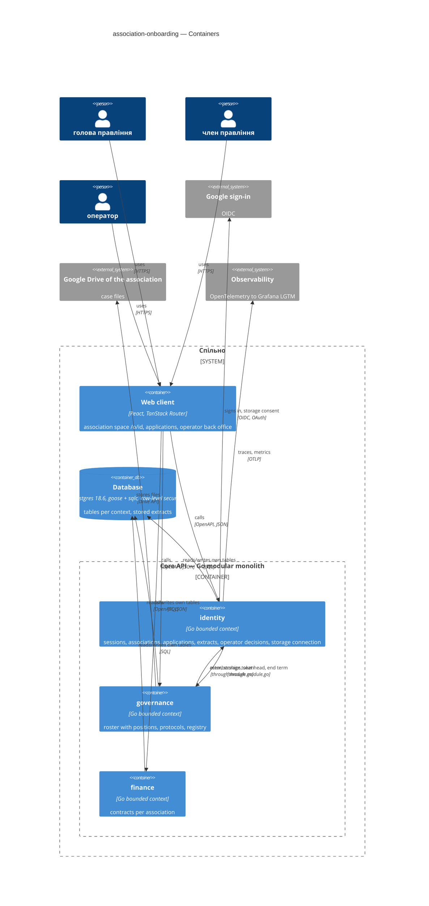

Dropped recommended containers: `files` (case files stay in the association's Drive, board-protocol ADR-0005; extracts live in `db`, ADR-0005), `ai` and `qes` (no AI; the КЕП is checked by hand).

**Roster change on approval** → [ADR-0006](./adr/0006-apply-approvals-to-the-roster-through-a-governance-facade-in-one-transaction.md): identity's approval use case calls `governance.SeatHead` / `EndTerm` inside one transaction carried in `ctx`. `SeatHead` creates the entry of a person who is not on the roster; for a person with a current entry it appends a revision of that entry with the position голова правління and the decision reference, never a second entry (AC-19, AC-19c) — the entry keeps its own term, the term typed in the запит stays with the filing. `EndTerm` ends the whole entry of the голова recorded by the previous approval and no other member's; it is not called when no голова is recorded (AC-19c) or when that голова is the applicant.

## 6. Runtime view

Primary flows per critical PRD §10 transition; `complete-sequence-diagrams` adds the rest.

**Flow 1: filing a заявка на підключення (— → Очікує) — covers AC-01, AC-02, AC-04, AC-04b, AC-04c, AC-30**

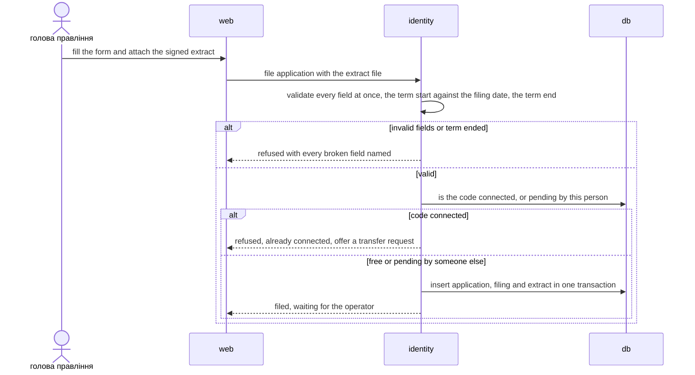

**Flow 2: the оператор records the check and approves a заявка (Очікує → Схвалена, — → Підключене) — covers AC-03, AC-03b, AC-08, AC-09, AC-12, AC-04c, AC-16c**

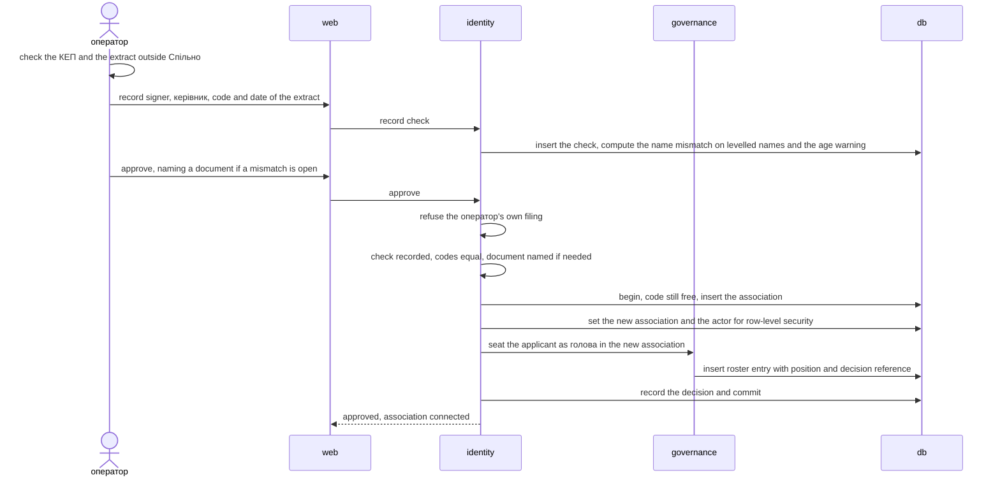

**Flow 3: approving a запит на передачу (Очікує → Схвалена, roster change) — covers AC-19, AC-19b, AC-19c, AC-24b, AC-16c**

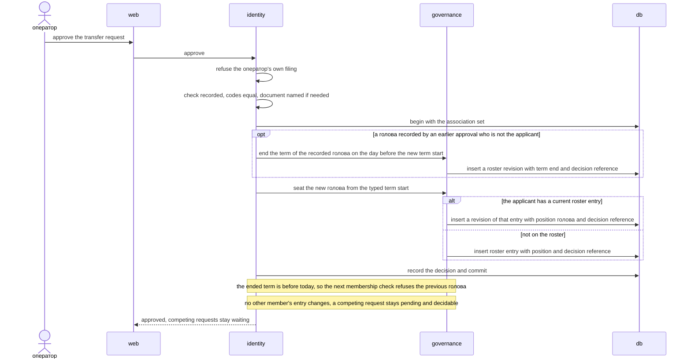

**Flow 4: an association-scoped request through the middleware (access, disabled, not a member) — covers AC-07, AC-16b, AC-21, AC-25, AC-26**

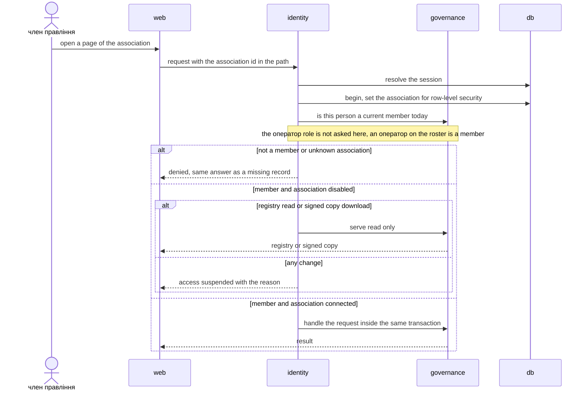

### Flow 5: following and refiling an application

Covers US-02 — AC-05, AC-06, AC-30.

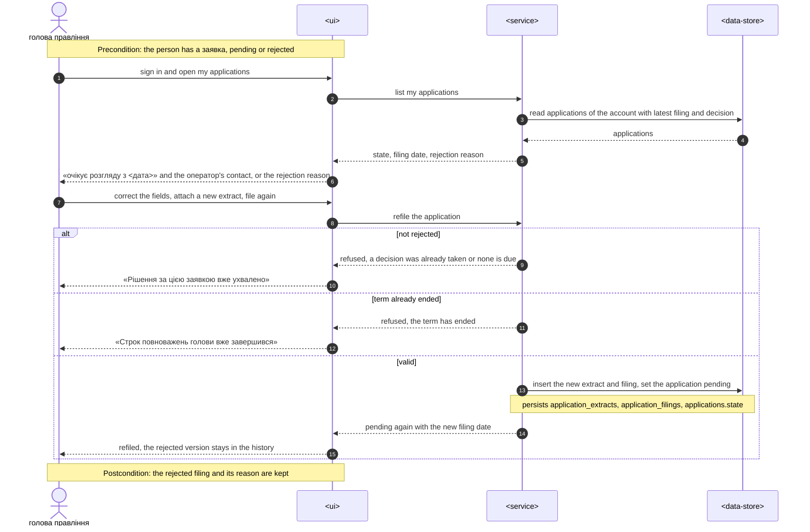

### Flow 6: filing a запит на передачу

Covers US-04 — AC-17, AC-18, AC-19c, AC-24b, AC-30.

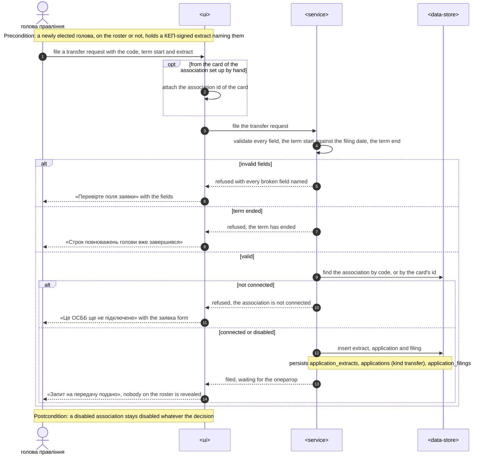

### Flow 7: the оператор opens an application for review

Covers US-03, US-05 — AC-10, AC-11, AC-11b, AC-04c, AC-19b, AC-16.

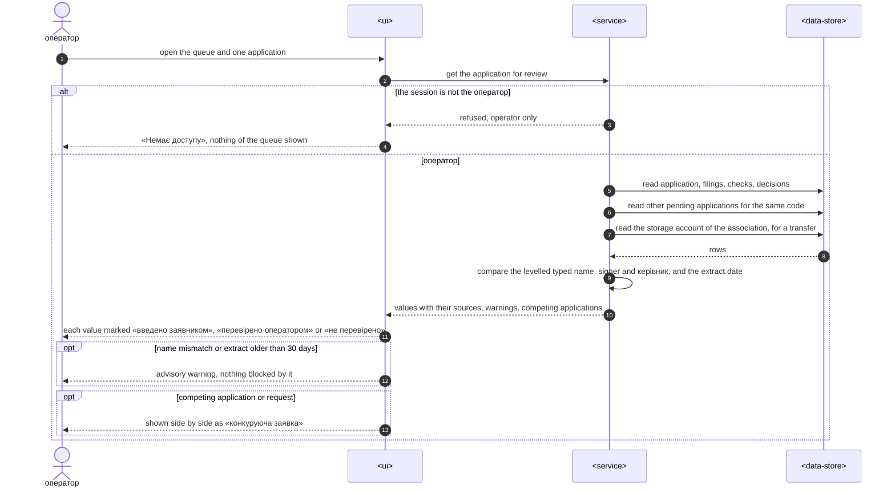

### Flow 8: rejecting an application

Covers US-03 — AC-13, AC-14, AC-15, AC-16c.

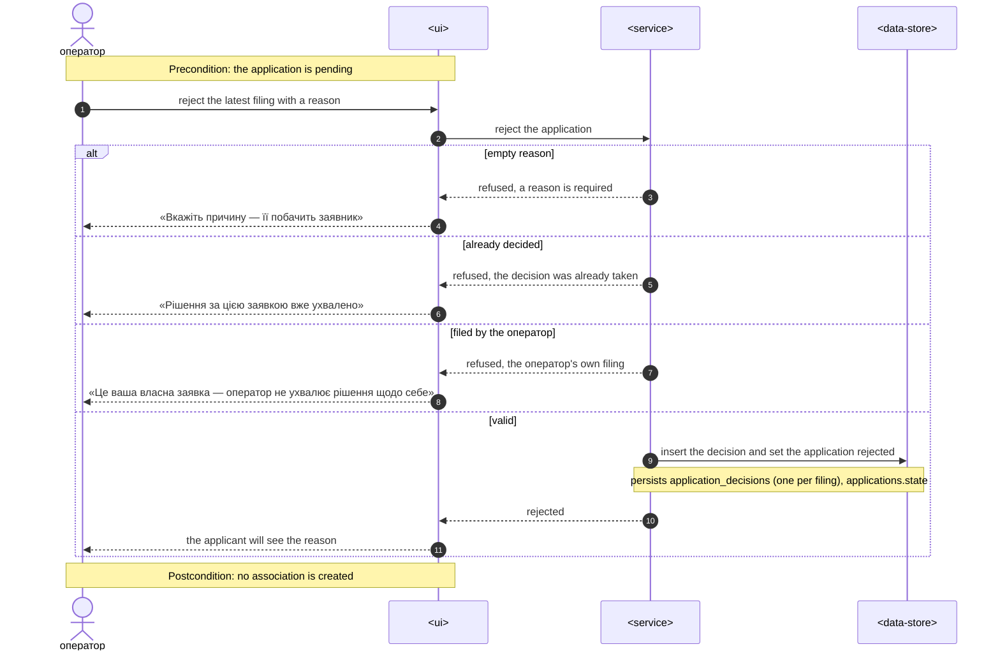

### Flow 9: disabling and enabling an association

Covers US-06 — AC-21, AC-22, AC-23, AC-24.

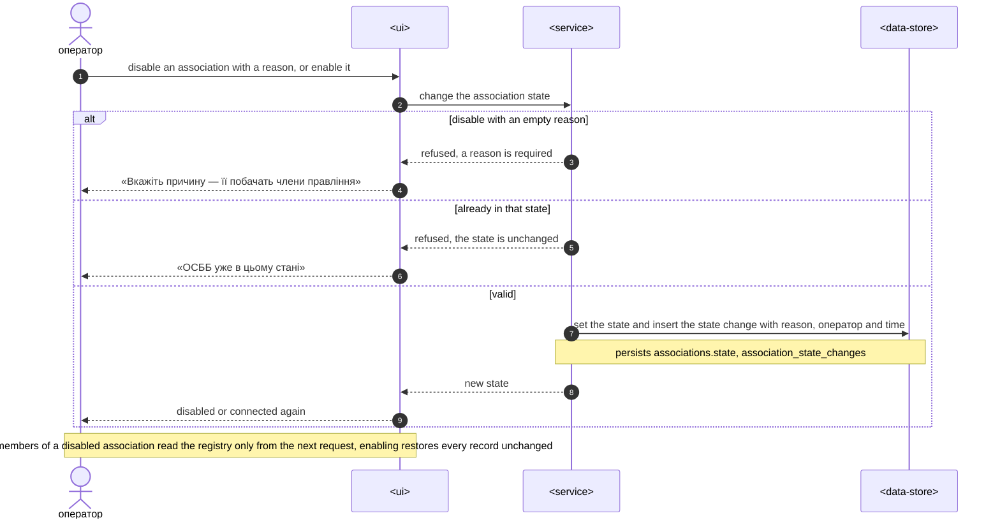

### Flow 10: connecting the document storage

Covers US-08 — AC-27, AC-28b, AC-25.

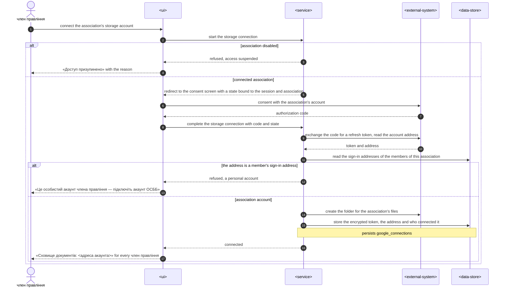

### Flow 11: attaching a document while the storage is not connected

Covers US-08 — AC-28.

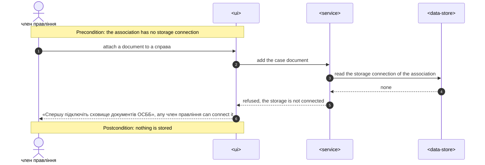

### Flow 12: my associations, the association card and the roster

Covers US-09 — AC-04d, AC-29, AC-20.

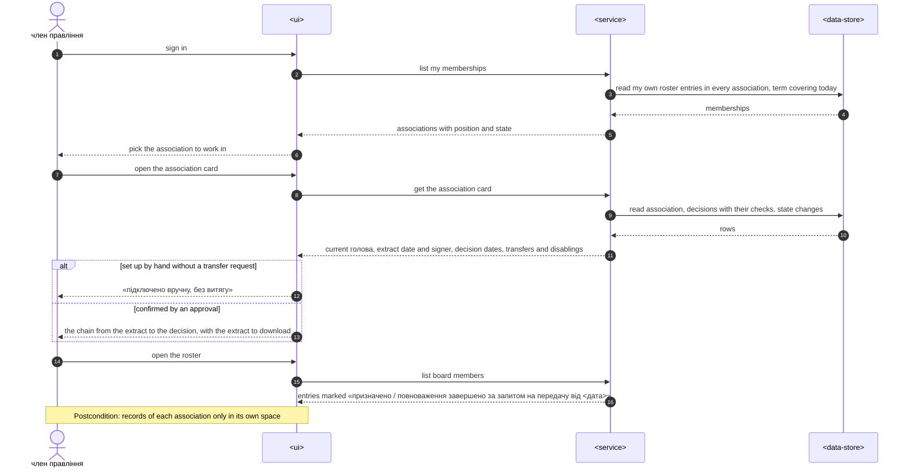

### Coverage: US/AC → flows

| ID | Realized by (§6 heading) | How | Note |
|---|---|---|---|
| US-01 | `Flow 1: filing a заявка на підключення` | flow | |
| US-02 | `Flow 5: following and refiling an application` | flow | |
| US-03 | `Flow 2: the оператор records the check and approves a заявка`, `Flow 7: the оператор opens an application for review`, `Flow 8: rejecting an application` | flow | |
| US-04 | `Flow 6: filing a запит на передачу` | flow | |
| US-05 | `Flow 3: approving a запит на передачу`, `Flow 7: the оператор opens an application for review` | flow | |
| US-06 | `Flow 9: disabling and enabling an association` | flow | |
| US-07 | `Flow 4: an association-scoped request through the middleware` | flow | |
| US-08 | `Flow 10: connecting the document storage`, `Flow 11: attaching a document while the storage is not connected` | flow | |
| US-09 | `Flow 12: my associations, the association card and the roster` | flow | |
| AC-01 | `Flow 1: filing a заявка на підключення` | flow | |
| AC-02 | `Flow 1: filing a заявка на підключення`, `Flow 6: filing a запит на передачу` | branch | Flow 1 `alt invalid fields or term ended`, a term start later than the filing date being one of the broken fields; Flow 6 `alt invalid fields` |
| AC-03 | `Flow 2: the оператор records the check and approves a заявка` | flow | refused at the guard step `check recorded, codes equal, document named if needed` when no check is recorded |
| AC-03b | `Flow 2: the оператор records the check and approves a заявка` | flow | refused at the same guard step, `codes equal` |
| AC-04 | `Flow 1: filing a заявка на підключення` | branch | `alt code connected` |
| AC-04b | `Flow 1: filing a заявка на підключення` | branch | found by the check `is the code connected, or pending by this person`; the valid path is `else free or pending by someone else` |
| AC-04c | `Flow 1: filing a заявка на підключення`, `Flow 2: the оператор records the check and approves a заявка`, `Flow 7: the оператор opens an application for review` | branch | Flow 1 `else free or pending by someone else` accepts the second заявка; Flow 2 step `begin, code still free, insert the association` refuses the later approval; Flow 7 `opt competing application or request` |
| AC-04d | `Flow 12: my associations, the association card and the roster` | flow | |
| AC-05 | `Flow 5: following and refiling an application` | flow | |
| AC-06 | `Flow 5: following and refiling an application` | flow | |
| AC-07 | `Flow 4: an association-scoped request through the middleware` | branch | `alt not a member or unknown association` |
| AC-08 | `Flow 2: the оператор records the check and approves a заявка` | flow | |
| AC-09 | `Flow 2: the оператор records the check and approves a заявка` | flow | |
| AC-10 | `Flow 7: the оператор opens an application for review` | flow | |
| AC-11 | `Flow 7: the оператор opens an application for review` | branch | `opt name mismatch or extract older than 30 days` |
| AC-11b | `Flow 7: the оператор opens an application for review` | branch | `opt name mismatch or extract older than 30 days` |
| AC-12 | `Flow 2: the оператор records the check and approves a заявка` | flow | step `approve, naming a document if a mismatch is open`, refused at the guard `document named if needed` |
| AC-13 | `Flow 8: rejecting an application` | branch | `alt empty reason` |
| AC-14 | `Flow 8: rejecting an application` | flow | |
| AC-15 | `Flow 8: rejecting an application` | branch | `else already decided` |
| AC-16 | `Flow 7: the оператор opens an application for review` | branch | `alt the session is not the оператор` |
| AC-16b | `Flow 4: an association-scoped request through the middleware` | branch | `alt not a member or unknown association` for an оператор off the roster; an оператор on the roster takes the member branches, the role is not asked |
| AC-16c | `Flow 2: the оператор records the check and approves a заявка`, `Flow 3: approving a запит на передачу`, `Flow 8: rejecting an application` | branch | Flow 2 and Flow 3 step `refuse the оператор's own filing`; Flow 8 `else filed by the оператор` |
| AC-17 | `Flow 6: filing a запит на передачу` | flow | the applicant may be on the roster; the roster effect is Flow 3 `alt the applicant has a current roster entry` |
| AC-18 | `Flow 6: filing a запит на передачу` | branch | `alt not connected` |
| AC-18b | `Flow 3: approving a запит на передачу` | flow | refused at the guard step `check recorded, codes equal, document named if needed`, as AC-03 / AC-03b in Flow 2 |
| AC-19 | `Flow 3: approving a запит на передачу` | flow | `alt the applicant has a current roster entry` re-seats without a second entry; `opt a голова recorded by an earlier approval who is not the applicant` ends that entry only |
| AC-19b | `Flow 3: approving a запит на передачу`, `Flow 7: the оператор opens an application for review` | flow | Flow 3 ends with `approved, competing requests stay waiting`; Flow 7 `opt competing application or request` shows them side by side; approving the competing запит later runs Flow 3 again as a new transfer |
| AC-19c | `Flow 6: filing a запит на передачу`, `Flow 3: approving a запит на передачу` | flow | filed through Flow 6 `opt from the card of the association set up by hand`, approved through Flow 3 with no term to end and the entry re-seated; not decidable while its голова is the оператор (AC-16c) |
| AC-20 | `Flow 12: my associations, the association card and the roster` | flow | |
| AC-21 | `Flow 9: disabling and enabling an association` | flow | what the members see next is Flow 4 `else member and association disabled` |
| AC-22 | `Flow 9: disabling and enabling an association` | branch | `alt disable with an empty reason` |
| AC-23 | `Flow 9: disabling and enabling an association` | flow | |
| AC-24 | `Flow 9: disabling and enabling an association` | branch | `else already in that state` |
| AC-24b | `Flow 6: filing a запит на передачу` | branch | `else connected or disabled`; the approval is Flow 3 and the association stays disabled |
| AC-25 | `Flow 4: an association-scoped request through the middleware`, `Flow 10: connecting the document storage` | branch | Flow 4 `else any change`; Flow 10 `alt association disabled` |
| AC-26 | `Flow 4: an association-scoped request through the middleware` | branch | `alt registry read or signed copy download` |
| AC-27 | `Flow 10: connecting the document storage` | flow | |
| AC-28 | `Flow 11: attaching a document while the storage is not connected` | flow | |
| AC-28b | `Flow 10: connecting the document storage` | branch | `alt the address is a member's sign-in address`; the оператор sees the account in Flow 7, step `read the storage account of the association, for a transfer` |
| AC-29 | `Flow 12: my associations, the association card and the roster` | flow | |
| AC-30 | `Flow 1: filing a заявка на підключення`, `Flow 5: following and refiling an application`, `Flow 6: filing a запит на передачу` | branch | Flow 1 `alt invalid fields or term ended`; Flow 5 `else term already ended`; Flow 6 `else term ended` |

Coverage: 9/9 user stories · 42/42 ACs — 0 non-runtime N/A.

**Flags:** Flow 1–4 predate this pass: they are titled with a bold line instead of a `###` heading and use the container aliases of §5 (`W`, `I`, `G`, `D`) instead of generic participants; they are kept as written. No new participant, no decision worth an ADR. Reconciled 2026-11-10 by ao-architecture with the clarified PRD: Flows 2, 3 and 8 refuse the оператор's own filing (AC-16c), Flow 3 re-seats an applicant who is on the roster (AC-19), Flow 4 no longer names the оператор (AC-16b), Flow 6 has the invalid-fields branch (AC-02).

## 7. Deployment view

Same VM and compose topology as board-protocol SAD §7 (`caddy`, `core-api`, `worker`, `postgres`, `backup`, `otel-lgtm`); no new process. Changes:

- **Two database roles** (ADR-0003): `spilno_owner` owns the schema and runs goose on start (`MIGRATIONS_DATABASE_URL`); `spilno_app` (no `BYPASSRLS`, not the owner) serves requests and River jobs (`DATABASE_URL`). A goose migration creates `spilno_app` and its grants, so `infra/compose.yaml`, `testdb.New(t)` and production get it the same way. `spilno_app` has `SELECT, INSERT` only on the insert-only tables: extracts, checks, filings, decisions, association state changes (ADR-0005, ADR-0007).
- **Configuration:** `SPILNO_OPERATOR_EMAIL` (the one оператор, ADR-0001; the address may also stand on a roster, ADR-0009); the OAuth redirect URI for the storage connection registered with Google (ADR-0008).
- **Backups:** extracts are inside Postgres, covered by the nightly dump (board-protocol ADR-0016); at ~6 filings a year of ≤ 5 MB the dump grows by ≤ 30 MB a year.

**Monitoring additions:**

| Signal | Source | Alert |
|---|---|---|
| Request duration p95 per route | `http.server.request.duration` | read > 200 ms, write > 500 ms, filing > 5 s for 15 min |
| Isolation denials | `identity.access.denied` by reason (not_member, disabled_write; an оператор off the roster counts as not_member, ADR-0009) | sudden rise > 10× weekly mean (probing) |
| Applications waiting | `identity.applications.pending_age_days` (oldest) | oldest > 5 working days |
| Row-level-security misses | `platform.db.association_unset` (a query on a scoped table without the association set returns nothing) | any |

**Scaling:** ~6 filings a year; tens of associations at most before brief §14's revisit trigger; one API replica.

## 8. Crosscutting concepts

| Concept | Convention for this feature | Where defined |
|---|---|---|
| Errors | problem+json; codes from PRD §5.1: `identity.application_invalid`, `identity.signature_not_checked`, `identity.extract_code_mismatch`, `identity.association_already_connected`, `identity.application_already_open`, `identity.mismatch_needs_document`, `identity.reason_required`, `identity.application_not_pending`, `identity.not_operator`, `identity.operator_own_application`, `identity.association_not_connected`, `identity.association_state_unchanged`, `identity.association_disabled`, `identity.term_ended`, `identity.storage_account_personal`, `governance.drive_not_connected` (planned); `identity.not_current_member` (existing) also answers another association's object and another person's application, so existence is not revealed | `internal/platform/httpapi`, PRD §5.1 |
| Authentication | OIDC sign-in for any verified address; server-side session; no session → `identity.session_required` | board-protocol ADR-0003, ADR-0004 |
| Authorization | PRD §10 matrix. Association-scoped paths: middleware → session → `governance.CurrentMember(association, email, today Europe/Kyiv)` (a non-member gets `identity.not_current_member` whatever the state, AC-07) → association state → actor. Applicant paths (`/identity/applications`): own records by account. Operator paths (`/identity/operator/...`): session address equals `SPILNO_OPERATOR_EMAIL`, else `identity.not_operator`. The two grants are independent: the оператор role is asked on operator paths only and adds nothing on an association path, where an оператор off the roster gets `identity.not_current_member` like anyone and an оператор on the roster is a member with a member's rights (AC-16b); approve and reject refuse an application whose applicant account is the acting оператор's with `identity.operator_own_application` (AC-16c) | ADR-0001, ADR-0002, ADR-0004, ADR-0009 |
| Association scope | path parameter `association_id`, never the body; RLS on every association-owned table; explicit filters kept | ADR-0002, ADR-0003 |
| Disabled association | actor carries `read_only`; only the registry read and signed-copy download operations pass; everything else `identity.association_disabled` with the reason | ADR-0007 |
| Validation | OpenAPI validator (422) + `domain.Validate()` naming every broken field of a заявка or a запит at once (ЄДРПОУ 8 digits, name, address, the applicant's full name, position голова правління only, term start present and not later than the filing date, extract attached); the document relied on is a typed reference of up to 500 characters, no file (AC-12) | CLAUDE.md, PRD AC-02 |
| Name comparison | `identity/domain`: the applicant's typed full name, the signer and the керівник are the same person when equal after ignoring letter case, extra spaces, the form of the apostrophe and the order of the words; any other difference is a розбіжність імен. Computed from the stored values when the check is recorded and on every read (Flows 2, 7); nothing levelled is stored | PRD AC-11 |
| IDs | UUID v7 generated app-side for new tables; cross-context references by id only | `.claude/rules/migrations.md`, repo ADR 0002 |
| Migrations | goose; new identity tables; `associations` + ЄДРПОУ (unique, nullable), address, state; `board_member_revisions` + position, decision reference; `finance.contracts` + `association_id` in 3 steps; `accounts.association_id` dropped in 3 steps; RLS policies and roles | ADR-0003, ADR-0004, ADR-0005, ADR-0006 |
| Audit / immutability | filings, checks, decisions and state changes are insert-only rows with author and time; the extract table is insert-only by privilege (no trigger); a decided application changes only by a new filing or decision | ADR-0005, PRD §6 Integrity |
| Files | extract: one file ≤ 5 MB — a PDF with the signature inside or a signed container that holds the PDF (`.p7s`, ASiC-E), never a separate signature file — content-sniffed, stored as uploaded with sha256, downloaded only by the оператор and the applicant as attachment; case files unchanged (board-protocol ADR-0005) | ADR-0005, PRD §6 |
| Storage connection | in-app OAuth consent by a current член правління; refused when the Google address is a member's sign-in address; a later connection replaces the record and moves no files until the open question of §11 is closed | ADR-0008, PRD §8 |
| Dates | terms are calendar dates in Europe/Kyiv; a term start later than the filing date is refused (AC-02), so the day before the new term start is always before the approval; a term end earlier than the filing date is refused, a term that ends on the filing date is in force and a missing term end is accepted (AC-30); the previous голова's whole entry ends the day before the new term start (AC-19) | PRD AC-02, AC-19, AC-30 |
| Observability | OTel spans; metrics in §7; logs never carry the extract, the РНОКПП or the reason text | repo convention |
| i18n | UI in Ukrainian; messages of PRD §5.1 verbatim | CONTEXT.md |
| Lifecycle | PRD §10 states in `identity/domain`: заявка / запит Очікує → Схвалена (Flows 2, 3; AC-08, AC-19), Очікує → Відхилена with a reason (AC-14), neither by the оператор who filed it (AC-16c); Відхилена → Очікує by the same applicant with a new filing (AC-06); ОСББ — → Підключене (Flow 2), Підключене ↔ Вимкнене by the оператор with a reason, an insert-only state change (AC-21, AC-23); a запит may come from a person on the roster, whose entry is re-seated (AC-17, AC-19); a competing запит stays Очікує after another is approved, and approving it later is a new transfer (AC-19b); a запит for the hand-made association has no term to end, its extract's ЄДРПОУ is compared with the one typed in the запит, and it stays Очікує while its голова is the оператор (AC-19c, AC-16c); refused transitions answer the PRD §5.1 codes. Sequences in §6 | PRD §10; ADR-0006, ADR-0007, ADR-0009 |
| Rate limiting | <!-- N/A: ~6 filings a year; probing is watched through identity.access.denied --> N/A | — |

## 9. Architecture decisions

| # | Decision | Status | Section | Blast radius (I / C / A / D) |
|---|---|---|---|---|
| [0001](./adr/0001-serve-the-operator-back-office-as-an-operator-only-section-of-the-web-app.md) | Serve the operator back office as an operator-only section of the web app | accepted, superseded in part by 0009 | §4 | ✓ / ✓ / ✓ / – |
| [0002](./adr/0002-put-the-association-id-in-every-association-scoped-path.md) | Put the association id in every association-scoped path | accepted | §4 | ✓ / ✓ / ✓ / – |
| [0003](./adr/0003-enforce-association-isolation-with-postgres-row-level-security.md) | Enforce association isolation with Postgres row-level security | accepted | §4 | ✓ / ✓ / ✓ / ✓ |
| [0004](./adr/0004-let-any-verified-person-sign-in-and-derive-memberships-from-rosters.md) | Let any verified person sign in and derive memberships from rosters | accepted | §4 | ✓ / ✓ / ✓ / ✓ |
| [0005](./adr/0005-check-the-signed-extract-manually-and-keep-the-uploaded-file-in-identity.md) | Check the signed extract manually and keep the uploaded file in identity | accepted | §4 | ✓ / – / ✓ / ✓ |
| [0006](./adr/0006-apply-approvals-to-the-roster-through-a-governance-facade-in-one-transaction.md) | Apply approvals to the roster through a governance facade in one transaction | accepted, amended 2026-11-10 | §5 | ✓ / ✓ / ✓ / ✓ |
| [0007](./adr/0007-enforce-a-disabled-association-as-read-only-in-the-identity-middleware.md) | Enforce a disabled association as read-only in the identity middleware | accepted | §8 | – / ✓ / ✓ / ✓ |
| [0008](./adr/0008-let-a-board-member-connect-the-association-storage-in-the-web-app.md) | Let a board member connect the association storage in the web app | accepted | §8 | – / ✓ / ✓ / ✓ |
| [0009](./adr/0009-treat-the-operator-role-and-a-roster-membership-as-independent-grants-on-one-account.md) | Treat the operator role and a roster membership as independent grants on one account | accepted | §4 | – / ✓ / ✓ / – |

ADR files: `docs/features/association-onboarding/adr/NNNN-<decision>.md`. Repo-level ADRs stay in `docs/adr/`.

## 10. Quality requirements

**QG-1. Isolation**
- **When:** a person on the roster of association A only, and a person on the rosters of A and B, call every read operation of the contract with B's id in the path, and the same queries run with A set for row-level security.
- **Then:** 0 records of association B readable by a person not on B's roster, for every kind of record, in a release-blocking check run against two seeded associations and one person on both rosters.
- **How verify:** `services/core/internal/platform/isolation_test.go` on `testdb.New(t)` (two associations seeded), iterating the operations of `openapi.yaml` with an `{association_id}` parameter; the оператор's address is seeded on A's roster only and is denied on B like any person off the roster (AC-16b); part of `mise run test`, which gates the release.

**QG-2. Effect of disabling and of a transfer**
- **When:** the оператор disables an association, or approves a запит на передачу, while an affected member has an open session.
- **Then:** 0 requests of an affected member served with the old rights after the decision is recorded.
- **How verify:** integration test in `identity/adapters/http` — decision recorded, then the old session's next write answers `identity.association_disabled` / `identity.not_current_member`.

**QG-3. Latency**
- **When:** filing with a 5 MB extract; reading the application page, operator queue or association card; deciding.
- **Then:** filing with the extract upload ≤ 5 s for a 5 MB file; read or list ≤ 200 ms; write without file ≤ 500 ms (p95).
- **How verify:** `http.server.request.duration` p95 per route (§7 alerts); a 5 MB fixture in the filing integration test.

**QG-4. Retention and integrity of proof**
- **When:** any time after filing.
- **Then:** заявки, запити на передачу, extracts and decisions kept ≥ 5 years, never hard-deleted; a decided заявка or запит changes only through a new filing or a new decision.
- **How verify:** privilege test — `spilno_app` cannot update or delete extract, check, decision rows; the extract's sha256 compared with the stored one on every download.

## 11. Risks and technical debt

| Risk / debt | Severity | Mitigation | Owner |
|---|---|---|---|
| Moving ~30 governance operations under `/governance/associations/{association_id}/` collides with board-protocol Stage 1 tasks in flight (T34–T44, T18 blocked) and their web routes | High | Do the path move as the first task of this feature in one PR (contract + `mise run gen` + routes under `/o/$associationId`), or before Stage 1 UI tasks start; agree the order before `/sdlc:break-tasks` | Andrii Opryshko |
| A request or job that forgets the association transaction reads nothing (row-level security fails closed) and looks like an empty list | Medium | `platform/db.InAssociation` is the only way handlers get a query runner on scoped tables; `platform.db.association_unset` metric; isolation test | Andrii Opryshko |
| The manual check is the only proof: an оператор mistake approves an impostor | Medium | approval refused without a recorded check (AC-03); розбіжність імен needs a named document (AC-12); every decision recorded with the extract | Andrii Opryshko (оператор) |
| A personal storage account with an address unknown to the roster is not detected | Low | the оператор sees the account on every transfer (AC-28b) | Andrii Opryshko |
| Dropping `accounts.association_id` and adding `finance.contracts.association_id` on live rows | Medium | 3-step migrations per `.claude/rules/migrations.md`; backfill to the one existing association | Andrii Opryshko |
| Effort grew from 3 to ~4.5 person-weeks (RLS, path move): delivery slips into Feb 2027 and the brief's RICE drops from 2 to ~1.3 | Medium | rollout steps of PRD §9 stay shippable one by one; the brief is not rewritten, this row records it | Andrii Opryshko |
| A single оператор is unavailable | Low | applicant sees the filing date and contact (AC-05); `identity.applications.pending_age_days` alert | Andrii Opryshko |
| Brownfield: sign-in itself (T08) is not built; this feature builds it on the changed rules | Medium | T08 is replaced by this feature's sign-in task; board-protocol ADR-0003 kept for the flow; the token cipher of T12a is merged and reused by ADR-0008 | Andrii Opryshko |
| The оператор role and a board membership sit on one sign-in account: one taken-over account holds the queue and that association's records | Medium | the role opens nothing on association paths (AC-16b); the оператор's own filing is refused (AC-16c); every decision records who made it and when; the required security review covers the оператор's account (PRD §6.1) | Andrii Opryshko (оператор) |
| The association set up by hand cannot get its витяг з ЄДР while its голова is the single оператор: nobody may decide that запит (AC-16c) | Low | accepted: the card keeps «підключено вручну, без витягу» and PRD §7 leaves it outside the KPI; it resolves when another person heads it, or with a second оператор (ADR-0001, ADR-0009) | Andrii Opryshko |
| After a disputed transfer the other члени правління keep their entries and may change the roster, the new голова's entry included (AC-19, PRD §6.1) | Medium | the оператор disables the association while the dispute lasts (AC-21); a new запит на передачу restores the голова | Andrii Opryshko (оператор) |
| The data model, the API contract delta and its sync report predate the 2026-11-10 clarification: the contract has no `identity.operator_own_application` and no refusal of a term start after the filing date | Medium | `/ao-api-forge association-onboarding --reconcile` and a drift check of `data-model.md` before `/sdlc:break-tasks`; no new table or column follows from this pass | Andrii Opryshko |
| Open architectural decision: how many associations actually wait to join (Reach) | Open question | Resolve before 2026-12-01; sizing only, no design change below ~20 associations | Andrii Opryshko |
| Open architectural decision: how long rejected заявки and their extracts are kept | Open question | Resolve before implementation; default ≥ 5 years like all decisions (PRD §8) | Andrii Opryshko |
| Open architectural decision: who may replace a connected document storage, and what happens to the files kept on the old account | Open question | Resolve before implementation of rollout step 4; default: any член правління connects another account under AC-27 and AC-28b, the new connection replaces the record (ADR-0008) and files are not moved (PRD §8) | Andrii Opryshko |

**Accepted debt:** no automatic КЕП verification or extract parsing (ADR-0005); one оператор configured by environment, no operator roles (ADR-0001); with a single оператор their own filing is never decided (ADR-0009).

## 12. Glossary

| Term | Meaning |
|---|---|
| заявка на підключення | a голова правління's request to connect an association, with the КЕП-signed витяг з ЄДР (CONTEXT.md) |
| запит на передачу | a newly elected голова's request to take over a connected association (CONTEXT.md) |
| витяг з ЄДР | the register extract naming the керівник, signed with the голова's КЕП (CONTEXT.md) |
| КЕП | qualified electronic signature (CONTEXT.md) |
| оператор | the person who runs Спільно and decides access (CONTEXT.md) |
| підключене ОСББ / вимкнене ОСББ | association states (CONTEXT.md) |
| розбіжність імен | advisory notice when the typed name, the signer and the керівник differ after levelling letter case, spaces, apostrophes and word order (CONTEXT.md, AC-11) |
| член правління / голова правління | roster roles (board-protocol CONTEXT.md) |
| check of the extract | what the оператор records after checking the extract outside Спільно: signer, signing date, керівник, the extract's ЄДРПОУ and date |
| own filing | a заявка or a запит whose applicant account is the acting оператор's; the оператор can neither approve nor reject it (AC-16c) |
| re-seat | a new revision of a person's current roster entry that sets the position голова правління with the decision reference, instead of a second entry (AC-19) |
| association-scoped path | an operation path `/<context>/associations/{association_id}/...` |
| row-level security (RLS) | Postgres policies that hide rows of other associations from the app role |
| `spilno_app` / `spilno_owner` | the database role that serves requests / the role that owns the schema and runs migrations |
