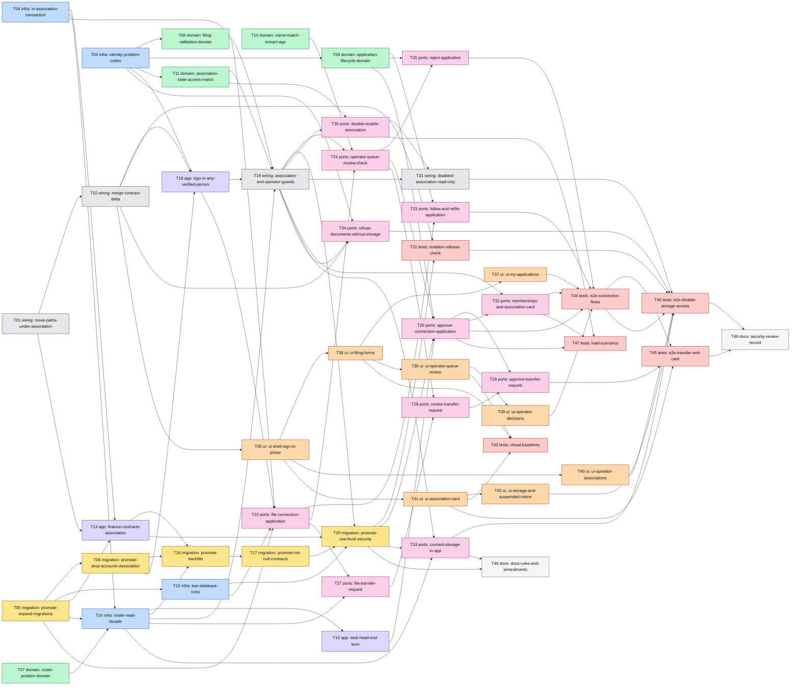

# Epic — association-onboarding

> **PRD:** [PRD.md](../PRD.md) · **Design:** [sad.md](../sad.md) · **Data model:** [data-model.md](../data-model.md) · **API:** [openapi.yaml](../contracts/openapi.yaml) · [api-sync-report](../contracts/api-sync-report.md) · **ADRs:** [adr/](../adr/) · **Tests:** [test-plan.md](../test-plan.md) · **Migrations:** [MANIFEST](../migrations/MANIFEST.md)

## Goal

A голова правління connects their association to Спільно, or takes it over after an election, without the developer: they sign in, file a заявка на підключення or a запит на передачу with a КЕП-signed витяг з ЄДР, and the оператор records the check made outside Спільно and decides with a reason (PRD §2). Every association and every change of голова then carries a checkable chain from the extract to the decision, and with a second association nothing of one association is readable by a person off its roster — enforced by the database and by a test that blocks a release.

## Scope

- **In:** surfaces `[backend-service, web-frontend]` (sad frontmatter); contexts `identity` (applications, the оператор's queue, association state, storage connection, sign-in and the guards), `governance` (positions on the roster, the roster facade), `finance` (the association on contracts), `platform` (`db.InAssociation`, two database roles, test fixtures); the 20 staged migrations; the contract delta and the path move of ADR-0002 in `services/core/api/openapi.yaml`; the SPA shell, the applicant's pages, the `/operator/` section, the association card and the storage connection.
- **Out:** everything in PRD §3 (no automatic check of the КЕП or the extract, no periodic re-check of ЄДР, no notifications, one оператор, no co-owners' accounts); editing the association's name and address by the board (named in PRD §9, no AC — api-sync-report §D); a River job (none in this feature); the board-protocol screens and handlers themselves (see «Board-protocol tasks» below).

## Task map

Same DAG as [tasks.json](./tasks.json). Colours = layer. Day-one parallel starts: T01, T03, T04, T05, T07, T10. Longest chain: 10 phases.

**Serialized lanes** (`implement-tasks` derives them from `layer` and overlapping `files_hint`): migrations T05 → T06 → T16 → T17 → T20; the live contract T01 → T02; the identity adapters T18 → T19 → T22 … T33 (shared `adapters/postgres` and its generated `sqlcgen`); the e2e specs T44 → T45 → T46. The domain tasks (T07–T11), the platform tasks (T04, T12) and the ui tasks after T35 (T36 / T40 / T41) run next to them.

## Rollout order (PRD §9)

| PRD §9 step | Tasks | Ships |
|---|---|---|
| 1. Isolation guard, positions, backfill | T01–T07, T12–T21 | association in every path, sign-in and the guards, row-level security, the release-blocking check; members keep working as before |
| 2. Заявки на підключення and the оператор's review | T08–T11, T22–T26, T32, T35–T39, T44 | a new association connects without the developer |
| 3. Запити на передачу | T27–T29, T41, T45 | a new голова takes over; the hand-made association can get its extract (AC-19c) |
| 4. Disable / enable, the storage connected by the board | T30, T31, T33, T34, T40, T42, T46 | replaces the developer's storage command |
| Across | T43, T47, T48, T49 | visual baselines, load scenarios, docs and amendments, the security review |

## Tasks

See [tracker.md](./tracker.md) for status. Total 49 tasks, ~29.5 person-days (S = 2 h, M = half a day, L = a day).

| # | Task | Layer | Blocked by | ACs | Est. |
|---|---|---|---|---|---|
| [T01](./T01-move-paths-under-association.md) | Move the governance and finance operations under `/<context>/associations/{association_id}/` | wiring | — | AC-04d, AC-07 | L |
| [T02](./T02-merge-contract-delta.md) | Merge the onboarding contract delta and stub the new identity operations | wiring | T01 | AC-01, AC-10, AC-17, AC-21, AC-27, AC-29 | L |
| [T03](./T03-identity-problem-codes.md) | Register the identity problem codes of PRD §5.1 and governance.drive_not_connected | infra | — | AC-02, AC-03, AC-03b, AC-04, AC-04b, AC-12, AC-13, AC-15, AC-16, AC-16c, AC-18, AC-22, AC-24, AC-25, AC-28, AC-28b, AC-30 | S |
| [T04](./T04-in-association-transaction.md) | Add platform/db.InAssociation: a transaction that carries the association and the actor | infra | — | AC-04d, AC-07 | M |
| [T05](./T05-promote-expand-migrations.md) | Promote the expand migrations: application tables, association and roster columns, the app role | migration | — | AC-01, AC-06, AC-08, AC-21, AC-29 | M |
| [T06](./T06-promote-drop-accounts-association.md) | Promote the drop of accounts.association_id ahead of the manifest order | migration | T05 | AC-04d, AC-05 | S |
| [T07](./T07-roster-position-domain.md) | Give roster entries a position and a decision reference, with the date rules of a transfer | domain | — | AC-08, AC-19, AC-19b, AC-19c | M |
| [T08](./T08-filing-validation-domain.md) | Validate a filing: every field at once, the term rules and the extract file | domain | T03 | AC-01, AC-02, AC-30 | M |
| [T09](./T09-application-lifecycle-domain.md) | Model the application lifecycle and the guards of a decision | domain | T03 | AC-03, AC-03b, AC-06, AC-12, AC-13, AC-15, AC-16c, AC-18b | M |
| [T10](./T10-name-match-extract-age.md) | Compare the three names after levelling and flag an extract older than 30 days | domain | — | AC-11, AC-11b | S |
| [T11](./T11-association-state-access-matrix.md) | Model the association state and the access matrix of PRD §10 | domain | T03 | AC-07, AC-16, AC-16b, AC-21, AC-22, AC-23, AC-24, AC-25, AC-26 | M |
| [T12](./T12-two-database-roles.md) | Run goose as the owner and serve as spilno_app; give tests an app-role pool with two associations | infra | T05 | AC-06, AC-15 | M |
| [T13](./T13-finance-contracts-association.md) | Scope finance contracts to the association in the path | app | T01, T04, T05 | AC-04d, AC-07 | S |
| [T14](./T14-roster-read-facade.md) | Serve the roster facade: the current member, a person's memberships and the members' sign-in addresses | infra | T04, T05, T07 | AC-04d, AC-07, AC-09, AC-28b | L |
| [T15](./T15-seat-head-end-term.md) | Seat a голова and end a term through the governance facade inside the caller's transaction | app | T14 | AC-08, AC-19, AC-19c, AC-20 | M |
| [T16](./T16-promote-backfills.md) | Promote the backfills: association state, roster positions and the contracts' association | migration | T06, T13, T14 | AC-19c, AC-29 | S |
| [T17](./T17-promote-not-null-contracts.md) | Promote the NOT NULL steps and the contracts index | migration | T16 | AC-08, AC-21 | S |
| [T18](./T18-sign-in-any-verified-person.md) | Sign in any verified person, keep the session in Postgres and tell the оператор | app | T02, T03, T06 | AC-01, AC-05, AC-16 | L |
| [T19](./T19-association-and-operator-guards.md) | Guard association paths with the session, the roster and a scoped transaction, and operator paths with the оператор flag | wiring | T04, T11, T14, T18 | AC-04d, AC-07, AC-16, AC-16b | L |
| [T20](./T20-promote-row-level-security.md) | Promote row-level security for the governance, finance and identity tables | migration | T12, T13, T17, T19 | AC-04d, AC-07, AC-16b | M |
| [T21](./T21-isolation-release-check.md) | Add the release-blocking isolation test over every association-scoped operation of the contract | tests | T02, T20 | AC-04d, AC-07, AC-16b | M |
| [T22](./T22-file-connection-application.md) | File a заявка на підключення and keep the signed extract unchanged | ports | T05, T08, T12, T18 | AC-01, AC-02, AC-04, AC-04b, AC-04c, AC-30 | L |
| [T23](./T23-follow-and-refile-application.md) | Let the applicant follow and refile their application | ports | T09, T22 | AC-05, AC-06, AC-07, AC-14 | M |
| [T24](./T24-operator-queue-review-check.md) | Serve the оператор's queue and review page, and record the check of the extract | ports | T10, T19, T22 | AC-04c, AC-10, AC-11, AC-11b, AC-16 | L |
| [T25](./T25-reject-application.md) | Reject an application with a reason | ports | T09, T24 | AC-13, AC-14, AC-15, AC-16c | S |
| [T26](./T26-approve-connection-application.md) | Approve a заявка на підключення: create the association and seat its first голова in one transaction | ports | T09, T15, T20, T24 | AC-03, AC-03b, AC-04c, AC-08, AC-09, AC-12, AC-15, AC-16c | L |
| [T27](./T27-file-transfer-request.md) | File a запит на передачу for a connected association | ports | T14, T22 | AC-02, AC-17, AC-18, AC-19c, AC-24b, AC-30 | M |
| [T28](./T28-review-transfer-request.md) | Show competing запити and the storage account in the review of a запит | ports | T24, T27 | AC-19b, AC-28b | S |
| [T29](./T29-approve-transfer-request.md) | Approve a запит на передачу: seat the new голова and end the previous term in one transaction | ports | T26, T28 | AC-16c, AC-18b, AC-19, AC-19b, AC-19c, AC-20, AC-24b | L |
| [T30](./T30-disable-enable-association.md) | Disable and enable an association as the оператор | ports | T11, T19 | AC-16, AC-21, AC-22, AC-23, AC-24 | M |
| [T31](./T31-disabled-association-read-only.md) | Make a disabled association read-only in the middleware | wiring | T19, T30 | AC-21, AC-23, AC-25, AC-26 | M |
| [T32](./T32-memberships-and-association-card.md) | Serve my associations and the association card with the confirmation chain | ports | T19, T26 | AC-04d, AC-19c, AC-20, AC-29 | M |
| [T33](./T33-connect-storage-in-app.md) | Connect the association's document storage from the web app | ports | T14, T19, T20 | AC-27, AC-28b | L |
| [T34](./T34-refuse-documents-without-storage.md) | Refuse case documents and assistant turns while the storage is not connected | ports | T02, T03, T19 | AC-28 | S |
| [T35](./T35-ui-shell-sign-in-picker.md) | Build the signed-in shell: sign-in page, association picker, routes under /o/$associationId and the оператор's entry | ui | T02 | AC-04d, AC-07, AC-16, AC-16b | L |
| [T36](./T36-ui-filing-forms.md) | Build the filing forms for a заявка на підключення and a запит на передачу | ui | T35 | AC-01, AC-02, AC-04, AC-04b, AC-17, AC-18, AC-30 | L |
| [T37](./T37-ui-my-applications.md) | Show my applications: status, the оператор's contact, the reason and refiling | ui | T36 | AC-05, AC-06, AC-14 | M |
| [T38](./T38-ui-operator-queue-review.md) | Build the оператор's queue and the review page with sources, warnings and the check form | ui | T36 | AC-04c, AC-10, AC-11, AC-11b, AC-16, AC-19b, AC-28b | L |
| [T39](./T39-ui-operator-decisions.md) | Add the оператор's decisions: approve, reject and their refusals | ui | T38 | AC-03, AC-03b, AC-08, AC-12, AC-13, AC-14, AC-15, AC-16c, AC-18b | M |
| [T40](./T40-ui-operator-associations.md) | Build the оператор's associations list with disabling and enabling | ui | T35 | AC-21, AC-22, AC-23, AC-24 | M |
| [T41](./T41-ui-association-card.md) | Build the association card with the confirmation chain and the roster marks | ui | T35 | AC-19c, AC-20, AC-29 | M |
| [T42](./T42-ui-storage-and-suspended-notice.md) | Show the storage connection, the connect flow and the «Доступ призупинено» notice | ui | T41 | AC-09, AC-21, AC-25, AC-27, AC-28, AC-28b | M |
| [T43](./T43-visual-baselines.md) | Add visual-regression checks for the filing form, the review page and the association card | tests | T36, T38, T41 | AC-01, AC-10, AC-29 | S |
| [T44](./T44-e2e-connection-flows.md) | Prove filing, following and deciding a заявка end to end through the UI (US-01, US-02, US-03) | tests | T23, T25, T26, T32, T37, T39 | AC-01, AC-02, AC-03, AC-03b, AC-04, AC-04b, AC-04c, AC-05, AC-06, AC-08, AC-09, AC-10, AC-11, AC-11b, AC-12, AC-13, AC-14, AC-15, AC-16c, AC-30 | L |
| [T45](./T45-e2e-transfer-and-card.md) | Prove a transfer, the takeover and the association card end to end (US-04, US-05, US-09) | tests | T29, T41, T44 | AC-17, AC-18, AC-18b, AC-19, AC-20, AC-29 | M |
| [T46](./T46-e2e-disable-storage-access.md) | Prove disabling, the read-only association, the storage connection and every access denial end to end (US-06, US-07, US-08) | tests | T21, T31, T33, T34, T40, T42, T44 | AC-04d, AC-07, AC-09, AC-16, AC-16b, AC-21, AC-22, AC-23, AC-24, AC-25, AC-26, AC-27, AC-28, AC-28b | L |
| [T47](./T47-load-scenarios.md) | Add the load scenarios for the latency and throughput targets of PRD §6 | tests | T26, T30, T32 | AC-01, AC-05, AC-08, AC-29 | M |
| [T48](./T48-docs-rules-and-amendments.md) | Update the repo rules and environment docs, amend the board-protocol documents and write the оператор's runbook | docs | T20, T33 | AC-03, AC-05, AC-12 | M |
| [T49](./T49-security-review-record.md) | Run and record the security review that PRD §6.1 requires | docs | T45, T46 | AC-04c, AC-07, AC-16b, AC-16c, AC-28b | M |

**AC coverage:** all 42 acceptance criteria of PRD §5 are in at least one task's `acs` (checked against the AC headings of PRD §5 when these files were written). The NFRs of PRD §6 without an AC are carried by T12 (integrity of the insert-only tables), T20 and T21 (isolation), T29 and T31 (effect of a decision on the next request), T22 (file size, filing latency) and T47 (latency and throughput).

## Board-protocol tasks this epic replaces or needs

`tasks.json` holds only this epic's ids, so these are not `deps`; they are named in the Notes of the task on the right.

| board-protocol task | Status there | Relation | Here |
|---|---|---|---|
| [T08](../../board-protocol/tasks/T08-identity-oidc-sessions.md) sign-in and sessions | todo | **replaced**: any verified person signs in (ADR-0004); `bootstrap-member` is not built | T18 |
| [T11](../../board-protocol/tasks/T11-require-session-current-member.md) session and current member on governance and finance routes | todo | **superseded**: the association is in the path and the check runs inside the scoped transaction | T19, T31 |
| [T12](../../board-protocol/tasks/T12-google-connection-token-source.md) / [T12d](../../board-protocol/tasks/T12d-google-config.md) Google connection | in progress | `cmd/google-connect` **replaced** by the in-app consent (ADR-0008); the cipher, the store and the consent exchange (T12a–c) are reused; T12d's configuration is **needed** | T33 |
| [T34](../../board-protocol/tasks/T34-ui-sign-in-session.md) sign-in page and session guard | todo | **superseded**: the principal changed and the shell gains the picker | T35 |
| [T10](../../board-protocol/tasks/T10-settings-roster-endpoints.md) settings and roster endpoints | todo | **shared**: the roster repository and `CurrentMember`; its handlers must return `position` and `decision_id`; AC-09's «add a член правління» needs it | T14, T44 |
| [T21](../../board-protocol/tasks/T21-cases-endpoints.md), [T25](../../board-protocol/tasks/T25-assistant-propose-draft.md) case documents, assistant turns | todo | keep the storage guard as their first step; `downloadFile` checks the signed snapshot when the actor is read-only | T34, T31 |
| [T29](../../board-protocol/tasks/T29-lock-with-signed-copy.md), [T31](../../board-protocol/tasks/T31-registry-search.md), [T43](../../board-protocol/tasks/T43-ui-registry.md) lock, registry, registry screen | todo | **needed** for the e2e step «download a signed protocol while disabled» | T46 |
| [T35](../../board-protocol/tasks/T35-ui-settings-roster.md), [T36](../../board-protocol/tasks/T36-ui-cases-documents.md) roster and case-document screens | todo | mount `RosterDecisionMark`; trigger the «connect the storage first» message | T41, T42 |
| [T14](../../board-protocol/tasks/T14-river-worker-jobs.md) River worker | todo | every job opens `InAssociation` from its payload once row-level security is on | T20 |
| every board-protocol handler and ui task not started | todo | builds on the moved paths and on routes under `/o/$associationId/` | T01, T35 |

## Risks / Hard rules

- **Order against board-protocol (sad §11, High).** The SAD asks to agree the order before this breakdown; none was recorded, so the default of its mitigation is taken: T01 moves the paths first, in one PR, before any further board-protocol handler or ui task starts. If board-protocol goes first instead, T01 grows with every handler it has to move.
- **Migration order deviates from MANIFEST.md (T06).** The drop of `accounts.association_id` is promoted second, not last: nothing reads the column, an applicant cannot get an account while it is `NOT NULL`, and the staged order would loop (T20 needs T19, T19 needs T18, T18 needs the drop). T06 records the change in MANIFEST.md and data-model.md.
- **«PR 3» of the manifest is split.** Files 13–16 (T17) need only the backfills; files 17–19 (T20) wait for the app-role connection (T12) and the guards (T19), because row-level security enabled earlier hides every row from the app.
- **Carried open items** (api-sync-report §D asked for them before this stage): no code for a bad storage `state` or a refused code — T33 answers 422 without a code; editing the association's name and address has no AC and no task; PRD AC-19 lacks the «never before the entry's first day» rule that SAD §8 and ADR-0006 state — T07 implements the SAD; the open questions of PRD §8 (retention of rejected заявки, replacing a connected storage) keep their defaults.
- **Size.** 49 tasks and ~29.5 person-days against the SAD's ~22.5 (4.5 person-weeks): the test plan chose e2e-through-UI for every refusal and visual baselines (T43–T46), the epic absorbs three board-protocol tasks (T18, T19, T35) and adds the load scenarios and the security review (T47, T49). The skill's 8–20 band is exceeded on purpose, as in board-protocol.
- **Contract first, handlers later (T02).** The delta is merged once with 501 stubs and each ports task removes its own — the accepted deviation of board-protocol T07, so the ui lane starts early.
- **Isolation has three lines and no bypass** (ADR-0003, ADR-0009): row-level security, the explicit `association_id` filters of board-protocol ADR-0015, the release-blocking test (T21). Every repository of an association-owned table takes its runner from `db.From(ctx)`. The оператор role opens nothing on an association path; an operator use case reads one association-owned value only, the storage account address (T28).
- **Proof of office is a document a person checked** (ADR-0005): no task parses the extract or verifies the КЕП. Extracts, filings, checks, decisions and state changes are insert-only by privilege, never by trigger, and are never deleted.
- **Contexts meet only through `module.go`** (repo ADR 0002): identity reaches the roster through its `Membership` port, which governance implements and `cmd/api` wires — identity does not import governance. No foreign key crosses a context.
- **Generated code is never edited** (`*.gen.go`, `sqlcgen/`, `apps/web/src/api/gen/`, `routeTree.gen.ts`); `mise run gen` after the contract, a query or a migration changes. No `r.Mount` for a context.
- **Messages are PRD §5.1 verbatim, in Ukrainian;** no refusal names a голова, an applicant or another заявка (PRD §6.1 «probing»).
- **Logs never carry** the extract, the РНОКПП or a reason text (sad §8). **Fixtures carry no real person:** `<name>@example.test`, «Тестовий Голова», codes like 12345678.
