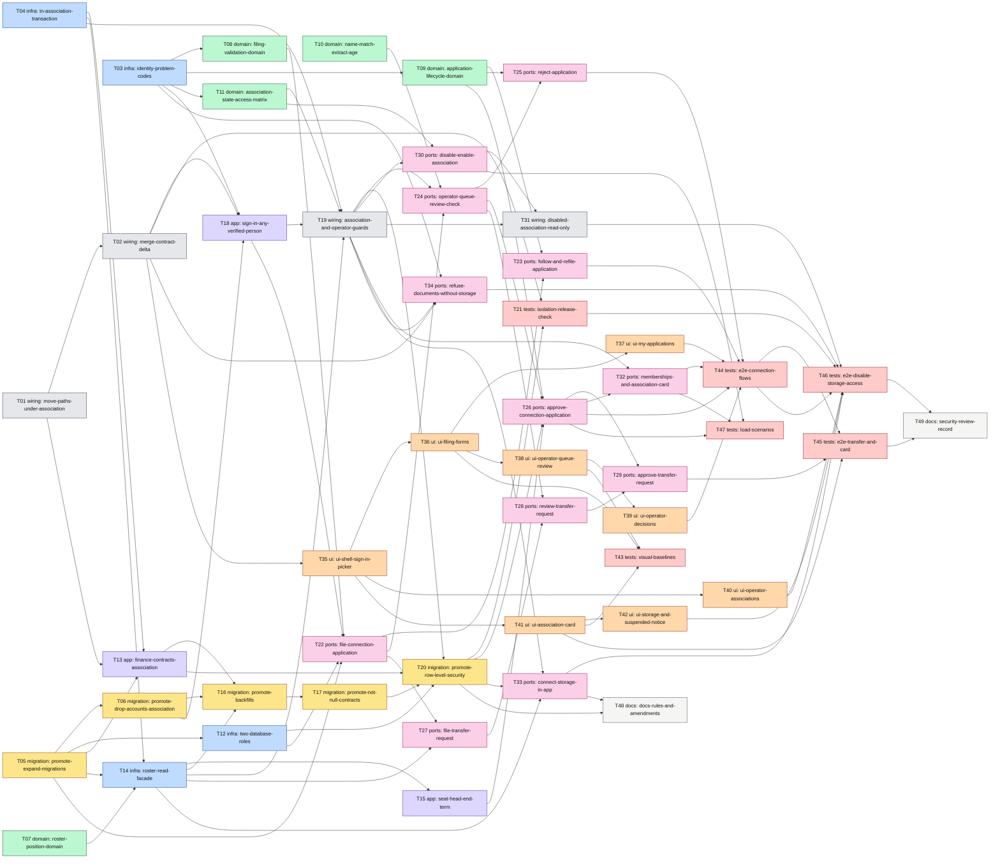
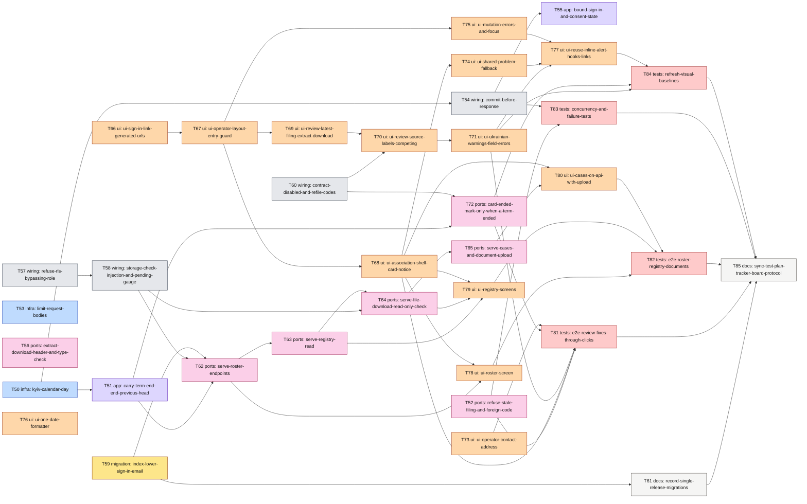
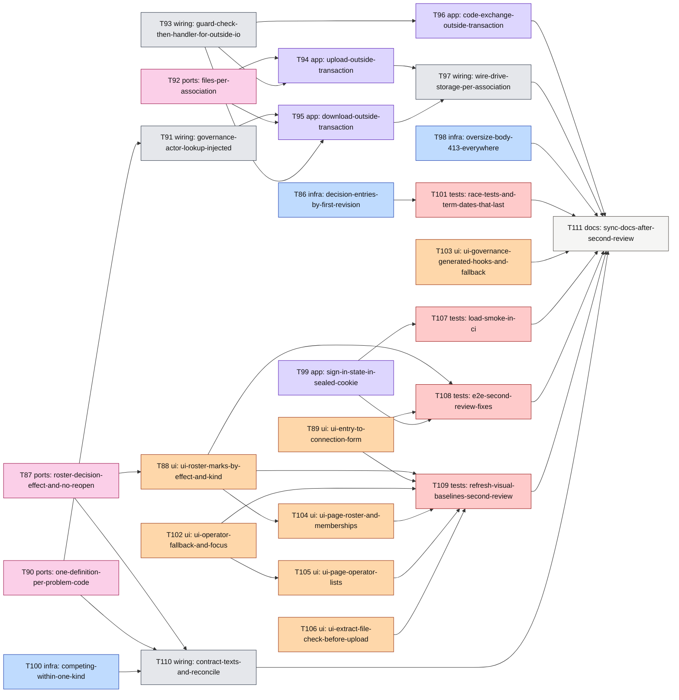
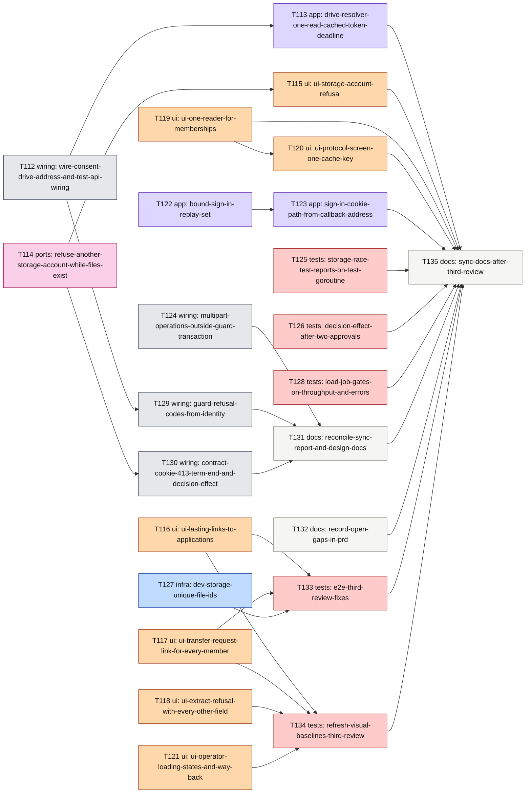

# Epic — association-onboarding

> **PRD:** [PRD.md](../PRD.md) · **Design:** [sad.md](../sad.md) · **Data model:** [data-model.md](../data-model.md) · **API:** [openapi.yaml](../contracts/openapi.yaml) · [api-sync-report](../contracts/api-sync-report.md) · **ADRs:** [adr/](../adr/) · **Tests:** [test-plan.md](../test-plan.md) · **Migrations:** [MANIFEST](../migrations/MANIFEST.md)

## Goal

A голова правління connects their association to Спільно, or takes it over after an election, without the developer: they sign in, file a заявка на підключення or a запит на передачу with a КЕП-signed витяг з ЄДР, and the оператор records the check made outside Спільно and decides with a reason (PRD §2). Every association and every change of голова then carries a checkable chain from the extract to the decision, and with a second association nothing of one association is readable by a person off its roster — enforced by the database and by a test that blocks a release.

## Scope

- **In:** surfaces `[backend-service, web-frontend]` (sad frontmatter); contexts `identity` (applications, the оператор's queue, association state, storage connection, sign-in and the guards), `governance` (positions on the roster, the roster facade), `finance` (the association on contracts), `platform` (`db.InAssociation`, two database roles, test fixtures); the 20 staged migrations; the contract delta and the path move of ADR-0002 in `services/core/api/openapi.yaml`; the SPA shell, the applicant's pages, the `/operator/` section, the association card and the storage connection.
- **Out:** everything in PRD §3 (no automatic check of the КЕП or the extract, no periodic re-check of ЄДР, no notifications, one оператор, no co-owners' accounts); editing the association's name and address by the board (named in PRD §9, no AC — api-sync-report §D); a River job (none in this feature); the board-protocol screens and handlers themselves (see «Board-protocol tasks» below), apart from the roster, the registry read, the file download and справи, which the review follow-up brings in (see «Review follow-up»).

## Task map

Same DAG as [tasks.json](./tasks.json). Colours = layer. Day-one parallel starts: T01, T03, T04, T05, T07, T10. Longest chain: 10 phases.

**Serialized lanes** (`implement-tasks` derives them from `layer` and overlapping `files_hint`): migrations T05 → T06 → T16 → T17 → T20; the live contract T01 → T02; the identity adapters T18 → T19 → T22 … T33 (shared `adapters/postgres` and its generated `sqlcgen`); the e2e specs T44 → T45 → T46. The domain tasks (T07–T11), the platform tasks (T04, T12) and the ui tasks after T35 (T36 / T40 / T41) run next to them.

## Rollout order (PRD §9)

| PRD §9 step | Tasks | Ships |
|---|---|---|
| 1. Isolation guard, positions, backfill | T01–T07, T12–T21 | association in every path, sign-in and the guards, row-level security, the release-blocking check; members keep working as before |
| 2. Заявки на підключення and the оператор's review | T08–T11, T22–T26, T32, T35–T39, T44 | a new association connects without the developer |
| 3. Запити на передачу | T27–T29, T41, T45 | a new голова takes over; the hand-made association can get its extract (AC-19c) |
| 4. Disable / enable, the storage connected by the board | T30, T31, T33, T34, T40, T42, T46 | replaces the developer's storage command |
| Across | T43, T47, T48, T49 | visual baselines, load scenarios, docs and amendments, the security review |

## Tasks

See [tracker.md](./tracker.md) for status. Total 49 tasks, ~29.5 person-days (S = 2 h, M = half a day, L = a day).

| # | Task | Layer | Blocked by | ACs | Est. |
|---|---|---|---|---|---|
| [T01](./T01-move-paths-under-association.md) | Move the governance and finance operations under `/<context>/associations/{association_id}/` | wiring | — | AC-04d, AC-07 | L |
| [T02](./T02-merge-contract-delta.md) | Merge the onboarding contract delta and stub the new identity operations | wiring | T01 | AC-01, AC-10, AC-17, AC-21, AC-27, AC-29 | L |
| [T03](./T03-identity-problem-codes.md) | Register the identity problem codes of PRD §5.1 and governance.drive_not_connected | infra | — | AC-02, AC-03, AC-03b, AC-04, AC-04b, AC-12, AC-13, AC-15, AC-16, AC-16c, AC-18, AC-22, AC-24, AC-25, AC-28, AC-28b, AC-30 | S |
| [T04](./T04-in-association-transaction.md) | Add platform/db.InAssociation: a transaction that carries the association and the actor | infra | — | AC-04d, AC-07 | M |
| [T05](./T05-promote-expand-migrations.md) | Promote the expand migrations: application tables, association and roster columns, the app role | migration | — | AC-01, AC-06, AC-08, AC-21, AC-29 | M |
| [T06](./T06-promote-drop-accounts-association.md) | Promote the drop of accounts.association_id ahead of the manifest order | migration | T05 | AC-04d, AC-05 | S |
| [T07](./T07-roster-position-domain.md) | Give roster entries a position and a decision reference, with the date rules of a transfer | domain | — | AC-08, AC-19, AC-19b, AC-19c | M |
| [T08](./T08-filing-validation-domain.md) | Validate a filing: every field at once, the term rules and the extract file | domain | T03 | AC-01, AC-02, AC-30 | M |
| [T09](./T09-application-lifecycle-domain.md) | Model the application lifecycle and the guards of a decision | domain | T03 | AC-03, AC-03b, AC-06, AC-12, AC-13, AC-15, AC-16c, AC-18b | M |
| [T10](./T10-name-match-extract-age.md) | Compare the three names after levelling and flag an extract older than 30 days | domain | — | AC-11, AC-11b | S |
| [T11](./T11-association-state-access-matrix.md) | Model the association state and the access matrix of PRD §10 | domain | T03 | AC-07, AC-16, AC-16b, AC-21, AC-22, AC-23, AC-24, AC-25, AC-26 | M |
| [T12](./T12-two-database-roles.md) | Run goose as the owner and serve as spilno_app; give tests an app-role pool with two associations | infra | T05 | AC-06, AC-15 | M |
| [T13](./T13-finance-contracts-association.md) | Scope finance contracts to the association in the path | app | T01, T04, T05 | AC-04d, AC-07 | S |
| [T14](./T14-roster-read-facade.md) | Serve the roster facade: the current member, a person's memberships and the members' sign-in addresses | infra | T04, T05, T07 | AC-04d, AC-07, AC-09, AC-28b | L |
| [T15](./T15-seat-head-end-term.md) | Seat a голова and end a term through the governance facade inside the caller's transaction | app | T14 | AC-08, AC-19, AC-19c, AC-20 | M |
| [T16](./T16-promote-backfills.md) | Promote the backfills: association state, roster positions and the contracts' association | migration | T06, T13, T14 | AC-19c, AC-29 | S |
| [T17](./T17-promote-not-null-contracts.md) | Promote the NOT NULL steps and the contracts index | migration | T16 | AC-08, AC-21 | S |
| [T18](./T18-sign-in-any-verified-person.md) | Sign in any verified person, keep the session in Postgres and tell the оператор | app | T02, T03, T06 | AC-01, AC-05, AC-16 | L |
| [T19](./T19-association-and-operator-guards.md) | Guard association paths with the session, the roster and a scoped transaction, and operator paths with the оператор flag | wiring | T04, T11, T14, T18 | AC-04d, AC-07, AC-16, AC-16b | L |
| [T20](./T20-promote-row-level-security.md) | Promote row-level security for the governance, finance and identity tables | migration | T12, T13, T17, T19 | AC-04d, AC-07, AC-16b | M |
| [T21](./T21-isolation-release-check.md) | Add the release-blocking isolation test over every association-scoped operation of the contract | tests | T02, T20 | AC-04d, AC-07, AC-16b | M |
| [T22](./T22-file-connection-application.md) | File a заявка на підключення and keep the signed extract unchanged | ports | T05, T08, T12, T18 | AC-01, AC-02, AC-04, AC-04b, AC-04c, AC-30 | L |
| [T23](./T23-follow-and-refile-application.md) | Let the applicant follow and refile their application | ports | T09, T22 | AC-05, AC-06, AC-07, AC-14 | M |
| [T24](./T24-operator-queue-review-check.md) | Serve the оператор's queue and review page, and record the check of the extract | ports | T10, T19, T22 | AC-04c, AC-10, AC-11, AC-11b, AC-16 | L |
| [T25](./T25-reject-application.md) | Reject an application with a reason | ports | T09, T24 | AC-13, AC-14, AC-15, AC-16c | S |
| [T26](./T26-approve-connection-application.md) | Approve a заявка на підключення: create the association and seat its first голова in one transaction | ports | T09, T15, T20, T24 | AC-03, AC-03b, AC-04c, AC-08, AC-09, AC-12, AC-15, AC-16c | L |
| [T27](./T27-file-transfer-request.md) | File a запит на передачу for a connected association | ports | T14, T22 | AC-02, AC-17, AC-18, AC-19c, AC-24b, AC-30 | M |
| [T28](./T28-review-transfer-request.md) | Show competing запити and the storage account in the review of a запит | ports | T24, T27 | AC-19b, AC-28b | S |
| [T29](./T29-approve-transfer-request.md) | Approve a запит на передачу: seat the new голова and end the previous term in one transaction | ports | T26, T28 | AC-16c, AC-18b, AC-19, AC-19b, AC-19c, AC-20, AC-24b | L |
| [T30](./T30-disable-enable-association.md) | Disable and enable an association as the оператор | ports | T11, T19 | AC-16, AC-21, AC-22, AC-23, AC-24 | M |
| [T31](./T31-disabled-association-read-only.md) | Make a disabled association read-only in the middleware | wiring | T19, T30 | AC-21, AC-23, AC-25, AC-26 | M |
| [T32](./T32-memberships-and-association-card.md) | Serve my associations and the association card with the confirmation chain | ports | T19, T26 | AC-04d, AC-19c, AC-20, AC-29 | M |
| [T33](./T33-connect-storage-in-app.md) | Connect the association's document storage from the web app | ports | T14, T19, T20 | AC-27, AC-28b | L |
| [T34](./T34-refuse-documents-without-storage.md) | Refuse case documents and assistant turns while the storage is not connected | ports | T02, T03, T19 | AC-28 | S |
| [T35](./T35-ui-shell-sign-in-picker.md) | Build the signed-in shell: sign-in page, association picker, routes under /o/$associationId and the оператор's entry | ui | T02 | AC-04d, AC-07, AC-16, AC-16b, AC-19 | L |
| [T36](./T36-ui-filing-forms.md) | Build the filing forms for a заявка на підключення and a запит на передачу | ui | T35 | AC-01, AC-02, AC-04, AC-04b, AC-17, AC-18, AC-30 | L |
| [T37](./T37-ui-my-applications.md) | Show my applications: status, the оператор's contact, the reason and refiling | ui | T36 | AC-05, AC-06, AC-14 | M |
| [T38](./T38-ui-operator-queue-review.md) | Build the оператор's queue and the review page with sources, warnings and the check form | ui | T36 | AC-04c, AC-10, AC-11, AC-11b, AC-16, AC-19b, AC-28b | L |
| [T39](./T39-ui-operator-decisions.md) | Add the оператор's decisions: approve, reject and their refusals | ui | T38 | AC-03, AC-03b, AC-08, AC-12, AC-13, AC-14, AC-15, AC-16c, AC-18b | M |
| [T40](./T40-ui-operator-associations.md) | Build the оператор's associations list with disabling and enabling | ui | T35 | AC-21, AC-22, AC-23, AC-24 | M |
| [T41](./T41-ui-association-card.md) | Build the association card with the confirmation chain and the roster marks | ui | T35 | AC-19c, AC-20, AC-29 | M |
| [T42](./T42-ui-storage-and-suspended-notice.md) | Show the storage connection, the connect flow and the «Доступ призупинено» notice | ui | T41 | AC-09, AC-21, AC-25, AC-27, AC-28, AC-28b | M |
| [T43](./T43-visual-baselines.md) | Add visual-regression checks for the filing form, the review page and the association card | tests | T36, T38, T41 | AC-01, AC-10, AC-29 | S |
| [T44](./T44-e2e-connection-flows.md) | Prove filing, following and deciding a заявка end to end through the UI (US-01, US-02, US-03) | tests | T23, T25, T26, T32, T37, T39 | AC-01, AC-02, AC-03, AC-03b, AC-04, AC-04b, AC-04c, AC-05, AC-06, AC-08, AC-09, AC-10, AC-11, AC-11b, AC-12, AC-13, AC-14, AC-15, AC-16c, AC-30 | L |
| [T45](./T45-e2e-transfer-and-card.md) | Prove a transfer, the takeover and the association card end to end (US-04, US-05, US-09) | tests | T29, T41, T44 | AC-17, AC-18, AC-18b, AC-19, AC-20, AC-29 | M |
| [T46](./T46-e2e-disable-storage-access.md) | Prove disabling, the read-only association, the storage connection and every access denial end to end (US-06, US-07, US-08) | tests | T21, T31, T33, T34, T40, T42, T44 | AC-04d, AC-07, AC-09, AC-16, AC-16b, AC-21, AC-22, AC-23, AC-24, AC-25, AC-26, AC-27, AC-28, AC-28b | L |
| [T47](./T47-load-scenarios.md) | Add the load scenarios for the latency and throughput targets of PRD §6 | tests | T26, T30, T32 | AC-01, AC-05, AC-08, AC-29 | M |
| [T48](./T48-docs-rules-and-amendments.md) | Update the repo rules and environment docs, amend the board-protocol documents and write the оператор's runbook | docs | T20, T33 | AC-03, AC-05, AC-12 | M |
| [T49](./T49-security-review-record.md) | Run and record the security review that PRD §6.1 requires | docs | T45, T46 | AC-04c, AC-07, AC-16b, AC-16c, AC-28b | M |

**AC coverage:** all 42 acceptance criteria of PRD §5 are in at least one task's `acs` (checked against the AC headings of PRD §5 when these files were written). The NFRs of PRD §6 without an AC are carried by T12 (integrity of the insert-only tables), T20 and T21 (isolation), T29 and T31 (effect of a decision on the next request), T22 (file size, filing latency) and T47 (latency and throughput).

## Review follow-up (2026-11-10)

The [feature review](../_review/review-2026-11-10.md) ran after PR #48 was merged and asked for changes: 22 stage-1 findings (F01–F22) and 15 stage-2 findings (B1–B9, W1–W6), all resolved as «fix now». T50–T85 carry them on a new branch off `main`; T01–T49 stay as built. F22 (no `ui` task claimed AC-19) is closed by this breakdown itself: T35 now lists AC-19.

Same DAG as [tasks.json](./tasks.json), follow-up tasks only. Parallel starts: T50, T52, T53, T56, T57, T59, T60, T66, T73, T76. Longest chain: 9 phases. ~19.25 person-days.

| Task | Title | Layer | Blocked by | ACs | Findings | Est. |
|---|---|---|---|---|---|---|
| [T50](./T50-kyiv-calendar-day.md) | Take «today» for every roster date from the Europe/Kyiv calendar | infra | — | AC-09, AC-19, AC-29 | F07 | M |
| [T51](./T51-carry-term-end-end-previous-head.md) | Carry the filed term end into the roster and end the previous голова whatever their term end | app | T50 | AC-08, AC-19, AC-19c, AC-30 | F05, F06 | M |
| [T52](./T52-refuse-stale-filing-and-foreign-code.md) | Refuse a decision on a stale filing and a card transfer that claims another association's code | ports | — | AC-15, AC-19c | F01 (backend half), B3 | M |
| [T53](./T53-limit-request-bodies.md) | Limit request bodies and read time before the request validator runs | infra | — | AC-02 | B1 | M |
| [T54](./T54-commit-before-response.md) | Commit the association transaction before the response leaves, and keep outside calls out of it | wiring | T50 | AC-25, AC-27 | B2 | L |
| [T55](./T55-bound-sign-in-and-consent-state.md) | Bound the sign-in and storage-consent state | app | T54 | AC-05, AC-27 | B4 | M |
| [T56](./T56-extract-download-header-and-type-check.md) | Send a valid Content-Disposition on the review download and tighten the extract type check | ports | — | AC-02, AC-03 | B5, B6 | S |
| [T57](./T57-refuse-rls-bypassing-role.md) | Refuse to start when the serving role bypasses row-level security | wiring | — | AC-04d, AC-07 | F16 | S |
| [T58](./T58-storage-check-injection-and-pending-gauge.md) | Pass the storage check into governance from cmd/api and count the pending age from the latest filing | wiring | T57 | AC-05, AC-28 | B7, B8 | S |
| [T59](./T59-index-lower-sign-in-email.md) | Make the memberships lookup use an index on the lowered sign-in address | migration | — | AC-04d | F20 | S |
| [T60](./T60-contract-disabled-and-refile-codes.md) | Advertise the two missing problem codes in the contract and reconcile the sync report | wiring | — | AC-06, AC-25 | F17, F18, F21 | M |
| [T61](./T61-record-single-release-migrations.md) | Record that the expand, backfill and contract migrations shipped in one release | docs | T59 | AC-04d | F19 | S |
| [T62](./T62-serve-roster-endpoints.md) | Serve the roster: list, add and change члени правління with their position and decision | ports | T51, T58, T59 | AC-09, AC-16b, AC-20, AC-25 | F15 | L |
| [T63](./T63-serve-registry-read.md) | Serve the реєстр протоколів: search and the signed protocol | ports | T62 | AC-09, AC-26 | F15 | L |
| [T64](./T64-serve-file-download-read-only-check.md) | Serve file downloads, and only signed copies while the association is read-only | ports | T58, T63 | AC-25, AC-26 | F15 | M |
| [T65](./T65-serve-cases-and-document-upload.md) | Serve справи and document upload behind the storage guard | ports | T64 | AC-25, AC-28 | F15 | L |
| [T66](./T66-ui-sign-in-link-generated-urls.md) | Point «Увійти» at the API and build every API link from the generated URL helpers | ui | — | AC-04d, AC-05 | F02, W5 (hand-built URLs) | S |
| [T67](./T67-ui-operator-layout-entry-guard.md) | Give the оператор's section an index, its own navigation and one access guard | ui | T66 | AC-16, AC-16b, AC-21 | F03, W1 | M |
| [T68](./T68-ui-association-shell-card-notice.md) | Put the association card in the navigation and the suspended notice in the association layout | ui | T67 | AC-04d, AC-21, AC-25, AC-27, AC-29 | F08, F14 | M |
| [T69](./T69-ui-review-latest-filing-extract-download.md) | Review the latest filing with its latest check, and let the оператор download the extract | ui | T67 | AC-03, AC-06, AC-08, AC-15 | F01 (web half), F04 | M |
| [T70](./T70-ui-review-source-labels-competing.md) | Label the source of every value on the review page and show competing заявки side by side | ui | T60, T69 | AC-04c, AC-10, AC-19b | F10, F11 | M |
| [T71](./T71-ui-ukrainian-warnings-field-errors.md) | Write the warnings and the field errors in Ukrainian from structured data | ui | T70 | AC-02, AC-11, AC-11b | F12 | M |
| [T72](./T72-card-ended-mark-only-when-a-term-ended.md) | Show «повноваження завершено» in the card history only when the decision ended a term | ports | T51, T60 | AC-19c, AC-20 | F09 | M |
| [T73](./T73-ui-operator-contact-address.md) | Show the оператор's contact address in every environment | ui | — | AC-05 | F13 | S |
| [T74](./T74-ui-shared-problem-fallback.md) | Give every page a loading state and one fallback for a failed request | ui | T68 | AC-05, AC-07 | W2 | M |
| [T75](./T75-ui-mutation-errors-and-focus.md) | Report every failed operator action and keep focus after a decision | ui | T67 | AC-13, AC-15, AC-22 | W3, W6 | M |
| [T76](./T76-ui-one-date-formatter.md) | Format every date with one Europe/Kyiv formatter | ui | — | AC-05, AC-29 | W4 | S |
| [T77](./T77-ui-reuse-inline-alert-hooks-links.md) | Reuse InlineAlert, the generated hooks and router links across the identity screens | ui | T71, T74, T75 | AC-13, AC-21 | W5 | M |
| [T78](./T78-ui-roster-screen.md) | Build the roster screen: list, add and change члени правління, with the decision mark on each голова | ui | T62, T68 | AC-09, AC-20 | F15 | L |
| [T79](./T79-ui-registry-screens.md) | Build the реєстр протоколів: search and the signed protocol with its download | ui | T63, T64, T68 | AC-09, AC-26 | F15 | M |
| [T80](./T80-ui-cases-on-api-with-upload.md) | Move the справи list and the case screen to the API, with document upload and the storage message | ui | T65, T68 | AC-25, AC-28 | F15, F08 (the mock) | L |
| [T81](./T81-e2e-review-fixes-through-clicks.md) | Prove the fixed flows end to end by clicking, not by typing addresses | tests | T52, T68, T71, T72, T73 | AC-04c, AC-05, AC-06, AC-08, AC-11, AC-21, AC-29 | F01, F02, F03, F04, F08, F11, F12 (e2e halves) | M |
| [T82](./T82-e2e-roster-registry-documents.md) | Prove the roster, the registry and the document refusal end to end | tests | T78, T79, T80 | AC-09, AC-16b, AC-20, AC-26, AC-28 | F15 | L |
| [T83](./T83-concurrency-and-failure-tests.md) | Test the decisions and the filings under concurrency | tests | T52, T54 | AC-04c, AC-15 | B9 | M |
| [T84](./T84-refresh-visual-baselines.md) | Refresh the visual baselines of the review page and the association card | tests | T71, T72, T77 | AC-10, AC-29 | follow-up of F09, F10, F11, F12 | S |
| [T85](./T85-sync-test-plan-tracker-board-protocol.md) | Bring the test plan, the trackers and the board-protocol tasks in line with what was built | docs | T61, T81, T82, T83, T84 | AC-09, AC-20, AC-26, AC-28 | F15 (bookkeeping), F21 | M |

**Finding coverage:** every finding of the review record is named by at least one task above, F22 excepted (closed here). F15 is carried by T62–T65 (handlers), T78–T80 (screens) and T82 (e2e).

### Board-protocol work carried here (F15)

The product owner chose to deliver AC-09, AC-20, AC-26, AC-28 and the on-roster part of AC-16b in this feature. That takes work out of six board-protocol tasks; each is built once, here, and T85 updates the board-protocol tracker.

| board-protocol task | Carried here by | Left in board-protocol |
|---|---|---|
| [T10](../../board-protocol/tasks/T10-settings-roster-endpoints.md) settings and roster endpoints | T62: the three board-member operations | the settings operations, `governance.register_start_locked` |
| [T31](../../board-protocol/tasks/T31-registry-search.md) registry search | T63: whole | nothing |
| [T21](../../board-protocol/tasks/T21-cases-endpoints.md) cases and files | T64: `downloadFile` with the ADR-0007 check; T65: the four case operations | the domain event for the needs-review hook, the upload-duration metric |
| [T35](../../board-protocol/tasks/T35-ui-settings-roster.md) settings and roster screens | T78: the roster screen | the settings screen |
| [T43](../../board-protocol/tasks/T43-ui-registry.md) registry screens | T79: whole | nothing |
| [T36](../../board-protocol/tasks/T36-ui-cases-documents.md) cases and documents screens | T80: whole | nothing |

Not carried: the lock with a signed copy (board-protocol T29) and everything before it. Until it exists no protocol can be signed in the app, so the registry is proven on seeded signed protocols (T63, T82), and the Drive adapter (board-protocol T13) stays there: files are served through the in-memory `Files` fake under `SPILNO_DEV_STORAGE=true` and answer 503 without it (T64).

### Risks of the follow-up

- **T54 changes the path of every association-scoped request** (commit before the response). It is the one L task with a wide blast radius; the review did not verify B2, so the task starts by reproducing it.
- **T51 fixes two defects that hide each other.** Storing the filed term end without the change to `GetEntryOfDecision` would stop transfers from ending the previous голова.
- **Three findings rest on the reviewer's read alone** (B3 in T52, F18 in T60, F20 in T59): each task starts with a failing test or an `EXPLAIN`, and records in the review record if the finding does not reproduce.
- **T65 and T80 are the slice to drop first.** They exist only for the UI half of AC-28; without them that half needs an explicit de-scope in PRD §8.
- **Contract lane.** T60, T70 and T72 edit `services/core/api/openapi.yaml`; their shared `files_hint` serializes them, and each lands with its generated code.

## Review follow-up (2026-11-17)

The [re-review](../_review/review-2026-11-17.md) of the first follow-up asked for changes again: 9 stage-1 findings (N01–N09) and 17 stage-2 findings (Q01–Q17), all resolved as «fix now», the wiring of the real file storage (N09) included. T86–T111 carry them on new branches off `main`; T01–T85 stay as built.

Same DAG as [tasks.json](./tasks.json), tasks of this follow-up only. Parallel starts: T86, T87, T89, T90, T92, T93, T98, T99, T100, T102, T103, T106. Longest chain: 5 phases. 26 tasks, ~13 person-days.

| Task | Title | Layer | Blocked by | ACs | Findings | Est. |
|---|---|---|---|---|---|---|
| [T86](./T86-decision-entries-by-first-revision.md) | Find the голова a decision seated and the entry it ended by the first revision that carries the decision | infra | — | AC-19, AC-19b, AC-20, AC-29 | N01 | M |
| [T87](./T87-roster-decision-effect-and-no-reopen.md) | Tell each roster entry what its decision did to it, and refuse to reopen an entry an approval ended | ports | — | AC-19, AC-20 | N01 | M |
| [T88](./T88-ui-roster-marks-by-effect-and-kind.md) | Mark roster entries by the decision's effect and word the mark by the kind of the decision | ui | T87 | AC-20, AC-29 | N01 (web half), N02 | M |
| [T89](./T89-ui-entry-to-connection-form.md) | Lead a signed-in person to the заявка на підключення form | ui | — | AC-01, AC-04d | N03 | S |
| [T90](./T90-one-definition-per-problem-code.md) | Advertise the disabled refusal of a file download and define every problem code once | ports | — | AC-25, AC-26 | N05, Q08 | M |
| [T91](./T91-governance-actor-lookup-injected.md) | Pass the read-only lookup into governance from cmd/api and refuse a request without an actor | wiring | T90 | AC-26 | Q09 | S |
| [T92](./T92-files-per-association.md) | Resolve the file storage per association | ports | — | AC-26, AC-28 | N09 (port half) | M |
| [T93](./T93-guard-check-then-handler-for-outside-io.md) | Run operations with outside I/O after the guard's check transaction, not inside it | wiring | — | AC-25, AC-28 | N06, Q01, B2 (remainder) | L |
| [T94](./T94-upload-outside-transaction.md) | Upload a case document before the write transaction and remove the file when the write fails | app | T92, T93 | AC-28 | N06, Q04 (checksum) | M |
| [T95](./T95-download-outside-transaction.md) | Read a download from the storage outside the transaction and answer 503 when the read fails | app | T91, T92, T93 | AC-26 | Q01, Q04 | M |
| [T96](./T96-code-exchange-outside-transaction.md) | Exchange the storage consent code with Google outside the transaction | app | T93 | AC-27, AC-28b | B2 (remainder) | M |
| [T97](./T97-wire-drive-storage-per-association.md) | Build each association's Drive storage from its Google connection in cmd/api | wiring | T94, T95 | AC-26, AC-28 | N09 | L |
| [T98](./T98-oversize-body-413-everywhere.md) | Answer 413 for every oversized body and limit the bodies of finance and system | infra | — | AC-02 | Q02, B9 (remainder) | M |
| [T99](./T99-sign-in-state-in-sealed-cookie.md) | Keep the pending sign-in in a sealed cookie of the browser that started it | app | — | AC-05, AC-27 | Q03 (also SEC-02 of the security review) | L |
| [T100](./T100-competing-within-one-kind.md) | Mark as competing only pending applications of the same kind for the same code | infra | — | AC-04c, AC-19b | Q07 | S |
| [T101](./T101-race-tests-and-term-dates-that-last.md) | Report race-test failures on the test goroutine and stop the term-end tests from expiring | tests | T86 | AC-08, AC-15, AC-19c, AC-30 | Q05, Q06 | S |
| [T102](./T102-ui-operator-fallback-and-focus.md) | Show the shared fallback on the оператор's review and associations pages and keep focus after an approval | ui | — | AC-10, AC-15, AC-21 | Q11, Q14 (W1, W2, W6 remainders) | M |
| [T103](./T103-ui-governance-generated-hooks-and-fallback.md) | Use the generated hooks, their query keys and the shared fallback in the governance screens | ui | — | AC-19, AC-26, AC-28 | Q12, Q13 (W2, W5 remainders) | M |
| [T104](./T104-ui-page-roster-and-memberships.md) | Read every page of the roster and of a person's memberships | ui | T88 | AC-04d, AC-20 | Q15 | M |
| [T105](./T105-ui-page-operator-lists.md) | Read every page of the оператор's queue and list of associations | ui | T102 | AC-04c, AC-21 | Q15 (known gap of T81) | M |
| [T106](./T106-ui-extract-file-check-before-upload.md) | Check the extract's size and type before the upload and name the field on a 413 | ui | — | AC-02 | Q16 | S |
| [T107](./T107-load-smoke-in-ci.md) | Run the load smoke of PRD §6 in CI | tests | T99 | AC-01, AC-05, AC-08, AC-29 | Q10 | M |
| [T108](./T108-e2e-second-review-fixes.md) | Prove the second review's fixes end to end | tests | T88, T89, T99 | AC-01, AC-04d, AC-05, AC-20, AC-29 | N03, N04, Q17, N01 and N02 (e2e halves) | M |
| [T109](./T109-refresh-visual-baselines-second-review.md) | Refresh the visual baselines the second review's fixes changed | tests | T88, T89, T102, T104, T105, T106 | AC-01, AC-20, AC-29 | follow-up of N01, N02, N03, Q11, Q15 | S |
| [T110](./T110-contract-texts-and-reconcile.md) | Correct the contract's descriptions and reconcile the sync report | wiring | T87, T90, T100 | AC-04c, AC-26 | N07, N08 (F21) | M |
| [T111](./T111-sync-docs-after-second-review.md) | Bring the test plan, the trackers and the review record in line with the second follow-up | docs | T96, T97, T98, T101, T103, T107, T108, T109, T110 | AC-01, AC-19, AC-20, AC-26, AC-28 | bookkeeping of N01–N09, Q01–Q17 | M |

**Finding coverage:** every finding of the record is named by at least one task above. N01 is carried by T86 (identity queries), T87 (roster rule and contract), T88 (screen) and T108 (e2e); N06 and Q01 by T93 (the guard) with T94–T96 (the three handlers); N09 by T92 (port) and T97 (wiring).

### Board-protocol work carried here (N09)

The product owner chose to wire the real storage in this feature. board-protocol T13b left the wiring to «the first use case that stores a file» (its T21), and that use case was built here as T64 and T65.

| board-protocol task | Carried here by | Left in board-protocol |
|---|---|---|
| [T13b](../../board-protocol/tasks/T13b-drive-files-adapter.md) the Drive adapter | T94: `Remove` on the port, the fake and the adapter; T97: the fake Drive moved where a module test can import it | the run of the contract against real Google |
| [T21](../../board-protocol/tasks/T21-cases-endpoints.md) cases and files | T92: the storage resolved per association; T97: the adapter built from the association's Google connection in `cmd/api` | the domain event for the needs-review hook, the upload-duration metric |
| [T14](../../board-protocol/tasks/T14-river-worker-jobs.md) the River worker | nothing: T94 removes an orphaned file best effort, in the request | the `remove_orphan_file` job |

As built (2026-11-17, all 26 tasks done, [tracker](./tracker.md)): the fake Drive of the adapter's tests did
not move; the module test of T97 (`governance/drive_wiring_test.go`) has its own fake Google and builds the
resolver the way `cmd/api` does. T109 changed no baseline. The amendment of ADR-0003 and SAD §8 that T93 names
is not written. What each finding got, and what stayed open, is in the
[review record](../_review/review-2026-11-17.md#follow-up-what-closed-each-finding) and in the tracker's
«Known gaps».

### Decisions taken in this breakdown

Each is the default of its task and is named in the task's Notes with the alternative; none needed an ADR by the blast-radius gate, T93 excepted, which amends ADR-0003.

- **N01 without a migration (T86).** The seated and the ended entry of a decision are found by the first revision that carries it. The alternative is a column on `board_member_revisions` with an expand and a backfill.
- **An entry an approval ended cannot be reopened (T87).** PRD AC-19: «the board adds them again». The alternative is to reset a reopened entry to член правління without a decision.
- **The pending sign-in moves into a sealed cookie (T99).** It closes Q03 and SEC-02 of the security review together. The alternative, a rate limit per client address, needs a trusted proxy header.
- **Operations with outside I/O leave the guard's single transaction (T93).** Their checks, their outside call and their write become three steps; ADR-0003 and SAD §8 get a dated amendment.

### Risks of the second follow-up

- **T93 changes the path of every association-scoped request**, as T54 did. It lands alone, before T94–T96; the three handlers only get one transaction around their body, their logic moves in T94–T96.
- **T97 cannot be proven against real Google here.** It is proven on a fake Drive through HTTP; the tracker keeps the run against real Google as a known gap.
- **T99 changes how every test signs in.** The e2e support and the load client keep the cookie between the start and the callback; T107 and T108 wait for it.
- **Contract lane.** T87, T90 and T110 edit `services/core/api/openapi.yaml`; their shared `files_hint` serializes them, each lands with its generated code, and T110 reconciles last.
- **Shared files outside the DAG edges.** T92, T94, T95 and T97 meet in `governance/app` and `module.go`; T88 and T104 in the roster screen; T102 and T105 in the оператор's lists. The `deps` already order them.
- **Three findings rest on the reviewer's read alone** (Q03 in T99, Q05 in T101, Q13 in T103): each task starts by reproducing its finding and records in the review record if it does not reproduce.

## Review follow-up (2026-11-17, second re-review)

The [second re-review](../_review/review-2026-11-17-2.md) of the feature at `25cf44e` asked for changes a third time: 13 stage-1 findings (R01–R13) and 12 stage-2 findings (S01–S12), all resolved as «fix now»; for R07 the product owner chose to refuse a connection of another storage account while the association has files. T112–T135 carry them; T01–T111 stay as built.

Same DAG as [tasks.json](./tasks.json), tasks of this follow-up only. Parallel starts: T112, T114, T116, T117, T118, T119, T121, T122, T124, T125, T126, T127, T128, T132. Longest chain: 4 phases. 24 tasks, ~9.25 person-days.

| Task | Title | Layer | Blocked by | ACs | Findings | Est. |
|---|---|---|---|---|---|---|
| [T112](./T112-wire-consent-drive-address-and-test-api-wiring.md) | Give the production storage consent its Drive address and test the wiring cmd/api runs | wiring | — | AC-26, AC-27, AC-28, AC-28b | R01, R02 (N09 remainder, SEC-13) | M |
| [T113](./T113-drive-resolver-one-read-cached-token-deadline.md) | Resolve an association's Drive storage with one read, a reused token and a deadline | app | T112 | AC-26, AC-28 | S03 | M |
| [T114](./T114-refuse-another-storage-account-while-files-exist.md) | Refuse to connect another storage account while the association has files | ports | — | AC-26, AC-27 | R07 | L |
| [T115](./T115-ui-storage-account-refusal.md) | Tell the член правління why another storage account was refused | ui | T114 | AC-27 | R07 (web half) | S |
| [T116](./T116-ui-lasting-links-to-applications.md) | Give every signed-in person a lasting way to their заявки and to the заявка на підключення form | ui | — | AC-01, AC-04d, AC-05, AC-06, AC-14 | R03 (N03 remainder) | M |
| [T117](./T117-ui-transfer-request-link-for-every-member.md) | Offer the запит на передачу on the association card to every member | ui | — | AC-17 | R04 | S |
| [T118](./T118-ui-extract-refusal-with-every-other-field.md) | Name a refused extract together with every other broken field | ui | — | AC-02 | R05 | S |
| [T119](./T119-ui-one-reader-for-memberships.md) | Read memberships through one hook everywhere and stop the page loop on a repeated cursor | ui | — | AC-04d, AC-19 | R06, S12 (Q12, Q15 remainders) | M |
| [T120](./T120-ui-protocol-screen-one-cache-key.md) | Read and write the protocol draft under one cache key and tighten the reuse test | ui | T119 | AC-25 | S08, S11 | S |
| [T121](./T121-ui-operator-loading-states-and-way-back.md) | Show a loading state in the оператор's queue and a way back from a missing protocol or справа | ui | — | AC-04c, AC-26 | S09, S10 (Q11, Q13 remainders) | S |
| [T122](./T122-bound-sign-in-replay-set.md) | Bound the set of used sign-in states | app | — | AC-05 | S01 (Q03 remainder) | S |
| [T123](./T123-sign-in-cookie-path-from-callback-address.md) | Scope the pending sign-in cookie by the path of the callback address | app | T122 | AC-05 | S05 | S |
| [T124](./T124-multipart-operations-outside-guard-transaction.md) | Run every multipart operation outside the guard's transaction and fail the build when one is missed | wiring | — | AC-25, AC-28 | S04 (Q01 remainder) | M |
| [T125](./T125-storage-race-test-reports-on-test-goroutine.md) | Report the storage race test's failures on the test goroutine | tests | — | AC-27 | S02 (Q05 again) | S |
| [T126](./T126-decision-effect-after-two-approvals.md) | Prove each roster entry's decision effect after two transfers in a row | tests | — | AC-19b, AC-20 | R13 (N01 test gap) | S |
| [T127](./T127-dev-storage-unique-file-ids.md) | Give the development storage file ids that are unique across associations | infra | — | AC-26 | S07 | S |
| [T128](./T128-load-job-gates-on-throughput-and-errors.md) | Fail the CI load job on throughput and errors and report its latency | tests | — | AC-01, AC-05, AC-08, AC-29 | S06 (Q10 caveat) | S |
| [T129](./T129-guard-refusal-codes-from-identity.md) | Take the guard's refusal codes from identity through cmd/api and drop the mirror | wiring | T112 | AC-25, AC-26 | R09 (N05 remainder) | M |
| [T130](./T130-contract-cookie-413-term-end-and-decision-effect.md) | Bring the contract in line with the sign-in cookie, the 413 answers, the term-end refusal and the decision effect | wiring | T114 | AC-02, AC-05, AC-19, AC-20, AC-26 | R08 (contract half), R10, R11 (delta) | M |
| [T131](./T131-reconcile-sync-report-and-design-docs.md) | Reconcile the sync report and write the roster rules into ADR-0006, the SAD and the data model | docs | T124, T129, T130 | AC-04c, AC-19, AC-20, AC-26 | R08 (report, N08 again), R11 | M |
| [T132](./T132-record-open-gaps-in-prd.md) | Record every gap left open in PRD §8 with an owner and a due date | docs | — | AC-01, AC-26, AC-27, AC-28 | R12 | S |
| [T133](./T133-e2e-third-review-fixes.md) | Prove the third review's fixes end to end by clicking | tests | T116, T117, T127 | AC-01, AC-04d, AC-05, AC-16c, AC-17, AC-26 | R03, R04 (e2e halves), S07 | M |
| [T134](./T134-refresh-visual-baselines-third-review.md) | Refresh the visual baseline of the association card | tests | T116, T117, T118, T121 | AC-17, AC-29 | follow-up of R03, R04, R05, S09 | S |
| [T135](./T135-sync-docs-after-third-review.md) | Bring the test plan, the trackers and the review record in line with the third follow-up | docs | T113, T115, T119, T120, T123, T125, T126, T128, T131, T132, T133, T134 | AC-01, AC-02, AC-04d, AC-17, AC-26, AC-27 | bookkeeping of R01–R13, S01–S12 | M |

**Finding coverage:** every finding of the record is named by at least one task above. R03 and R04 are carried by T116 and T117 (screens) and T133 (e2e); R07 by T114 (rule, code, contract, PRD, ADR) and T115 (message); R08 by T130 (contract) and T131 (sync report); R11 by T130 (delta) and T131 (ADR-0006, SAD, data model).

### Decisions taken in this breakdown (third follow-up)

Each is the default of its task and is named in the task's Notes with the alternative. None crosses the blast-radius gate for a new ADR: T114 amends ADR-0008 and T124 rewords the amendment of ADR-0003.

- **A connection of another storage account is refused while the association has files (T114).** The product owner's choice of 2026-11-17 for R07; it closes the open question of PRD §8. The same account may connect again. The code's default name is `identity.storage_has_files`.
- **A refused extract still sends the other fields (T118).** The server stays the one place that validates a filing; the alternative is a second copy of the rules on the client.
- **The outside-I/O list follows the contract, not the request (T124).** Every association-scoped operation with a multipart body is listed and a test walks the contract; the request's content type does not decide, because the client chooses it.
- **The guard's refusal codes reach governance through `cmd/api` (T129).** Governance names no identity code; the mirror constants and their test go.
- **The CI load job enforces throughput and errors and reports latency (T128).** `mise run load` keeps the PRD §6 limits for the run before a release.

### Risks of the third follow-up

- **PRs #55 and #56 are still drafts.** These tasks build on `25cf44e`, so they continue on `fix/association-onboarding-second-review` or on a branch cut from it; a branch off `main` would not have the code they change. Which one is the product owner's call when `implement-tasks` starts.
- **`cmd/api/main.go` lane.** T112, T113, T114, T123 and T129 edit it; `deps` order T112 → T113 and T112 → T129, the shared `files_hint` serializes the rest.
- **Contract lane.** T114 and T130 edit `services/core/api/openapi.yaml`, each lands with its generated code, and T131 reconciles last.
- **`PRD.md` lane.** T114 (§5, §5.1, §8), T131 (§5.1 marker) and T132 (§8) share the file; the shared `files_hint` serializes them. The due dates of T132 need the product owner's word.
- **`uk.ts` lane.** T115, T116, T117 and T121 add or remove strings; they serialize on the file and are otherwise independent.
- **T112 is still not a run against real Google.** It proves the wiring `cmd/api` runs against a fake Google; the real run stays a PRD §8 line.
- **Two findings rest on reading alone** (R06 in T119, S07 in T127): each task starts by reproducing its finding in a test and records in the review record if it does not reproduce.
- **T130 changes a generated Go type** (`BoardMemberDecisionEffect`); the roster handler and the web roster follow in the same commit.

## Board-protocol tasks this epic replaces or needs

`tasks.json` holds only this epic's ids, so these are not `deps`; they are named in the Notes of the task on the right.
«Status there» is the [board-protocol tracker](../../board-protocol/tasks/tracker.md) as of 2026-11-17.

| board-protocol task | Status there | Relation | Here |
|---|---|---|---|
| [T08](../../board-protocol/tasks/T08-identity-oidc-sessions.md) sign-in and sessions | replaced | **replaced**: any verified person signs in (ADR-0004); `bootstrap-member` is not built | T18 |
| [T11](../../board-protocol/tasks/T11-require-session-current-member.md) session and current member on governance and finance routes | replaced | **superseded**: the association is in the path and the check runs inside the scoped transaction | T19, T31 |
| [T12](../../board-protocol/tasks/T12-google-connection-token-source.md) / [T12d](../../board-protocol/tasks/T12d-google-config.md) Google connection | done | `cmd/google-connect` **replaced** by the in-app consent (ADR-0008); the cipher, the store and the consent exchange (T12a–c) are reused; T12d's configuration is **needed** | T33 |
| [T34](../../board-protocol/tasks/T34-ui-sign-in-session.md) sign-in page and session guard | replaced | **superseded**: the principal changed and the shell gains the picker | T35 |
| [T10](../../board-protocol/tasks/T10-settings-roster-endpoints.md) settings and roster endpoints | in_progress | **shared**: the roster repository and `CurrentMember`; its handlers must return `position` and `decision_id`; AC-09's «add a член правління» needs it | T14, T44 |
| [T21](../../board-protocol/tasks/T21-cases-endpoints.md), [T25](../../board-protocol/tasks/T25-assistant-propose-draft.md) case documents, assistant turns | T21 in_progress, T25 todo | keep the storage guard as their first step; `downloadFile` checks the signed snapshot when the actor is read-only | T34, T31 |
| [T29](../../board-protocol/tasks/T29-lock-with-signed-copy.md), [T31](../../board-protocol/tasks/T31-registry-search.md), [T43](../../board-protocol/tasks/T43-ui-registry.md) lock, registry, registry screen | T29 todo, T31 done, T43 in_progress | **needed** for the e2e step «download a signed protocol while disabled» | T46 |
| [T35](../../board-protocol/tasks/T35-ui-settings-roster.md), [T36](../../board-protocol/tasks/T36-ui-cases-documents.md) roster and case-document screens | T35 in_progress, T36 done | mount `RosterDecisionMark`; trigger the «connect the storage first» message | T41, T42 |
| [T14](../../board-protocol/tasks/T14-river-worker-jobs.md) River worker | todo | every job opens `InAssociation` from its payload once row-level security is on | T20 |
| every board-protocol handler and ui task not started | todo | builds on the moved paths and on routes under `/o/$associationId/` | T01, T35 |

## Risks / Hard rules

- **Order against board-protocol (sad §11, High).** The SAD asks to agree the order before this breakdown; none was recorded, so the default of its mitigation is taken: T01 moves the paths first, in one PR, before any further board-protocol handler or ui task starts. If board-protocol goes first instead, T01 grows with every handler it has to move.
- **Migration order deviates from MANIFEST.md (T06).** The drop of `accounts.association_id` is promoted second, not last: nothing reads the column, an applicant cannot get an account while it is `NOT NULL`, and the staged order would loop (T20 needs T19, T19 needs T18, T18 needs the drop). T06 records the change in MANIFEST.md and data-model.md.
- **The four planned migration PRs shipped as one (review F19, T61).** Files 1–21 reached `main` together in PR #48; with one API replica that migrates at start this is a stop-start deploy and safe. What was delivered, why, and the rule for the next expand/contract change: [data-model, «Delivery: one release instead of four»](../data-model.md#delivery-one-release-instead-of-four).
- **«PR 3» of the manifest is split.** Files 13–16 (T17) need only the backfills; files 17–19 (T20) wait for the app-role connection (T12) and the guards (T19), because row-level security enabled earlier hides every row from the app.
- **Carried open items** (api-sync-report §D asked for them before this stage): no code for a bad storage `state` or a refused code — T33 answers 422 without a code; editing the association's name and address has no AC and no task; PRD AC-19 lacks the «never before the entry's first day» rule that SAD §8 and ADR-0006 state — T07 implements the SAD; the open questions of PRD §8 (retention of rejected заявки, replacing a connected storage) keep their defaults.
- **Size.** 49 tasks and ~29.5 person-days against the SAD's ~22.5 (4.5 person-weeks): the test plan chose e2e-through-UI for every refusal and visual baselines (T43–T46), the epic absorbs three board-protocol tasks (T18, T19, T35) and adds the load scenarios and the security review (T47, T49). The skill's 8–20 band is exceeded on purpose, as in board-protocol.
- **Contract first, handlers later (T02).** The delta is merged once with 501 stubs and each ports task removes its own — the accepted deviation of board-protocol T07, so the ui lane starts early.
- **Isolation has three lines and no bypass** (ADR-0003, ADR-0009): row-level security, the explicit `association_id` filters of board-protocol ADR-0015, the release-blocking test (T21). Every repository of an association-owned table takes its runner from `db.From(ctx)`. The оператор role opens nothing on an association path; an operator use case reads one association-owned value only, the storage account address (T28).
- **Proof of office is a document a person checked** (ADR-0005): no task parses the extract or verifies the КЕП. Extracts, filings, checks, decisions and state changes are insert-only by privilege, never by trigger, and are never deleted.
- **Contexts meet only through `module.go`** (repo ADR 0002): identity reaches the roster through its `Membership` port, which governance implements and `cmd/api` wires — identity does not import governance. No foreign key crosses a context.
- **Generated code is never edited** (`*.gen.go`, `sqlcgen/`, `apps/web/src/api/gen/`, `routeTree.gen.ts`); `mise run gen` after the contract, a query or a migration changes. No `r.Mount` for a context.
- **Messages are PRD §5.1 verbatim, in Ukrainian;** no refusal names a голова, an applicant or another заявка (PRD §6.1 «probing»).
- **Logs never carry** the extract, the РНОКПП or a reason text (sad §8). **Fixtures carry no real person:** `<name>@example.test`, «Тестовий Голова», codes like 12345678.
