# Data model — board-protocol

<!-- Generated by generate-data-model (--mode brownfield). Migrations are STAGED under
docs/features/board-protocol/migrations/ (NOT the live services/core/migrations/ tree);
implement-tasks promotes them. -->

> **Inputs:** [PRD.md](./PRD.md) §4–§5 (Stage 1 ACs) · [sad.md](./sad.md) §5 context ownership, §6 Flows 1–13, §8 · ADR-0003, 0005, 0006, 0007, 0009, 0011, 0015, 0017, 0018 · existing `services/core/migrations/00001`–`00003`.
> **Scope:** Stage 1 only. Stage 2 tables (effective-dated правила статуту ADR-0008, checks and overrides ADR-0010, шаблони формулювання) are not modelled.
> **Decisions taken in this pass (2026-10-27, product owner):** (1) the two ADR-0007 triggers stay — a documented exception to the course "no TRIGGER" rule; (2) association settings and the board roster are append-only revisions (latest wins), never updated in place, and the protocol-number counter lives in its own row `protocol_registers`.

## Conventions applied

- **Course defaults** for every new table: UUID v7 PK generated in Go (no DB default); `created_at TIMESTAMPTZ NOT NULL DEFAULT now()` and **no `updated_at`**; hard delete; `VARCHAR(N)` bounded, `TEXT` only for long free text; no `CHECK`, no business `DEFAULT`. State and kind columns are `VARCHAR` enums validated in `governance/domain`.
- **Exception:** the immutability triggers of ADR-0007 (`protocol_snapshots`, `protocols`) — see [migration 21](./migrations/20261027120021_create_protocol_immutability_triggers.up.sql).
- **Association scope (ADR-0015):** every table carries `association_id UUID NOT NULL`. In `identity` it is an FK to `associations`; in `governance` it is an id only (no FK across contexts). Every sqlc query filters on it.
- **Contexts:** `associations`, `accounts`, `sessions`, `google_connections` are owned by `identity`; everything else by `governance` (ADR-0014). All tables live in the `public` schema next to `meetings` and `contracts`.
- **Mutable columns, and why each has no `updated_at`:**

| Column(s) | Why it changes | Where the history lives |
|---|---|---|
| `protocols.state`, `.revision`, `.number` | Lifecycle (ADR-0009), number reserved once (ADR-0017) | `protocol_transitions` (who, when, from → to, revision) |
| `decision_slots.status` | unconfirmed → confirmed → needs_review (AC-21, AC-28b, AC-09) | `slot_values` + `slot_confirmations` |
| `protocol_registers.next_number` | Counter taken under the row lock at the first print | the numbers on `print_copies` / `protocols` |
| `poll_rounds.closed_at`, `.closed_by_member_id` | Set once when the round closes (AC-05d, AC-33) | itself |
| `print_copies.voided_at` | Set once when an edit voids the copy (AC-14b) | itself |
| `sessions.last_seen_at` | Session bookkeeping (ADR-0003) | not needed |
| `accounts.email` | Provider-verified email can change | not needed |

## ER diagram

```mermaid
erDiagram
    associations ||--o{ accounts : "has"
    associations ||--o| google_connections : "connects"
    accounts ||--o{ sessions : "holds"
    accounts ||--o{ google_connections : "authorized"

    board_members ||--|{ board_member_revisions : "revised as"
    board_members ||--o{ association_settings : "saved"
    board_members |o--o{ meetings : "chairs"

    meetings ||--o{ protocols : "recorded by"
    protocols ||--o{ protocol_transitions : "moves through"
    protocols ||--o{ agenda_items : "lists"
    cases |o--o{ agenda_items : "justifies"
    cases ||--o{ case_documents : "holds"
    files ||--o| case_documents : "stores"
    case_documents |o--o{ case_documents : "superseded by"

    agenda_items ||--|{ agenda_item_versions : "worded as"
    agenda_items ||--o{ decision_slots : "has"
    decision_slots ||--|{ slot_values : "valued as"
    decision_slots ||--o{ slot_confirmations : "confirmed by"
    slot_values ||--o{ slot_confirmations : "confirmed"
    case_documents |o--o{ slot_values : "source of"

    protocols ||--o{ assistant_turns : "converses"
    assistant_turns |o--o{ slot_values : "proposed"
    assistant_turns ||--o{ assistant_turn_documents : "attaches"
    case_documents ||--o{ assistant_turn_documents : "attached to"

    protocols ||--o{ poll_rounds : "polls"
    poll_rounds ||--o{ poll_votes : "collects"
    agenda_items ||--o{ poll_votes : "voted on"

    protocols ||--o{ print_copies : "printed as"
    files ||--o| print_copies : "stores"
    protocols ||--o| meeting_facts : "locked with"
    print_copies ||--o| meeting_facts : "signed copy of"
    files ||--o| meeting_facts : "signed scan"
    meeting_facts ||--|{ meeting_attendees : "present"
    meeting_facts ||--|{ meeting_item_votes : "counted"
    agenda_items ||--o{ meeting_item_votes : "result of"

    protocols ||--o| protocol_snapshots : "frozen as"
    protocol_snapshots ||--o{ registry_entries : "projected to"
    integrity_runs ||--o{ integrity_findings : "finds"
    protocols ||--o{ integrity_findings : "checked"

    associations {
        uuid id PK
        varchar name
        timestamptz created_at
    }
    accounts {
        uuid id PK
        uuid association_id FK
        varchar oidc_issuer UK
        varchar oidc_subject UK
        varchar email
        timestamptz created_at
    }
    sessions {
        uuid id PK
        uuid account_id FK
        bytea token_hash UK
        timestamptz expires_at
        timestamptz last_seen_at
        timestamptz created_at
    }
    google_connections {
        uuid id PK
        uuid association_id UK
        varchar google_account_email
        bytea refresh_token_ciphertext
        varchar encryption_key_id
        uuid authorized_by_account_id FK
        timestamptz created_at
    }
    board_members {
        uuid id PK
        uuid association_id
        uuid created_by_member_id FK
        timestamptz created_at
    }
    board_member_revisions {
        uuid id PK
        uuid board_member_id FK
        varchar full_name
        varchar sign_in_email
        date term_start
        date term_end
        timestamptz created_at
    }
    association_settings {
        uuid id PK
        uuid association_id
        varchar meeting_form
        varchar signers
        int register_start_number
        uuid created_by_member_id FK
        timestamptz created_at
    }
    protocol_registers {
        uuid id PK
        uuid association_id UK
        int next_number
        timestamptz created_at
    }
    meetings {
        uuid id PK
        uuid association_id "new, backfilled"
        uuid chair_board_member_id FK "new"
        timestamptz held_at
    }
    files {
        uuid id PK
        varchar drive_file_id UK
        varchar drive_revision_id
        bytea sha256
        bigint size_bytes
        varchar media_type
        timestamptz created_at
    }
    cases {
        uuid id PK
        uuid association_id
        varchar title
        timestamptz created_at
    }
    case_documents {
        uuid id PK
        uuid case_id FK
        uuid file_id FK
        uuid previous_version_id FK
        date document_date
        timestamptz created_at
    }
    protocols {
        uuid id PK
        uuid association_id
        uuid meeting_id FK
        varchar state
        int revision
        int number UK
        uuid copied_from_protocol_id FK
        timestamptz created_at
    }
    protocol_transitions {
        uuid id PK
        uuid protocol_id FK
        varchar from_state
        varchar to_state
        int revision
        uuid actor_member_id FK
        timestamptz created_at
    }
    agenda_items {
        uuid id PK
        uuid protocol_id FK
        uuid case_id FK
        smallint position
        timestamptz created_at
    }
    agenda_item_versions {
        uuid id PK
        uuid agenda_item_id FK
        int protocol_revision
        varchar subject
        jsonb fragments
        uuid author_member_id FK
        timestamptz created_at
    }
    decision_slots {
        uuid id PK
        uuid agenda_item_id FK
        varchar kind
        varchar status
        timestamptz created_at
    }
    slot_values {
        uuid id PK
        uuid slot_id FK
        varchar origin
        bigint amount_kopiyky
        varchar text_value
        date date_value
        uuid source_document_id FK
        text source_fragment
        uuid assistant_turn_id FK
        timestamptz created_at
    }
    slot_confirmations {
        uuid id PK
        uuid slot_id FK
        uuid slot_value_id FK
        int protocol_revision
        uuid confirmed_by_member_id FK
        timestamptz created_at
    }
    assistant_turns {
        uuid id PK
        uuid protocol_id FK
        varchar role
        text message
        jsonb proposal
        timestamptz created_at
    }
    assistant_turn_documents {
        uuid assistant_turn_id PK, FK
        uuid case_document_id PK, FK
        timestamptz created_at
    }
    poll_rounds {
        uuid id PK
        uuid protocol_id FK
        int round_number
        int protocol_revision
        jsonb frozen
        timestamptz closed_at
        timestamptz created_at
    }
    poll_votes {
        uuid id PK
        uuid poll_round_id FK
        uuid agenda_item_id FK
        uuid board_member_id FK
        varchar choice
        timestamptz created_at
    }
    print_copies {
        uuid id PK
        uuid protocol_id FK
        int protocol_revision
        int number
        uuid file_id FK
        timestamptz voided_at
        timestamptz created_at
    }
    meeting_facts {
        uuid id PK
        uuid protocol_id FK
        uuid print_copy_id FK
        uuid signed_scan_file_id FK
        boolean has_handwritten_corrections
        text corrections_note
        timestamptz created_at
    }
    meeting_attendees {
        uuid meeting_facts_id PK, FK
        uuid board_member_id PK, FK
        timestamptz created_at
    }
    meeting_item_votes {
        uuid meeting_facts_id PK, FK
        uuid agenda_item_id PK, FK
        smallint votes_for
        smallint votes_against
        smallint votes_abstained
    }
    protocol_snapshots {
        uuid id PK
        uuid protocol_id FK
        varchar kind
        int number
        date meeting_date
        smallint schema_version
        jsonb snapshot
        bytea fingerprint
        timestamptz created_at
    }
    registry_entries {
        uuid id PK
        uuid snapshot_id FK
        uuid agenda_item_id FK
        int number
        date meeting_date
        varchar subject
        varchar counterparty
        bigint amount_kopiyky
    }
    integrity_runs {
        uuid id PK
        timestamptz started_at
        int verified_count
        int mismatched_count
        int restored_count
        timestamptz created_at
    }
    integrity_findings {
        uuid id PK
        uuid integrity_run_id FK
        uuid protocol_id FK
        uuid file_id FK
        varchar kind
        timestamptz created_at
    }
```

Member-authorship FKs (`created_by_member_id`, `author_member_id`, `confirmed_by_member_id`, `entered_by_member_id`, …) to `board_members` are listed in the entity tables below and left out of the diagram to keep it readable.

## Aggregates

| Aggregate root | Owns | Context |
|---|---|---|
| `associations` | `accounts` → `sessions`; `google_connections` | identity |
| `board_members` (one person, one term) | `board_member_revisions` | governance |
| association settings (by `association_id`) | `association_settings` revisions; `protocol_registers` counter | governance |
| `meetings` (existing) | — (referenced by `protocols`) | governance |
| `cases` | `case_documents` (+ their `files`) | governance |
| `protocols` | `protocol_transitions`, `agenda_items` → `agenda_item_versions`, `decision_slots` → `slot_values`, `slot_confirmations`; `assistant_turns` → `assistant_turn_documents`; `poll_rounds` → `poll_votes`; `print_copies`; `meeting_facts` → `meeting_attendees`, `meeting_item_votes`; `protocol_snapshots` → `registry_entries` | governance |
| `integrity_runs` | `integrity_findings` | governance |

## Entities

Every governance table also has `association_id UUID NOT NULL` (id only) and `created_at TIMESTAMPTZ NOT NULL DEFAULT now()`; they are not repeated below unless they carry a constraint.

### identity

#### `associations`
| Column | Type | Constraints | Notes |
|---|---|---|---|
| `id` | UUID | PK, app-generated | The one Stage 1 row is bootstrapped as `00000000-0000-7000-8000-000000000001` ([migration 01](./migrations/20261027120001_bootstrap_association.up.sql)) |
| `name` | VARCHAR(200) | NOT NULL | Bootstrapped as `Test Association`, renamed by the board <!-- TBD: no PRD AC or flow edits the association name; api-forge decides whether settings carry it --> |

**Aggregate root.** Access: by id from the session (`ActorFrom`).

#### `accounts`
| Column | Type | Constraints | Notes |
|---|---|---|---|
| `id` | UUID | PK | |
| `association_id` | UUID | NOT NULL, FK → `associations(id)` | |
| `oidc_issuer` | VARCHAR(255) | NOT NULL, UNIQUE with subject | Provider configurable (ADR-0003) |
| `oidc_subject` | VARCHAR(255) | NOT NULL | Stable provider id |
| `email` | VARCHAR(320) | NOT NULL | Verified email, lowercased in app; matched to `board_member_revisions.sign_in_email` by `CurrentMember` — no FK across contexts |

**Access:** sign-in callback finds the account by `(oidc_issuer, oidc_subject)` → `uq_accounts_issuer_subject`.

#### `sessions`
| Column | Type | Constraints | Notes |
|---|---|---|---|
| `id` | UUID | PK | |
| `account_id` | UUID | NOT NULL, FK → `accounts(id)` | |
| `token_hash` | BYTEA | NOT NULL, UNIQUE | SHA-256 of the random cookie token; the token itself is never stored |
| `expires_at` | TIMESTAMPTZ | NOT NULL | Set by app from the session lifetime |
| `last_seen_at` | TIMESTAMPTZ | NOT NULL DEFAULT now() | Touched per request (bookkeeping) |

Sign-out and revocation hard-delete the row (ADR-0003). **Access:** every request resolves the cookie → `uq_sessions_token_hash` (Flow 7). <!-- TBD: expired-session cleanup has no flow; add a periodic delete and its index on expires_at only if one is specified -->

#### `google_connections`
| Column | Type | Constraints | Notes |
|---|---|---|---|
| `id` | UUID | PK | |
| `association_id` | UUID | NOT NULL, FK → `associations(id)`, UNIQUE | One connection per association |
| `google_account_email` | VARCHAR(320) | NOT NULL | The association-owned account |
| `refresh_token_ciphertext` | BYTEA | NOT NULL | AES-GCM (ADR-0005, §8 Secrets) |
| `refresh_token_nonce` | BYTEA | NOT NULL | Random per write |
| `encryption_key_id` | VARCHAR(64) | NOT NULL | For key rotation |
| `scopes` | VARCHAR(500) | NOT NULL | `drive.file` + Docs |
| `drive_root_folder_id` | VARCHAR(128) | NULL | The `spilno/` folder spilno created |
| `authorized_by_account_id` | UUID | NOT NULL, FK → `accounts(id)` | |

Re-authorization deletes the row and inserts a new one, so `created_at` is the authorization time. **Access:** `GoogleTokenSource(ctx, association)` → `uq_google_connections_association_id`.

### governance — roster and settings

#### `board_members`
| Column | Type | Constraints | Notes |
|---|---|---|---|
| `id` | UUID | PK | Stable id of one person's one term; referenced by votes, attendees, slot persons, meetings' chair and every authorship column |
| `created_by_member_id` | UUID | NULL, FK → `board_members(id)` | NULL only for the first member (see TBD below) |

#### `board_member_revisions`
| Column | Type | Constraints | Notes |
|---|---|---|---|
| `id` | UUID | PK | |
| `board_member_id` | UUID | NOT NULL, FK → `board_members(id)` | Latest revision is current |
| `full_name` | VARCHAR(200) | NOT NULL | |
| `sign_in_email` | VARCHAR(320) | NULL | Lowercased in app; NULL for a past member who never signs in |
| `term_start` | DATE | NOT NULL | AC-02: required, validated in domain |
| `term_end` | DATE | NULL | AC-02: not before `term_start` (domain, no CHECK); open term = NULL |
| `created_by_member_id` | UUID | NULL, FK → `board_members(id)` | Author of this save (PRD §6.1) |

A re-election is a **new** `board_members` row, so "the roster in force on a date" (AC-03) keeps every past term. **Access:** `CurrentMember(email, date)` and "roster on a date" pick the latest revision per member (`idx_board_member_revisions_member_created`) and match the email (`idx_board_member_revisions_association_email`). <!-- TBD: how the first член правління is created before anyone can sign in — an ops command (`cmd/api` flag or a one-off SQL with the real email, kept out of migrations by the PII guard); decide in break-tasks -->

#### `association_settings`
| Column | Type | Constraints | Notes |
|---|---|---|---|
| `id` | UUID | PK | One row per save; latest per association is current (AC-42) |
| `meeting_form` | VARCHAR(500) | NOT NULL | The meeting form the charter allows for the board |
| `signers` | VARCHAR(500) | NOT NULL | Who signs the protocol, as printed on the copy <!-- TBD: free text vs a list of roles — PRD §8 «Which meeting forms … and who signs» is open; free text until it is answered --> |
| `register_start_number` | INTEGER | NOT NULL | The number the register continues from |
| `created_by_member_id` | UUID | NOT NULL, FK → `board_members(id)` | |

#### `protocol_registers`
| Column | Type | Constraints | Notes |
|---|---|---|---|
| `id` | UUID | PK | |
| `association_id` | UUID | NOT NULL, UNIQUE | One counter per association |
| `next_number` | INTEGER | NOT NULL | Inserted with the first settings save as `register_start_number`; while `next_number` equals the latest start value a start change rewrites it, after the first issue a change gets 409 `governance.register_start_locked` (ADR-0017) |

At готовий до підпису: `UPDATE protocol_registers SET next_number = next_number + 1 WHERE association_id = $1 RETURNING next_number - 1` under the row lock, written to `protocols.number` (ADR-0017, moved from `association_settings.next_protocol_number`).

### governance — meetings (existing, altered)

#### `meetings` — delta
| Column | Type | Constraints | Notes |
|---|---|---|---|
| `association_id` | UUID | NOT NULL after phase 3 | 3-step: add nullable (07) → backfill to the bootstrap association (08) → SET NOT NULL (09). See [backfill note](./migrations/backfill-meetings-association-id.md) |
| `chair_board_member_id` | UUID | NULL, FK → `board_members(id)` | The головуючий that the decision text renders (AC-28, ADR-0011 `{meeting: chair}`); existing meetings have none |

Untouched: the existing `CHECK`s, `updated_at` + trigger and `DEFAULT gen_random_uuid()` stay as they are (brownfield; see audit).

### governance — cases and files

#### `files`
| Column | Type | Constraints | Notes |
|---|---|---|---|
| `id` | UUID | PK | One row per stored file version — case documents, print copies, signed scans |
| `drive_file_id` | VARCHAR(128) | NOT NULL, UNIQUE | |
| `drive_revision_id` | VARCHAR(128) | NOT NULL | Head revision at upload |
| `sha256` | BYTEA | NOT NULL | 32 bytes, computed while streaming, compared with Drive's |
| `size_bytes` | BIGINT | NOT NULL | ≤ 20 MB enforced in app (PRD §6) |
| `media_type` | VARCHAR(100) | NOT NULL | Sniffed: PDF / JPEG / PNG |
| `original_name` | VARCHAR(255) | NOT NULL | |
| `uploaded_by_member_id` | UUID | NULL, FK → `board_members(id)` | NULL for a print copy rendered by the worker |

#### `cases` (справи)
| Column | Type | Constraints | Notes |
|---|---|---|---|
| `id` | UUID | PK | |
| `title` | VARCHAR(200) | NOT NULL | Same bound as meeting title |
| `drive_folder_id` | VARCHAR(128) | NULL | `spilno/cases/<case-id>/`, created on first upload |
| `created_by_member_id` | UUID | NOT NULL, FK → `board_members(id)` | |

#### `case_documents`
| Column | Type | Constraints | Notes |
|---|---|---|---|
| `id` | UUID | PK | One row per document version |
| `case_id` | UUID | NOT NULL, FK → `cases(id)` | |
| `file_id` | UUID | NOT NULL, FK → `files(id)`, UNIQUE | |
| `previous_version_id` | UUID | NULL, FK → `case_documents(id)` | A revised estimate or amendment points at the version it replaces (AC-09) |
| `document_date` | DATE | NULL | The date written on the document — AC-22 picks the latest by this, not by upload; filled by the proposal or by hand |
| `created_by_member_id` | UUID | NOT NULL, FK → `board_members(id)` | |

### governance — protocol aggregate

#### `protocols`
| Column | Type | Constraints | Notes |
|---|---|---|---|
| `id` | UUID | PK | |
| `meeting_id` | UUID | NOT NULL, FK → `meetings(id)` | Partial UNIQUE where `state <> 'withdrawn'`: one draft per meeting, more items are added to it (AC-03c); a withdrawn draft does not block a new one (AC-39) |
| `state` | VARCHAR(32) | NOT NULL | `draft` · `ready_for_vote` · `ready_for_signing` · `signed` · `withdrawn` (ADR-0009; UI labels from CONTEXT.md) |
| `revision` | INTEGER | NOT NULL | Bumped by every change; optimistic concurrency (ADR-0009) |
| `number` | INTEGER | NULL, UNIQUE `(association_id, number)` | Reserved at the first print copy, never cleared (ADR-0017) |
| `copied_from_protocol_id` | UUID | NULL, FK → `protocols(id)` | "Start a new draft copied from it" (AC-39) |
| `drive_folder_id` | VARCHAR(128) | NULL | `spilno/protocols/<protocol-id>/` |
| `created_by_member_id` | UUID | NOT NULL, FK → `board_members(id)` | |

DELETE and TRUNCATE are rejected by trigger (ADR-0007, PRD §6 Retention).

#### `protocol_transitions`
| Column | Type | Constraints | Notes |
|---|---|---|---|
| `id` | UUID | PK | Append-only |
| `protocol_id` | UUID | NOT NULL, FK → `protocols(id)` | |
| `from_state` | VARCHAR(32) | NULL | NULL for creation |
| `to_state` | VARCHAR(32) | NOT NULL | |
| `revision` | INTEGER | NOT NULL | Revision after the transition |
| `actor_member_id` | UUID | NULL, FK → `board_members(id)` | NULL when the worker (proposal re-base) triggers it |

#### `agenda_items`
| Column | Type | Constraints | Notes |
|---|---|---|---|
| `id` | UUID | PK | |
| `protocol_id` | UUID | NOT NULL, FK → `protocols(id)` | UNIQUE `(protocol_id, position)` |
| `case_id` | UUID | NULL, FK → `cases(id)` | One item per справа (AC-03) |
| `position` | SMALLINT | NOT NULL | Order on the print copy |
| `created_by_member_id` | UUID | NULL, FK → `board_members(id)` | NULL when the помічник протоколу added it |

#### `agenda_item_versions`
| Column | Type | Constraints | Notes |
|---|---|---|---|
| `id` | UUID | PK | Append-only; latest is current (AC-29) |
| `agenda_item_id` | UUID | NOT NULL, FK → `agenda_items(id)` | |
| `protocol_revision` | INTEGER | NOT NULL | Revision this wording belongs to |
| `subject` | VARCHAR(500) | NULL | AC-04: NULL is allowed in a draft, refused at готовий до підпису |
| `fragments` | JSONB | NOT NULL | ADR-0011 `[{text} \| {slot} \| {meeting}]` — polymorphic ordered list, read whole |
| `author_member_id` | UUID | NULL, FK → `board_members(id)` | NULL = помічник протоколу |

#### `decision_slots` (слоти рішення)
| Column | Type | Constraints | Notes |
|---|---|---|---|
| `id` | UUID | PK | |
| `agenda_item_id` | UUID | NOT NULL, FK → `agenda_items(id)` | |
| `kind` | VARCHAR(32) | NOT NULL | `amount` · `counterparty` · `funding_source` · `document_ref` · `date` · `term` · `person` · `votes` · `non_participation` (AC-28 list) |
| `status` | VARCHAR(16) | NOT NULL | `unconfirmed` · `confirmed` · `needs_review` — the AC-21 print gate reads it |

#### `slot_values`
| Column | Type | Constraints | Notes |
|---|---|---|---|
| `id` | UUID | PK | Append-only; a later value beside a confirmed one is AC-28b |
| `slot_id` | UUID | NOT NULL, FK → `decision_slots(id)` | |
| `origin` | VARCHAR(16) | NOT NULL | `ai` · `document` · `human` |
| `amount_kopiyky` | BIGINT | NULL | Money as integer kopiyky (§8 Money) |
| `currency` | VARCHAR(3) | NULL | ISO 4217, as `contracts.currency` |
| `text_value` | VARCHAR(500) | NULL | Counterparty, джерело коштів, document number |
| `date_value` / `date_end_value` | DATE | NULL | Date, or a term's start/end |
| `person_member_id` | UUID | NULL, FK → `board_members(id)` | Person slot |
| `source_document_id` | UUID | NULL, FK → `case_documents(id)` | The document version it came from (AC-21, AC-09) |
| `source_fragment` | TEXT | NULL | Quoted fragment shown next to the value (AC-21) |
| `assistant_turn_id` | UUID | NULL, FK → `assistant_turns(id)` | The proposal that produced it |
| `author_member_id` | UUID | NULL, FK → `board_members(id)` | Person who typed or corrected it |

Only the columns of the slot's `kind` are set — enforced in `governance/domain`, not by a CHECK.

#### `slot_confirmations`
| Column | Type | Constraints | Notes |
|---|---|---|---|
| `id` | UUID | PK | Append-only |
| `slot_id` | UUID | NOT NULL, FK → `decision_slots(id)` | |
| `slot_value_id` | UUID | NOT NULL, FK → `slot_values(id)` | Which value was confirmed |
| `protocol_revision` | INTEGER | NOT NULL | |
| `confirmed_by_member_id` | UUID | NOT NULL, FK → `board_members(id)` | PRD §7 KPI "confirmed proposed numbers" counts these |

#### `assistant_turns`
| Column | Type | Constraints | Notes |
|---|---|---|---|
| `id` | UUID | PK | |
| `protocol_id` | UUID | NOT NULL, FK → `protocols(id)` | The turn and the draft are written in one transaction (Flow 1) |
| `role` | VARCHAR(16) | NOT NULL | `member` · `assistant` |
| `author_member_id` | UUID | NULL, FK → `board_members(id)` | NULL for assistant turns |
| `message` | TEXT | NOT NULL | Conversation text — confidential, never logged (§8) |
| `proposal` | JSONB | NULL | Schema-validated structured answer kept verbatim for audit — opaque payload |
| `protocol_revision` | INTEGER | NOT NULL | Revision the proposal was built on (ADR-0009 re-base) |

Job state (pending/failed) is River's (`propose_draft` keyed by turn id), not a column here.

#### `assistant_turn_documents`
Join table, composite PK `(assistant_turn_id, case_document_id)`, plus `association_id`, `created_at`. Which documents were attached to which turn (AC-26).

#### `poll_rounds`
| Column | Type | Constraints | Notes |
|---|---|---|---|
| `id` | UUID | PK | |
| `protocol_id` | UUID | NOT NULL, FK → `protocols(id)` | UNIQUE `(protocol_id, round_number)` |
| `round_number` | INTEGER | NOT NULL | 1, 2, 3 … (AC-30, AC-05d) |
| `protocol_revision` | INTEGER | NOT NULL | |
| `frozen` | JSONB | NOT NULL | Immutable copy of items, fragments and slot values at that revision — read whole |
| `opened_by_member_id` | UUID | NOT NULL, FK → `board_members(id)` | |
| `closed_at` | TIMESTAMPTZ | NULL | Set once on return to чернетка, print or withdrawal |
| `closed_by_member_id` | UUID | NULL, FK → `board_members(id)` | |

#### `poll_votes`
| Column | Type | Constraints | Notes |
|---|---|---|---|
| `id` | UUID | PK | Append-only; the latest row per (round, item, member) counts |
| `poll_round_id` | UUID | NOT NULL, FK → `poll_rounds(id)` | |
| `agenda_item_id` | UUID | NOT NULL, FK → `agenda_items(id)` | |
| `board_member_id` | UUID | NOT NULL, FK → `board_members(id)` | Always the actor (AC-05e, enforced in app) |
| `choice` | VARCHAR(16) | NOT NULL | `for` · `against` · `abstain` |

#### `print_copies`
| Column | Type | Constraints | Notes |
|---|---|---|---|
| `id` | UUID | PK | |
| `protocol_id` | UUID | NOT NULL, FK → `protocols(id)` | UNIQUE `(protocol_id, protocol_revision)` — `render_print_copy` idempotency key |
| `protocol_revision` | INTEGER | NOT NULL | |
| `number` | INTEGER | NOT NULL | The number printed on this copy |
| `file_id` | UUID | NOT NULL, FK → `files(id)`, UNIQUE | Rendered PDF |
| `requested_by_member_id` | UUID | NOT NULL, FK → `board_members(id)` | Who marked готовий до підпису |
| `voided_at` | TIMESTAMPTZ | NULL | AC-14b; kept in history |

#### `meeting_facts`
| Column | Type | Constraints | Notes |
|---|---|---|---|
| `id` | UUID | PK | Written once, in the lock transaction (ADR-0018) |
| `protocol_id` | UUID | NOT NULL, FK → `protocols(id)`, UNIQUE | |
| `print_copy_id` | UUID | NOT NULL, FK → `print_copies(id)` | The copy that was signed — must be the current one |
| `signed_scan_file_id` | UUID | NOT NULL, FK → `files(id)`, UNIQUE | |
| `has_handwritten_corrections` | BOOLEAN | NOT NULL | Business flag, no DB default |
| `corrections_note` | TEXT | NULL | Required in app when the flag is set (AC-15) |
| `entered_by_member_id` | UUID | NOT NULL, FK → `board_members(id)` | AC-14, AC-16 |

#### `meeting_attendees`
Join table, composite PK `(meeting_facts_id, board_member_id)`, plus `association_id`, `created_at`. Members present from the signed paper (AC-14, AC-34); never filled from the roster or the poll (AC-41).

#### `meeting_item_votes`
Composite PK `(meeting_facts_id, agenda_item_id)`; `votes_for`, `votes_against`, `votes_abstained` `SMALLINT NOT NULL`; `association_id`, `created_at`. One row per agenda item is required at lock (AC-34, in app).

#### `protocol_snapshots`
| Column | Type | Constraints | Notes |
|---|---|---|---|
| `id` | UUID | PK | |
| `protocol_id` | UUID | NOT NULL, FK → `protocols(id)`, UNIQUE | One snapshot per protocol |
| `kind` | VARCHAR(16) | NOT NULL | `signed` · `withdrawn` |
| `number` | INTEGER | NULL | NULL for a withdrawn draft that never took one |
| `meeting_date` | DATE | NOT NULL | Europe/Kyiv date of `meetings.held_at` |
| `schema_version` | SMALLINT | NOT NULL | 1 in Stage 1 |
| `snapshot` | JSONB | NOT NULL | Canonical document covered by the fingerprint (ADR-0007) — read and hashed whole; a withdrawn one carries the reason |
| `fingerprint` | BYTEA | NOT NULL | SHA-256 of the canonical serialization |
| `created_by_member_id` | UUID | NOT NULL, FK → `board_members(id)` | Who locked or withdrew |

UPDATE, DELETE and TRUNCATE are rejected by trigger (ADR-0007).

#### `registry_entries`
| Column | Type | Constraints | Notes |
|---|---|---|---|
| `id` | UUID | PK | One row per decision (agenda item) of a **signed** snapshot; written in the lock transaction; rebuildable from snapshots |
| `snapshot_id` | UUID | NOT NULL, FK → `protocol_snapshots(id)` | UNIQUE with `agenda_item_id` |
| `agenda_item_id` | UUID | NOT NULL, FK → `agenda_items(id)` | |
| `number` | INTEGER | NOT NULL | |
| `meeting_date` | DATE | NOT NULL | Period filter |
| `subject` | VARCHAR(500) | NOT NULL | Subject filter |
| `counterparty` | VARCHAR(500) | NULL | Counterparty filter |
| `amount_kopiyky` | BIGINT | NULL | Exact or range filter |
| `currency` | VARCHAR(3) | NULL | |

#### `integrity_runs` / `integrity_findings`
`integrity_runs`: `started_at TIMESTAMPTZ NOT NULL`, `verified_count`, `mismatched_count`, `restored_count INTEGER NOT NULL` — one row per nightly run, written at its end. `integrity_findings`: `integrity_run_id` FK, `protocol_id` FK, `file_id` FK NULL, `kind VARCHAR(32)` (`fingerprint_mismatch` · `sha256_mismatch` · `file_missing` · `file_restored`), `detail VARCHAR(500)` NULL (Flow 10).

## Indexes

FK columns whose index is already the leading column of a UNIQUE or composite PK are not listed twice (e.g. `agenda_items.protocol_id`, `poll_rounds.protocol_id`, `meeting_facts.protocol_id`).

| Index | Columns | Query it serves |
|---|---|---|
| `uq_accounts_issuer_subject` | `accounts (oidc_issuer, oidc_subject)` | OIDC callback finds the account (ADR-0003) |
| `uq_sessions_token_hash` | `sessions (token_hash)` | Every request resolves the cookie (Flow 7) |
| `idx_sessions_account_id` | `sessions (account_id)` | Revoke an account's sessions; FK |
| `uq_google_connections_association_id` | `google_connections (association_id)` | `GoogleTokenSource(association)` |
| `idx_board_member_revisions_member_created` | `(board_member_id, created_at DESC, id DESC)` | Latest revision per member: roster list, roster in force on the meeting date (AC-03), `CurrentMember` (Flow 7, 12) |
| `idx_board_member_revisions_association_email` | `(association_id, sign_in_email)` | `CurrentMember(email, date)` on every request (Flow 7, Flow 12 hint) |
| `idx_association_settings_association_created` | `(association_id, created_at DESC, id DESC)` | Current settings — AC-42 refusal (Flow 1), print copy (Flow 4), settings form (Flow 12) |
| `uq_protocol_registers_association_id` | `protocol_registers (association_id)` | Number reservation under the row lock (Flow 4, ADR-0017) |
| `idx_meetings_association_created` *(CONCURRENTLY)* | `meetings (association_id, created_at DESC, id DESC)` | `ListMeetings` once it filters by association (ADR-0015) |
| `idx_meetings_chair_board_member_id` *(CONCURRENTLY)* | `meetings (chair_board_member_id)` | FK; render `{meeting: chair}` joins by it |
| `uq_files_drive_file_id` | `files (drive_file_id)` | Integrity check maps Drive metadata back to a file (Flow 10); orphan cleanup by Drive id |
| `idx_cases_association_created` | `cases (association_id, created_at DESC, id DESC)` | Cases list, cursor pagination (§2 convention) |
| `idx_case_documents_case_id` | `case_documents (case_id)` | Draft shows the case documents (AC-03); `propose_draft` downloads them (Flow 1) |
| `idx_case_documents_previous_version` | `case_documents (previous_version_id)` | "Has this version been superseded?" (AC-09, Flow 3) |
| `uq_protocols_meeting_not_withdrawn` *(partial)* | `protocols (meeting_id) WHERE state <> 'withdrawn'` | Find the meeting's existing draft and block a second one (AC-03c, Flow 1) |
| `idx_protocols_meeting_id` | `protocols (meeting_id)` | FK; withdrawn drafts of a meeting (AC-39 copy) |
| `idx_protocols_association_state_created` | `(association_id, state, created_at DESC, id DESC)` | Drafts list by state; nightly sha256 check over documents of open drafts (Flow 3 note) |
| `uq_protocols_association_number` | `protocols (association_id, number)` | No duplicate numbers (AC-14c); open by number |
| `idx_protocol_transitions_protocol_created` | `(protocol_id, created_at, id)` | Protocol history in the draft and the snapshot |
| `uq_agenda_items_protocol_position` | `agenda_items (protocol_id, position)` | Items of a protocol in order (AC-03, AC-04) |
| `idx_agenda_items_case_id` | `agenda_items (case_id)` | "Is this справа already an item?" (AC-03c) |
| `idx_agenda_item_versions_item_created` | `(agenda_item_id, created_at DESC, id DESC)` | Current wording of each item (Flow 1 load, AC-29) |
| `idx_decision_slots_agenda_item_id` | `decision_slots (agenda_item_id)` | Slots of a draft; AC-21 gate (Flow 4) |
| `idx_slot_values_slot_created` | `(slot_id, created_at DESC, id DESC)` | Current and alternative values (AC-22, AC-28b) |
| `idx_slot_values_source_document` | `slot_values (source_document_id)` | Slots citing a changed document → `needs_review` (AC-09, Flow 3) |
| `idx_slot_confirmations_slot_created` | `(slot_id, created_at DESC, id DESC)` | Latest confirmation of a slot |
| `idx_assistant_turns_protocol_created` | `(protocol_id, created_at, id)` | Conversation panel of a draft (Flow 1) |
| `uq_poll_rounds_protocol_round` | `poll_rounds (protocol_id, round_number)` | Open round of a draft; next round number (AC-30, AC-05d) |
| `idx_poll_votes_round_item_member_created` | `(poll_round_id, agenda_item_id, board_member_id, created_at DESC)` | Tally: latest vote per member per item (AC-31, Flow 2) |
| `uq_print_copies_protocol_revision` | `print_copies (protocol_id, protocol_revision)` | Current copy of a protocol; `render_print_copy` idempotency (Flow 4) |
| `uq_meeting_facts_protocol_id` | `meeting_facts (protocol_id)` | Lock writes once; registry shows facts (Flow 5, Flow 13) |
| `uq_protocol_snapshots_protocol_id` | `protocol_snapshots (protocol_id)` | Open a signed decision (Flow 13) |
| `idx_protocol_snapshots_association_kind_number` | `(association_id, kind, number)` | Withdrawn numbers shown as gaps in the registry page's number range (Flow 13, ADR-0017) |
| `idx_registry_entries_association_meeting_date` | `(association_id, meeting_date DESC, id DESC)` | Registry search, newest first, period filter + cursor (AC-18, Flow 13) |
| `idx_integrity_runs_association_created` | `(association_id, created_at DESC)` | "No successful run in 26 h" alert, last run shown (§7) |
| `idx_integrity_findings_run` | `integrity_findings (integrity_run_id)` | Findings of a run |

**Plain FK indexes** (self-check: every `REFERENCES` has an index; no other query): `idx_accounts_association_id`, `idx_google_connections_authorized_by`, `idx_board_members_created_by`, `idx_board_member_revisions_created_by`, `idx_association_settings_created_by`, `idx_files_uploaded_by`, `idx_cases_created_by`, `idx_case_documents_created_by`, `idx_protocols_copied_from`, `idx_protocols_created_by`, `idx_protocol_transitions_actor`, `idx_agenda_items_created_by`, `idx_agenda_item_versions_author`, `idx_slot_values_person`, `idx_slot_values_assistant_turn`, `idx_slot_values_author`, `idx_slot_confirmations_value`, `idx_slot_confirmations_confirmed_by`, `idx_assistant_turns_author`, `idx_assistant_turn_documents_case_document`, `idx_poll_rounds_opened_by`, `idx_poll_rounds_closed_by`, `idx_poll_votes_agenda_item`, `idx_poll_votes_board_member`, `idx_print_copies_requested_by`, `idx_meeting_facts_print_copy`, `idx_meeting_facts_entered_by`, `idx_meeting_attendees_board_member`, `idx_meeting_item_votes_agenda_item`, `idx_protocol_snapshots_created_by`, `idx_registry_entries_agenda_item`, `idx_integrity_findings_protocol`, `idx_integrity_findings_file`.

**Deliberately not indexed:** counterparty and subject text search in `registry_entries` (AC-18 "contains" match — a btree does not help, `pg_trgm` is not worth it at 15-20 protocols a year; the date index bounds the scan); amount range (same volume argument). Revisit if QG-4 read p95 for registry search passes 200 ms.

## Migrations (staged)

All in [`migrations/`](./migrations/), feature-local order; `implement-tasks` re-stamps and merges each pair into one goose file at promote time.

| # | File | What |
|---|---|---|
| 00 | `20261027120000_create_associations` | identity |
| 01 | `20261027120001_bootstrap_association` | Bootstrap seed, deterministic id |
| 02 | `20261027120002_create_accounts` | identity |
| 03 | `20261027120003_create_sessions` | identity |
| 04 | `20261027120004_create_google_connections` | identity |
| 05 | `20261027120005_create_board_members` | + `board_member_revisions` |
| 06 | `20261027120006_create_association_settings` | + `protocol_registers` |
| 07 | `20261027120007_add_association_and_chair_to_meetings` | Phase 1 expand (nullable) |
| 08 | `20261027120008_backfill_meetings_association` | Phase 2 backfill |
| 09 | `20261027120009_set_meetings_association_not_null` | Phase 3 contract |
| 10 | `20261027120010_create_idx_meetings_association_created` | CONCURRENTLY, own file |
| 11 | `20261027120011_create_idx_meetings_chair` | CONCURRENTLY, own file |
| 12 | `20261027120012_create_cases` | `files`, `cases`, `case_documents` |
| 13 | `20261027120013_create_protocols` | + `protocol_transitions` |
| 14 | `20261027120014_create_agenda_items` | + `agenda_item_versions` |
| 15 | `20261027120015_create_assistant_turns` | + `assistant_turn_documents` |
| 16 | `20261027120016_create_decision_slots` | + `slot_values`, `slot_confirmations` |
| 17 | `20261027120017_create_poll_rounds` | + `poll_votes` |
| 18 | `20261027120018_create_print_copies` | |
| 19 | `20261027120019_create_meeting_facts` | + `meeting_attendees`, `meeting_item_votes` |
| 20 | `20261027120020_create_protocol_snapshots` | + `registry_entries` |
| 21 | `20261027120021_create_protocol_immutability_triggers` | ADR-0007 exception |
| 22 | `20261027120022_create_integrity_runs` | + `integrity_findings` |
| — | River schema | **Not staged** — generated at promote time from the pinned River version (`river migrate-get --all --up` / `--down`) into its own goose file (ADR-0006) <!-- TBD: River version is picked in implement-tasks --> |

## Test fixtures

Not in migrations. Created by `implement-tasks` next to the tests that need them, in the repo's form — helper functions in `_test.go` files of `internal/governance` and `internal/identity` (as `validBody()` / `newServer(t)` in `governance/meetings_test.go`), on `testdb.New(t)`:

- `seedAssociation(t, db)` — the bootstrap association is already there; a **second** association `00000000-0000-7000-8000-000000000002` for the ADR-0015 isolation tests.
- `seedMember(t, db, termStart, termEnd)` — `board_members` + one revision, `full_name: "Test User"`, `sign_in_email: "user-<uuid>@example.test"`.
- `seedSettings(t, db, startNumber)` — settings revision + `protocol_registers` row.
- `seedDraft(t, db, meeting)` — protocol in `draft`, one agenda item with a version and an `amount` slot with an `ai` unconfirmed value citing a seeded case document.
- `seedSignedProtocol(t, db)` — the full lock path output including a `signed` snapshot (for AC-17, AC-18, QG-1).

PII guard: names `Test User`, emails `@example.test` only.
