# Software Architecture Document — board-protocol

<!-- ao-architecture: Arc42 12 sections, C4 L1 in §3, C4 L2 in §5. N/A sections carry
     <!-- N/A: <reason> -->. Numbers in §10 come verbatim from PRD §6.
     Inputs: PRD.md (§5.1 / §9 / §10 when written by ao-prd), CONTEXT.md, docs/adr/, CLAUDE.md,
     references/repo-practice.md. -->

> **Inputs:** [PRD](./PRD.ao-prd.md) · [CONTEXT](./CONTEXT.md) · repo ADRs [`docs/adr/`](../../adr/) · reference contexts `services/core/internal/governance`, `services/core/internal/finance`

## 1. Introduction and goals

**Intent.** board-protocol lets a член правління turn a кошторис робіт into a printable протокол правління in one sitting. The protocol is assembled from typed слоти рішення: an amount, counterparty or джерело коштів reaches print only with a document of the справа and a person's confirmation, and кворум, кворум пункту, majority, the competence limit and the allowed meeting form are computed from the board in force and the правила статуту in force on the meeting date. The помічник протоколу writes wording and попередження and proposes amounts, but is never the source of a number. Попереднє голосування is advisory; printing is gated on блокуючі перевірки, some of which a member may lift with an обхід блокування and a reason. Uploading the signed scan locks the protocol in the реєстр протоколів with its справа, votes and overrides; a draft that is not signed is closed as знятий з розгляду and kept (PRD §1-§2, §10).

**Top-3 quality goals** (full scenarios in §10):

1. **Integrity of signed protocols** — a підписаний protocol changes only through a new protocol that references it; 0 mismatches between printed numbers and confirmed slots (PRD §6 Integrity, AC-30, AC-30b).
2. **Traceability and rule accuracy** — every number shows its справа document and the person who confirmed it; кворум, majority and the competence limit are computed from the rule in force on the meeting date (PRD §2, AC-02, AC-09, AC-19).
3. **Confidentiality within one association** — only a член правління with a term in force acts on or reads the association's records; to anyone from another association a protocol is "not found" (PRD §6.1, AC-32, AC-33).

Latency, durability (RPO ≤ 24 h, RTO ≤ 4 h) and availability (99.5 %) from PRD §6 are additional scenarios in §10; they yield to the three goals above when they conflict.

**Stakeholders.**

| Role (glossary) | Interest | Sign-off? |
|---|---|---|
| член правління | Keeps the board and правила статуту, drafts with the помічник протоколу, confirms slots, casts own попереднє голосування, overrides, marks ready, uploads the signed copy, withdraws, searches the реєстр протоколів | No |
| головуючий | Chairs the meeting and signs the paper protocol; a slot of the protocol, not a separate permission (PRD §1 ¶4) | No |
| голова правління | Answers the charter open questions (meeting forms, competence limit, кворум vs majority) | No |
| ревізійна комісія | Checks spending against protocols at the annual meeting; no access in this feature (PRD §3) | No |
| управляюча компанія | Issues the кошторис робіт and акт виконаних робіт held in a справа; no access | No |
| співвласник | Receives printed protocols as today; no access | No |
| Tech lead | SAD and ADR approval; security review (PRD §6.1) | Yes |

**Decision overrides** (resolved in the Step 7 critic):

- Decision override: PRD AC-11b for wording — co-editing in Google Docs without lost changes replaces "refuse the second save of an old version"; AC-11b holds for slots, agenda and meeting facts (§4 pillar 5, ADR 0006).
- Decision override: PRD §6 Retention and Durability for files — files of locked protocols rely on the association's Google Drive (read-only restriction, daily hash check, `untrash`); RPO for files is Google's and the signed paper original is the legal copy outside Google (ADR 0004, 0014, §11).

## 2. Constraints

**Technical** (versions from `mise.toml`, `services/core/go.mod`, `apps/web/package.json`, `infra/compose.yaml`):
- Go 1.27.3, chi v5, oapi-codegen v2.8 strict server, sqlc + pgx/v5, otelpgx, goose (repo ADR 0001, 0003, 0004).
- Postgres 18.6 (`postgres:18.6-alpine`), one database for the whole `core` process.
- React 19.3, TypeScript 6.0.3, Vite 8, Tailwind 4.3, shadcn/ui, TanStack Router 1.170 + Query 5.104, orval-generated hooks.
- Observability: OpenTelemetry → `grafana/otel-lgtm` 0.37 (traces, metrics, logs via `otelslog`).

**Repo ADRs that bind this feature:** [0001 Stack](../../adr/0001-stack.md) · [0002 Bounded contexts](../../adr/0002-bounded-contexts.md) · [0003 Spec-first codegen](../../adr/0003-spec-first-codegen.md) · [0004 Migrations and queries](../../adr/0004-migrations-and-queries.md). None is superseded by this feature.

**Starting point of the repo** (scan 2026-10-25): contexts `system`, `finance` (contracts) and `governance` (meetings: kind, held date, optional end and location, `quorum_required`); no sign-in, no association scope, no file storage, no outbound HTTP client, no background jobs. Migrations live in one directory `services/core/migrations/` (`0000N_*.sql`), not per context; tables use CHECK constraints and the shared `set_updated_at` trigger.

**Conventions** (`CLAUDE.md`): one OpenAPI contract, one tag per context, paths `/<context>/`; contexts import each other only through `module.go` (depguard `<bc>-private`); `domain/` imports only stdlib and uuid; problem+json errors; `r.Group`, never `r.Mount`; generated files are never edited; integration tests on `testdb.New(t)`.

**Organisational:** one developer; rollout Stage 0 (sign-in, association scope) → Stage 1 (US-01-US-09) → Stage 2 (US-10-US-12) (PRD §9). There is no fixed project deadline: the date of an association's annual general meeting, which the KPI "100 % of spending decisions locked before the annual meeting" is measured against, is the association's own setting, kept with the association record (Stage 0).

**Regulatory / legal** (PRD §6.1, §6, §3):
- Data class Confidential: names and terms of board members, signatures on scans, co-owners' names and apartment numbers in case documents, reasons for неучасть у голосуванні (personal data under the Law of Ukraine "On Personal Data Protection").
- Signed and withdrawn protocols kept ≥ 5 years and never hard-deleted.
- The binding signature is on paper; no electronic signing, no binding electronic vote.
- Case documents go to a text-generation service only under an agreement that excludes training on the data.
- Case documents, signed scans (with signatures), printable PDFs and wording Docs are stored on the Google Drive of an association-owned account (ADR 0004, 0006); Google is a processor of these personal data, and access is limited to the app (`drive.file`) and, for wording Docs in чернетка, to current members of the board.
- Security review required before Stage 1 release (first feature with authorization, personal data and an external AI service).

## 3. Context and scope

spilno is the association's own record of board governance: a член правління prepares, checks and locks протоколи правління against the board roster, the правила статуту and the documents of each справа, and finds past decisions in the реєстр протоколів. The trust boundary is the association: everything inside spilno is visible only to the association's members of the board with a term in force; data leaves it to three Google services — sign-in identity checks (Google Sign-In), every file and wording Doc stored on the association's own Google Drive account, and case-document content sent to the Gemini text-generation service — plus printed paper protocols that people carry out by hand. (Updated in the Step 7 critic: sign-in and file storage were decided in §4.)

| Actor or system | Type | Interaction |
|---|---|---|
| член правління | Person | Uses spilno for every protocol action; also acts as головуючий of a meeting (a slot, not a role in the system) |
| управляюча компанія | Person (external) | Hands over кошторис робіт, invoices and акти виконаних робіт; a член правління attaches them to a справа. No access |
| ревізійна комісія | Person (external) | Checks signed paper protocols at the annual meeting. No access in this feature (PRD §3) |
| співвласник | Person (external) | Receives printed protocols as today. No access |
| Google Sign-In | System (external) | Verifies who a член правління is (OIDC); spilno keeps the session |
| Google Drive and Docs | System (external) | Holds case files, signed scans, PDFs and wording Docs in the association-owned account; members co-edit wording Docs while in чернетка |
| Text generation service | System (external) | Receives case documents and the draft; returns wording, попередження, proposed amounts and the number/date read from a signed scan. Never the source of a confirmed number |

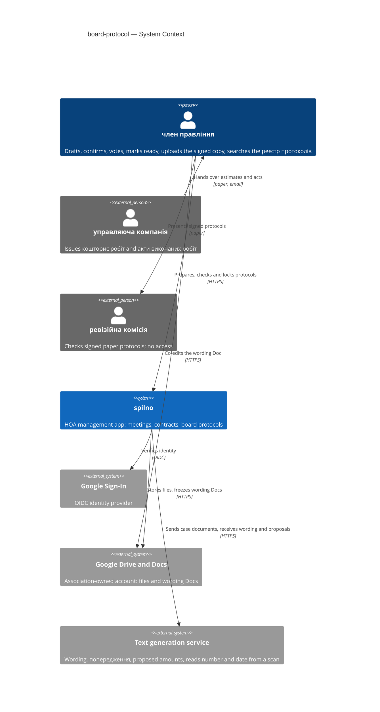

## 4. Solution strategy

**Target surface(s):** `[backend-service, web-frontend, worker]` → [ADR 0001](./adr.ao-architecture/0001-deliver-board-protocol-as-core-endpoints-spa-routes-and-a-worker-process.md).

- `backend-service` — new `governance` and `identity` endpoints in `core` (one OpenAPI contract, tags `governance`, `identity`).
- `web-frontend` — SPA routes in the existing `apps/web` (TanStack Router file routes under `src/routes/`, feature code in `src/features/governance/`). **UI architecture:** client-side SPA, as the rest of `apps/web` (repo ADR 0001); it reuses the prototype components already in `src/features/governance/` (`slot-row`, `readiness-card`, `origin-tag`, `inline-hint`, `limit-note`) and shadcn primitives, and replaces the hand-written `types.ts` with orval models. Long operations (assistant draft, scan reading) show a pending state and poll the job status with TanStack Query. The wording itself is edited in an embedded link to Google Docs (pillar 5), not in a spilno editor.
- `worker` — a new process `cmd/worker` from the same Go module, running the jobs of pillar 7.

**Strategic pillars:**

1. **Extend `governance`; `finance` only lends contracts.** Protocols, справи, board terms, правила статуту and частки будинку join the existing meetings in `governance`; `finance` provides contracts in force as джерела коштів through its `module.go`. Constraint: repo ADR 0002 (no cross-context table access) and PRD §5.1 (`governance.*` codes); a protocol is 1:1 with a meeting and every блокуюча перевірка reads meeting, roster and rules together → [ADR 0002](./adr.ao-architecture/0002-keep-protocols-cases-roster-and-charter-rules-in-the-governance-context.md).
2. **Google sign-in in a new `identity` context (Stage 0).** OIDC with Google, server-side sessions in an HTTP-only cookie, association records and invitations; `identity/module.go` gives every context the current actor (account, association). Authorization stays in `governance/app` against the board term in force on the action date (PRD §10). Constraint: PRD §8 "sign-in is a prerequisite decided in architecture"; the app has no sign-in today (§2) → [ADR 0003](./adr.ao-architecture/0003-sign-in-with-google-in-a-new-identity-context.md).
3. **Files on the association's Google Drive, hashes in Postgres.** Case documents, signed scans and printable PDFs live in a folder of one Google account owned by the association (scope `drive.file`); Postgres keeps only metadata and sha256. The folder is not shared; members open files through spilno. On lock, files get a Drive read-only content restriction; the worker checks hashes daily and restores trashed files. Constraint: PRD §6 file limits and ≥ 5-year retention; QG-1 → [ADR 0004](./adr.ao-architecture/0004-store-case-files-and-signed-scans-on-the-associations-google-drive-with-hashes-in-postgres.md).
4. **Gemini writes wording and proposes, never decides.** The paid Gemini API is called only from the worker, through a `TextGenerator` port in `governance/ports`; the worker downloads case files from Drive and sends them with the draft. Every output is stored with origin `ai`, amounts as proposed and unconfirmed. Constraint: PRD §6.1 (no training on the data → paid tier only), CONTEXT "помічник протоколу — NOT the source of any number" → [ADR 0005](./adr.ao-architecture/0005-call-gemini-through-a-governance-textgenerator-port-for-wording-and-proposals-only.md).
5. **Wording is edited in Google Docs and frozen into Postgres on every transition.** Each draft has one Google Doc in the association folder, shared as editor with the current members of the board while in чернетка; slot values sit in Docs named ranges. Marking готовий до голосування or готовий до підпису first sets the Doc read-only, then exports its text at that revision into Postgres as a numbered frozen version (the legal text), so no edit can slip in between; "edit" in spilno returns to чернетка and unlocks it. **Decision override (PRD AC-11b):** for wording, "refuse the second save of an old version" is replaced by real-time co-editing without lost changes; AC-11b stays as written for slots and agenda edits made in spilno (optimistic version). Constraint: PRD §8 OQ on hand editing (author proposed Google Docs), AC-12, AC-13, AC-17, AC-26 → [ADR 0006](./adr.ao-architecture/0006-edit-protocol-wording-in-google-docs-and-freeze-it-into-postgres-on-transition.md).
6. **Blocking checks are a pure domain function.** `governance/domain` evaluates a snapshot (frozen or current text, slots, meeting facts, board and правила статуту on the meeting date) into блокуючі перевірки and попередження with PRD §5.1 codes; nothing calls the AI. It runs on every read of a draft and its result, with the applied rule ids, is stored on the transition to готовий до підпису. Constraint: PRD §10 override table, QG-2 → [ADR 0007](./adr.ao-architecture/0007-evaluate-blocking-checks-as-a-pure-domain-function-and-snapshot-them-on-transition.md).
7. **Slow and external work goes through a Postgres job table.** `core` enqueues jobs in the same transaction as the state change (assistant draft, scan reading, PDF rendering, Doc access sync); `cmd/worker` claims them with `FOR UPDATE SKIP LOCKED`, retries with backoff and runs the daily integrity check. Synchronous Google calls stay in `core` only where the transition needs them (Doc export on freeze, Drive upload of a file). Constraint: PRD §6 (draft ≤ 30 s p95, upload ≤ 3 s for 20 MB), no broker in the stack (§2) → [ADR 0008](./adr.ao-architecture/0008-queue-ai-drive-and-pdf-work-in-a-postgres-job-table-processed-by-cmd-worker.md).
8. **Signed and withdrawn protocols are append-only, guarded twice.** `governance/app` refuses changes with `governance.protocol_locked` / `governance.transition_not_allowed`, and a Postgres trigger rejects UPDATE or DELETE on a підписаний or знятий з розгляду protocol and its children; on lock a sha256 of the canonical snapshot is stored and re-verified daily. Corrections are new protocols with a reference. Constraint: QG-1, PRD §6 Integrity and Retention, AC-30, AC-30b, AC-35 → [ADR 0009](./adr.ao-architecture/0009-guard-signed-protocols-with-a-database-trigger-and-a-snapshot-hash.md).

## 5. Building block view

Every context keeps the repo's hexagonal layout (repo ADR 0002): `domain/` (stdlib + uuid), `app/` (use cases and authorization), `ports/`, `adapters/http` (generated strict server), `adapters/postgres` (sqlc), `module.go`. The feature **extends `governance`** with protocols and everything their checks read (ADR 0002), **adds `identity`** for sign-in and the association (ADR 0003), and **touches `finance`** only to add a funding source to contracts (ADR 0012). Every governance and finance row carries `association_id` under Postgres Row-Level Security (ADR 0010). Recommended containers from repo practice, adapted: `files` is replaced by the association's Google Drive (ADR 0004), `ai` is the Gemini API (ADR 0005), `qes` is dropped (no electronic signing, PRD §3), and a `worker` process is added (ADR 0001).

**Context ownership** (fills frontmatter `contexts`):

| Context | New? | Owns (aggregates, tables) | Provides to others via module.go | Uses from others |
|---|---|---|---|---|
| `governance` | existing, extended | meeting (`meetings` + `association_id`); protocol (`protocols`, `protocol_versions`, slots and confirmations, meeting facts, `protocol_votes`, `protocol_overrides`, `protocol_check_snapshots`, `protocol_integrity_checks`); справа (`cases`, `governance_files`); board term (`board_terms`); правило статуту (`charter_rules`); частка будинку (`building_shares`); jobs (`governance_jobs`) | `Routes(r)`; `Worker()` — job handlers for `cmd/worker` | `identity`: `RequireSession`, `ActorFrom(ctx)`, `GoogleTokenSource(ctx, association)`; `finance`: `ContractsInForce(ctx, association, date)` |
| `identity` | **new** | association (`associations`: name, annual-meeting date setting, encrypted Google connection); account (`accounts`, Google subject + e-mail); `invitations`; `sessions` | `Routes(r)`; `RequireSession` middleware; `ActorFrom(ctx)` → account, association, e-mail; `GoogleTokenSource(ctx, association)` | — |
| `finance` | existing | contract (`contracts` + `association_id`, `funding_source`) | `Routes(r)`; `ContractsInForce(ctx, association, date)` with funding source and dates | `identity`: `RequireSession`, `ActorFrom(ctx)` |
| `system` | existing, unchanged | — | health | — |

Shared platform additions (not a context): `internal/platform/postgres.InAssociation(ctx, pool, association, fn)` opens a transaction and sets `app.association_id` for RLS (ADR 0010); `internal/platform/google` builds Drive and Docs clients from a token source.

**Layout of the governance additions:**

```
services/core/internal/governance/
├── domain/              meeting.go (exists), protocol.go (states, transitions), slot.go, vote.go,
│                        checks.go (Evaluate — ADR 0007), charter.go (rule in force on a date — ADR 0011),
│                        board.go, case.go, numbering.go (lowest free number — ADR 0013), errors.go (PRD §5.1)
├── app/                 one file per use case group: cases, drafts, transitions, voting, signing, registry;
│                        authorization against the board term in force on the action date (PRD §10)
├── ports/               repositories, TextGenerator (ADR 0005), Files and Docs (ADR 0004, 0006),
│                        Contracts (finance), Actor (identity)
├── adapters/http/       StrictServerInterface; problem+json with governance.* codes
├── adapters/postgres/   queries/{meetings,protocols,cases,board,charter,jobs}.sql → sqlcgen/
├── adapters/gemini/     TextGenerator on the Google Gen AI SDK
├── adapters/gdrive/     Files and Docs ports on Drive v3 and Docs v1
├── jobs/                job handlers run by cmd/worker (assistant_draft, read_signed_scan, render_pdf,
│                        sync_doc_access, verify_integrity)
└── module.go            wiring: Routes, Worker
```

**New-context wiring for `identity`** (CLAUDE.md): `identity` tag and `/identity/` paths in `services/core/api/openapi.yaml` · `internal/identity/adapters/http/gen/oapi-codegen.yaml` · `sqlc.yaml` entry · `identity-private` depguard rule in `.golangci.yml` (and the `(system|finance|governance|identity)-private` exclusion pattern) · `identity.New(pool)` in `cmd/api/main.go`, with `RequireSession` wrapped around the `governance` and `finance` groups. **New binary:** `services/core/cmd/worker/main.go` wires `governance.New(...).Worker()`; `.air.toml`/`mprocs.yaml` get a worker pane.

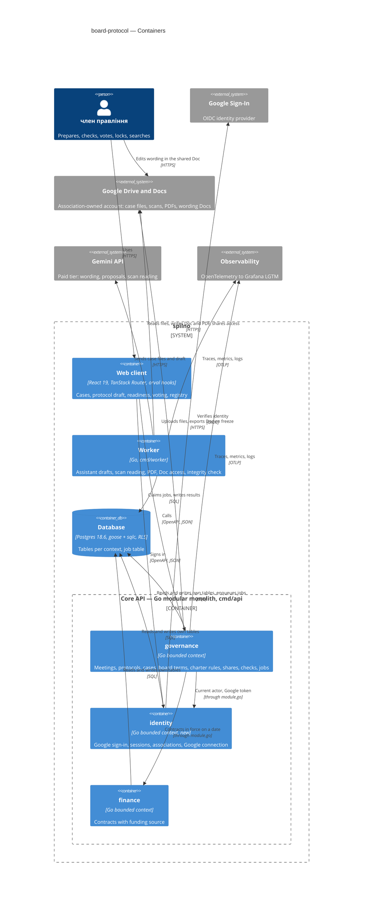

## 6. Runtime view

Seed flows, one per critical transition of PRD §10, each naming the ACs it covers. Participants are the §5 container aliases; messages are semantic (no paths or status codes — those come with `/sdlc:api-forge`). Every request runs inside `InAssociation` (ADR 0010) after `identity.RequireSession`; this is drawn once in Flow 7 and implied elsewhere. The meeting-facts entry (AC-15b, AC-15c) and the Stage 2 flows (US-10-US-12) are left to `/sdlc:complete-sequence-diagrams`.

**Flow 1: Draft through the помічник (none → чернетка) — covers AC-03, AC-04, AC-05, AC-06**

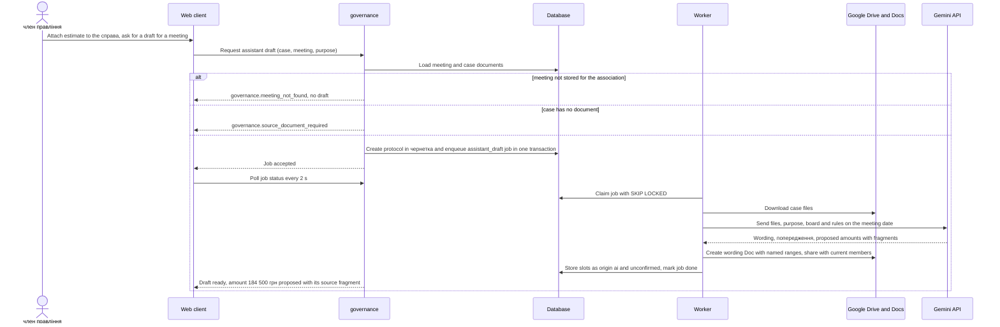

**Flow 2: Freeze for the попереднє голосування and vote (чернетка → готовий до голосування) — covers AC-12, AC-13, AC-14, AC-15, AC-16, AC-18**

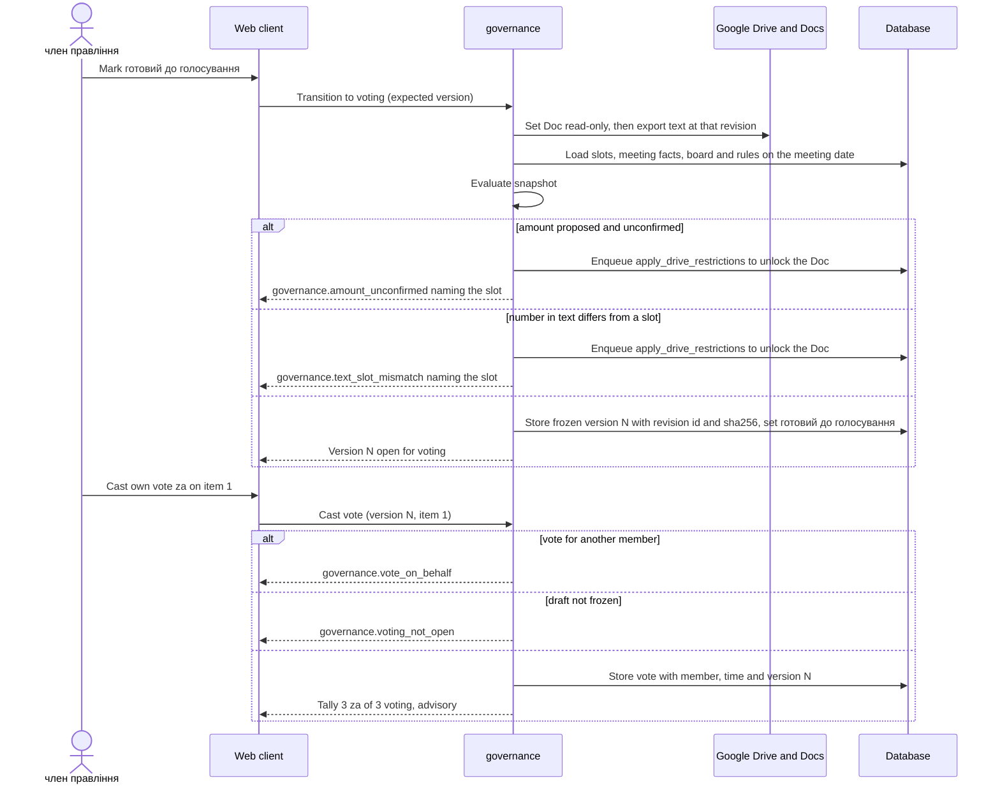

**Flow 3: Mark готовий до підпису with an override (чернетка or готовий до голосування → готовий до підпису) — covers AC-06, AC-09, AC-19, AC-19b, AC-19c, AC-20, AC-21, AC-21b, AC-23, AC-24, AC-25, AC-25b, AC-27**

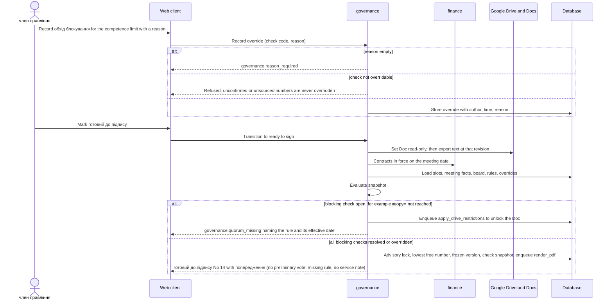

**Flow 4: An edit returns the draft to чернетка (готовий до голосування or готовий до підпису → чернетка) — covers AC-17, AC-26**

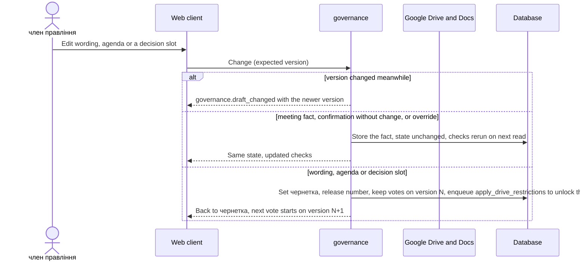

**Flow 5: Upload the signed copy and lock (готовий до підпису → підписаний) — covers AC-28, AC-28b, AC-29, AC-31**

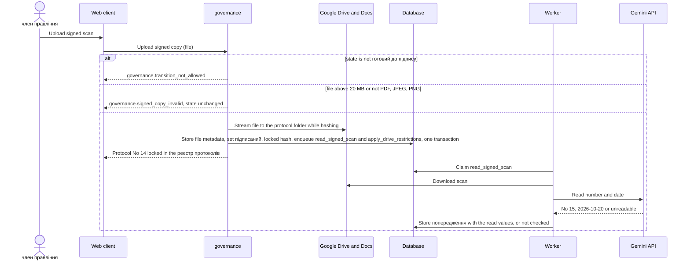

**Flow 6: A change to a locked protocol is refused (підписаний or знятий з розгляду → any) — covers AC-30, AC-30b, AC-35**

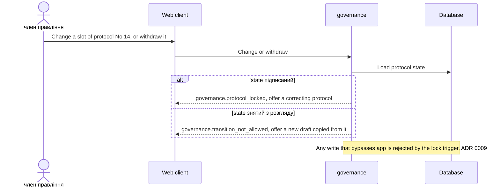

**Flow 7: Access outside the term or the association is refused — covers AC-32, AC-33**

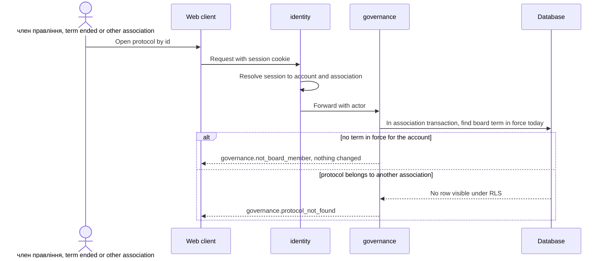

**Flow 8: Google services fail — covers PRD §6 availability and the draft target; Flow 1, 2, 3, 5 branches**

Rule: a step that needs Drive or Docs **before** the state can change (set the Doc read-only and export it on freeze, upload of a file) runs before the database transaction; a Doc locked for a transition that is then refused is unlocked by a retried job; if it fails, nothing is committed and the member gets `governance.storage_unavailable` (an addition to PRD §5.1, see §8 and §11). Drive-side effects **after** a committed change (read-only restrictions, Doc sharing, PDF, scan reading) are jobs with retries, so a Google outage delays them but never undoes a state.

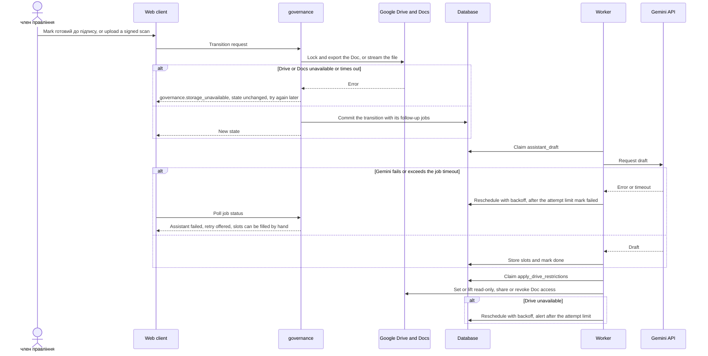

**Flow 9: Withdraw a draft (чернетка, готовий до голосування or готовий до підпису → знятий з розгляду) — covers AC-34, AC-34b, AC-34c, AC-30b**

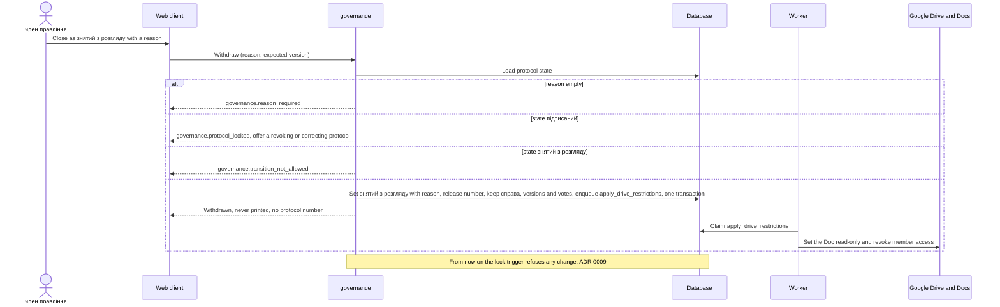

## 7. Deployment view

**Topology** → [ADR 0014](./adr.ao-architecture/0014-run-core-worker-and-postgres-on-one-vm-with-docker-compose.md). One VM runs a production compose file next to `infra/compose.yaml`: `caddy` (TLS, serves the built `apps/web` bundle, proxies `/api/*` to `core`), `core` (`cmd/api`, 1 replica), `worker` (`cmd/worker`, 1 replica, same image, different command), `postgres:18.6`, `otel-lgtm`. Load is ~13 associations × ~20 protocols a year (PRD §8 Reach), far below the ≥ 50 req/s read target per instance; a second worker replica is safe at any time (`SKIP LOCKED`), a second `core` replica needs only the session table, which is already in Postgres.

**External dependencies:** Google Sign-In, Google Drive and Docs (association-owned account), Gemini API (paid tier). One Google Cloud project holds the OAuth client (sign-in and Drive/Docs scopes) and the Gemini API key; secrets (OAuth client secret, Gemini key, token-encryption key, database passwords for `spilno_owner` and `spilno_app`) come from an env file readable only by root on the VM.

**Data and backup:** Postgres is dumped nightly (`pg_dump`, encrypted) to storage outside the VM, which gives RPO ≤ 24 h; restore onto a fresh VM from compose + dump fits RTO ≤ 4 h and is drilled quarterly (PRD §6). Files are **not** copied out of Google Drive: their protection is the read-only restriction, the daily hash check and `untrash` within Drive's 30-day trash window (ADR 0004); a permanent deletion is detected but not recoverable — accepted debt in §11.

| Signal | Source | Alert |
|---|---|---|
| Request duration p95 per route | `otelhttp` histogram (existing) | read > 200 ms, write > 500 ms, upload > 3 s, PDF route > 5 s for 15 min |
| Assistant draft time, request to filled draft | job `assistant_draft` duration | p95 > 30 s over a day |
| Job queue age and failures per kind | `governance_jobs` gauge from the worker | oldest due job > 10 min; any job `failed` |
| Integrity mismatches | `protocol_integrity_checks` | any mismatch, trashed or missing locked file |
| Google API errors | Drive, Docs, Gemini client spans | error rate > 5 % for 15 min |
| Uptime | external check on the `system` health endpoint | below 99.5 % monthly budget |
| Backup | nightly dump job exit code and size | missing or failed dump |

## 8. Crosscutting concepts

| Concept | Convention for this feature | Where defined |
|---|---|---|
| Errors | RFC 9457 problem+json; `type` carries the PRD §5.1 code `<context>.<error_name>`. Kind → status: validation 422, not_found 404, invariant 409, conflict 409, authorization 403. Added beyond PRD §5.1: `governance.storage_unavailable` (503, Drive or Docs down before a transition, §6 Flow 8), `identity.session_required` (401), `identity.invitation_required` (403, Google account not invited to the association) | `internal/platform/httpapi`, PRD §5.1, §11 |
| Authorization | PRD §10 roles × actions in `governance/app`: the actor's board term must be in force on the date of the action; who may vote, who counts as present and the кворум use the board on the meeting date; "own vote only" compares the vote's member with the actor. `finance` and `identity` routes require a session in the association | PRD §10, ADR 0003 |
| Association scope | `association_id` on every governance and finance row; RLS with `app.association_id` set by `platform/postgres.InAssociation`; another association's id answers not found | ADR 0010 |
| Validation | OpenAPI request validator → 422 with field pointers; domain `Validate()` reports every broken field at once (as `meetings` and `contracts` do) | CLAUDE.md, repo ADR 0003 |
| IDs | UUID (`gen_random_uuid()` / `github.com/google/uuid`) | repo convention |
| Money and shares | Amounts as `bigint` kopiyky (`amount_cents`, as in `contracts`); частки будинку in basis points; per-building amounts split with the largest-remainder method so they sum to the confirmed amount (AC-07: 107 010 + 77 490 = 184 500 грн); amounts in words rendered from the integer | PRD AC-07 |
| Dates and time | Meeting date, term dates and `effective_from` are calendar dates in Europe/Kyiv; "in force on D" compares dates, never timestamps; audit times are `timestamptz` | ADR 0011 |
| Audit trail | Every slot confirmation or correction, wording freeze, vote, meeting-fact entry and override is its own append-only row with actor and time; the proposed value stays in history (AC-06b) | ADR 0006, 0007, 0009 |
| Concurrency | Protocol rows carry `version int`; changes made in spilno send the expected version and get `governance.draft_changed` on a mismatch (AC-11b for slots, agenda and meeting facts); wording concurrency is Google Docs co-editing | ADR 0006 |
| Lifecycle | PRD §10 states and transitions in `governance/domain/protocol.go`; withdrawal from чернетка, готовий до голосування or готовий до підпису needs a reason, releases the number and is final (§6 Flow 9, AC-34-AC-35) | PRD §10, ADR 0013 |
| Immutability | `app/` check + trigger on signed and withdrawn protocols, append-only rule tables, `locked_hash` verified daily | ADR 0009, 0011 |
| Migrations | goose, one directory `services/core/migrations/`; triggers, RLS policies and role grants inside `-- +goose StatementBegin/End`; `cmd/api` applies pending migrations on start (repo ADR 0004) over a separate short-lived connection as `spilno_owner`, then serves through a pool as `spilno_app` | repo ADR 0004, ADR 0010 |
| Files | Drive of the association account, `drive.file` scope; ≤ 20 MB, PDF / JPEG / PNG checked by content sniffing, not by extension; sha256 at upload; downloads streamed through `core` | ADR 0004, PRD §6 |
| Secrets | Env file on the VM; the association's Google refresh token encrypted with AES-GCM under a key from the environment | ADR 0003, 0014 |
| Personal data in logs | `slog` attributes carry ids only — never document text, names, reasons for неучасть у голосуванні or Gemini prompts and responses | PRD §6.1 |
| Observability | OTel spans per request and per job; the job payload carries the trace context so a request and its job share one trace; request-duration histogram per route; job metrics from the worker (§7) | repo ADR 0001, ADR 0008 |
| i18n | UI and printable protocol in Ukrainian; error messages from PRD §5.1 verbatim | PRD §5.1 |
| Stored data below the ADR gate | The protocol aggregate and справа tables are listed in ADR 0002 (Migration); frozen versions in ADR 0006; check snapshots and overrides in ADR 0007; lock hash and integrity checks in ADR 0009; identity tables in ADR 0003; jobs in ADR 0008 — no further data shape is decided outside an ADR | blast-radius rule |

## 9. Architecture decisions

| # | Decision | Status | Section | Blast radius (I / C / A / D) |
|---|---|---|---|---|
| [0001](./adr.ao-architecture/0001-deliver-board-protocol-as-core-endpoints-spa-routes-and-a-worker-process.md) | Deliver board-protocol as core endpoints, SPA routes in apps/web and a separate worker process | accepted | §4 | ✓ / ✓ / ✓ / – |
| [0002](./adr.ao-architecture/0002-keep-protocols-cases-roster-and-charter-rules-in-the-governance-context.md) | Keep protocols, cases, the board roster and charter rules in the governance context | accepted | §4 | ✓ / ✓ / ✓ / ✓ |
| [0003](./adr.ao-architecture/0003-sign-in-with-google-in-a-new-identity-context.md) | Sign in with Google in a new identity context | accepted | §4 | ✓ / ✓ / ✓ / ✓ |
| [0004](./adr.ao-architecture/0004-store-case-files-and-signed-scans-on-the-associations-google-drive-with-hashes-in-postgres.md) | Store case files and signed scans on the association's Google Drive with hashes in Postgres | accepted | §4 | ✓ / ✓ / ✓ / ✓ |
| [0005](./adr.ao-architecture/0005-call-gemini-through-a-governance-textgenerator-port-for-wording-and-proposals-only.md) | Call Gemini through a governance TextGenerator port for wording and proposals only | accepted | §4 | – / ✓ / ✓ / – |
| [0006](./adr.ao-architecture/0006-edit-protocol-wording-in-google-docs-and-freeze-it-into-postgres-on-transition.md) | Edit protocol wording in Google Docs and freeze it into Postgres on every transition | accepted | §4 | ✓ / ✓ / ✓ / ✓ |
| [0007](./adr.ao-architecture/0007-evaluate-blocking-checks-as-a-pure-domain-function-and-snapshot-them-on-transition.md) | Evaluate blocking checks as a pure domain function and snapshot them on transition | accepted | §4 | – / – / ✓ / ✓ |
| [0008](./adr.ao-architecture/0008-queue-ai-drive-and-pdf-work-in-a-postgres-job-table-processed-by-cmd-worker.md) | Queue AI, Drive and PDF work in a Postgres job table processed by cmd/worker | accepted | §4 | ✓ / ✓ / ✓ / ✓ |
| [0009](./adr.ao-architecture/0009-guard-signed-protocols-with-a-database-trigger-and-a-snapshot-hash.md) | Guard signed and withdrawn protocols with a database trigger and a snapshot hash | accepted | §4 | ✓ / – / ✓ / ✓ |
| [0010](./adr.ao-architecture/0010-scope-every-governance-and-finance-row-to-an-association-with-row-level-security.md) | Scope every governance and finance row to an association with Row-Level Security and backfill existing rows to the first one | accepted | §5 | ✓ / ✓ / ✓ / ✓ |
| [0011](./adr.ao-architecture/0011-keep-charter-rules-board-terms-and-building-shares-as-append-only-effective-dated-rows.md) | Keep charter rules, board terms and building shares as append-only effective-dated rows | accepted | §5 | ✓ / – / ✓ / ✓ |
| [0012](./adr.ao-architecture/0012-add-a-funding-source-to-finance-contracts-and-read-contracts-in-force-through-finance-module.md) | Add a funding source to finance contracts and read contracts in force through finance module.go | accepted | §5 | – / ✓ / ✓ / ✓ |
| [0013](./adr.ao-architecture/0013-reserve-the-lowest-free-protocol-number-per-association-on-ready-to-sign.md) | Reserve the lowest free protocol number per association on ready to sign | accepted | §5 | ✓ / – / ✓ / ✓ |
| [0014](./adr.ao-architecture/0014-run-core-worker-and-postgres-on-one-vm-with-docker-compose.md) | Run core, worker and Postgres on one VM with docker compose | accepted | §7 | – / ✓ / ✓ / ✓ |

I = irreversible, C = multi-context, A = legitimate alternative, D = touches the database (references/blast-radius-heuristic.md). ADR files: `docs/features/board-protocol/adr.ao-architecture/NNNN-<decision>.md`. Repo-level ADRs stay in `docs/adr/`; none is superseded. ADR 0014 is a candidate for promotion to repo ADR 0005 (hosting applies to every feature).

## 10. Quality requirements

Numbers are copied verbatim from PRD §6; where PRD §6 has no number (QG-2, QG-3) the scenario is verified against the PRD acceptance criteria instead of an invented threshold.

**QG-1. Integrity of signed protocols** (§1 goal 1)
- **When:** any change to a підписаний or знятий з розгляду protocol or its children is attempted — through `app/` or as raw SQL under `spilno_app` — and when the daily `verify_integrity` job runs.
- **Then:** "a signed protocol changes only through a new referencing protocol; 0 mismatches between printed numbers and confirmed slots" (PRD §6 Integrity); signed and withdrawn protocols "kept ≥ 5 years, never hard-deleted" (PRD §6 Retention).
- **How verify:** `testdb.New(t)` integration tests `TestLockTrigger_<table>` issuing UPDATE and DELETE per child table under `spilno_app`; `app` tests for AC-30, AC-30b, AC-35 expecting `governance.protocol_locked` / `governance.transition_not_allowed`; a render test that extracts every number from the PDF of a frozen version and compares it with the confirmed slots; metric `governance_integrity_mismatches_total` stays 0 (alert on any increment, §7).

**QG-2. Traceability and rule accuracy** (§1 goal 2)
- **When:** a draft for a meeting held on date D is evaluated, with правила статуту and board terms recorded before and after D.
- **Then:** кворум, кворум пункту, majority, competence limit and meeting form are taken from the rule in force on D and give the results stated in AC-02, AC-19, AC-19b, AC-19c, AC-20, AC-21, AC-21b; every amount, counterparty and джерело коштів in a готовий до підпису draft has a справа document and a person's confirmation (AC-06, AC-09).
- **How verify:** table-driven unit tests of `domain.Evaluate` with one case per AC above; a regression fixture of the association's past paper protocols, recounted by hand by the голова правління (§11 action), run in `mise run test`; PRD §7 KPI "AI-proposed amounts corrected by a person" logged per protocol from slot history.

**QG-3. Confidentiality within one association** (§1 goal 3)
- **When:** a member of association B, or a person whose board term ended, opens, edits or uploads to a protocol or справа of association A.
- **Then:** the answer is "not found" for B without revealing existence (AC-33), refusal for the ended term (AC-32), and nothing changes.
- **How verify:** an integration test generated from `openapi.yaml` that calls every `governance` and `finance` operation as a member of a second association and expects 404 or 403; an RLS test that runs a query without the `association_id` filter and expects zero foreign rows; the security review required by PRD §6.1 before Stage 1 release.

**QG-4. Responsiveness** (additional)
- **When:** a member works with one association's records at normal load.
- **Then:** read or list p95 ≤ 200 ms; write without file p95 ≤ 500 ms; upload of a signed scan ≤ 3 s for 20 MB; printable protocol generation ≤ 5 s p95; draft from the помічник протоколу ≤ 30 s p95 from request to filled draft; ≥ 50 req/s per instance on the read path (PRD §6).
- **How verify:** `http.server.request.duration` histogram per route in Grafana with the §7 alerts; `assistant_draft` job duration from enqueue to done; a k6 load smoke test in CI on the read routes.

**QG-5. Availability and durability** (additional)
- **When:** the VM, Postgres or a Google service fails, or data must be restored.
- **Then:** availability 99.5 % monthly; RPO ≤ 24 h, RTO ≤ 4 h; files ≤ 20 MB per file, PDF / JPEG / PNG (PRD §6). For files on Google Drive the recovery point is Google's (accepted debt, §11).
- **How verify:** external uptime check on the `system` health endpoint; nightly dump job status; quarterly restore drill onto a fresh VM timed against 4 h; upload validation tests for size and type (AC-29).

## 11. Risks and technical debt

| Risk / debt | Severity | Mitigation | Owner |
|---|---|---|---|
| A file of a locked protocol is permanently deleted on the association's Google Drive, or the account is locked; no copy outside Google (§7, ADR 0004, 0014) | High | Read-only restriction on lock, daily sha256 check, `untrash` within 30 days, alert on a missing file; the association account's password and 2-step verification held by two members; the signed paper original is kept as today | голова правління |
| Case documents with personal data leave the hosting for Gemini; a free-tier key would allow training on them (PRD §6.1, ADR 0005) | Medium | Billing-enabled Google Cloud project checked at deploy; key only in the VM env file; send only the справа documents the draft needs; no prompts or responses in logs | Tech lead |
| Upload of a 20 MB scan now includes the Drive upload and may exceed 3 s p95 (PRD §6, ADR 0004) | Medium | Measure the upload route from the first release; if over target, switch to a Drive resumable upload started by `core` and finished by the browser | Andrii Opryshko |
| One VM is a single point of failure for 99.5 % monthly (ADR 0014) | Medium | Compose + nightly dump restore drilled quarterly within 4 h; uptime alert; move to managed hosting if the budget is missed twice | Andrii Opryshko |
| Two SADs for this feature on one branch: `sad.md` + `adr/` from `sdlc:architecture-design` and this file + `adr.ao-architecture/`, with different decisions; parallel sessions also mixed each other's files into commits (brownfield drift) | Medium | Pick the canonical SAD before `/sdlc:break-tasks` and point downstream skills at it; run parallel skill sessions in separate worktrees | Andrii Opryshko |
| PRD AC-11b overridden for wording (ADR 0006, §4 pillar 5) | Medium | Update AC-11b in the PRD: co-editing without lost changes for wording; refusal of stale versions for slots, agenda and meeting facts; before `/sdlc:break-tasks` | Andrii Opryshko |
| PRD §6 Retention and Durability overridden for files: they live only on Google Drive (§1 Decision overrides) | Medium | Update PRD §6: RPO for files is Google's, the signed paper original is the legal copy; before `/sdlc:break-tasks` | Andrii Opryshko |
| Three error codes added beyond PRD §5.1: `governance.storage_unavailable`, `identity.session_required`, `identity.invitation_required` (§8) | Low | Add them to PRD §5.1 before `/sdlc:api-forge` | Andrii Opryshko |
| Doc access is revoked by a worker job, so a member whose term ended can still edit a draft Doc until the next cycle (ADR 0006) | Low | `sync_doc_access` enqueued on every board-term change and daily; the frozen text in Postgres is what counts | Andrii Opryshko |
| A член правління without a Google account cannot sign in (ADR 0003) | Low | The association creates a Google account for that member; revisit the emailed link option if it recurs | голова правління |
| RLS: a query outside `InAssociation` sees no rows — safe, but shows up as "not found" bugs (ADR 0010) | Low | Lint rule or review checklist: repositories take a transaction from `InAssociation`; integration tests run as `spilno_app` | Andrii Opryshko |
| Existing `meetings` and `contracts` have no association; backfill to the first association (repo scan, ADR 0010) | Low | Backfill in the migration, confirmed by a член правління at setup; test on a copy of the dev database | Andrii Opryshko |
| Regression fixture for QG-2 needs past protocols recounted by hand (§10) | Low | Recount 3-5 past paper protocols (кворум, majority, limit) as fixtures; before `/sdlc:plan-tests` | голова правління |
| Open question (PRD §8): which meeting forms the charter allows and which clause | Open question | Resolve before Stage 1 release; until recorded as a правило статуту the check warns (AC-21b) | голова правління |
| Open question (PRD §8): is the 100 000 грн limit per protocol, per job or per estimate | Open question | Resolve before `/sdlc:break-tasks` (PRD due "before architecture" passed); default per decision line, splitting is a Stage 2 warning (AC-40) | голова правління |
| Open question (PRD §8): on a 4-member board, is "3 votes for" the кворум, the majority or both | Open question | Resolve before Stage 1 release; default two separate правила статуту, кворум 3 and majority 3 | голова правління |
| Open question (PRD §8): at what overrun of the act over the approved amount is a new decision needed | Open question | Resolve before Stage 2; default any overrun keeps the line open with a warning (AC-42) | голова правління + accountant |
| Open question (PRD §8): will the management company hand over acts and statements per expense line | Open question | Resolve before Stage 2; default attached by a член правління | Andrii Opryshko |
| Open question (PRD §8): time the next 2-3 protocols to replace the estimated KPI baselines | Open question | Resolve before Stage 1 release | Andrii Opryshko |
| Open question (PRD §8): confirm Reach, 13 associations at about 20 protocols each | Open question | Resolve before roadmap scoring; §7 sizing assumes it | Andrii Opryshko |

PRD §8 questions closed by this SAD: sign-in (ADR 0003), association scope (ADR 0010), personal data to the text-generation service (ADR 0005, paid tier), where the wording is edited (ADR 0006), джерело коштів as a contract field and contract in force (ADR 0012, both questions), reading number and date from the scan (ADR 0005, best effort, "не перевірено" when unreadable).

**Accepted debt:** files of locked protocols live only on Google Drive (no copy outside Google); Files API copies of case documents stay on Google's side up to 48 h; backups and restores of the VM are scripts owned by one developer; Doc access revocation lags by one worker cycle.

## 12. Glossary

Domain terms are defined in [CONTEXT.md](./CONTEXT.md) `## Glossary`; this table lists the ones this SAD relies on, in one line each, plus the technical terms of this design. Terms marked *(new)* are not in CONTEXT.md yet and go there through `/sdlc:fix-term` after this pass.

| Term | Meaning |
|---|---|
| блокуюча перевірка | Deterministic check that stops готовий до підпису; some are lifted by an обхід блокування, unconfirmed or unsourced numbers and text-slot mismatch never (CONTEXT, PRD §10) |
| попередження | Advisory notice with a source; never stops printing (CONTEXT) |
| обхід блокування | A член правління's recorded override of a блокуюча перевірка with a mandatory reason (CONTEXT) |
| слот рішення | Typed field of a decision with its value, origin and confirming document (CONTEXT) |
| справа | Bundle of source documents a decision is based on; one per agenda item (CONTEXT, PRD §9) |
| правило статуту | Charter parameter kept as data with the date it takes effect (CONTEXT, ADR 0011) |
| попереднє голосування | Advisory per-member vote on one frozen version of the wording (CONTEXT) |
| готовий до голосування / готовий до підпису / підписаний / знятий з розгляду | States of a protocol (CONTEXT, PRD §10) |
| реєстр протоколів | The association's searchable record of locked and withdrawn protocols (CONTEXT) |
| помічник протоколу | The conversation that drafts wording and proposes amounts; never the source of a number (CONTEXT, ADR 0005) |
| кворум, кворум пункту | Presence needed for the meeting, and for one agenda item (CONTEXT) |
| член правління, головуючий, голова правління | Board member with a term; per-meeting chair (a slot); the elected chair position (CONTEXT) |
| association (ОСББ) *(new)* | The housing association that owns all records; the scope of every governance and finance row (ADR 0010) |
| association Google account *(new)* | One Google account owned by the association, not by a person; holds the Drive folder with case files, scans, PDFs and wording Docs (ADR 0004) |
| протокол-виправлення *(new)* | A new protocol that references a signed one to correct or revoke it; the only way a signed decision changes (AC-30, ADR 0009) |
| frozen version | The Doc text exported into Postgres with its revision id and sha256 on готовий до голосування or готовий до підпису; the legal text (ADR 0006) |
| named range | A Google Docs marker around a slot value in the wording, used to keep text and slot equal (ADR 0006) |
| check snapshot | The list of блокуючі перевірки, попередження and applied rule ids stored on готовий до підпису (ADR 0007) |
| locked hash | sha256 of the canonical snapshot of a signed protocol, re-verified daily (ADR 0009) |
| job | A row in `governance_jobs` processed by `cmd/worker` with retries (ADR 0008) |
| RLS | Postgres Row-Level Security: policies that hide rows of other associations (ADR 0010) |
| `InAssociation` | Platform helper that runs a transaction with `app.association_id` set for RLS (ADR 0010) |
| OIDC | OpenID Connect, the "sign in with Google" protocol (ADR 0003) |
| `drive.file` | Google OAuth scope giving access only to files the app created (ADR 0004) |
