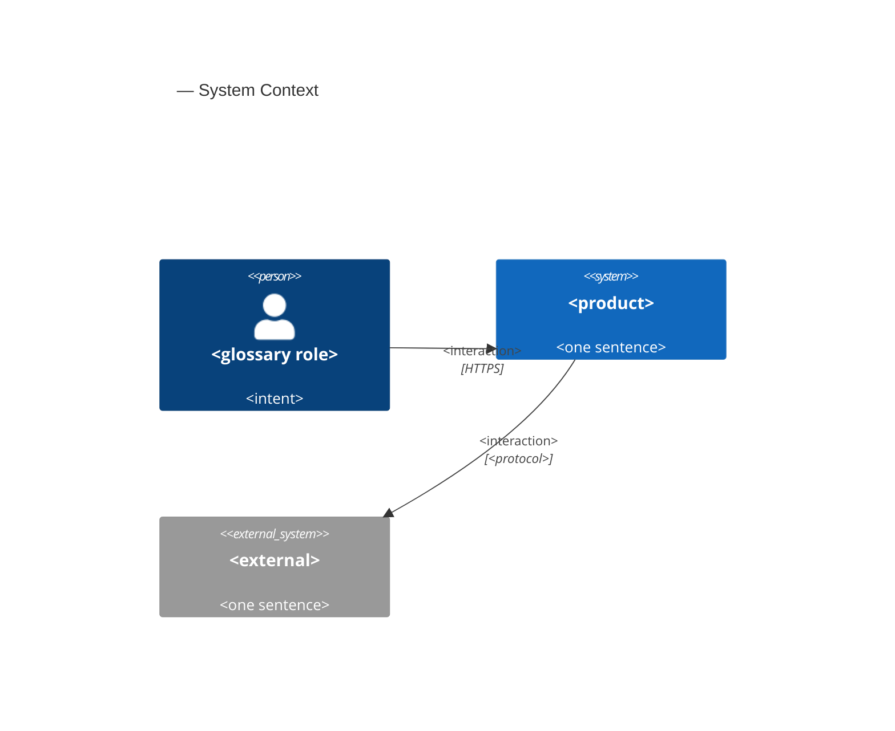
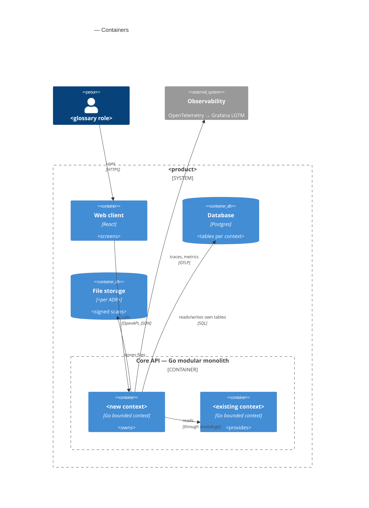
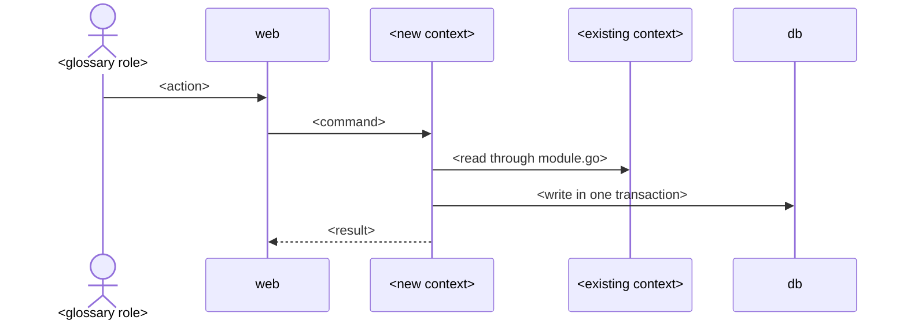

# Software Architecture Document — board-protocol

<!-- ao-architecture: Arc42 12 sections, C4 L1 in §3, C4 L2 in §5. N/A sections carry
     <!-- N/A: <reason> -->. Numbers in §10 come verbatim from PRD §6.
     Inputs: PRD.md (§5.1 / §9 / §10 when written by ao-prd), CONTEXT.md, docs/adr/, CLAUDE.md,
     references/repo-practice.md. -->

> **Inputs:** [PRD](./PRD.ao-prd.md) · [CONTEXT](./CONTEXT.md) · repo ADRs [`docs/adr/`](../../adr/) · reference contexts `services/core/internal/governance`, `services/core/internal/finance`

## 1. Introduction and goals

**Intent.** board-protocol lets a член правління turn a кошторис робіт into a printable протокол правління in one sitting. The protocol is assembled from typed слоти рішення: an amount, counterparty or джерело коштів reaches print only with a document of the справа and a person's confirmation, and кворум, кворум пункту, majority, the competence limit and the allowed meeting form are computed from the board in force and the правила статуту in force on the meeting date. The помічник протоколу writes wording and попередження and proposes amounts, but is never the source of a number. Попереднє голосування is advisory; printing is gated on блокуючі перевірки, some of which a member may lift with an обхід блокування and a reason. Uploading the signed scan locks the protocol in the реєстр протоколів with its справа, votes and overrides; a draft that is not signed is closed as знятий з розгляду and kept (PRD §1-§2, §10).

**Top-3 quality goals** (full scenarios in §10):

1. **Integrity of signed protocols** — a підписаний protocol changes only through a new protocol that references it; 0 mismatches between printed numbers and confirmed slots (PRD §6 Integrity, AC-30, AC-30b).
2. **Traceability and rule accuracy** — every number shows its справа document and the person who confirmed it; кворум, majority and the competence limit are computed from the rule in force on the meeting date (PRD §2, AC-02, AC-09, AC-19).
3. **Confidentiality within one association** — only a член правління with a term in force acts on or reads the association's records; to anyone from another association a protocol is "not found" (PRD §6.1, AC-32, AC-33).

Latency, durability (RPO ≤ 24 h, RTO ≤ 4 h) and availability (99.5 %) from PRD §6 are additional scenarios in §10; they yield to the three goals above when they conflict.

**Stakeholders.**

| Role (glossary) | Interest | Sign-off? |
|---|---|---|
| член правління | Keeps the board and правила статуту, drafts with the помічник протоколу, confirms slots, casts own попереднє голосування, overrides, marks ready, uploads the signed copy, withdraws, searches the реєстр протоколів | No |
| головуючий | Chairs the meeting and signs the paper protocol; a slot of the protocol, not a separate permission (PRD §1 ¶4) | No |
| голова правління | Answers the charter open questions (meeting forms, competence limit, кворум vs majority) | No |
| ревізійна комісія | Checks spending against protocols at the annual meeting; no access in this feature (PRD §3) | No |
| управляюча компанія | Issues the кошторис робіт and акт виконаних робіт held in a справа; no access | No |
| співвласник | Receives printed protocols as today; no access | No |
| Tech lead | SAD and ADR approval; security review (PRD §6.1) | Yes |

## 2. Constraints

**Technical** (versions from `mise.toml`, `go.mod`, `package.json`, `infra/compose.yaml`):
- <Go x.y, chi, oapi-codegen strict server, sqlc + pgx, goose>
- <Postgres x>
- <React x, TanStack Router, shadcn/ui, generated TS client>

**Repo ADRs that bind this feature:**
- <0001 stack> · <0002 bounded contexts> · <0003 spec-first codegen> · <0004 migrations and queries>

**Conventions** (`CLAUDE.md`): one OpenAPI contract, one tag per context, paths `/<context>/`;
contexts import each other only through `module.go`; problem+json errors; `r.Group`, never
`r.Mount`; generated files are never edited.

**Organisational:** <effort, deadline, team — from PRD or TBD with a §11 row>

**Regulatory / legal:** <personal data of co-owners, record retention, signature law — from PRD §6.1 and brief §18>

## 3. Context and scope

<2-3 sentences: what the system does for the association and where its trust boundary is>

| Actor or system | Type | Interaction |
|---|---|---|
| <glossary role> | Person | <...> |
| <text generation service> | System (external) | <wording only> |



## 4. Solution strategy

**Target surface(s):** `<[backend-service, web-frontend]>`

**Strategic pillars** (each one seeds ADRs; cite a §2 constraint or a past incident/limitation):

1. **<e.g. New `protocols` context, governance stays the owner of meetings>** — <2-3 sentences; constraint: repo ADR 0002>.
2. **<e.g. Signed records are immutable; corrections are new records>** — <2-3 sentences; PRD §10>.
3. **<e.g. Deterministic checks in Go, AI writes wording only>** — <2-3 sentences; brief §16>.
4. **<UI architecture: SPA route under apps/web reusing shadcn components>** — <per UI surface>.

## 5. Building block view

<one paragraph: hexagonal per context, why the feature extends or adds a context>

**Context ownership** (fills frontmatter `contexts`):

| Context | New? | Owns (aggregates, tables) | Provides to others via module.go | Uses from others |
|---|---|---|---|---|
| <protocols> | new | <protocol, agenda item, vote> | <...> | <governance: meetings, roster> |
| <governance> | existing | <meeting, board term> | <meeting by id, roster on date> | — |

**Layout of the new context:**

```
services/core/internal/<bc>/
├── domain/              <entities, sentinel errors; stdlib only>
├── app/                 <use cases; authorization against the board term on the action date>
├── ports/               <repositories, other contexts' ports>
├── adapters/http/       <StrictServerInterface; problem+json>
├── adapters/postgres/   <queries/ → sqlcgen/>
└── module.go            <wiring>
```

New-context wiring (CLAUDE.md): spec tag · `adapters/http/gen/oapi-codegen.yaml` · `sqlc.yaml` entry ·
`<bc>-private` depguard rule · `cmd/api/main.go`.



## 6. Runtime view

<!-- Seed the primary flows here; complete-sequence-diagrams adds the rest. Participants are §5
     container aliases. Messages are semantic — no HTTP verbs, paths or status codes.
     With an ao-prd PRD: one flow per critical §10 transition (e.g. mark ready, sign and lock,
     refused edit after lock) and name the PRD AC each flow covers. -->

**Flow 1: <happy path> — covers AC-<NN>**



**Flow 2: <refused transition / failure mode> — covers AC-<NN>**

## 7. Deployment view

<!-- Usually N/A for a feature inside the core process: <!-- N/A: reuses the core deployment unit -->
     plus one line of scaling numbers. Fill when the feature adds a process, a queue or storage. -->

<topology; storage for files; backup and restore numbers from PRD §6>

## 8. Crosscutting concepts

| Concept | Convention for this feature | Where defined |
|---|---|---|
| Errors | problem+json; codes from PRD §5.1 (`<context>.<error_name>`) | `internal/platform/httpapi`, PRD §5.1 |
| Authorization | <roles × actions from PRD §10, checked in `app/`> | PRD §10 |
| Validation | OpenAPI validator (422) + domain `Validate()` | CLAUDE.md |
| IDs | UUID | repo convention |
| Migrations | goose; <what this feature migrates, link ADR> | ADR 0004 |
| Audit / immutability | <how locked records are protected> | ADR <NNNN> |
| Files | <where scans live, size limit from PRD §6> | ADR <NNNN> |
| Observability | OTel spans + request-duration histogram | repo convention |
| i18n | UI in Ukrainian | — |

## 9. Architecture decisions

| # | Decision | Status | Section | Blast radius (I / C / A / D) |
|---|---|---|---|---|
| <NNNN> | <decision as a sentence> | accepted | §<N> | <✓ / – / ✓ / ✓> |

ADR files: `docs/features/<slug>/adr/NNNN-<decision>.md`. Repo-level ADRs stay in `docs/adr/`.

## 10. Quality requirements

**QG-1. <quality>**
- **When:** <trigger>
- **Then:** <PRD §6 number verbatim>
- **How verify:** <testdb integration test / Playwright e2e / k6 / OTel metric name>

**QG-2. <quality>** — <...>

**QG-3. <quality>** — <...>

## 11. Risks and technical debt

| Risk / debt | Severity | Mitigation | Owner |
|---|---|---|---|
| <migration of existing records (PRD §9)> | <Low/Medium/High> | <...> | <...> |
| Open architectural decision: <headline> | Open question | Resolve before <stage or date>; <reason> | <owner> |

**Accepted debt:** <...>

## 12. Glossary

<!-- Terms from CONTEXT.md used in this SAD + technical terms of this feature. New domain terms go
     to CONTEXT.md first. -->

| Term | Meaning |
|---|---|
| <term> | <meaning> |
