# Software Architecture Document — board-protocol

<!-- ao-architecture: Arc42 12 sections, C4 L1 in §3, C4 L2 in §5. N/A sections carry
     <!-- N/A: <reason> -->. Numbers in §10 come verbatim from PRD §6.
     Inputs: PRD.md (§5.1 / §9 / §10 when written by ao-prd), CONTEXT.md, docs/adr/, CLAUDE.md,
     references/repo-practice.md.
     Realigned 2026-10-25 to the rescoped Stage 1 of PRD.ao-prd.md (draft → informal poll →
     print → signed scan); superseded and deferred ADRs are listed in §9. -->

> **Inputs:** [PRD](./PRD.ao-prd.md) · [CONTEXT](./CONTEXT.md) · repo ADRs [`docs/adr/`](../../adr/) · reference context `services/core/internal/governance`

## 1. Introduction and goals

**Intent.** Stage 1 of board-protocol is the помічник протоколу's draft and the keeping of the document until it is signed. A член правління picks a meeting, attaches case documents to the справа of an agenda item and asks the помічник for a draft; the помічник writes the wording and proposes amounts and other values, each with a visible link to the document it came from. Any current член правління edits the text in spilno (чернетка). The board may run an informal попереднє голосування on the current text (готовий до голосування), labelled as not the meeting's vote; any edit or «повернути в чернетку» ends the round. Rendering the PDF print copy reserves the protocol number (готовий до підпису) and is refused while any value the помічник proposed is unconfirmed — the one Stage 1 gate. The board signs on paper; uploading the signed scan with the meeting facts written on it locks the protocol (підписаний). A draft that will not be signed is closed as знятий з розгляду with a reason. Blocking checks and overrides, the finance cross-check, reading the scan with AI and the audit export are Stage 2 (PRD §1, §3, §10).

**Top-3 quality goals** (full scenarios in §10):

1. **Integrity of signed protocols** — a підписаний protocol changes only through a new referencing protocol; 0 changes to its text, meeting facts or scan after lock (PRD §6 Integrity, AC-30, AC-30b).
2. **Traceability of numbers and an informal poll** — every value the помічник proposed shows its source document and who confirmed it, no unconfirmed value reaches the print copy, and the poll never passes for the meeting's vote (PRD §2, AC-06, AC-06b, AC-46).
3. **Confidentiality of the association's records** — only a член правління with a term in force acts on or reads them; an identifier not stored for the association answers "not found" (PRD §6.1, AC-32, AC-33).

Latency, durability (RPO ≤ 24 h, RTO ≤ 4 h) and availability (99.5 %) from PRD §6 are additional scenarios in §10; they yield to the three goals above when they conflict.

**Stakeholders.**

| Role (glossary) | Interest | Sign-off? |
|---|---|---|
| член правління | Keeps the board and association settings, drafts with the помічник протоколу, confirms values, edits text, casts own попереднє голосування, renders the print copy, uploads the signed copy with the meeting facts, withdraws, searches the реєстр протоколів | No |
| головуючий | Chairs the meeting and signs the paper protocol; a slot of the protocol, not a separate permission (PRD §1) | No |
| голова правління | Answers the charter open questions (meeting form for the settings, Stage 2 rules) | No |
| ревізійна комісія | Checks spending against protocols at the annual meeting; no access in this feature (PRD §3) | No |
| управляюча компанія | Issues the кошторис робіт held in a справа; no access | No |
| співвласник | Receives printed protocols as today; no access | No |
| Tech lead | SAD and ADR approval; security review (PRD §6.1) | Yes |

**Decision overrides** (resolved in the Step 7 critic):

- Decision override: PRD §6 Retention and Durability for files — files of locked protocols rely on the association's Google Drive (read-only restriction, nightly sha256 check against Drive metadata, `untrash`); RPO for files is Google's and the signed paper original is the legal copy outside Google (ADR 0004, 0014, §11).

## 2. Constraints

**Technical** (versions from `mise.toml`, `services/core/go.mod`, `apps/web/package.json`, `infra/compose.yaml`):
- Go 1.27.3, chi v5, oapi-codegen v2.8 strict server, sqlc + pgx/v5, otelpgx, goose (repo ADR 0001, 0003, 0004).
- Postgres 18.6 (`postgres:18.6-alpine`), one database for the whole `core` module.
- React 19.3, TypeScript 6.0.3, Vite 8, Tailwind 4.3, shadcn/ui, TanStack Router 1.170 + Query 5.104, orval-generated hooks.
- Observability: OpenTelemetry → `grafana/otel-lgtm` 0.37 (traces, metrics, logs via `otelslog`).

**Repo ADRs that bind this feature:** [0001 Stack](../../adr/0001-stack.md) · [0002 Bounded contexts](../../adr/0002-bounded-contexts.md) · [0003 Spec-first codegen](../../adr/0003-spec-first-codegen.md) · [0004 Migrations and queries](../../adr/0004-migrations-and-queries.md). None is superseded by this feature.

**Starting point of the repo** (scan 2026-10-25): contexts `system`, `finance` (contracts) and `governance` (meetings: kind, held date, optional end and location, `quorum_required`); no sign-in, no association, no file storage, no outbound HTTP client, no background jobs, one binary `cmd/api`. Migrations live in one directory `services/core/migrations/` (`0000N_*.sql`), not per context; tables use CHECK constraints and the shared `set_updated_at` trigger.

**Conventions** (`CLAUDE.md`): one OpenAPI contract, one tag per context, paths `/<context>/`; contexts import each other only through `module.go` (depguard `<bc>-private`); `domain/` imports only stdlib and uuid; problem+json errors; `r.Group`, never `r.Mount`; generated files are never edited; integration tests on `testdb.New(t)`.

**Organisational:** one developer; rollout Stage 0 (sign-in, the association record) → Stage 1 (US-01–US-09 without the ACs deferred to Stage 2) → Stage 2 (deferred ACs, US-10–US-12) (PRD §9). There is no fixed project deadline: the date of the association's annual general meeting, which the KPI "100 % of 2027 spending decisions" is measured against, is kept with the association record (Stage 0).

**Regulatory / legal** (PRD §6.1, §6, §3):
- Data class Confidential: names and terms of board members, signatures on scans, co-owners' names and apartment numbers in case documents, handwritten-correction notes (personal data under the Law of Ukraine "On Personal Data Protection").
- Signed and withdrawn protocols, print copies and scans kept ≥ 5 years and never hard-deleted.
- The binding signature is on paper; no electronic signing; the in-system poll is informal and is not the meeting's vote (PRD §3, AC-46).
- Case documents go to a text-generation service only under an agreement that excludes training on the data.
- Case documents, signed scans (with signatures) and print copies are stored on the Google Drive of an association-owned account (ADR 0004); Google is a processor of these personal data, and the app's access is limited to files it created (`drive.file`). Nothing in the folder is shared with members' accounts.
- Security review required before Stage 1 release (first feature with authorization, personal data and an external AI service).

## 3. Context and scope

spilno is the association's own record of board protocols: a член правління drafts a протокол правління with the помічник протоколу from the documents of each справа, confirms what it proposed, edits the text, polls the board informally, prints, and files the signed scan with the meeting facts in the реєстр протоколів. The trust boundary is the association: everything inside spilno is visible only to members of the board with a term in force; data leaves it to three Google services — sign-in identity checks (Google Sign-In), every file and the print template on the association's own Google Drive account, and case-document content sent to the Gemini text-generation service — plus printed paper protocols that people carry out by hand.

| Actor or system | Type | Interaction |
|---|---|---|
| член правління | Person | Uses spilno for every protocol action; also acts as головуючий of a meeting (a slot, not a role in the system) |
| управляюча компанія | Person (external) | Hands over кошторис робіт and other documents; a член правління attaches them to a справа. No access |
| ревізійна комісія | Person (external) | Checks signed paper protocols at the annual meeting. No access in this feature (PRD §3) |
| співвласник | Person (external) | Receives printed protocols as today. No access |
| Google Sign-In | System (external) | Verifies who a член правління is (OIDC); spilno keeps the session |
| Google Drive and Docs | System (external) | Holds case files, signed scans, print copies and the print template in the association-owned account; renders the PDF from the template |
| Text generation service | System (external) | Receives case documents and the request; returns wording and proposed values with their source fragments. Never the source of a confirmed number |

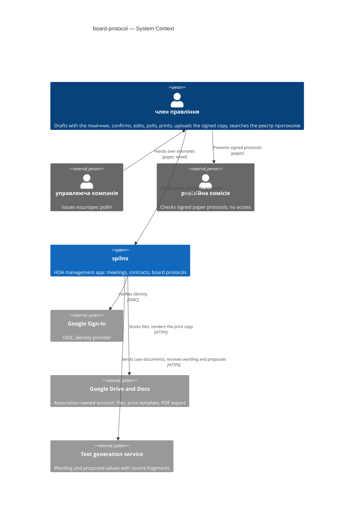

## 4. Solution strategy

**Target surface(s):** `[backend-service, web-frontend, worker]` → [ADR 0001](./adr.ao-architecture/0001-deliver-board-protocol-as-core-endpoints-spa-routes-and-a-worker-process.md).

- `backend-service` — new `governance` and `identity` endpoints in `core` (one OpenAPI contract, tags `governance`, `identity`).
- `web-frontend` — SPA routes in the existing `apps/web` (TanStack Router file routes under `src/routes/`, feature code in `src/features/governance/`). **UI architecture:** client-side SPA, as the rest of `apps/web` (repo ADR 0001); it reuses the prototype components in `src/features/governance/` (`slot-row`, `origin-tag`, `inline-hint`, readiness card narrowed to "every proposed value confirmed") and shadcn primitives, and replaces the hand-written `types.ts` with orval models. The wording is edited in a structured text field with slot chips (ADR 0017). Long operations (assistant draft, print copy) show a pending state and poll the job state with TanStack Query.
- `worker` — a new process `cmd/worker` from the same Go module, running the River jobs of pillar 7.

**Strategic pillars:**

1. **Extend `governance`; `finance` is untouched in Stage 1.** Protocols, справи, board terms, association settings and частки будинку join the existing meetings in `governance`. A contract is only a document of a справа in Stage 1; reading contracts in force through `finance/module.go` comes with AC-10 in Stage 2 ([ADR 0012](./adr.ao-architecture/0012-add-a-funding-source-to-finance-contracts-and-read-contracts-in-force-through-finance-module.md), deferred). Constraint: repo ADR 0002, PRD §5.1 `governance.*` codes, protocol 1:1 with a meeting → [ADR 0002](./adr.ao-architecture/0002-keep-protocols-cases-roster-and-charter-rules-in-the-governance-context.md).
2. **Google sign-in in a new `identity` context (Stage 0).** OIDC with Google, server-side sessions in an HTTP-only cookie, the association record and invitations; `identity/module.go` gives `governance` the current actor. Authorization stays in `governance/app` against the board term in force on the action date (PRD §10). Constraint: PRD §8 sign-in OQ → [ADR 0003](./adr.ao-architecture/0003-sign-in-with-google-in-a-new-identity-context.md).
3. **Files on the association's Google Drive, sha256 and Drive revision in Postgres.** Case documents, signed scans and print copies live in a folder of one association-owned Google account (scope `drive.file`); Postgres keeps metadata, the Drive revision at upload and sha256. The folder is shared with nobody; members open files through spilno. On lock or withdrawal files get a Drive read-only restriction; the nightly integrity check compares sha256 with Drive metadata, without downloading. Constraint: PRD §6 file limits and retention, QG-1 → [ADR 0004](./adr.ao-architecture/0004-store-case-files-and-signed-scans-on-the-associations-google-drive-with-hashes-in-postgres.md).
4. **Gemini writes wording and proposes, never decides.** The paid Gemini API is called only from the worker, through a `TextGenerator` port; a depguard rule keeps the Gemini SDK inside `governance/adapters/gemini`. Every proposed value is stored with origin `ai`, unconfirmed, with its source document and fragment. Constraint: PRD §6.1, CONTEXT "помічник протоколу" → [ADR 0005](./adr.ao-architecture/0005-call-gemini-through-a-governance-textgenerator-port-for-wording-and-proposals-only.md).
5. **Text is fragments with slot placeholders, edited in spilno with a revision number.** Plain text fragments plus references to slots and meeting facts; every save sends the expected revision and a stale one is refused (`governance.draft_changed`, AC-11b); every accepted change is an append-only revision with its author (AC-11). A poll round and a print copy each reference one revision; any change while готовий до голосування or готовий до підпису returns to чернетка (AC-17, AC-26). Constraint: PRD §8 closed OQ "edited in spilno" → [ADR 0017](./adr.ao-architecture/0017-store-protocol-text-as-fragments-with-slot-placeholders-edited-in-spilno.md), superseding ADR 0006.
6. **The print copy is rendered from a pinned Google Docs template in a job; the number is reserved on first render and never reused.** Constraint: AC-25, AC-26, AC-34c, AC-45, PRD §6 print-copy rendering → [ADR 0018](./adr.ao-architecture/0018-render-the-print-copy-from-a-pinned-google-docs-template-in-a-worker-job.md), [ADR 0021](./adr.ao-architecture/0021-reserve-the-protocol-number-on-the-first-print-copy-and-never-reuse-it.md), superseding ADR 0013.
7. **Slow and external work runs in `cmd/worker` on River.** `core` enqueues in the same transaction as the state change (`assistant_draft`, `render_pdf`, `apply_drive_restrictions`); the worker also runs the periodic `verify_integrity`. Payloads carry ids and the trace context only; handlers are idempotent. Synchronous Google calls stay in `core` only for a file upload. Constraint: PRD §6 (draft ≤ 30 s p95, print copy ≤ 5 s p95), no broker (§2) → [ADR 0015](./adr.ao-architecture/0015-run-background-jobs-in-cmd-worker-with-river-on-postgres.md), superseding ADR 0008.
8. **A locked or withdrawn protocol is one fingerprinted snapshot row.** Lock is refused without the meeting facts (`governance.meeting_facts_required`, AC-47); the snapshot (jsonb with `schema_version`) and its sha256 fingerprint are written in the lock transaction; a trigger refuses UPDATE and DELETE on the snapshot table and another refuses DELETE of any protocol in any state. Constraint: QG-1, PRD §6 Integrity and Retention, AC-30, AC-30b, AC-35 → [ADR 0019](./adr.ao-architecture/0019-lock-a-protocol-as-one-fingerprinted-snapshot-row-guarded-by-a-trigger.md), superseding ADR 0009.
9. **No blocking checks in Stage 1.** The only transition guard on content is "every value the помічник proposed is confirmed or corrected" before готовий до підпису (AC-06); the pure check function and overrides wait for Stage 2 ([ADR 0007](./adr.ao-architecture/0007-evaluate-blocking-checks-as-a-pure-domain-function-and-snapshot-them-on-transition.md), deferred). Settings are current values, not effective-dated rules → [ADR 0020](./adr.ao-architecture/0020-keep-board-terms-and-building-shares-as-dated-rows-and-charter-rules-as-current-settings.md), superseding ADR 0011.

## 5. Building block view

Every context keeps the repo's hexagonal layout (repo ADR 0002): `domain/` (stdlib + uuid), `app/` (use cases and authorization), `ports/`, `adapters/http` (generated strict server), `adapters/postgres` (sqlc), `module.go`. The feature **extends `governance`** with protocols and what they read (ADR 0002) and **adds `identity`** for sign-in and the association (ADR 0003); `finance` and `system` are unchanged. Every governance row carries `association_id`, and every query filters on it explicitly — one association, no Row-Level Security in Stage 1 ([ADR 0016](./adr.ao-architecture/0016-scope-governance-rows-to-the-single-association-with-an-explicit-filter-in-every-query.md), superseding ADR 0010). Recommended containers from repo practice, adapted: `files` is the association's Google Drive (ADR 0004), `ai` is the Gemini API (ADR 0005), `qes` is dropped (no electronic signing, PRD §3), and a `worker` process is added (ADR 0001).

**Context ownership** (fills frontmatter `contexts`):

| Context | New? | Owns (aggregates, tables) | Provides to others via module.go | Uses from others |
|---|---|---|---|---|
| `governance` | existing, extended | meeting (`meetings` + `association_id`); protocol (`protocols`, `protocol_items`, `protocol_revisions`, `protocol_slots`, `slot_confirmations`, `poll_rounds`, `protocol_votes`, `print_copies`, `protocol_meeting_facts`, `protocol_snapshots`, `protocol_integrity_checks`, `protocol_number_counters`); справа (`cases`, `case_documents`, `governance_files`); board term (`board_terms`); частка будинку (`building_shares`); association settings (`association_settings`) | `Routes(r)`; `RegisterWorkers(workers)` and `PeriodicJobs()` for `cmd/worker` | `identity`: `RequireSession`, `ActorFrom(ctx)`, `GoogleTokenSource(ctx, association)` |
| `identity` | **new** | association (`associations`: name, annual-meeting date, encrypted Google connection); account (`accounts`, Google subject + e-mail); `invitations`; `sessions` | `Routes(r)`; `RequireSession` middleware; `ActorFrom(ctx)` → account, association, e-mail; `GoogleTokenSource(ctx, association)` | — |
| `finance` | existing, untouched in Stage 1 | contract (`contracts`) | `Routes(r)` | — (its route group is wrapped in `RequireSession` by `cmd/api`, no code change in the context) |
| `system` | existing, unchanged | — | health (stays public) | — |

**Internal decomposition** (ported from the other SAD's §5, adapted to two contexts):

```
services/core/
├── cmd/api/main.go            + identity.New(...); RequireSession around every context group except system
├── cmd/worker/main.go         NEW — River client in work mode; registers governance.RegisterWorkers and PeriodicJobs
├── internal/governance/       EXTENDED
│   ├── domain/                meeting.go (exists) · protocol.go (states, transitions, the AC-06 print guard)
│   │                          text.go (fragments + validator — ADR 0017) · slot.go · poll.go · meeting_facts.go
│   │                          board.go · shares.go (largest-remainder split) · settings.go · snapshot.go (canonical form,
│   │                          fingerprint — ADR 0019) · numbering.go (ADR 0021) · errors.go (PRD §5.1)
│   ├── app/                   settings · board · cases · drafts · revisions · poll · printing · signing · withdrawal · registry;
│   │                          authorization against the board term in force on the action date (PRD §10)
│   ├── ports/                 repositories · TextGenerator (ADR 0005) · Files (ADR 0004) · Renderer (ADR 0018) · Actor · Jobs
│   ├── adapters/http/         StrictServerInterface (+gen/); problem+json with governance.* codes
│   ├── adapters/postgres/     queries/{meetings,protocols,poll,cases,board,settings,snapshots}.sql → sqlcgen/
│   ├── adapters/gemini/       TextGenerator on the Google Gen AI SDK — the only importer (depguard gemini-sdk)
│   ├── adapters/gdrive/       Files on Drive v3 (upload, stream, metadata sha256Checksum, readOnly restriction, untrash)
│   ├── adapters/gdocs/        Renderer: copy pinned template, batchUpdate, export PDF (ADR 0018)
│   ├── jobs/                  River workers: assistant_draft · render_pdf · apply_drive_restrictions · verify_integrity (periodic)
│   └── module.go              Routes · RegisterWorkers · PeriodicJobs · enqueue helpers used inside app transactions
├── internal/identity/         NEW — OIDC flow, sessions, invitations, association record, encrypted Google refresh token
├── internal/platform/
│   ├── jobs/                  NEW — River client from the shared pgx pool: insert-only for api, insert + work for worker
│   ├── google/                NEW — Drive and Docs clients from an oauth2 token source
│   └── httpapi/               + problem+json for identity.session_required / identity.invitation_required
└── migrations/                identity · governance protocol tables · meetings.association_id backfill · River schema · triggers
apps/web/src/
├── routes/                    sign-in · settings (board, shares, association settings) · cases · protocols/$id (draft, poll, print, upload) · registry
└── features/governance/       grows from the prototype: text editor with slot chips, slot rows, poll panel, meeting-facts form
```

**Context and process interactions** (ported from the other SAD's From→To table; all in-process calls through `module.go`, no shared tables):

| From → To | Why | Shape |
|---|---|---|
| `cmd/api` → identity | Every protected request needs a session (Stage 0) | `RequireSession` middleware around the `governance` and `finance` groups |
| governance → identity | Who acts, for which association (AC-32, AC-33) | `ActorFrom(ctx)` query |
| governance → identity | Token for the association's Google account (Drive, Docs) | `GoogleTokenSource(ctx, association)` |
| governance (in `cmd/api`) → worker | Slow or external work after a committed change | River job inserted in the caller's transaction (ADR 0015) |
| worker → governance | Run the job with the context's own code and tables | handlers registered from `governance/module.go` |
| governance → finance | none in Stage 1 | `ContractsInForce` with AC-10 in Stage 2 (ADR 0012, deferred) |

**New-context wiring for `identity`** (CLAUDE.md): `identity` tag and `/identity/` paths in `services/core/api/openapi.yaml` · `internal/identity/adapters/http/gen/oapi-codegen.yaml` · `sqlc.yaml` entry · `identity-private` depguard rule in `.golangci.yml` (and the `(system|finance|governance|identity)-private` exclusion pattern) · `identity.New(pool)` in `cmd/api/main.go`. **Extra depguard rule:** `gemini-sdk` — `google.golang.org/genai` allowed only in `internal/governance/adapters/gemini/**` (ADR 0005). **New binary:** `services/core/cmd/worker/main.go`; `.air.toml`/`mprocs.yaml` get a worker pane.

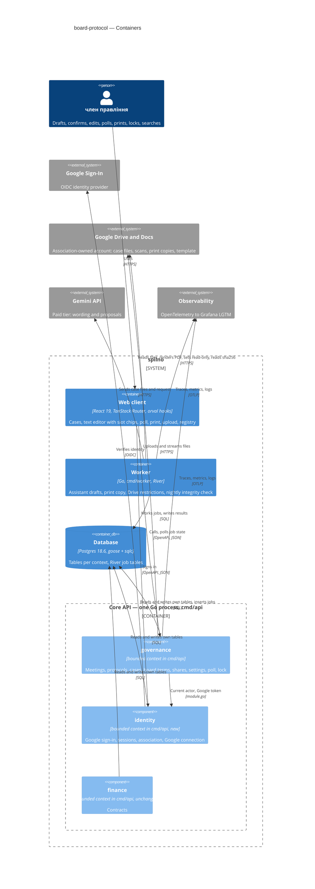

The three bounded contexts are components of the single `cmd/api` process, not separately deployed containers; `cmd/worker` is the second process built from the same module.

## 6. Runtime view

One flow per Stage 1 transition of PRD §10, each naming the PRD.ao-prd.md ACs it covers, plus the nightly integrity check and the Google-failure rules. Participants are the §5 aliases; messages are semantic (no paths or status codes — those come with `/sdlc:api-forge`). Every request passes `identity.RequireSession` and the board-term check (drawn once in Flow 10) and every query carries the association id (ADR 0016). Searching the реєстр протоколів (AC-36) is a paginated read (§8) and has no flow.

**Flow 1: Draft through the помічник (none → чернетка) — covers AC-03, AC-04, AC-05, AC-06, AC-08, AC-45**

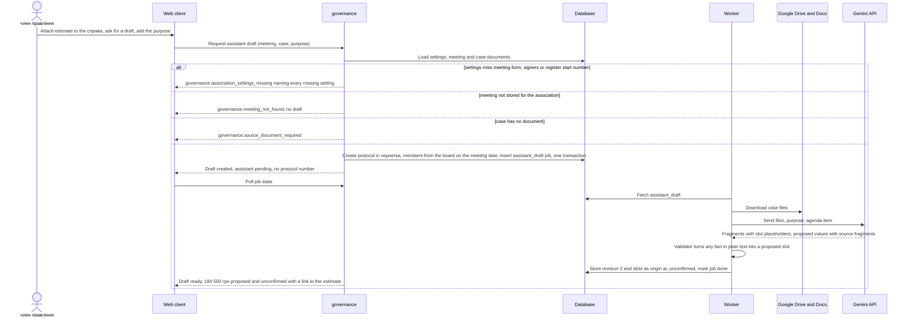

**Flow 2: Confirm and edit in чернетка (чернетка → чернетка) — covers AC-06b, AC-07, AC-11, AC-11b, AC-43**

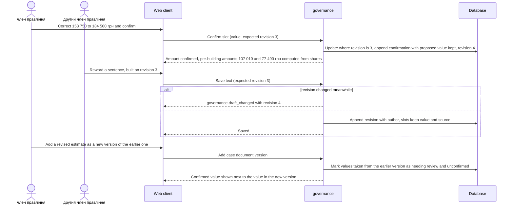

**Flow 3: Start the informal poll and vote (чернетка → готовий до голосування) — covers AC-13, AC-15, AC-16, AC-18, AC-46**

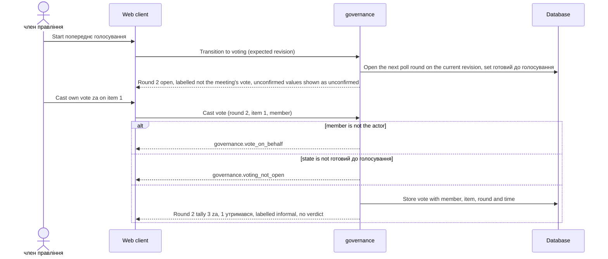

**Flow 4: A change returns the protocol to чернетка (готовий до голосування or готовий до підпису → чернетка) — covers AC-17, AC-26, AC-43**

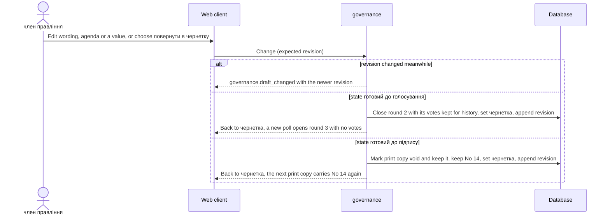

**Flow 5: Render the print copy (чернетка or готовий до голосування → готовий до підпису) — covers AC-06, AC-25, AC-25b, AC-26, AC-45, AC-46**

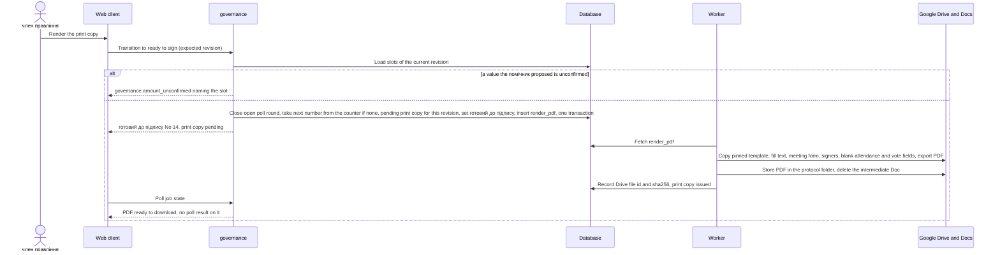

**Flow 6: Upload the signed scan with the meeting facts and lock (готовий до підпису → підписаний) — covers AC-28, AC-29, AC-31, AC-44, AC-47**

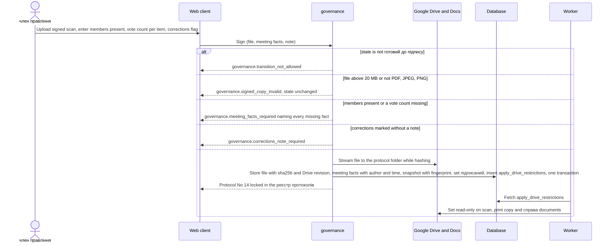

**Flow 7: Withdraw (чернетка, готовий до голосування or готовий до підпису → знятий з розгляду) — covers AC-34, AC-34b, AC-34c, AC-30b**

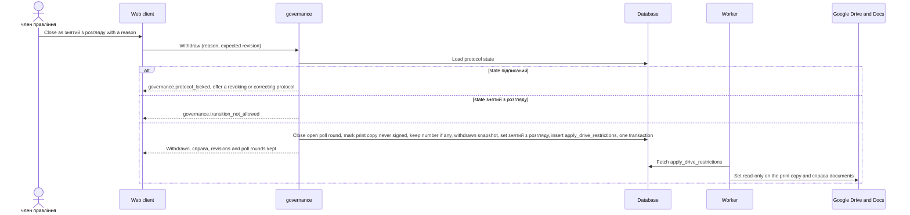

**Flow 8: A change to a final protocol is refused (підписаний or знятий з розгляду → any) — covers AC-30, AC-35**

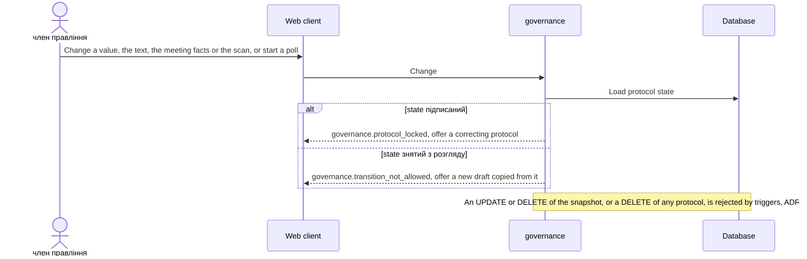

**Flow 9: Nightly integrity check (worker, periodic) — covers PRD §6 Integrity; QG-1** (ported from the other SAD; sha256 via Drive metadata, no download)

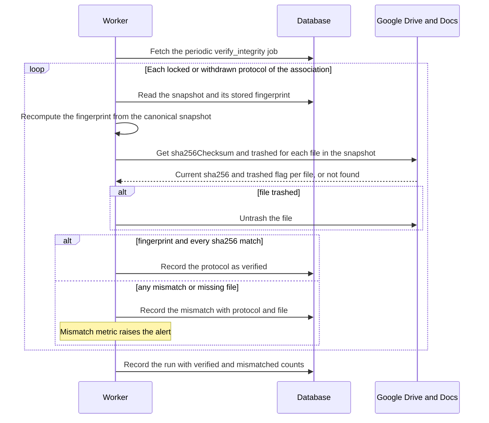

**Flow 10: Access outside the term or the association is refused — covers AC-32, AC-33**

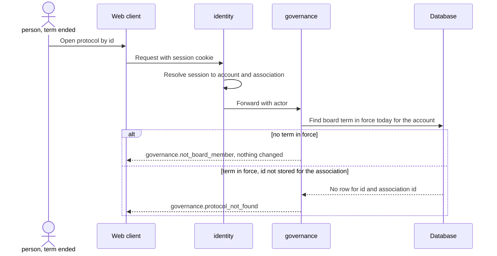

**Flow 11: Google services fail — covers PRD §6 availability and the draft target; Flow 1, 5, 6, 7 branches**

Rule: the only Drive call **before** a state change is the file upload (case document, signed scan); if it fails, nothing is committed and the member gets `governance.storage_unavailable` (an addition to PRD §5.1, see §8 and §11). Everything **after** a committed change — assistant draft, print copy, read-only restrictions, the nightly check — is a River job with retries, so a Google outage delays it but never undoes a state.

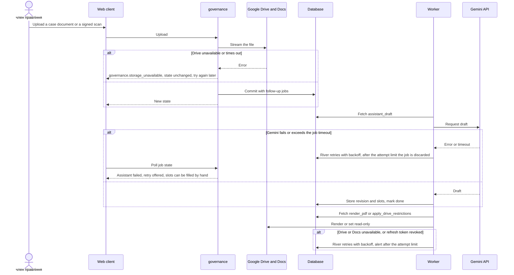

## 7. Deployment view

**Topology** → [ADR 0014](./adr.ao-architecture/0014-run-core-worker-and-postgres-on-one-vm-with-docker-compose.md). One VM runs a production compose file next to `infra/compose.yaml`: `caddy` (TLS, serves the built `apps/web` bundle, proxies `/api/*` to `core`), `core` (`cmd/api`, 1 replica), `worker` (`cmd/worker`, 1 replica, same image, different command, started after `core` is healthy so River's schema exists), `postgres:18.6`, `otel-lgtm`. Load is ~13 associations × ~20 protocols a year (PRD §8 Reach) and one association in Stage 1; a second worker replica is safe at any time (River), a second `core` replica needs only the session table, which is already in Postgres.

**External dependencies:** Google Sign-In, Google Drive and Docs (association-owned account), Gemini API (paid tier). One Google Cloud project holds the OAuth client (sign-in and Drive/Docs scopes) and the Gemini API key; secrets (OAuth client secret, Gemini key, token-encryption key, database password) come from an env file readable only by root on the VM.

**Data and backup:** Postgres is dumped nightly (`pg_dump`, encrypted) to storage outside the VM, which gives RPO ≤ 24 h; restore onto a fresh VM from compose + dump fits RTO ≤ 4 h and is drilled quarterly (PRD §6, ADR 0014). Files are **not** copied out of Google Drive: their protection is the read-only restriction, the nightly sha256 check against Drive metadata and `untrash` within Drive's 30-day trash window (ADR 0004); a permanent deletion is detected but not recoverable — accepted debt in §11.

| Signal | Source | Alert |
|---|---|---|
| Request duration p95 per route | `otelhttp` histogram (existing) | read > 200 ms, write > 500 ms, upload > 3 s for 15 min |
| Print copy latency, enqueue to issued | River job `render_pdf` duration | p95 > 5 s over a day |
| Assistant draft time, request to filled draft | River job `assistant_draft` duration | p95 > 30 s over a day |
| Job failures and queue age per kind | River job states from the worker | oldest available job > 10 min; any job discarded |
| Integrity mismatches | `protocol_integrity_checks` | any mismatch, trashed or missing locked file; no successful nightly run in 26 h |
| Google API errors | Drive, Docs, Gemini client spans | error rate > 5 % for 15 min; any authorization error (refresh token revoked) |
| Uptime | external check on the `system` health endpoint | below 99.5 % monthly budget |
| Backup | nightly dump job exit code and size | missing or failed dump |

## 8. Crosscutting concepts

| Concept | Convention for this feature | Where defined |
|---|---|---|
| Errors | RFC 9457 problem+json; `type` carries the PRD §5.1 code `<context>.<error_name>`. Kind → status: validation 422, not_found 404, invariant 409, conflict 409, authorization 403. Added beyond PRD §5.1: `governance.storage_unavailable` (503, Drive down during an upload, §6 Flow 11), `governance.register_start_locked` (409, start number changed after a number was issued, ADR 0021), `identity.session_required` (401), `identity.invitation_required` (403, Google account not invited). A withdrawal without a reason is a 422 from the OpenAPI validator (`minLength: 1`) | `internal/platform/httpapi`, PRD §5.1, §11 |
| Authorization | PRD §10 roles × actions in `governance/app`: the actor's board term must be in force on the date of the action; who may vote is the board in force on that date; members shown in a draft come from the board on the meeting date; "own vote only" compares the vote's member with the actor (AC-16). `finance` routes require a session; `system` health stays public | PRD §10, ADR 0003, 0020 |
| Association scope | One association. `association_id` on every governance row; every sqlc query filters on it and every lookup by id is `id + association_id`, so an unknown id answers not found (AC-33). A test fails when a statement in `governance/adapters/postgres/queries/*.sql` on a governance table does not mention `association_id`. No Row-Level Security in Stage 1 (§11 accepted debt) | ADR 0016 |
| Validation | OpenAPI request validator → 422 with field pointers; domain `Validate()` reports every broken field at once (as `meetings` and `contracts` do); AC-45 and AC-47 name every missing setting or fact at once | CLAUDE.md, repo ADR 0003 |
| IDs | UUID (`gen_random_uuid()` / `github.com/google/uuid`); the protocol number is a separate per-association counter (ADR 0021) | repo convention |
| Money and shares | Amounts as `bigint` kopiyky (`amount_cents`, as in `contracts`); частки будинку in basis points; per-building amounts split with the largest-remainder method so they sum to the confirmed amount (AC-07: 107 010 + 77 490 = 184 500 грн); amounts in words rendered from the integer by one renderer for screen and print copy | PRD AC-07, ADR 0017 |
| Dates and time | Meeting date and term dates are calendar dates in Europe/Kyiv; "in force on D" compares dates, never timestamps; audit times are `timestamptz` | ADR 0020 |
| Text | Fragments with slot and meeting-fact placeholders; the validator makes a fact in generated plain text a proposed slot; for hand-typed text it only highlights (AC-12 is Stage 2) | ADR 0017 |
| Concurrency | `protocols.revision`; every change sends the expected revision and gets `governance.draft_changed` on a mismatch (AC-11b) — for text, slots, agenda and transitions alike | ADR 0017 |
| Lifecycle | PRD §10 states and transitions in `governance/domain/protocol.go`. The one content guard: готовий до підпису is refused while a value with origin `ai` is unconfirmed (`governance.amount_unconfirmed`, AC-06). Any change in готовий до голосування or готовий до підпису returns to чернетка (AC-17, AC-26). Lock needs the meeting facts (AC-47). Withdrawal from any non-final state needs a reason and is final (AC-34–AC-35). No blocking checks or overrides (ADR 0007 deferred) | PRD §10, ADR 0019, 0021 |
| Informal poll | Poll rounds reference a revision; votes are per member, item and round; closed rounds are history, never counted; tallies carry the AC-46 label, never appear on the print copy and never pre-fill the meeting facts | PRD AC-13–AC-18, AC-46 |
| Audit trail | Every revision, slot confirmation or correction, vote, meeting-fact entry, settings change, board-term or share row is its own append-only row with actor and time; the proposed value stays in history (AC-06b) | ADR 0017, 0019, 0020 |
| Immutability | `app/` check + one snapshot row per final protocol under a trigger; DELETE of any protocol refused by a trigger; board terms and shares append-only under a trigger | ADR 0019, 0020 |
| Migrations | goose, one directory `services/core/migrations/`; trigger functions inside `-- +goose StatementBegin/End`; River's schema copied into a goose migration; `cmd/api` applies pending migrations on start (repo ADR 0004) | repo ADR 0004, ADR 0015 |
| Files | Drive of the association account, `drive.file` scope; ≤ 20 MB, PDF / JPEG / PNG checked by content sniffing, not by extension; sha256 and Drive revision recorded at upload; downloads streamed through `core` as attachments | ADR 0004, PRD §6 |
| Background jobs | River; payloads carry ids (association, protocol, revision, file) and the trace context only, never document text or personal data; handlers are idempotent (check the target state first) so retries are safe; `assistant_draft` and `render_pdf` unique per protocol and revision; enqueued in the same transaction as the change | ADR 0015 |
| Pagination | Opaque cursor over `(created_at, id)`, newest first, page 20 / max 100; the реєстр протоколів search (date, contractor, amount — AC-36) pages the same way | existing `governance` meetings list |
| Rate limiting | <!-- N/A: a handful of signed-in users, all members of one board; Gemini spend bounded by one queued assistant_draft per protocol and revision; watched through the §7 job metrics --> N/A — deliberate: one board of a few members behind sign-in; Gemini cost bounded by the unique `assistant_draft` job | ADR 0015 |
| Secrets | Env file on the VM; the association's Google refresh token encrypted with AES-GCM under a key from the environment | ADR 0003, 0014 |
| Personal data in logs | `slog` attributes carry ids only — never document text, names, correction notes or Gemini prompts and responses | PRD §6.1 |
| Observability | OTel spans per request and per job; the job payload carries the trace context so a request and its job share one trace; request-duration histogram per route; job metrics from the worker (§7) | repo ADR 0001, ADR 0015 |
| i18n | UI and print copy in Ukrainian; error messages from PRD §5.1 verbatim | PRD §5.1 |
| Stored data below the ADR gate | The protocol aggregate, poll and справа tables are listed in ADR 0002 (Migration); revisions in ADR 0017; print copies in ADR 0018; meeting facts, snapshots and integrity checks in ADR 0019; board terms, shares and settings in ADR 0020; the number counter in ADR 0021; identity tables in ADR 0003; River tables in ADR 0015 — no further data shape is decided outside an ADR | blast-radius rule |

## 9. Architecture decisions

| # | Decision | Status | Section | Blast radius (I / C / A / D) |
|---|---|---|---|---|
| [0001](./adr.ao-architecture/0001-deliver-board-protocol-as-core-endpoints-spa-routes-and-a-worker-process.md) | Deliver board-protocol as core endpoints, SPA routes in apps/web and a separate worker process | accepted | §4 | ✓ / ✓ / ✓ / – |
| [0002](./adr.ao-architecture/0002-keep-protocols-cases-roster-and-charter-rules-in-the-governance-context.md) | Keep protocols, cases, the board roster and charter rules in the governance context | accepted | §4 | ✓ / ✓ / ✓ / ✓ |
| [0003](./adr.ao-architecture/0003-sign-in-with-google-in-a-new-identity-context.md) | Sign in with Google in a new identity context | accepted | §4 | ✓ / ✓ / ✓ / ✓ |
| [0004](./adr.ao-architecture/0004-store-case-files-and-signed-scans-on-the-associations-google-drive-with-hashes-in-postgres.md) | Store case files and signed scans on the association's Google Drive with hashes in Postgres | accepted | §4 | ✓ / ✓ / ✓ / ✓ |
| [0005](./adr.ao-architecture/0005-call-gemini-through-a-governance-textgenerator-port-for-wording-and-proposals-only.md) | Call Gemini through a governance TextGenerator port for wording and proposals only | accepted | §4 | – / ✓ / ✓ / – |
| [0006](./adr.ao-architecture/0006-edit-protocol-wording-in-google-docs-and-freeze-it-into-postgres-on-transition.md) | Edit protocol wording in Google Docs and freeze it into Postgres on every transition | superseded by 0017 | §4 | ✓ / ✓ / ✓ / ✓ |
| [0007](./adr.ao-architecture/0007-evaluate-blocking-checks-as-a-pure-domain-function-and-snapshot-them-on-transition.md) | Evaluate blocking checks as a pure domain function and snapshot them on transition | deferred (Stage 2) | §4 | – / – / ✓ / ✓ |
| [0008](./adr.ao-architecture/0008-queue-ai-drive-and-pdf-work-in-a-postgres-job-table-processed-by-cmd-worker.md) | Queue AI, Drive and PDF work in a Postgres job table processed by cmd/worker | superseded by 0015 | §4 | ✓ / ✓ / ✓ / ✓ |
| [0009](./adr.ao-architecture/0009-guard-signed-protocols-with-a-database-trigger-and-a-snapshot-hash.md) | Guard signed and withdrawn protocols with a database trigger and a snapshot hash | superseded by 0019 | §4 | ✓ / – / ✓ / ✓ |
| [0010](./adr.ao-architecture/0010-scope-every-governance-and-finance-row-to-an-association-with-row-level-security.md) | Scope every governance and finance row to an association with Row-Level Security and backfill existing rows to the first one | superseded by 0016 | §5 | ✓ / ✓ / ✓ / ✓ |
| [0011](./adr.ao-architecture/0011-keep-charter-rules-board-terms-and-building-shares-as-append-only-effective-dated-rows.md) | Keep charter rules, board terms and building shares as append-only effective-dated rows | superseded by 0020 | §5 | ✓ / – / ✓ / ✓ |
| [0012](./adr.ao-architecture/0012-add-a-funding-source-to-finance-contracts-and-read-contracts-in-force-through-finance-module.md) | Add a funding source to finance contracts and read contracts in force through finance module.go | deferred (Stage 2) | §5 | – / ✓ / ✓ / ✓ |
| [0013](./adr.ao-architecture/0013-reserve-the-lowest-free-protocol-number-per-association-on-ready-to-sign.md) | Reserve the lowest free protocol number per association on ready to sign | superseded by 0021 | §5 | ✓ / – / ✓ / ✓ |
| [0014](./adr.ao-architecture/0014-run-core-worker-and-postgres-on-one-vm-with-docker-compose.md) | Run core, worker and Postgres on one VM with docker compose | accepted | §7 | – / ✓ / ✓ / ✓ |
| [0015](./adr.ao-architecture/0015-run-background-jobs-in-cmd-worker-with-river-on-postgres.md) | Run background jobs in cmd/worker with River on Postgres | accepted | §4 | ✓ / ✓ / ✓ / ✓ |
| [0016](./adr.ao-architecture/0016-scope-governance-rows-to-the-single-association-with-an-explicit-filter-in-every-query.md) | Scope governance rows to the single association with an explicit filter in every query | accepted | §5 | ✓ / ✓ / ✓ / ✓ |
| [0017](./adr.ao-architecture/0017-store-protocol-text-as-fragments-with-slot-placeholders-edited-in-spilno.md) | Store protocol text as fragments with slot placeholders, edited in spilno with a revision number | accepted | §4 | ✓ / ✓ / ✓ / ✓ |
| [0018](./adr.ao-architecture/0018-render-the-print-copy-from-a-pinned-google-docs-template-in-a-worker-job.md) | Render the print copy from a pinned Google Docs template in a worker job | accepted | §4 | – / ✓ / ✓ / ✓ |
| [0019](./adr.ao-architecture/0019-lock-a-protocol-as-one-fingerprinted-snapshot-row-guarded-by-a-trigger.md) | Lock a protocol as one fingerprinted snapshot row guarded by a trigger, and never delete a protocol | accepted | §4 | ✓ / – / ✓ / ✓ |
| [0020](./adr.ao-architecture/0020-keep-board-terms-and-building-shares-as-dated-rows-and-charter-rules-as-current-settings.md) | Keep board terms and building shares as append-only dated rows, and charter rules as current association settings | accepted | §5 | ✓ / – / ✓ / ✓ |
| [0021](./adr.ao-architecture/0021-reserve-the-protocol-number-on-the-first-print-copy-and-never-reuse-it.md) | Reserve the protocol number on the first print copy and never reuse it | accepted | §5 | ✓ / – / ✓ / ✓ |

I = irreversible, C = multi-context, A = legitimate alternative, D = touches the database (references/blast-radius-heuristic.md). ADR files: `docs/features/board-protocol/adr.ao-architecture/NNNN-<decision>.md`. Superseded ADRs keep their text with `superseded_by` in the frontmatter; deferred ones return with Stage 2. Repo-level ADRs stay in `docs/adr/`; none is superseded. ADR 0014 is a candidate for promotion to repo ADR 0005 (hosting applies to every feature).

## 10. Quality requirements

Targets are copied verbatim from PRD §6; where PRD §6 has no number (QG-2) the scenario is verified against the PRD acceptance criteria instead of an invented threshold. Any other number under "How verify" is a test parameter, not a target, and `/sdlc:plan-tests` may change it.

**QG-1. Integrity of signed protocols** (§1 goal 1)
- **When:** any change to a підписаний or знятий з розгляду protocol is attempted — through `app/` or as raw SQL on its snapshot or protocol row — and when the nightly `verify_integrity` job runs.
- **Then:** "a signed protocol changes only through a new referencing protocol: 0 changes to its text, meeting facts or scan after lock" (PRD §6 Integrity); "signed and withdrawn protocols, print copies and scans kept ≥ 5 years, never hard-deleted" (PRD §6 Retention).
- **How verify:** `testdb.New(t)` integration tests that UPDATE and DELETE a `protocol_snapshots` row and DELETE a `protocols` row in each state and expect the triggers to raise; `app` tests for AC-30, AC-30b, AC-35 expecting `governance.protocol_locked` / `governance.transition_not_allowed`; a worker test with a fake Drive port returning a different `sha256Checksum` for one file (test parameter, not a target) that expects a recorded mismatch; in production the integrity mismatch metric stays 0 (alert on any increment, §7).

**QG-2. Traceability of numbers and an informal poll** (§1 goal 2)
- **When:** the помічник proposes values for a draft, a person confirms or corrects them, a new document version arrives, and the board runs poll rounds before printing.
- **Then:** every proposed value shows the document and fragment it came from and who confirmed it (AC-06, AC-06b); готовий до підпису is refused while one is unconfirmed (AC-06); a new document version makes it unconfirmed again (AC-43); the poll carries the AC-46 label, never appears on the print copy and never pre-fills the meeting facts (AC-46, AC-25b).
- **How verify:** unit tests of the transition guard in `governance/domain` per AC above; a render test that the print copy of a protocol with poll rounds contains no tally and contains the meeting form and signers from the settings (AC-45); a validator test set of Ukrainian number words and dates (test parameter, not a target); PRD §7 KPI "AI-proposed amounts corrected by a person" logged per protocol from slot history.

**QG-3. Confidentiality of the association's records** (§1 goal 3)
- **When:** a person whose board term ended, or who was never a член правління, signs in and calls any protected operation; or a member opens a protocol or справа by an identifier not stored for the association.
- **Then:** refusal for the ended term with nothing changed (AC-32); "not found" for an identifier not stored for the association (AC-33).
- **How verify:** an integration test generated from `openapi.yaml` that calls every `governance` operation with a session whose term ended yesterday (test parameter, not a target) and expects 403 `governance.not_board_member`; a test that calls every by-id operation with a random UUID and expects 404; the security review required by PRD §6.1 before Stage 1 release.

**QG-4. Responsiveness** (additional)
- **When:** a member works with the association's records at normal load.
- **Then:** read or list p95 ≤ 200 ms; write without file p95 ≤ 500 ms; upload of a signed scan ≤ 3 s for 20 MB; print copy (PDF) rendering ≤ 5 s p95; draft from the помічник протоколу ≤ 30 s p95 from request to filled draft (PRD §6).
- **How verify:** `http.server.request.duration` histogram per route in Grafana with the §7 alerts; rendering runs as a job, so PRD §6's "request duration" for the print copy is measured as `render_pdf` duration from enqueue to issued; `assistant_draft` duration from enqueue to done; a k6 smoke run on the read routes with 10 virtual users (test parameter, not a target).

**QG-5. Availability and durability** (additional)
- **When:** the VM, Postgres or a Google service fails, or data must be restored.
- **Then:** availability 99.5 % monthly; RPO ≤ 24 h (nightly backup), RTO ≤ 4 h; ≤ 20 MB per file, PDF / JPEG / PNG (PRD §6). For files on Google Drive the recovery point is Google's (§1 decision override, §11).
- **How verify:** external uptime check on the `system` health endpoint every 5 min (test parameter, not a target); nightly dump job status; quarterly restore drill onto a fresh VM timed against 4 h; upload validation tests with a 20 MB file accepted and a 20 MB + 1 byte file refused (AC-29).

## 11. Risks and technical debt

| Risk / debt | Severity | Mitigation | Owner |
|---|---|---|---|
| Compromise or loss of the association Google account: it is the single home of every file (ADR 0004, 0018); anyone holding it can edit or permanently delete files outside spilno, and there is no copy outside Google (§7) | High | Account owned by the association, not a person; password and 2-step verification held by two members; folder shared with nobody; read-only restriction on lock; nightly sha256 check against Drive metadata with alert; `untrash` within 30 days; the signed paper original is kept as today | голова правління |
| Case documents with personal data leave the hosting for Gemini; a free-tier key would allow training on them (PRD §6.1, ADR 0005) | Medium | Billing-enabled Google Cloud project checked at deploy; key only in the VM env file; send only the справа documents the draft needs; no prompts or responses in logs | Tech lead |
| The refresh token of the association Google account is revoked or expires — uploads, rendering, restrictions and the nightly check stop | Medium | Alert on any Drive or Docs authorization error (§7); a short re-connection runbook in settings; uploads fail visibly with `governance.storage_unavailable`, jobs retry and nothing is half-written | Andrii Opryshko |
| Local development needs a sign-in shim instead of Google, which must never reach production (ADR 0003) | Medium | Shim enabled only by a dev configuration flag; a test asserts it is off in the production configuration; the production compose file does not set the flag | Andrii Opryshko |
| Upload of a 20 MB scan includes the Drive upload and may exceed 3 s p95 (PRD §6, ADR 0004) | Medium | Measure the upload route from the first release; if over target, switch to a Drive resumable upload started by `core` and finished by the browser | Andrii Opryshko |
| Rendering through the Docs API: variable-length agenda tables are verbose, tests need a Google test account or recorded responses, and the 5 s target now depends on Google (ADR 0018) | Medium | A fake `Renderer` port for unit and integration tests; one smoke test against a test Google account; a Typst adapter behind the same port as the fallback | Andrii Opryshko |
| One VM is a single point of failure for 99.5 % monthly (ADR 0014) | Medium | Compose + nightly dump restore drilled quarterly within 4 h; uptime alert; move to managed hosting if the budget is missed twice | Andrii Opryshko |
| Two SADs for this feature on one branch: `sad.md` + `adr/` from `sdlc:architecture-design` and this file + `adr.ao-architecture/`; aligned on 2026-10-25 but numbered differently | Medium | Pick the canonical SAD before `/sdlc:break-tasks` and point downstream skills at it; run parallel skill sessions in separate worktrees | Andrii Opryshko |
| Text validator false positives force rephrasing of plain prose (ADR 0017) | Low | Highlight only for hand-typed text in Stage 1; word lists covered by their own tests | Andrii Opryshko |
| PRD §6 Retention and Durability overridden for files: they live only on Google Drive (§1 Decision overrides) | Medium | Update PRD §6: RPO for files is Google's, the signed paper original is the legal copy; before `/sdlc:break-tasks` | Andrii Opryshko |
| Four error codes added beyond PRD §5.1: `governance.storage_unavailable`, `governance.register_start_locked`, `identity.session_required`, `identity.invitation_required` (§8) | Low | Add them to PRD §5.1 before `/sdlc:api-forge` | Andrii Opryshko |
| A член правління without a Google account cannot sign in (ADR 0003) | Low | The association creates a Google account for that member; revisit the emailed link option if it recurs | голова правління |
| Existing `meetings` have no association; backfill to the single association (ADR 0016); PRD §9 also assigns existing contracts, which this SAD leaves to Stage 2 with ADR 0012 because `finance` is untouched | Low | Backfill in the migration, confirmed by a член правління at setup; test on a copy of the dev database | Andrii Opryshko |
| Open question (PRD §8): which meeting forms the charter allows and which clause | Open question | Resolve before Stage 1 release; recorded in the association settings and printed on every copy (AC-45) | голова правління |
| Open question (PRD §8): time the next 2-3 protocols to replace the estimated KPI baselines | Open question | Resolve before Stage 1 release | Andrii Opryshko |
| Open questions (PRD §8) for Stage 2: competence limit per protocol / job / estimate; кворум vs majority on a 4-member board; overrun of the act; acts per expense line; fund line on contracts; reading the scan | Open question | Resolve before Stage 2, with ADR 0007 and ADR 0012 revisited | голова правління, Andrii Opryshko |
| Open question (PRD §8): confirm Reach, 13 associations at about 20 protocols each | Open question | Resolve before roadmap scoring; §7 sizing assumes it | Andrii Opryshko |

PRD §8 questions closed by this SAD: sign-in (ADR 0003), the association record and existing meetings (ADR 0016), personal data to the text-generation service (ADR 0005, paid tier), the editor for the wording edited in spilno (ADR 0017).

**Accepted debt:**
- No Row-Level Security: one association in Stage 1, scope enforced by an explicit `association_id` filter and a query test; RLS is an additive guard when a second association is onboarded (ADR 0016).
- Files of locked protocols live only on Google Drive (no copy outside Google); Files API copies of case documents stay on Google's side up to 48 h.
- River's schema migrations are mirrored into goose by hand on every River upgrade (ADR 0015).
- Live child rows of a final protocol are guarded by `app/` only; the snapshot row is the legal record and the registry renders final protocols from it (ADR 0019).
- Polling instead of server push for job state and poll tallies (§4).
- Backups and restores of the VM are scripts owned by one developer (ADR 0014).

## 12. Glossary

Domain terms are defined in [CONTEXT.md](./CONTEXT.md) `## Glossary`; this table lists the ones this SAD relies on, in one line each, plus the technical terms of this design. Terms marked *(new)* are not in CONTEXT.md yet and go there through `/sdlc:fix-term` after this pass.

| Term | Meaning |
|---|---|
| слот рішення | Typed field of a decision with its value, origin (system / ai / human), confirmation and source document (CONTEXT) |
| справа | Bundle of source documents a decision is based on; one per agenda item (CONTEXT, PRD §9) |
| правило статуту | Charter parameter; in Stage 1 a current value in the association settings, effective dates in Stage 2 (CONTEXT, ADR 0020) |
| попереднє голосування | Informal per-member poll on one frozen revision; not the meeting's vote (CONTEXT, AC-46) |
| чернетка / готовий до голосування / готовий до підпису / підписаний / знятий з розгляду | States of a protocol (CONTEXT, PRD §10) |
| реєстр протоколів | The association's searchable record of locked and withdrawn protocols (CONTEXT) |
| помічник протоколу | The conversation that drafts wording and proposes values; never the source of a number (CONTEXT, ADR 0005) |
| член правління, головуючий, голова правління | Board member with a term; per-meeting chair (a slot); the elected chair position (CONTEXT) |
| блокуюча перевірка, обхід блокування | Deterministic check and its override — Stage 2 (CONTEXT, ADR 0007 deferred) |
| association (ОСББ) *(new)* | The housing association that owns all records; one in Stage 1 (ADR 0016) |
| association settings *(new)* | Current meeting form, signers, register start number, current правила статуту and print template revision (AC-45, ADR 0020) |
| meeting facts *(new)* | Members present, vote count per agenda item and the handwritten-corrections note, entered from the signed paper at upload (AC-28, AC-44, AC-47) |
| print copy *(new)* | The PDF rendered from one revision for signing; issued, void or never signed (ADR 0018) |
| протокол-виправлення *(new)* | A new protocol that references a signed one to correct or revoke it (AC-30, ADR 0019) |
| association Google account *(new)* | One Google account owned by the association, not by a person; holds the Drive folder (ADR 0004) |
| revision | Numbered, append-only state of a draft's text, agenda and slots; the expected revision guards concurrent saves (ADR 0017) |
| fragment | One piece of protocol text: plain text, or a placeholder for a slot or a meeting fact (ADR 0017) |
| snapshot, fingerprint | The canonical jsonb record of a locked or withdrawn protocol and its sha256 (ADR 0019) |
| River | Go job queue on Postgres used by `cmd/api` (insert) and `cmd/worker` (work) (ADR 0015) |
| OIDC | OpenID Connect, the "sign in with Google" protocol (ADR 0003) |
| `drive.file` | Google OAuth scope giving access only to files the app created (ADR 0004) |
