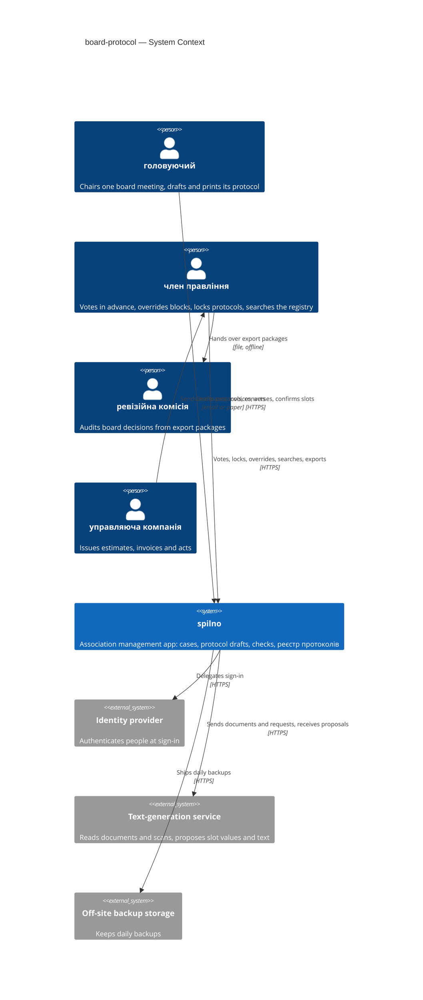
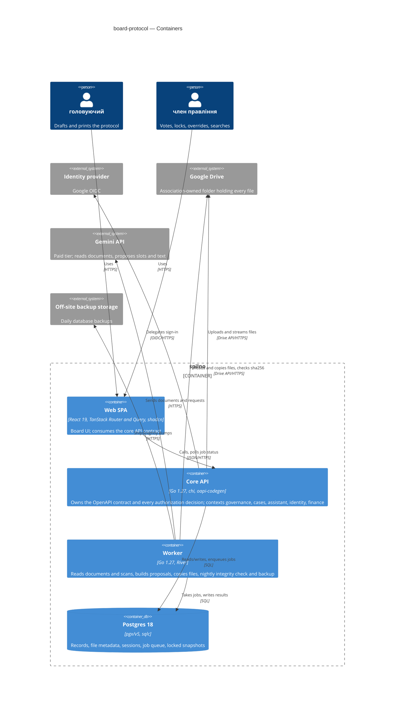
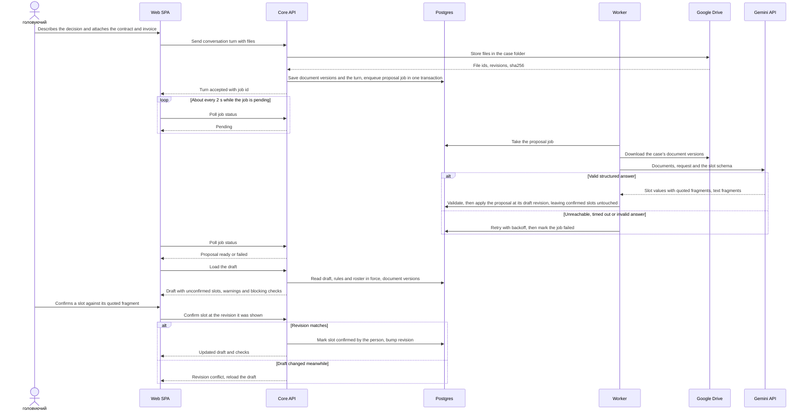
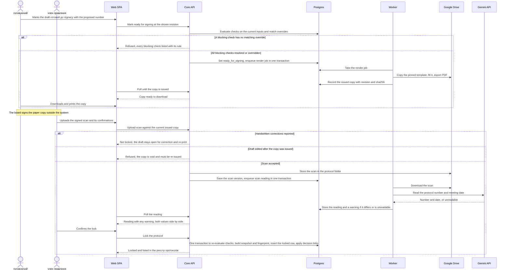
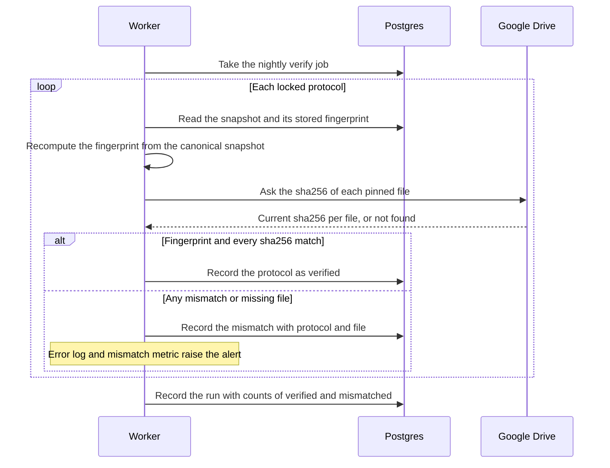

# Software Architecture Document — board-protocol

<!-- Stages 04-05 → see sdlc/plugin/skills/architecture-design/SKILL.md -->
<!-- 12 Arc42 sections. Empty sections — <!-- N/A: <one-line reason> -->. -->
<!-- C4 Context (L1) lives inline in §3. C4 Container (L2) lives inline in §5. -->
<!-- §6 Runtime view seeds the primary flow(s) here; complete-sequence-diagrams (stage 06) then -->
<!--    fills §6 with every critical flow / §5 AC — no cap. -->
<!-- Numbers in §10 come VERBATIM from PRD §6 NFR — no inventing, no rounding. -->

## 1. Introduction and goals

**Intent.** board-protocol lets the головуючий of a board meeting produce a протокол правління in which every amount, counterparty and джерело коштів is a слот рішення confirmed against a document of the справа, and in which the meeting quorum, each кворум пункту and each majority are computed from the board roster and the правила статуту in force on the meeting date (Stage 1). Every current член правління finds a past decision with its signed copy, votes, applied rules and cited documents in the реєстр протоколів instead of searching chats (Stage 1). In Stage 2 the головуючий describes in a conversation what the protocol should decide, attaches the case documents, and reviews a proposed draft whose numbers are pre-filled from those documents but count only once a person confirms them; попередження (required wording, possible personal interest, related чинні рішення) remind without judging. The binding vote and the signatures stay on paper: the system prepares the document, collects the попереднє голосування, gates printing on deterministic блокуючі перевірки, and locks the protocol once the signed scan is uploaded (PRD §1-§2).

**Top-3 quality goals (1-liners; full scenarios in §10):**

1. **Integrity of locked protocols** — nothing in a locked protocol (text, votes, signed copy, applied rule and document versions) changes after lock (PRD §6 "Integrity of locked protocols").
2. **Rule accuracy** — quorum and majority computed from the roster and правила статуту in force on the meeting date agree with hand calculation on the association's past protocols (PRD §6 "Quorum and rule accuracy").
3. **Confidentiality of the association's records** — only current члени правління see cases, drafts and the реєстр протоколів; anyone else learns nothing, not even whether a record exists (PRD §6.1, AC-19).

Responsiveness, durability and availability targets from PRD §6 are kept as additional scenarios in §10; they yield to the three goals above when they conflict.

**Stakeholders.**

| Role | Interest | Sign-off owner? |
|---|---|---|
| головуючий | Prepares the protocol draft, records attendance and неучасть у голосуванні, confirms слоти рішення, marks the draft готовий до голосування / готовий до підпису | No |
| член правління | Casts their own попереднє голосування, records обхід блокування, uploads the signed scan, maintains the roster and правила статуту, searches the реєстр протоколів | No |
| ревізійна комісія | Receives export packages of locked protocols; has no access to the system (PRD §3) | No |
| управляюча компанія | Issues the кошторис робіт, invoices and акт виконаних робіт that a справа holds; does not use the system | No |
| співвласник | Asks the board about past decisions; has no access to the system (PRD §3) | No |
| PM (Andrii Opryshko) | Consulted on §10 quality goals and §11 risk severities | No |
| Architect / Tech Lead (Andrii Opryshko) | SAD and ADR approval | Yes |

<!-- Decision overrides (¶4) — populated by the Step-7 critic resolution loop, empty otherwise. -->

## 2. Constraints

**Technical.**
- Go 1.27.3, chi v5, oapi-codegen v2.8 strict server over one OpenAPI 3.1 contract `services/core/api/openapi.yaml`; every operation has exactly one context tag and a `/<context>/` path (repo ADR 0001, 0003).
- Postgres 18.6, pgx/v5 + sqlc, goose migrations in `services/core/migrations/` applied on service start (repo ADR 0004). Next migration number: `00004`.
- Web: React 19.3, TypeScript 6.0, Vite 8, Tailwind v4, shadcn/ui, TanStack Router + Query, orval-generated hooks per tag, Storybook 10 (repo ADR 0001). The web app is a client-side SPA served on :5180 that proxies `/api/*` to the core API on :8080.
- Tests: testcontainers-go with `internal/platform/testdb.New(t)`, Vitest + Testing Library, Storybook stories as tests with a11y checks, Playwright e2e (`apps/web/e2e/`).
- Architecture convention: modular monolith, one Go module; a bounded context is `internal/<bc>/` with `domain/` (stdlib + uuid only), `app/`, `ports/`, `adapters/http{,/gen}/`, `adapters/postgres{,/queries,/sqlcgen}/` and `module.go` — the only package importable from outside; enforced by depguard `domain-pure` + `<bc>-private` rules (repo ADR 0002).
- Existing infrastructure (`infra/compose.yaml`): `postgres:18.6-alpine` and `grafana/otel-lgtm:0.37.0` only. The repo has **no** authentication, file/blob storage, background jobs, LLM client or PDF generation today — whatever this feature needs of those is introduced by an ADR in §4, not assumed here.
- Existing contexts this feature touches: `governance` (board `meetings`: kind, held date, optional end and location, quorum-required flag; validation reporting every broken field at once; `ErrMeetingNotFound`), `finance` (`contracts`: counterparty, amount in cents, currency, signed and end dates — no джерело коштів, no link to a decision).

**Organisational.**
- One developer (Andrii Opryshko) working with coding agents; capstone/pet project.
- Rollout: one association (the author's own) and its current board; charter rules kept as data so neighbouring associations can follow later (PRD §1).
- No deadline or effort budget is quoted in the PRD; delivery is staged — Stage 1 stories are useful on their own, Stage 2 follows (PRD §1 ¶4). Tracked in §11.

**Conventions.**
- [`CLAUDE.md`](../../../CLAUDE.md): `mise run gen` after spec/query/migration edits; "green" = `mise run lint` + `mise run test` + `mise run e2e`; generated files (`*.gen.go`, `sqlcgen/`, `apps/web/src/api/gen/`, `routeTree.gen.ts`) are never edited.
- A new context needs its tag in the spec, `adapters/http/gen/oapi-codegen.yaml`, an entry in `sqlc.yaml`, a `<bc>-private` depguard rule and a line in `cmd/api/main.go`; contexts register with `r.Group`, never `r.Mount`.
- Errors on the wire are RFC 9457 `application/problem+json` via `internal/platform/httpapi` (422 for validation).
- Validation reports every broken field at once (pattern of `governance/domain/meeting.go`) — carried to drafts, roster and rules (PRD reference module).
- List endpoints use opaque cursor pagination over `(created_at, id)`, newest first, page 20 / max 100.
- Web: generated hooks from `@/api/gen/endpoints/<bc>/<bc>`, pages under `src/routes/`, feature components under `src/features/<bc>/`, primitives from `src/components/ui`; stories next to components.

**Regulatory / external.**
- Law of Ukraine "On associations of co-owners of apartment buildings" and the association's charter: board competence, quorum and majority come from the charter, kept as правила статуту with effective dates; the signed paper protocol is the binding record and outranks the system (PRD §1, CONTEXT "попереднє голосування").
- Law of Ukraine "On personal data protection": data classification **confidential** — board members' names and terms; names, apartment numbers and payment details of co-owners and sole-proprietor contractors inside case documents; handwritten signatures on signed copies; conversation requests that may name people (PRD §6.1).
- Security review required before release — new authorization boundary and new personal data (PRD §6.1).
- Uploaded files: only document and image formats are accepted; files are served as downloads, never rendered as active content (PRD §6.1 abuse case "Malicious upload").
- Case documents and conversation requests may go to a text-generation service outside the association's own hosting only under an agreement that excludes training on the data (PRD §8 default; decided in §4).

## 3. Context and scope

spilno is the association's own management app; board-protocol adds the board's protocol workflow to it. The current члени правління prepare, check and lock board protocols and search the реєстр протоколів; the головуючий of a meeting drafts its protocol, in Stage 2 through a conversation that proposes slot values read from the case documents. The trust boundary is the spilno system: everything outside it — the identity provider, the text-generation service, the backup storage, and every uploaded document — is untrusted input that the system checks before use; nothing a document or the text-generation service says becomes a fact in a protocol until a person confirms it (PRD §6.1, AC-21, AC-28).

**External systems (in / out):**

| Actor or system | Type | Interaction |
|---|---|---|
| головуючий | Person | Opens a protocol draft from a справа, records attendance and неучасть у голосуванні, confirms слоти рішення, converses with the помічник протоколу, marks the draft готовий до голосування / готовий до підпису, prints the copy for signing |
| член правління | Person | Casts their own попереднє голосування, records обхід блокування, uploads the signed scan, maintains the roster and правила статуту, searches the реєстр протоколів, exports a locked protocol |
| ревізійна комісія | Person (outside the system) | Receives the export package of a locked protocol from a член правління; never signs in (PRD §3) |
| управляюча компанія | Organisation (outside the system) | Issues the кошторис робіт, invoices and акт виконаних робіт that a член правління uploads into a справа; no integration |
| Identity provider | System (external) | Authenticates a person at sign-in; spilno decides on its own whether that person is a current член правління (choice of provider in §4) |
| Text-generation service | System (external) | Receives case documents, signed scans and conversation requests; returns proposed slot values with quoted fragments, the protocol number and date read from a scan, and connecting text — proposals only (choice of service and data terms in §4) |
| Off-site backup storage | System (external) | Receives the daily backup of the registry and its files (PRD §6 RPO ≤ 24 h) |
| finance context (spilno) | System (internal) | Already holds contracts; gains each contract's джерело коштів and the decision that approved it, read for related-contract попередження (AC-25, PRD §8) |

<!-- brownfield: existing monolith — governance (meetings) and finance (contracts) contexts exist; no sign-in, file storage, jobs or AI integration yet (Step-3 explorer scan, 2026-10-24). -->

**C4 Context (L1):**



## 4. Solution strategy

**Target surface(s) (the first decision — what's being built):** `[backend-service, web-frontend, worker]` → [ADR-0001](./adr/0001-build-backend-web-and-worker-surfaces.md)

- **backend-service** — the existing core API (`services/core/cmd/api`) owns the OpenAPI contract, all writes and every authorization decision.
- **web-frontend** — the existing SPA (`apps/web`) consumes the contract through orval-generated hooks; it authors no contract.
- **worker** — a separate process (`services/core/cmd/worker`, same Go module and contexts) that runs the slow and scheduled work: reading case documents and signed scans with the text-generation service, building conversation proposals, copying files in Google Drive, the nightly integrity check of locked protocols and the nightly backup. It has no request/response surface; it consumes jobs (ADR-0006).

**UI-architecture (web-frontend) — inline, no ADR (gate 1 of 3).** Client-side SPA as fixed by repo ADR 0001: TanStack Router pages under `src/routes/`, feature components under `src/features/governance/` and new `src/features/cases/`, grown from the existing protocol-draft prototype (slot origin and status, advisory vs blocking notices, readiness gate before printing) and replacing its in-memory `api.ts` with the generated hooks. The UI reuses the shadcn primitives in `src/components/ui` (badge, button, card, input, kbd, skeleton, textarea; new ones added through shadcn, not hand-rolled) and the Tailwind v4 tokens; no second styling system. Results that take seconds — a proposal from the помічник протоколу, the number and date read from a signed scan — and other members' попереднє голосування reach the browser by **polling**: a long action answers at once with the job or resource it started, and TanStack Query re-fetches its status about every 2 s while it is pending and stops when it settles. No server push in the first release.

**Top strategic choices (the seeds for ADRs):**

1. **Board decisions stay in `governance`; cases, the assistant and identity get their own contexts** → [ADR-0002](./adr/0002-extend-governance-and-add-cases-assistant-identity-contexts.md). The roster, правила статуту, шаблони формулювання, protocol drafts, слоти рішення, attendance, votes, checks, overrides and the реєстр протоколів live in `governance`, because quorum, majority and locking need all of them consistent in one transaction (QG-1, QG-2). `cases` owns справи and their document versions, which both protocols and `finance` contracts cite. `assistant` owns the помічник протоколу and is the only context that may import the text-generation client — depguard turns "the AI only proposes" into a lint rule: `governance` can receive proposals, never call the model. `identity` owns accounts and sessions; `finance` gains джерела коштів and the decision that approved each contract (PRD §8 default adopted).
2. **Sign-in through OIDC with server-side sessions in Postgres** → [ADR-0003](./adr/0003-sign-in-with-oidc-and-postgres-sessions.md). A person signs in with Google (any OIDC provider by configuration); the verified email links the account to a person in the roster; the session is a Postgres row behind an HttpOnly cookie. Whether that person is a current член правління is decided by spilno from the roster on every request, never by the identity provider (QG-3, AC-16, AC-19). Resolves PRD §8 "How does a член правління sign in".
3. **Gemini API reads documents and drafts, behind a port; people confirm** → [ADR-0004](./adr/0004-use-gemini-api-for-document-reading-and-drafting.md). The worker sends a справа's documents (fetched from Google Drive), a signed scan or a conversation request to the Gemini API on a paid tier whose terms exclude using the data for training, and gets back structured proposals: slot values with the quoted fragment and the document they came from, the protocol number and date read from a scan, connecting text. Nothing it returns is a fact until a person confirms it (AC-21, AC-27, AC-28). Resolves PRD §8 "May case documents … be processed by a text-generation service outside the association's own hosting".
4. **Files live in an association-owned Google Drive folder; Postgres keeps their metadata** → [ADR-0005](./adr/0005-store-files-in-association-owned-google-drive-folder.md). Case documents, signed scans, copies printed for signing and export packages are stored in a `spilno/` folder of the association's Google account, shared with nobody; spilno reaches it through the Drive API with that account's authorization. Postgres keeps, per file version, the Drive file id, revision id, sha256, size, media type, author and time. Members read and add files only through spilno, which checks the term on every request (QG-3); an existing file in the association's Drive is attached by copying it into the case folder, so later edits of the original never touch the cited version (AC-09, AC-17b).
5. **Background work goes through a River job queue in Postgres to the worker** → [ADR-0006](./adr/0006-run-background-work-in-worker-via-river-queue.md). The API enqueues a job in the same transaction as the domain write that needs it (an uploaded scan, a conversation turn, an attached document), so a job is never lost or orphaned; the worker retries failed calls with backoff and runs the nightly periodic jobs. River's schema is copied into a goose migration so goose stays the only migrator (repo ADR 0004).
6. **A locked protocol is an immutable, fingerprinted snapshot** → [ADR-0007](./adr/0007-lock-protocols-as-fingerprinted-immutable-snapshots.md). Locking writes one canonical JSON snapshot — text, slots, attendance, неучасть у голосуванні, votes, applied rule versions, roster, computed quorum and majority, overrides, and the Drive id, revision and sha256 of the signed scan and of every cited document version — plus its SHA-256 fingerprint. A database trigger rejects UPDATE and DELETE on locked rows; the registry and the export read only the snapshot; the nightly job recomputes every fingerprint and compares the sha256 Drive reports for each pinned file, alerting on any mismatch (QG-1, AC-17, AC-17b).
7. **правила статуту are a typed catalog of effective-dated parameters** → [ADR-0008](./adr/0008-keep-charter-rules-as-typed-effective-dated-parameters.md). A fixed set of rule kinds — quorum size (count, or share of the roster in force), majority (threshold and what it is counted from), board competence limit, whether a non-voting member counts toward a кворум пункту — each stored as append-only versions with effective date, charter or decision reference, author and time. Quorum and majority are pure functions in `governance/domain`, checked by a regression suite over the 30+ historical protocols on every change (QG-2, AC-01, AC-02b, AC-02c).

**Guiding principle across all seven: a deterministic core with an advisory assistant.** Every number, check and lock decision is computed by deterministic code from confirmed data; the text-generation service, documents and Drive are inputs that propose or store, never decide (PRD §3 non-goals "Legal advice or interpretive blocking", "The autonomous part of approach B").

Each tactical decision in later sections should be traceable to one of these strategic seeds. Tactical decisions that *contradict* a strategic choice are red flags — surface them in §11 Risks.

## 5. Building block view

Hexagonal modular monolith, unchanged from repo ADR 0002: each bounded context keeps `domain/` (stdlib + uuid only) → `app/` (use cases) → `ports/` (interfaces app needs) ← `adapters/` (HTTP, Postgres, Drive, model), and other contexts reach it only through its `module.go`. The feature adds a second entry point, `cmd/worker`, that wires the same contexts and runs their job handlers (ADR-0001, ADR-0006). Contexts per ADR-0002.

**Internal decomposition:**

```
services/core/
├── cmd/api/main.go            + identity, cases, assistant modules; session middleware before every context group
├── cmd/worker/main.go         NEW — River client; registers job handlers and periodic jobs exported by each module.go
├── internal/governance/       EXTENDED — board decisions
│   ├── domain/                meeting · roster entry (term) · charter rule kinds + versions · wording template
│   │                          draft (lifecycle, revision, wording versions) · agenda item · слот рішення (value, origin, status, source)
│   │                          attendance · неучасть у голосуванні · попереднє голосування · check · override
│   │                          quorum.go (pure: meeting quorum, кворум пункту, majority) · locked snapshot (canonical form, fingerprint)
│   ├── app/                   roster/ · rules/ · templates/ · drafts/ · voting/ · checks/ · locking/ · registry/ · export/
│   ├── ports/                 repositories · CaseDocuments · FundingContracts · ProtocolFiles · Renderer · Jobs
│   ├── adapters/              http/ (+gen/) · postgres/ (+queries/, sqlcgen/) · gdrive/ · gdocs/ (Renderer)
│   └── module.go              routes · CurrentMember(person, date) · ApplyProposal(draft, proposal) · job handlers
├── internal/cases/            NEW — справи, case documents and versions, file metadata, text read from documents
├── internal/assistant/        NEW — conversations, proposals; ports.TextModel + adapters/gemini (the only model client)
├── internal/identity/         NEW — accounts ↔ roster persons, sessions, OIDC flow, the session middleware
├── internal/finance/          EXTENDED — джерела коштів; contract → джерело коштів + approving decision id
├── internal/platform/
│   ├── google/                NEW — Drive and Docs API clients for the association account (upload, copy, download, sha256, export)
│   ├── jobs/                  NEW — River client construction shared by api (enqueue) and worker (run)
│   └── httpapi/               + current principal in context; unauthenticated/forbidden as problem+json
└── migrations/                00004… — identity, cases, governance board-decision tables, finance columns, River schema
apps/web/src/
├── routes/                    sign-in · cases · protocols/$id (draft, votes, checks, print, upload) · registry · board (roster, rules, templates)
└── features/                  governance/ (grows from the prototype) · cases/ · assistant/ (conversation panel)
```

**Context interactions (all in-process calls through `module.go`, no shared tables) → [ADR-0012](./adr/0012-integrate-contexts-through-synchronous-module-facades.md).** Each consumer declares the port in its own types; `cmd/api` and `cmd/worker` adapt the provider's `module.go` functions to it, so contexts never import each other and depguard rules stay as they are.

| From → To | Why | Shape |
|---|---|---|
| identity → governance | Is this person a current член правління today? (AC-16, AC-19) | `CurrentMember(person, date)` query |
| governance → cases | Document versions a slot is confirmed against and the latest version of each — "changed or replaced" is detected on read (AC-09) | read query |
| governance → finance | Contracts on the same джерело коштів approved by чинні рішення (AC-25) | read query |
| finance → governance | Is the approving decision still чинне? | read query |
| assistant → cases | Documents of the справа to send to the model | read query |
| assistant → governance | Hand over a proposal; governance stores it as unconfirmed slots and text | `ApplyProposal` command |
| any → worker | Slow or scheduled work | River job enqueued in the caller's transaction (ADR-0006) |

**Key building-block decisions (inside `governance` unless noted):**

- **Draft lifecycle with explicit states and a revision number** → [ADR-0009](./adr/0009-track-draft-lifecycle-with-states-and-revision-numbers.md). `draft` ⇄ `ready_for_vote` (frozen wording version that votes reference) → `ready_for_signing` (issued copy recorded) → `locked`; any edit bumps `revision`, returns the draft to `draft`, leaves older votes uncounted and voids the issued copy; stale writes get 409 `governance.draft_revision_conflict`; assistant proposals never overwrite confirmed slots (AC-05d, AC-14b, AC-28b).
- **Checks evaluated on read; overrides bound to the check's input fingerprint** → [ADR-0010](./adr/0010-evaluate-checks-on-read-and-bind-overrides-to-input-fingerprints.md). One pure `Evaluate` returns every блокуюча перевірка and попередження with a stable key and an input fingerprint; an обхід блокування applies only while key and fingerprint match (AC-12b); `number_without_confirmed_source` and `incomplete_agenda` are not overridable.
- **Decision text as fragments with slot placeholders** → [ADR-0011](./adr/0011-store-decision-text-as-fragments-with-slot-placeholders.md). Text is plain fragments plus references to slots and meeting facts; a deterministic validator turns any fact in plain text into a proposed slot (AC-28); шаблони формулювання use the same shape with fixed fragments (AC-23).
- **Signing copies and export summaries rendered from Google Docs templates** → [ADR-0013](./adr/0013-render-signing-copies-from-google-docs-templates.md). The worker fills a pinned template Doc, exports PDF to Drive and records its sha256 as the issued copy; export is one ZIP with summary, signed scan, cited document versions and a manifest (AC-14c, AC-20).
- **слот рішення** (inline): typed value (amount in kopiyky, counterparty, джерело коштів, document reference, date or term, person, votes, неучасть у голосуванні), origin (`system` · `document` · `human` · `note`), status (`confirmed` · `needs_review` · `not_found` · `unconfirmed`), source document version id and quoted fragment; confirmation records person and time (AC-21, AC-22, AC-27). Meeting facts (date, головуючий, members present) are system-filled slots.

**C4 Container (L2):**



## 6. Runtime view

Primary flows seeded by architecture-design; `complete-sequence-diagrams` adds a flow, branch or explicit N/A for every PRD §5 acceptance criterion. Participants are the §5 containers and the glossary roles; the worker runs the owning context's code in its own process, so its writes go straight to Postgres through that context. Every request from the SPA passes the session check (ADR-0003) before it reaches a context.

**Critical flow 1: draft through the помічник протоколу and confirm slots (US-12, US-09, AC-26, AC-28b)**



**Critical flow 2: from готовий до підпису to a locked protocol (US-05, US-06, AC-12b, AC-14, AC-14b, AC-14c, AC-14d, AC-15)**



**Critical flow 3: nightly integrity check of locked protocols (PRD §6 "Integrity of locked protocols")**



## 7. Deployment view

One small virtual machine in the EU runs the whole system with docker compose, the same shape as `infra/compose.yaml` locally: `caddy` (TLS for the public HTTPS origin that OIDC needs, serves the built SPA, reverse-proxies `/api/*` to the API), `core-api` (1 replica), `worker` (1 replica, ADR-0001), `postgres:18.6` on a persistent volume. Secrets live in an env file on the VM, readable only by the services: the OIDC client (ADR-0003), the encrypted refresh token of the association Google account for Drive and Docs (ADR-0005, ADR-0013), the Gemini API key (ADR-0004), the session-cookie key. Telemetry goes over OTLP to `grafana/otel-lgtm` on the same VM (or a hosted Grafana stack with the same endpoint). Deploys are image pulls plus `docker compose up -d`; migrations run on API start (repo ADR 0004), and the worker starts after the API is healthy so River's schema exists.

**Backups — none in the first release (deliberate deviation from PRD §6 "Durability of the registry").** No database backup and no restore drill until the registry becomes the only record of a decision. Rationale (author, 2026-10-25): production is still far off — the first release is a pilot in which the signed paper protocols and the files in the association's Google Drive remain the primary record; a database backup is added before the registry becomes the sole source. Tracked as a High risk in §11; restated as a decision override in §1 for downstream stages.

**Monitoring:**
- Metrics: `http.server.request.duration` from otelhttp per route (PRD §6 open draft / registry decision / search p95 ≤ 1 s); `governance.scan_upload.duration` (upload through number-and-date reading, p95 ≤ 20 s) and `governance.scan_upload.rejected_size` (scans over 50 MB); `assistant.proposal.duration` (p95 ≤ 60 s) and `assistant.proposal.failures`; `governance.integrity.mismatches` and `governance.integrity.verified` per nightly run; River job counts by kind and state; `gdrive.request.errors` by operation.
- Alerts: `governance.integrity.mismatches` > 0 → alert the maintainer at once; no successful nightly integrity run in 26 h → alert; failed jobs of one kind > 3 in 1 h → alert; `gdrive.request.errors` showing an authorization failure → alert (refresh token revoked, ADR-0005); external uptime check of the public origin every 5 min, monthly availability reported against 99%.
- Tracing: otelhttp spans on every request, otelpgx spans on SQL, spans around each Drive, Docs and Gemini call in the worker, linked to the job id; logs via `log/slog` with `otelslog` (repo ADR 0001), never logging document content or personal data.

**Scaling thresholds:**
- 15-20 protocols a year and ≤ 500 locked protocols (PRD §6 sizing) is decades of rows in single tables — no partitioning, one API and one worker replica.
- Files: roughly up to 1.2 GB a year in the association's Drive; Drive quota is the first limit to watch (the account's storage is shared with its mail).
- Revisit topology only when a second association joins (PRD §3 non-goal for the first release) or when `http.server.request.duration` p95 for draft open passes 1 s.

## 8. Crosscutting concepts

| Concept | Convention | Where defined |
|---|---|---|
| Logging | `log/slog` JSON to stdout + `otelslog`; fields `module=<bc>`, `job_id`, `draft_id`, `protocol_id` where known; never log document content, extracted text, conversation text, personal data, tokens or keys | repo ADR 0001; here |
| Authentication | OIDC authorization-code flow with PKCE, server-side session row behind an HttpOnly, Secure, SameSite=Lax cookie; `system/health` stays public | ADR-0003 |
| Authorization | Every protected request: no session → 401; a session whose person is not a current член правління today (term covers today, Europe/Kyiv) → 403 `identity.not_current_member` **before** the request reaches any resource, so existence is never revealed (AC-19). Action rules inside `governance`: only the meeting's головуючий edits its draft, refusal names the головуючий (AC-03b); a member casts and changes only their own vote (AC-05e); lock, override, scan upload, rule and roster changes by any current член правління, author recorded (AC-16, PRD §6.1) | ADR-0003; PRD §6.1 |
| Error handling | RFC 9457 `application/problem+json` through `internal/platform/httpapi`; machine code `<context>.<error_name>` (e.g. `governance.draft_revision_conflict`, `governance.override_reason_required`); 422 names every broken field at once; 409 on a stale revision | CLAUDE.md; repo ADR 0003; ADR-0009 |
| ID strategy | UUIDs (`github.com/google/uuid`) for every entity; cross-context references by id only, no foreign keys between contexts; the protocol number is a separate human sequence, proposed as next and editable, unique per association (AC-14c) | repo ADR 0002; ADR-0012 |
| Money | Integer kopiyky (`bigint`) plus currency, matching `finance.contracts.amount_cents`; formatting (digits and words) in one renderer | ADR-0011; here |
| Dates and time | Meeting dates, term dates and `effective_from` are calendar `date`s; "today" and "in force on" are evaluated in Europe/Kyiv; event times are `timestamptz` | ADR-0008; here |
| Audit trail | Rule and roster changes (with reference), change of головуючий, overrides, uploads with confirmations, votes, slot confirmations and lock are append-only rows with author and time; history is never updated in place | PRD AC-02b, AC-03b, AC-12, AC-14, AC-16 |
| Concurrency | Optimistic: each mutation carries the draft revision it was built on | ADR-0009 |
| Files | Allow-list PDF, JPEG, PNG, DOCX, XLSX, checked by content sniffing and extension; ≤ 50 MB; stored in the association's Drive; served only through the API as `Content-Disposition: attachment` with `X-Content-Type-Options: nosniff`, never inline | ADR-0005; PRD §6.1 |
| Text-generation boundary | Only `assistant` imports a model client (depguard); prompts carry only the documents of the справа being drafted; output is schema-validated and treated as untrusted proposals; facts in text only as slot placeholders | ADR-0002, ADR-0004, ADR-0011 |
| Background jobs | River; payloads carry ids only; handlers are idempotent so retries are safe; job enqueued in the same transaction as the write that needs it | ADR-0006 |
| Pagination | Opaque cursor over `(created_at, id)`, newest first, page 20 / max 100; registry search pages the same way | existing `governance` meetings list |
| Observability | OpenTelemetry traces, metrics and logs over OTLP; otelhttp and otelpgx spans; feature metrics and alerts in §7 | repo ADR 0001; §7 |
| Internationalisation | UI in Ukrainian only; domain terms exactly as in CONTEXT.md; code identifiers, error codes and API fields in English | CONTEXT.md |
| Rate limiting | <!-- N/A: ≤ 7 signed-in users, all members of one board; Gemini spend bounded by conversation turns, watched through assistant.proposal metrics --> N/A | — |

## 9. Architecture decisions

| # | Title | Status | Section |
|---|---|---|---|
| [0001](./adr/0001-build-backend-web-and-worker-surfaces.md) | Build board-protocol as backend service, web frontend and a separate worker | Accepted | §4 |
| [0002](./adr/0002-extend-governance-and-add-cases-assistant-identity-contexts.md) | Extend governance with board decisions and add cases, assistant and identity contexts | Accepted | §4 |
| [0003](./adr/0003-sign-in-with-oidc-and-postgres-sessions.md) | Sign in through OIDC (Google first) with server-side sessions in Postgres | Accepted | §4 |
| [0004](./adr/0004-use-gemini-api-for-document-reading-and-drafting.md) | Use the Gemini API, behind a port, to read case documents and scans and to draft | Accepted | §4 |
| [0005](./adr/0005-store-files-in-association-owned-google-drive-folder.md) | Store files in an association-owned Google Drive folder, with metadata in Postgres | Accepted | §4 |
| [0006](./adr/0006-run-background-work-in-worker-via-river-queue.md) | Run background work in the worker through a River job queue in Postgres | Accepted | §4 |
| [0007](./adr/0007-lock-protocols-as-fingerprinted-immutable-snapshots.md) | Lock a protocol as an immutable, fingerprinted snapshot | Accepted | §4 |
| [0008](./adr/0008-keep-charter-rules-as-typed-effective-dated-parameters.md) | Keep правила статуту as a typed catalog of effective-dated parameters | Accepted | §4 |
| [0009](./adr/0009-track-draft-lifecycle-with-states-and-revision-numbers.md) | Track the draft lifecycle with explicit states and a revision number | Accepted | §5 |
| [0010](./adr/0010-evaluate-checks-on-read-and-bind-overrides-to-input-fingerprints.md) | Evaluate checks on read and bind each override to the check's input fingerprint | Accepted | §5 |
| [0011](./adr/0011-store-decision-text-as-fragments-with-slot-placeholders.md) | Store decision text as fragments with slot placeholders | Accepted | §5 |
| [0012](./adr/0012-integrate-contexts-through-synchronous-module-facades.md) | Integrate contexts through synchronous module.go facades wired in the composition root | Accepted | §5 |
| [0013](./adr/0013-render-signing-copies-from-google-docs-templates.md) | Render signing copies and export summaries from Google Docs templates | Accepted | §5 |

Inline decisions below the ADR gate: web UI-architecture (SPA per repo ADR 0001, polling for slow results — §4), single-VM compose topology (§7), crosscutting conventions (§8).

ADR files live under `docs/features/board-protocol/adr/NNNN-<title>.md`.

## 10. Quality requirements

The three goals of §1 first, then the remaining PRD §6 targets. Numbers are quoted from PRD §6 verbatim.

**QG-1. Integrity of locked protocols**
- **When:** anyone tries to change a locked protocol — through the API, by a direct SQL UPDATE or DELETE on `governance.locked_protocols`, or by editing or deleting a pinned file in the association's Google Drive.
- **Then:** "0 changes to text, votes or signed copy after lock": the API refuses and explains that a locked protocol changes only through a new referencing decision (AC-17); the database trigger rejects the UPDATE or DELETE (ADR-0007); a change made in Drive is caught by the "periodic fingerprint comparison of every locked protocol, alert on mismatch".
- **How verify:** integration test on `testdb.New(t)` that locks a protocol and asserts UPDATE and DELETE on its row fail; API test for AC-17 on text, votes and signed copy; worker test with a fake Drive port returning a different sha256 for one pinned file, asserting a recorded mismatch and `governance.integrity.mismatches` incremented; in production the nightly run's `governance.integrity.mismatches` stays 0 and its alert (§7) is wired.

**QG-2. Rule accuracy**
- **When:** any change to `governance` code, or a new правило статуту version.
- **Then:** "100% agreement with hand calculation on the association's past protocols" for meeting quorum, кворум пункту and majority, using the rules and roster in force on each meeting date (AC-01, AC-02c, AC-05, AC-05b, AC-06).
- **How verify:** "regression suite over the 30+ historical protocols, run on every change" — a table-driven test in `governance/domain` whose fixtures encode each historical protocol's roster, rule versions, attendance, неучасть у голосуванні and votes with the hand-calculated results, run by `mise run test`; unit tests for each AC above, including the share-of-roster rounding of AC-02c.

**QG-3. Confidentiality of the association's records**
- **When:** a person whose board term has ended, or who was never a член правління, signs in and calls any protected operation (cases, drafts, the реєстр протоколів, files, exports).
- **Then:** "only current члени правління (term covers today) can see cases, drafts and the реєстр протоколів; access ends on the term end date" (PRD §6.1); the system "denies access and does not reveal whether any protocol or case exists" (AC-19).
- **How verify:** integration test that iterates every operation in `services/core/api/openapi.yaml` except `system/health` with a former member's session and asserts 403 `identity.not_current_member` with an identical body whether the target id exists or not; boundary test with a term ending today and yesterday; Playwright e2e that a former member reaches no registry page.

**QG-4. Responsiveness of reads**
- **When:** a член правління opens a draft or a registry decision, or searches the registry.
- **Then:** "≤ 1 s with ≤ 500 locked protocols" at p95, for both open and search (PRD §6).
- **How verify:** integration benchmark on testcontainers Postgres seeded with 500 locked protocols, asserting p95 over 200 requests per operation stays under 1 s; in production the "request-duration metric in the service telemetry" (`http.server.request.duration` per route).

**QG-5. Signed-copy upload**
- **When:** a член правління uploads a signed scan.
- **Then:** "scans up to 50 MB accepted; p95 ≤ 20 s including reading the protocol number and date" (PRD §6); larger files are refused.
- **How verify:** integration test uploading a 50 MB scan (accepted) and a 51 MB one (refused, counted); in production the "upload-duration metric; rejected-size count" (`governance.scan_upload.duration`, `governance.scan_upload.rejected_size`).

**QG-6. Proposed protocol from a conversation**
- **When:** the головуючий asks the помічник протоколу for a draft with attached documents.
- **Then:** "p95 ≤ 60 s for up to 10 attached documents" (PRD §6).
- **How verify:** before the Stage 2 release, a run of the evaluation set (documents of the historical protocols) against the configured Gemini model, recording duration per proposal; in production the "proposal-duration metric in the service telemetry" (`assistant.proposal.duration`).

**QG-7. Durability of the registry — not met in the first release**
- **When:** the VM's disk is lost.
- **Then:** PRD §6 asks "data loss ≤ 24 h (RPO); restore verified quarterly". The first release deliberately has no database backup (§7, §11, §1 decision override); files remain in the association's Drive, database records would be lost.
- **How verify:** none until the backup is added; the return trigger is the first locked protocol that exists only in the system (§11).

**QG-8. Availability**
- **When:** any calendar month of operation.
- **Then:** "99% monthly" (PRD §6).
- **How verify:** "uptime check, monthly window" — the external uptime check of the public origin every 5 min (§7), with the monthly ratio reported.

## 11. Risks and technical debt

| Risk / debt | Severity | Mitigation | Owner |
|---|---|---|---|
| No database backup in the first release (deviation from PRD §6 "Durability of the registry", §7) — losing the VM's disk loses every record, snapshot and file reference | High | Return trigger: before the first locked protocol that exists only in the system (no signed paper copy kept elsewhere); the VPS provider's daily snapshots are a one-step stopgap; the nightly backup job slot already exists in the worker (ADR-0006) | Andrii Opryshko |
| Personal data of co-owners and contractors leaves the association's hosting for the Gemini API (ADR-0004; PRD §8 "May case documents … be processed …") | High | Paid tier only (no use of data to improve the provider's products); only the documents of the справа being drafted are sent; the board approves the processing by its own decision before the Stage 2 release; no content in logs | Andrii Opryshko |
| The association's Google account is the single home of every file (ADR-0005, ADR-0013): its compromise or loss takes all case documents and signed scans; anyone holding it can edit or delete files outside spilno | High | Account owned by the association, not a person; two-factor authentication and two administrators; the `spilno/` folder shared with nobody; the nightly sha256 check detects any change (§6 flow 3) | Andrii Opryshko |
| Gemini extraction quality on the association's own estimates, invoices and scans is unmeasured (no bake-off was run) | Medium | Evaluation set from the 30+ historical protocols' documents before the Stage 2 release, measuring slot accuracy, scan number and date reading, and duration; the `TextModel` port admits another adapter; every number still needs a person's confirmation (AC-21) | Andrii Opryshko |
| The refresh token of the association Google account is revoked or expires — file reads, uploads and rendering stop | Medium | Alert on Drive authorization errors (§7); a short re-authorization runbook; uploads fail visibly, nothing is half-written (job retries) | Andrii Opryshko |
| Rendering through the Docs API: variable-length tables are verbose to build, and tests need a Google test account or recorded responses (ADR-0013) | Medium | A fake `Renderer` port for unit and integration tests; one smoke test against a test Google account; a Typst adapter remains a fallback behind the same port | Andrii Opryshko |
| Every член правління needs a Google account (or another configured OIDC provider), and local development needs a sign-in shim that must never reach production (ADR-0003) | Medium | Shim enabled only by a dev configuration; a test asserts it is off in the production configuration; roster entries record each member's sign-in email | Andrii Opryshko |
| Adoption and habit: members keep deciding in chat and on paper (PRD §7 adoption ≥ 80%), or override blocks routinely (PRD §7 override rate ≤ 10%) | Medium | Overrides visible with reason in the реєстр протоколів; override rate and adoption reviewed quarterly against PRD §7 | Andrii Opryshko |
| Brownfield: existing `finance` and `governance` endpoints become sign-in protected; the web prototype's in-memory `api.ts` is replaced; each new context needs the five wiring steps of CLAUDE.md; `r.Mount` returns 404 for generated handlers; the lock trigger needs `-- +goose StatementBegin/End` | Low | break-tasks carries the CLAUDE.md wiring checklist per new context; `system/health` stays public so the existing e2e smoke test keeps working | Andrii Opryshko |
| PRD §8 product questions resolved by architecture defaults: a non-voting member does not count toward кворум пункту; no шаблони формулювання until reviewed; only board decisions feed related-decision warnings; "same subject" = same agenda-item type | Low | Each default is data (a rule kind, template rows) or one replaceable function (ADR-0008, ADR-0010); owners and dates stay in PRD §8 | Andrii Opryshko |
| No deadline or effort budget is quoted (§2) | Low | Staged delivery — Stage 1 stories are useful on their own, Stage 2 follows (PRD §1) | Andrii Opryshko |

**Accepted debt (acceptable in v1, plan to fix later):**
- No database backup or restore drill (row above; §7; QG-7).
- Polling instead of server push for slow results and votes (§4).
- Export is a ZIP, not one merged PDF (ADR-0013).
- No `знятий з розгляду` state; an abandoned draft stays a draft (PRD §3).
- Only a Gemini adapter behind `TextModel`; no measured alternative (ADR-0004).
- The locked-snapshot format is a long-lived contract carried by `schema_version` (ADR-0007).
- River's schema migrations are mirrored into goose by hand on every River upgrade (ADR-0006).

## 12. Glossary

<!-- 🎯 Навіщо: ⭐ СЛОВНИК ДОМЕНУ, який припиняє суперечки через рік («checkpoint —      -->
<!--           weekly чи biweekly? Quarter — календарний чи фіскальний?»).                -->
<!-- 📋 Що писати: таблиця термін / значення. Бізнес-терміни + технічні вперемішку.       -->
<!--           Один термін може мати дві мови у заголовку: «Goal (Обʼєктив)».              -->
<!-- 📌 Приклад: «Lesson | урок усередині курсу, що складається з блоків (text, video)». -->

| Term | Meaning |
|---|---|
| <e.g. Goal> | <quarterly intent in statement form> |
| <e.g. KR> | <Key Result — measurable target linked to a Goal> |
| <e.g. Checkpoint> | <bi-weekly progress update on a KR> |
