# Software Architecture Document — board-protocol

<!-- Stages 04-05 → see sdlc/plugin/skills/architecture-design/SKILL.md -->
<!-- 12 Arc42 sections. Empty sections — <!-- N/A: <one-line reason> -->. -->
<!-- C4 Context (L1) lives inline in §3. C4 Container (L2) lives inline in §5. -->
<!-- §6 Runtime view seeds the primary flow(s) here; complete-sequence-diagrams (stage 06) then -->
<!--    fills §6 with every critical flow / §5 AC — no cap. -->
<!-- Numbers in §10 come VERBATIM from PRD §6 NFR — no inventing, no rounding. -->
<!-- Realigned 2026-10-25 to the Stage 1 rescope of PRD.md (draft → informal poll → print → signed scan). -->
<!-- Cross-checked 2026-10-25 with sad.ao-architecture.md: withdrawn snapshots, Drive read-only + untrash, typed facts only highlighted, register start locked after the first number, registry lists signed protocols only. -->

## 1. Introduction and goals

**Intent.** Stage 1 of board-protocol is the помічник протоколу's draft and the keeping of the document. A член правління describes in a conversation what the protocol should decide and attaches the case documents; the system proposes a protocol draft whose слоти рішення are pre-filled from those documents, each linked to its source and unconfirmed until a person confirms or corrects it (US-12, US-09, AC-26, AC-21). Any current член правління edits the text in spilno (AC-29). The board may run an informal попереднє голосування on the frozen wording — labelled as not the meeting's vote (AC-41) — return the draft to чернетка and start a new round (AC-05d). Marking готовий до підпису renders the PDF print copy and reserves the protocol number (AC-14c); the board signs on paper; a член правління uploads the signed scan together with the meeting facts written on the paper, which locks the protocol in the реєстр протоколів (AC-14). A draft that will not be signed is closed as знятий з розгляду with a reason (AC-35, AC-36, AC-37). Blocking checks with overrides, effective-dated правила статуту, reading the scan, required wording, warnings and the export for the ревізійна комісія are Stage 2 (PRD §1, §3).

**Top-3 quality goals (1-liners; full scenarios in §10):**

1. **Integrity of locked protocols** — nothing in a locked protocol (text, meeting facts, signed copy) changes after lock, and no protocol in any state is ever deleted (PRD §6 "Integrity of locked protocols", "Retention").
2. **Traceability of proposed numbers** — no number the system proposed reaches a print copy without a person's confirmation, and every number links to the case document it came from (PRD §2, AC-21, AC-28; PRD §7 "Confirmed proposed numbers").
3. **Confidentiality of the association's records** — only current члени правління see cases, drafts and the реєстр протоколів; anyone else learns nothing, not even whether a record exists (PRD §6.1, AC-19).

Responsiveness, durability and availability targets from PRD §6 are kept as additional scenarios in §10; they yield to the three goals above when they conflict.

**Stakeholders.**

| Role | Interest | Sign-off owner? |
|---|---|---|
| член правління | Fills the association settings and roster, drafts through the помічник протоколу, edits and confirms слоти рішення, starts and casts the попереднє голосування, prints, uploads the signed scan with the meeting facts, withdraws a draft, searches the реєстр протоколів | No |
| головуючий | Chairs the meeting and signs the paper protocol; in Stage 1 has no extra rights in the system (AC-29, AC-03b dropped) | No |
| ревізійна комісія | Receives export packages of locked protocols — Stage 2 (PRD §3); has no access to the system | No |
| управляюча компанія | Issues the кошторис робіт, invoices and акт виконаних робіт that a справа holds; does not use the system | No |
| співвласник | Asks the board about past decisions; has no access to the system (PRD §3) | No |
| PM (Andrii Opryshko) | Consulted on §10 quality goals and §11 risk severities | No |
| Architect / Tech Lead (Andrii Opryshko) | SAD and ADR approval | Yes |

**Decision overrides.** None — every PRD §6 target is met by this design, including the nightly backup with a quarterly restore drill ([ADR-0016](./adr/0016-back-up-postgres-nightly-off-the-vm-with-quarterly-restore-drills.md)).

## 2. Constraints

**Technical.**
- Go 1.27.3, chi v5, oapi-codegen v2.8 strict server over one OpenAPI 3.1 contract `services/core/api/openapi.yaml`; every operation has exactly one context tag and a `/<context>/` path (repo [ADR 0001](../../adr/0001-stack.md), [ADR 0003](../../adr/0003-spec-first-codegen.md)).
- Postgres 18.6, pgx/v5 + sqlc, goose migrations in `services/core/migrations/` applied on service start (repo [ADR 0004](../../adr/0004-migrations-and-queries.md)). Next migration number: `00004`.
- Web: React 19.3, TypeScript 6.0, Vite 8, Tailwind v4, shadcn/ui, TanStack Router + Query, orval-generated hooks per tag, Storybook 10 (repo ADR 0001). The web app is a client-side SPA served on :5180 that proxies `/api/*` to the core API on :8080.
- Tests: testcontainers-go with `internal/platform/testdb.New(t)`, Vitest + Testing Library, Storybook stories as tests with a11y checks, Playwright e2e (`apps/web/e2e/`).
- Architecture convention: modular monolith, one Go module; a bounded context is `internal/<bc>/` with `domain/` (stdlib + uuid only), `app/`, `ports/`, `adapters/http{,/gen}/`, `adapters/postgres{,/queries,/sqlcgen}/` and `module.go` — the only package importable from outside; enforced by depguard `domain-pure` + `<bc>-private` rules in `services/core/.golangci.yml` (repo [ADR 0002](../../adr/0002-bounded-contexts.md)).
- Existing infrastructure (`infra/compose.yaml`): `postgres:18.6-alpine` and `grafana/otel-lgtm:0.37.0` only. The repo has **no** authentication, association scope, file storage, background jobs, LLM client or PDF generation today — whatever this feature needs of those is introduced by an ADR in §4, not assumed here.
- Existing contexts: `governance` (board `meetings`: kind, `held_at timestamptz`, optional end and location, quorum-required flag; validation reporting every broken field at once; `ErrMeetingNotFound`) is extended; `finance` (`contracts`) is **untouched** in Stage 1 — only its route group is put behind sign-in in `cmd/api`.

**Organisational.**
- One developer (Andrii Opryshko) working with coding agents; capstone/pet project.
- Rollout: one association (the author's own) and its current board; records carry the association, but there is no multi-association scope (PRD §3).
- No deadline or effort budget is quoted in the PRD; delivery is staged — Stage 1 (draft, poll, print, signed scan) is useful on its own, Stage 2 adds checks, dated rules, scan reading and export (PRD §1). Tracked in §11.

**Conventions.**
- [`CLAUDE.md`](../../../CLAUDE.md): `mise run gen` after spec/query/migration edits; "green" = `mise run lint` + `mise run test` + `mise run e2e`; generated files (`*.gen.go`, `sqlcgen/`, `apps/web/src/api/gen/`, `routeTree.gen.ts`) are never edited.
- A new context needs its tag in the spec, `adapters/http/gen/oapi-codegen.yaml`, an entry in `sqlc.yaml`, a `<bc>-private` depguard rule and a line in `cmd/api/main.go`; contexts register with `r.Group`, never `r.Mount` (checklist for `identity` in §5).
- Errors on the wire are RFC 9457 `application/problem+json` via `internal/platform/httpapi` (422 for validation).
- Validation reports every broken field at once (pattern of `governance/domain/meeting.go`) — carried to settings, roster, drafts and meeting facts (PRD reference module, AC-42, AC-02, AC-04, AC-34).
- List endpoints use opaque cursor pagination over `(created_at, id)`, newest first, page 20 / max 100.
- Web: generated hooks from `@/api/gen/endpoints/<bc>/<bc>`, pages under `src/routes/`, feature components under `src/features/<bc>/`, primitives from `src/components/ui`; stories next to components.

**Regulatory / external.**
- Law of Ukraine "On associations of co-owners of apartment buildings" and the association's charter: the vote and the signatures happen on paper at the meeting; the signed paper protocol is the binding record and outranks the system, including any handwritten correction on it (PRD §3, AC-15). The in-system попереднє голосування is not the meeting's vote (AC-41).
- Law of Ukraine "On personal data protection": data classification **confidential** — board members' names and terms; names, apartment numbers and payment details of co-owners and sole-proprietor contractors inside case documents; handwritten signatures on signed copies, handwritten-correction notes and conversation requests that may name people (PRD §6.1).
- Security review required before release — new authorization boundary and new personal data (PRD §6.1).
- Uploaded files: only document and image formats are accepted; files are served as downloads, never rendered as active content (PRD §6.1 abuse case "Malicious upload").
- Case documents and conversation requests may go to a text-generation service outside the association's own hosting only under an agreement that excludes training on the data (PRD §8 default; decided in [ADR-0004](./adr/0004-use-gemini-api-for-document-reading-and-drafting.md)).

## 3. Context and scope

spilno is the association's own management app; board-protocol adds the board's protocol workflow to it. Current члени правління draft protocols through a conversation, edit and confirm them, run an informal poll, print, and lock them with the signed scan; they search the реєстр протоколів. The trust boundary is the spilno system: everything outside it — the identity provider, the text-generation service, the association's Google Drive, and every uploaded document — is untrusted input; nothing a document or the text-generation service says becomes a fact in a protocol until a person confirms it (PRD §6.1, AC-21, AC-28).

**External systems (in / out):**

| Actor or system | Type | Interaction |
|---|---|---|
| член правління | Person | Converses with the помічник протоколу, edits and confirms drafts, polls, prints, uploads the signed scan with the meeting facts, withdraws, searches |
| головуючий | Person | Chairs the meeting and signs the paper copy; uses the system as any член правління |
| управляюча компанія | Organisation (outside the system) | Issues the кошторис робіт, invoices and акт виконаних робіт that a член правління uploads into a справа; no integration |
| Identity provider (Google OIDC) | System (external) | Authenticates a person at sign-in; spilno decides on its own whether that person is a current член правління ([ADR-0003](./adr/0003-sign-in-with-oidc-and-postgres-sessions.md)) |
| Text-generation service (Gemini API) | System (external) | Receives the case documents and the conversation request; returns proposed slot values with quoted fragments and connecting text — proposals only ([ADR-0004](./adr/0004-use-gemini-api-for-document-reading-and-drafting.md)) |
| Google Drive and Docs (association account) | System (external) | Holds every file spilno uploads — case documents, print copies, signed scans — in a folder shared with nobody, under the `drive.file` scope; Docs renders the print copy; spilno keeps metadata, sha256 and Drive revision ([ADR-0005](./adr/0005-store-files-in-association-owned-google-drive-folder.md), [ADR-0013](./adr/0013-render-signing-copies-from-google-docs-templates.md)) |
| Off-site backup storage | System (external) | Receives the nightly encrypted database dump; read only on restore ([ADR-0016](./adr/0016-back-up-postgres-nightly-off-the-vm-with-quarterly-restore-drills.md)) |

<!-- brownfield: existing monolith — governance (meetings) and finance (contracts) contexts exist; no sign-in, file storage, jobs or AI integration yet (Step-3 explorer scan, 2026-10-24). -->

**C4 Context (L1):**

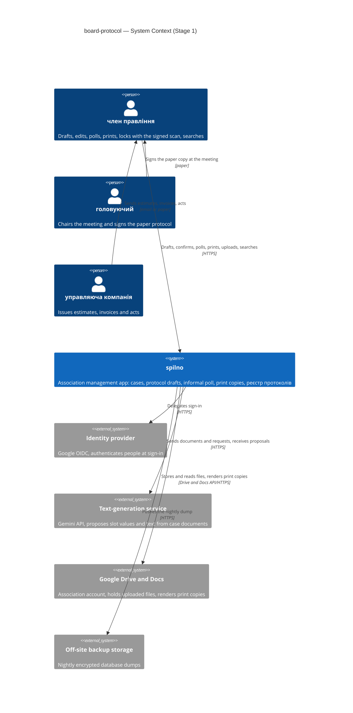

## 4. Solution strategy

**Target surface(s) (the first decision — what's being built):** `[backend-service, web-frontend, worker]` → [ADR-0001](./adr/0001-build-backend-web-and-worker-surfaces.md)

- **backend-service** — the existing core API (`services/core/cmd/api`) owns the OpenAPI contract, all writes and every authorization decision.
- **web-frontend** — the existing SPA (`apps/web`) consumes the contract through orval-generated hooks; it authors no contract.
- **worker** — a separate process (`services/core/cmd/worker`, same Go module and contexts) that runs the slow and scheduled work: proposing a draft with the text-generation service, rendering the print copy through Google Docs, and the nightly integrity check of locked protocols. It has no request/response surface; it consumes jobs ([ADR-0006](./adr/0006-run-background-work-in-worker-via-river-queue.md)).

**UI-architecture (web-frontend) — inline, no ADR (gate 1 of 3).** Client-side SPA as fixed by repo ADR 0001: TanStack Router pages under `src/routes/`, feature components under `src/features/governance/` (including the conversation panel of the помічник протоколу), grown from the existing protocol-draft prototype (slot origin and status, readiness gate before printing) and replacing its in-memory `api.ts` with the generated hooks. The protocol text is edited in spilno with a structured editor — plain text plus slot chips ([ADR-0011](./adr/0011-store-decision-text-as-fragments-with-slot-placeholders.md)); Google Docs is never an editing surface. The UI reuses the shadcn primitives in `src/components/ui` and the Tailwind v4 tokens; no second styling system. Results that take seconds — a proposal from the помічник протоколу, a rendered print copy — and other members' poll votes reach the browser by **polling**: a long action answers at once with the job or resource it started, and TanStack Query re-fetches its status about every 2 s while it is pending and stops when it settles. No server push in Stage 1.

**Top strategic choices (the seeds for ADRs):**

1. **Everything board-protocol owns lives in `governance`; only sign-in gets a new `identity` context** → [ADR-0014](./adr/0014-keep-board-protocol-in-governance-and-add-only-an-identity-context.md) (supersedes [ADR-0002](./adr/0002-extend-governance-and-add-cases-assistant-identity-contexts.md) and [ADR-0012](./adr/0012-integrate-contexts-through-synchronous-module-facades.md)). Settings, roster, справи and their document versions, drafts, слоти рішення, conversations and proposals, poll rounds, print copies, meeting facts and the реєстр протоколів are one context, so a transition or a lock is one local transaction. The Gemini SDK may be imported only in `governance/adapters/gemini` — a depguard rule turns "the AI only proposes" into a lint failure. `identity` owns accounts, sessions and the association's Google connection; `finance` is untouched in Stage 1.
2. **Sign-in through OIDC with server-side sessions in Postgres** → [ADR-0003](./adr/0003-sign-in-with-oidc-and-postgres-sessions.md). A person signs in with Google; the verified email links the account to a person in the roster; the session is a Postgres row behind an HttpOnly cookie. Whether that person is a current член правління is decided by spilno from the roster on every request (QG-3, AC-16, AC-19). Resolves PRD §8 "How does a член правління sign in".
3. **Gemini API drafts, behind a port in `governance`; people confirm** → [ADR-0004](./adr/0004-use-gemini-api-for-document-reading-and-drafting.md). The worker sends the справа's documents (fetched from Drive) and the conversation request to the paid tier of the Gemini API and gets back structured proposals: slot values with the quoted fragment and the document they came from, and connecting text as fragments. Nothing it returns is a fact until a person confirms it; printing is refused while any proposed value is unconfirmed (AC-21, AC-28, AC-28b). Reading the signed scan is Stage 2 (AC-14d). Resolves PRD §8 "May case documents … be processed by a text-generation service outside the association's own hosting".
4. **Files live in an association-owned Google Drive folder under the `drive.file` scope; Postgres keeps their metadata** → [ADR-0005](./adr/0005-store-files-in-association-owned-google-drive-folder.md). Case documents, print copies and signed scans are uploaded through spilno into a `spilno/` folder that spilno itself created and shares with nobody. Postgres keeps, per file version, the Drive file id, revision id, sha256 (computed at upload and compared with Drive's), size, media type, author and time. Members read files only through spilno, which checks the term on every request (QG-3). On lock and on withdrawal a job sets Drive's `contentRestrictions.readOnly` on the protocol's files, and the nightly check restores a trashed file with `untrash` and alerts — both possible under `drive.file` because spilno created the files. Attaching a file that already sits elsewhere in the association's Drive needs a wider scope and is Stage 2 (§11).
5. **Background work goes through a River job queue in Postgres to the worker** → [ADR-0006](./adr/0006-run-background-work-in-worker-via-river-queue.md). The API enqueues a job in the same transaction as the domain write that needs it, so a job is never lost or orphaned; payloads carry ids (and the trace context) only, and handlers are idempotent so retries are safe. River's schema is copied into a goose migration so goose stays the only migrator (repo ADR 0004).
6. **A signed or withdrawn protocol is an immutable, fingerprinted snapshot, and no protocol is ever deleted** → [ADR-0007](./adr/0007-lock-protocols-as-fingerprinted-immutable-snapshots.md). Locking writes one canonical `jsonb` snapshot of kind `signed` — frozen text, slots with their source document versions, meeting facts, the handwritten-corrections note, the print copy and the signed scan (Drive id, revision, sha256), poll rounds as history — plus its SHA-256 fingerprint; withdrawing writes one of kind `withdrawn` with the reason. A trigger on the snapshot table rejects UPDATE and DELETE; a second trigger rejects DELETE on `protocols` in any state (PRD §6 Retention); the nightly job recomputes every fingerprint of both kinds and compares each pinned file's sha256 (QG-1, AC-17). The реєстр протоколів reads only `signed` snapshots; a withdrawn protocol's number shows there as a gap marked «знято з розгляду».
7. **One association, scoped by an `association_id` column and explicit query filters, without Row-Level Security** → [ADR-0015](./adr/0015-scope-owned-rows-to-one-association-with-explicit-query-filters.md). Every table this feature owns carries `association_id`; every sqlc query filters on it; RLS waits until a second association joins (PRD §3).
8. **Nightly `pg_dump` off the VM, RPO ≤ 24 h, restore drilled quarterly** → [ADR-0016](./adr/0016-back-up-postgres-nightly-off-the-vm-with-quarterly-restore-drills.md). Meets PRD §6 "Durability of the registry" from the first release.

**Guiding principle across all eight: a deterministic core with an advisory assistant.** Every state change, number reservation and lock is decided by deterministic code from confirmed data; the text-generation service, documents and Drive are inputs that propose or store, never decide (PRD §3 non-goals "Legal advice or interpretive blocking", "The autonomous part of approach B"). In Stage 1 the system computes no quorum or majority and blocks on nothing but missing data: an incomplete agenda (AC-04), an unconfirmed proposed value (AC-21), missing settings (AC-42) and missing meeting facts (AC-34). A number a person types into the decision text is highlighted, not blocked (blocking it is Stage 2).

Each tactical decision in later sections should be traceable to one of these strategic seeds. Tactical decisions that *contradict* a strategic choice are red flags — surface them in §11 Risks.

## 5. Building block view

Hexagonal modular monolith, unchanged from repo ADR 0002: each bounded context keeps `domain/` (stdlib + uuid only) → `app/` (use cases) → `ports/` (interfaces app needs) ← `adapters/` (HTTP, Postgres, Drive, Docs, Gemini), and other contexts reach it only through its `module.go`. The feature adds a second entry point, `cmd/worker`, that wires the same contexts and runs their job handlers (ADR-0001, ADR-0006). Contexts per [ADR-0014](./adr/0014-keep-board-protocol-in-governance-and-add-only-an-identity-context.md).

**Context ownership:**

| Context | New? | Owns (aggregates, tables) | Provides to others via module.go | Uses from others |
|---|---|---|---|---|
| `governance` | existing, extended | meeting (`meetings` + `association_id`); association settings — meeting form, signers, register start number (`association_settings`); board roster with terms and sign-in email (`board_members`); справа and document versions with file metadata (`cases`, `case_documents`); protocol — state, revision, reserved number (`protocols`), agenda items, слоти рішення and confirmations, text fragments; conversation turns and proposals (`assistant_turns`); poll rounds and votes (`poll_rounds`, `poll_votes`); print copies (`print_copies`); meeting facts and correction note (`meeting_facts`); signed and withdrawn snapshots (`protocol_snapshots`, kind `signed` | `withdrawn`); integrity runs | `Routes(r)`; `Worker()` — job handlers and periodic jobs for `cmd/worker`; `CurrentMember(ctx, email, date)` | `identity`: `ActorFrom(ctx)`, `GoogleTokenSource(ctx, association)` |
| `identity` | **new** | association (`associations`: one row, name); account (`accounts`: Google subject, verified email); `sessions`; the association's Google connection (`google_connections`: refresh token encrypted with AES-GCM) | `Routes(r)`; `RequireSession` middleware; `ActorFrom(ctx)` → account, person, association; `GoogleTokenSource(ctx, association)` | `governance`: `CurrentMember(ctx, email, date)` |
| `finance` | existing, **untouched** | contract (`contracts`) | `Routes(r)` | — (its route group is wrapped by `RequireSession` in `cmd/api`) |
| `system` | existing, unchanged | — | health (stays public) | — |

**Internal decomposition:**

```
services/core/
├── cmd/api/main.go            + identity.New(...); RequireSession + current-member check around the governance and finance groups
├── cmd/worker/main.go         NEW — River client; registers governance.Worker() handlers and periodic jobs
├── internal/governance/       EXTENDED
│   ├── domain/                meeting (exists) · settings · roster entry (term) · справа + document version
│   │                          protocol (state, revision, number) · agenda item · слот рішення (value, origin, status, source)
│   │                          text fragments + fact validator · poll round + vote · print copy · meeting facts
│   │                          protocol snapshot, signed or withdrawn (canonical form, fingerprint) · proposal
│   ├── app/                   settings/ · roster/ · cases/ · drafts/ · assistant/ · poll/ · printing/ · signing/ · withdrawal/ · registry/
│   ├── ports/                 repositories · TextModel · Files · Renderer · Actor · GoogleToken · Jobs
│   ├── adapters/              http/ (+gen/) · postgres/ (+queries/, sqlcgen/) · gemini/ (TextModel — the only importer of the Gemini SDK)
│   │                          gdrive/ (Files: upload, stream, sha256, readOnly restriction, untrash) · gdocs/ (Renderer)
│   ├── jobs/                  propose_draft · render_print_copy · apply_drive_restrictions · verify_protocol_snapshots · remove_orphan_file
│   └── module.go              Routes · Worker · CurrentMember
├── internal/identity/         NEW — association, accounts ↔ roster persons, sessions, OIDC flow, Google connection, RequireSession
├── internal/finance/          UNCHANGED in Stage 1
├── internal/platform/
│   ├── google/                NEW — Drive and Docs API clients built from a token source
│   ├── jobs/                  NEW — River client construction shared by api (enqueue) and worker (run)
│   └── httpapi/               + current principal in context; unauthenticated/forbidden as problem+json
└── migrations/                00004… — identity, governance board-protocol tables with association_id, snapshot and no-delete triggers, River schema
apps/web/src/
├── routes/                    sign-in · settings (association, roster) · cases · protocols/$id (draft, conversation, poll, print, upload) · registry
└── features/governance/       grows from the prototype: conversation panel, slot rows, text editor with slot chips, poll, print, signing
```

**New-context wiring for `identity`** (CLAUDE.md): `identity` tag and `/identity/` paths in `services/core/api/openapi.yaml` · `services/core/internal/identity/adapters/http/gen/oapi-codegen.yaml` · an `identity` entry in `services/core/sqlc.yaml` · an `identity-private` depguard rule in `services/core/.golangci.yml`, and the `_test.go` exclusion pattern widened from `(system|finance|governance)-private` to `(system|finance|governance|identity)-private` · `identity.New(...)` in `services/core/cmd/api/main.go`, registered with `r.Group` (never `r.Mount`), with `RequireSession` wrapped around the `governance` and `finance` groups. **Also:** a `gemini-sdk-in-adapter` depguard rule that denies the Gemini SDK (`google.golang.org/genai`) for `$all` except `**/internal/governance/adapters/gemini/**`. **New binary:** `services/core/cmd/worker/main.go` wires `governance.New(...).Worker()`; `mprocs.yaml` gets a worker pane.

**Context interactions (in-process calls through `module.go`, no shared tables) → [ADR-0014](./adr/0014-keep-board-protocol-in-governance-and-add-only-an-identity-context.md).** The consumer declares the port in its own types; `cmd/api` and `cmd/worker` adapt the provider's `module.go` functions to it, so the two contexts never import each other.

| From → To | Why | Shape |
|---|---|---|
| identity → governance | Is this verified email a current член правління today, and which roster person? (AC-16, AC-19) | `CurrentMember(ctx, email, date)` query |
| governance → identity | Who is acting, in which association; a token for the association's Google account | `ActorFrom(ctx)`, `GoogleTokenSource(ctx, association)` |
| api → worker | Slow or scheduled work | River job enqueued in the caller's transaction (ADR-0006) |

**Key building-block decisions (inside `governance`):**

- **Lifecycle with explicit states, poll rounds and a revision number** → [ADR-0009](./adr/0009-track-draft-lifecycle-with-states-and-revision-numbers.md). `чернетка` ⇄ `готовий до голосування` (round N frozen) → `готовий до підпису` (print copy rendered) → `підписаний`; `знятий з розгляду` from any non-final state with a reason. Any edit, or «повернути в чернетку», bumps `revision`, returns the draft to чернетка, closes the open poll round and voids the current print copy; stale writes get 409 `governance.draft_revision_conflict`; proposals never overwrite confirmed slots (AC-05d, AC-14b, AC-28b).
- **Decision text as fragments with slot placeholders, edited in spilno** → [ADR-0011](./adr/0011-store-decision-text-as-fragments-with-slot-placeholders.md). Text is plain fragments plus references to slots and meeting facts; a deterministic validator turns any fact the помічник протоколу writes into plain text into a proposed, unconfirmed slot (AC-28); a fact a person types into plain text is only highlighted in Stage 1, with an offer to make it a slot — it never stops printing (blocking: Stage 2).
- **Print copy rendered from a Google Docs layout template** → [ADR-0013](./adr/0013-render-signing-copies-from-google-docs-templates.md). The worker fills a pinned template with the frozen text, the settings (meeting form, signers) and the reserved number, leaves blank fields for members present and the vote count per item, exports PDF to Drive and records its sha256 (AC-14c). Docs only renders; it is never an editing surface.
- **Protocol number reserved at the first print, never reused** → [ADR-0017](./adr/0017-reserve-the-protocol-number-at-first-print-and-never-reuse-it.md). Taken from a per-association counter that starts at the settings value, kept on return to чернетка and on withdrawal, gaps allowed (AC-14c, AC-14b, AC-37, AC-42). The start value may be changed only until the first number is issued, then 409 `governance.register_start_locked`. The реєстр протоколів lists signed protocols only; a withdrawn protocol's number shows as a gap marked «знято з розгляду».
- **Meeting facts entered with the signed scan; no lock without them** → [ADR-0018](./adr/0018-enter-meeting-facts-with-the-signed-scan-and-refuse-lock-without-them.md). Members present, the vote count per agenda item and the handwritten-corrections note are entered in the same request as the scan, never pre-filled from the poll (AC-14, AC-34, AC-15, AC-41).
- **слот рішення** (inline): typed value (amount in kopiyky, counterparty, джерело коштів, document reference, date or term, person), origin (`ai` · `document` · `human`), status (`unconfirmed` · `confirmed` · `needs_review`), source document version id and quoted fragment; confirmation records person and time; an alternative value proposed later is stored beside the confirmed one (AC-21, AC-22, AC-28b, AC-09). Meeting facts for the text: the meeting date and головуючий are filled from the meeting record; members present and the vote counts are not filled by the system — they are entered from the signed paper with the scan (ADR-0018).
- **Protocol snapshot, signed or withdrawn** → [ADR-0007](./adr/0007-lock-protocols-as-fingerprinted-immutable-snapshots.md), [ADR-0005](./adr/0005-store-files-in-association-owned-google-drive-folder.md). Lock and withdrawal each insert one `protocol_snapshots` row with its fingerprint in their transaction and enqueue `apply_drive_restrictions`, which sets `contentRestrictions.readOnly` on the pinned files; the nightly `verify_protocol_snapshots` covers both kinds.
- **Stage 2 placeholders:** [ADR-0008](./adr/0008-keep-charter-rules-as-typed-effective-dated-parameters.md) (typed effective-dated правила статуту) and [ADR-0010](./adr/0010-evaluate-checks-on-read-and-bind-overrides-to-input-fingerprints.md) (checks and override fingerprints) are deferred; Stage 1 stores only the current settings and has no блокуючі перевірки.

**C4 Container (L2):**

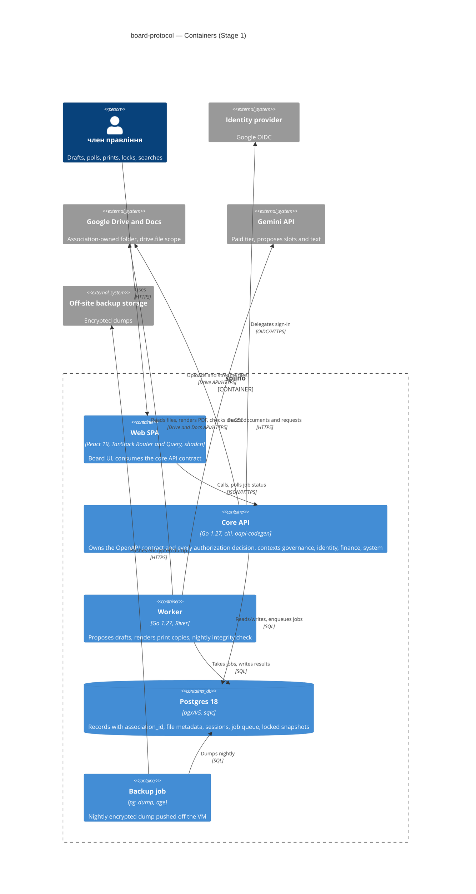

## 6. Runtime view

One flow per Stage 1 transition (PRD §1 lifecycle), each naming the PRD.md AC ids it covers; `complete-sequence-diagrams` adds the remaining flows (settings and roster AC-42, AC-02; registry search AC-18) and every branch. Participants are the §5 containers and the glossary roles; the worker runs governance code in its own process. Every request from the SPA passes the session and current-member check (ADR-0003) before it reaches a context — drawn once in Flow 7 and implied elsewhere. Error codes are `<context>.<error_name>` problem+json (§8).

**Flow 1: Draft through the помічник протоколу and confirm slots ((none) → чернетка) — AC-42, AC-26, AC-03, AC-03c, AC-21, AC-22, AC-28, AC-28b, AC-29**

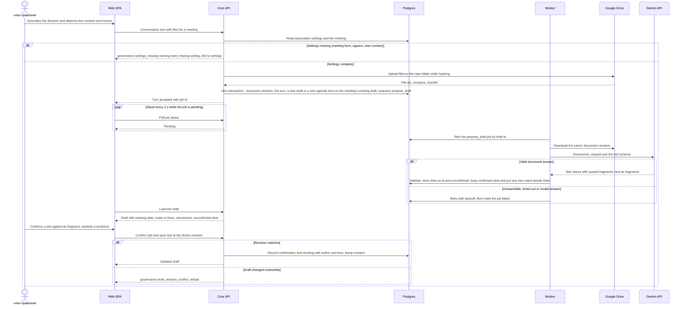

**Flow 2: Start the попереднє голосування and vote (чернетка → готовий до голосування) — AC-30, AC-31, AC-41, AC-05e, AC-32**

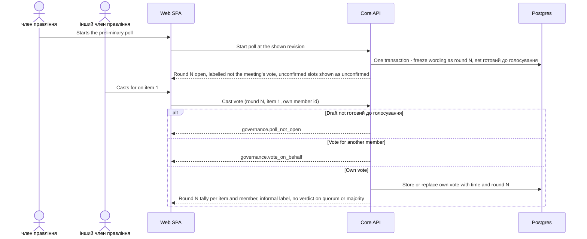

**Flow 3: Return to чернетка (готовий до голосування or готовий до підпису → чернетка) — AC-05d, AC-14b, AC-09**

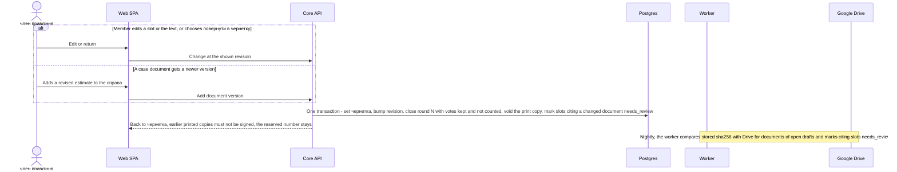

**Flow 4: Render the print copy and reserve the number (чернетка or готовий до голосування → готовий до підпису) — AC-04, AC-21, AC-14c, AC-33, AC-41**

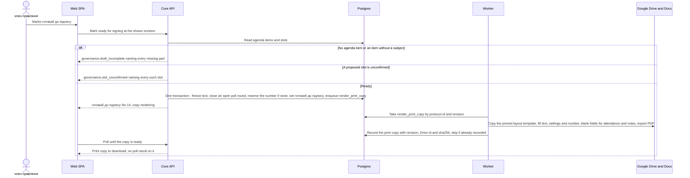

**Flow 5: Upload the signed scan with the meeting facts and lock (готовий до підпису → підписаний) — AC-14, AC-34, AC-15, AC-40, AC-16**

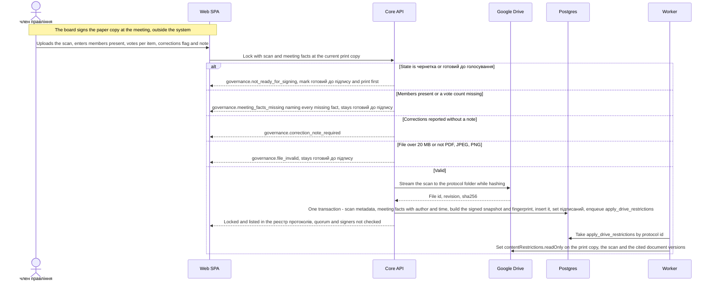

**Flow 6: A change after lock or after withdrawal is refused — AC-17, AC-38, AC-39, AC-32**

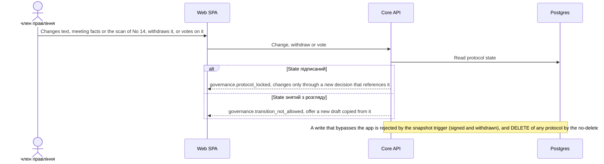

**Flow 7: Access outside the term is refused — AC-19, AC-16**

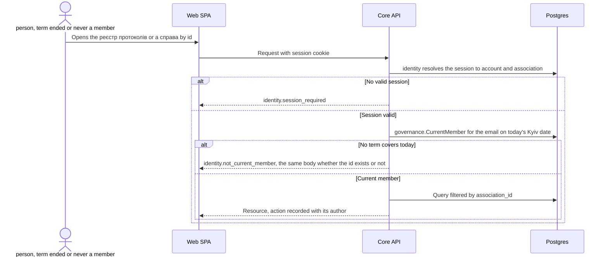

**Flow 8: Google services fail — PRD §6 availability; branches of Flows 1, 4, 5**

Rule: a step that needs Drive **before** the state can change (file upload in Flows 1 and 5) runs before the database transaction; if it fails nothing is committed and the member gets `governance.storage_unavailable`. A file uploaded whose transaction then fails is removed by a `remove_orphan_file` job. Google work **after** a committed change (proposal, print copy) is a job with retries, so an outage delays it but never undoes a state.

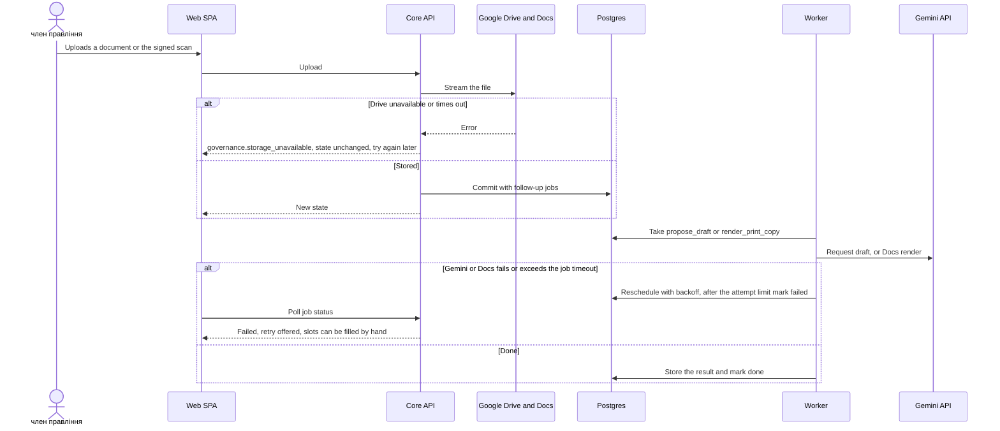

**Flow 9: Withdraw a draft (чернетка, готовий до голосування or готовий до підпису → знятий з розгляду) — AC-35, AC-36, AC-37, AC-38**

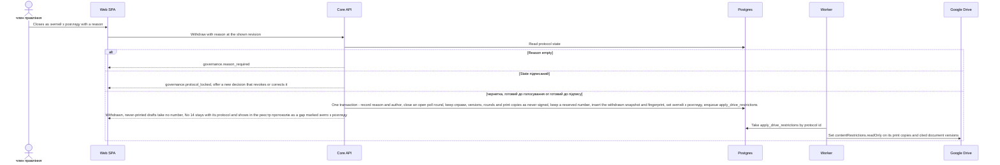

**Flow 10: Nightly integrity check of signed and withdrawn snapshots (PRD §6 "Integrity of locked protocols", "Retention")**

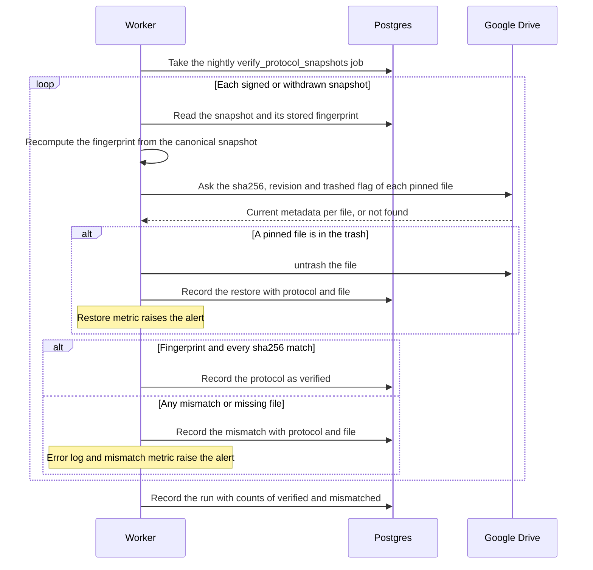

**Flow 11: Nightly backup (PRD §6 "Durability of the registry")**

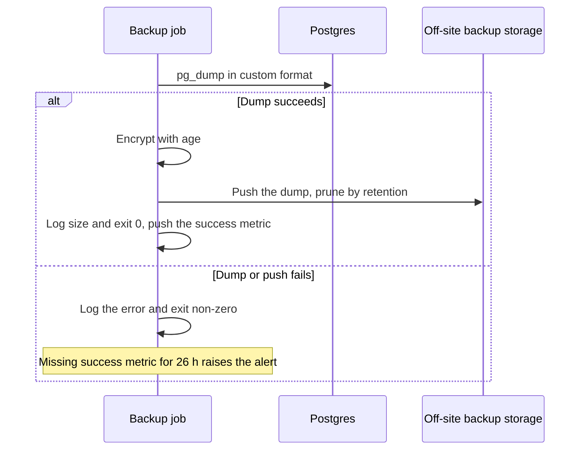

### Flow 12: Maintain association settings and roster — AC-42, AC-02

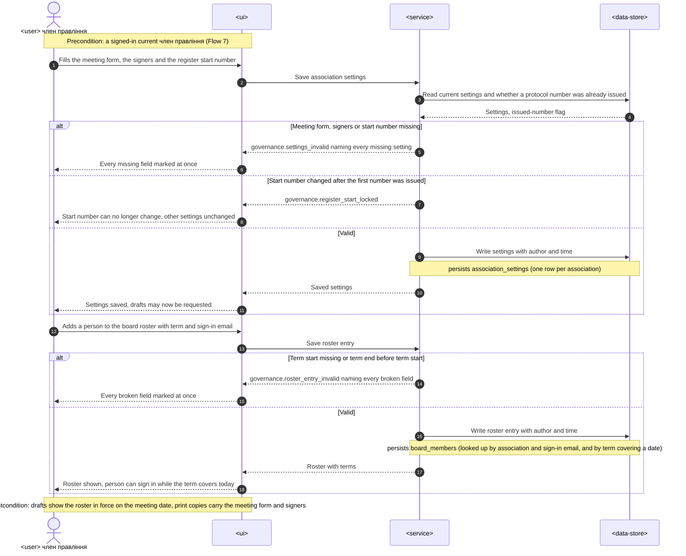

### Flow 13: Search the реєстр протоколів and open a decision — AC-18, AC-41, AC-15

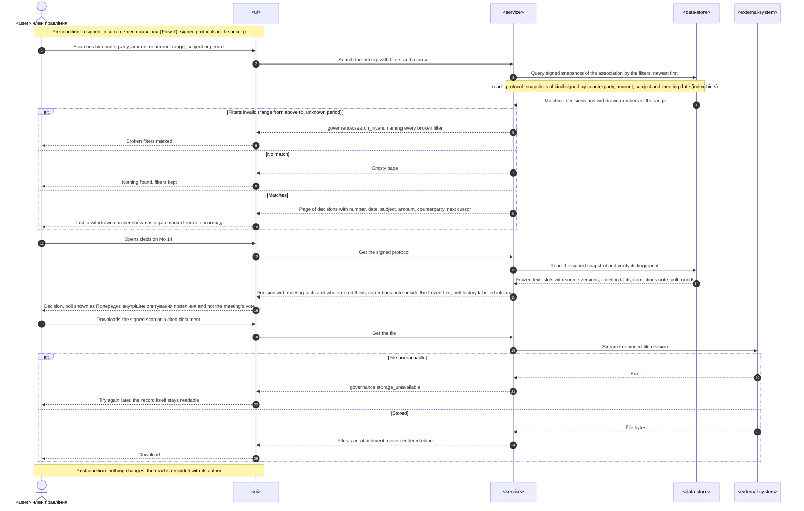

### Coverage: US/AC → flows

| ID | Realized by (§6 heading) | How | Note |
|---|---|---|---|
| US-01 | Flow 12, Flow 1 | flow | |
| US-02 | Flow 1, Flow 4 | flow | |
| US-03 | Flow 2, Flow 3 | flow | |
| US-04 | Flow 1, Flow 3 | flow | |
| US-05 | — | N/A | Stage 2 (blocking checks and overrides), PRD §1, §3 |
| US-06 | Flow 4, Flow 5, Flow 6 | flow | |
| US-07 | Flow 13, Flow 7 | flow | |
| US-08 | — | N/A | Stage 2 (export for the ревізійна комісія), PRD §1, §3 |
| US-09 | Flow 1 | flow | |
| US-10 | — | N/A | Stage 2 (шаблони формулювання), PRD §1, §3 |
| US-11 | — | N/A | Stage 2 (попередження and related чинні рішення), PRD §1, §3 |
| US-12 | Flow 1, Flow 8 | flow | |
| US-13 | Flow 9, Flow 6 | flow | |
| AC-42 | Flow 12, Flow 1 | flow | Saving in Flow 12, refusal in Flow 1 `alt Settings missing` |
| AC-02 | Flow 12 | branch | `alt Term start missing or term end before term start` |
| AC-26 | Flow 1 | flow | |
| AC-03 | Flow 1 | flow | Step «Load the draft» |
| AC-03c | Flow 1 | flow | Transaction step «new agenda item on the meeting's existing draft» |
| AC-29 | Flow 1 | branch | `alt Revision matches` |
| AC-04 | Flow 4 | branch | `alt No agenda item or an item without a subject` |
| AC-30 | Flow 2 | flow | |
| AC-31 | Flow 2 | branch | `else Own vote` |
| AC-41 | Flow 2, Flow 4, Flow 13 | flow | Informal label on the poll, no poll result on the print copy, poll history labelled in the реєстр |
| AC-05d | Flow 3 | flow | |
| AC-05e | Flow 2 | branch | `else Vote for another member` |
| AC-32 | Flow 2, Flow 6 | branch | `alt Draft not готовий до голосування` |
| AC-09 | Flow 3 | branch | `else A case document gets a newer version`, plus the nightly sha256 note |
| AC-21 | Flow 1, Flow 4 | branch | `else A proposed slot is unconfirmed` (Flow 4) |
| AC-22 | Flow 1 | branch | `alt Valid structured answer` — the amount choice rule runs inside the propose_draft validation, not drawn step by step |
| AC-28 | Flow 1 | branch | `alt Valid structured answer` — fact validator turns facts in text into unconfirmed slots |
| AC-28b | Flow 1 | branch | `alt Valid structured answer` — confirmed slots kept, new value stored beside them |
| AC-14c | Flow 4 | branch | `else Ready` |
| AC-33 | Flow 4 | branch | `else Ready` — open poll round closed, no poll result on the copy |
| AC-14b | Flow 3 | flow | |
| AC-14 | Flow 5 | branch | `else Valid` |
| AC-34 | Flow 5 | branch | `else Members present or a vote count missing` |
| AC-15 | Flow 5, Flow 13 | branch | `else Corrections reported without a note` (Flow 5), note shown beside the frozen text (Flow 13) |
| AC-40 | Flow 5 | branch | `alt State is чернетка or готовий до голосування` |
| AC-16 | Flow 7 | branch | `alt No term covers today` |
| AC-17 | Flow 6 | branch | `alt State підписаний` |
| AC-18 | Flow 13 | flow | |
| AC-19 | Flow 7 | flow | |
| AC-35 | Flow 9 | branch | `else чернетка, готовий до голосування or готовий до підпису` |
| AC-36 | Flow 9 | branch | `else чернетка, готовий до голосування or готовий до підпису` — poll round closed and kept |
| AC-37 | Flow 9 | branch | `else чернетка, готовий до голосування or готовий до підпису` — reserved No 14 kept |
| AC-38 | Flow 9, Flow 6 | branch | `else State підписаний` (Flow 9) |
| AC-39 | Flow 6 | branch | `else State знятий з розгляду` |
| AC-01 | — | N/A | Stage 2 (effective-dated rules), PRD §5 Deferred |
| AC-02b | — | N/A | Stage 2 (effective-dated rules), PRD §5 Deferred |
| AC-02c | — | N/A | Stage 2 (quorum computation), PRD §5 Deferred |
| AC-03b | — | N/A | Dropped 2026-10-25, replaced by AC-29 |
| AC-05 | — | N/A | Stage 2 (quorum and majority), PRD §5 Deferred |
| AC-05b | — | N/A | Stage 2 (quorum and majority), PRD §5 Deferred |
| AC-05c | — | N/A | Stage 2 (blocking checks), PRD §5 Deferred |
| AC-06 | — | N/A | Stage 2 (quorum and majority), PRD §5 Deferred |
| AC-07 | — | N/A | Stage 2 (attendance and non-voting rules), PRD §5 Deferred |
| AC-08 | — | N/A | Stage 2 (attendance and non-voting rules), PRD §5 Deferred |
| AC-10 | — | N/A | Stage 2 (source of truth as a blocking rule), PRD §5 Deferred |
| AC-11 | — | N/A | Stage 2 (blocking checks), PRD §5 Deferred |
| AC-12 | — | N/A | Stage 2 (overrides), PRD §5 Deferred |
| AC-12b | — | N/A | Stage 2 (overrides), PRD §5 Deferred |
| AC-13 | — | N/A | Stage 2 (overrides), PRD §5 Deferred |
| AC-14d | — | N/A | Stage 2, PRD §5 Deferred |
| AC-17b | — | N/A | Stage 2, PRD §5 Deferred |
| AC-17c | — | N/A | Stage 2, PRD §5 Deferred |
| AC-20 | — | N/A | Stage 2, PRD §5 Deferred |
| AC-23 | — | N/A | Stage 2, PRD §5 Deferred |
| AC-23b | — | N/A | Stage 2, PRD §5 Deferred |
| AC-24 | — | N/A | Stage 2, PRD §5 Deferred |
| AC-25 | — | N/A | Stage 2, PRD §5 Deferred |
| AC-25b | — | N/A | Stage 2, PRD §5 Deferred |
| AC-27 | — | N/A | Stage 2, PRD §5 Deferred |

Coverage: 13/13 user stories · 59/59 ACs — 29 non-runtime N/A.

**Flags:**
- Flows 1–11 were seeded by architecture-design with concrete participants (Web SPA, Core API, Postgres, Worker, Google Drive, Gemini API, Backup job) and bold labels instead of `###` headings; left untouched (additive run), so this table cites them as «Flow N». Flows 12–13 use the generic vocabulary.
- §6 follows the lifecycle order, not §4: Flow 12 (US-01) is appended rather than moved to the top, to keep the existing blocks untouched.
- New error codes not yet in §8: `governance.settings_invalid`, `governance.roster_entry_invalid`, `governance.search_invalid` — for api-forge and the §8 error-handling row.
- Async flows (1, 4, 5, 9, 10) show idempotent job handlers and retries; the dead-letter is River's failed/discarded state (Flow 8), with no separate dead-letter queue — confirm against ADR-0006 if a retry or alert shape is needed per job kind.
- Index hints for generate-data-model: `board_members` by (association, sign-in email) and by term covering a date; `protocol_snapshots` of kind `signed` by counterparty, amount, subject and meeting date, cursor over (created_at, id).

## 7. Deployment view

One small virtual machine in the EU runs the whole system with docker compose, the same shape as `infra/compose.yaml` locally: `caddy` (TLS for the public HTTPS origin that OIDC needs, serves the built SPA, reverse-proxies `/api/*` to the API), `core-api` (1 replica), `worker` (1 replica, same image, different command, ADR-0001), `postgres:18.6` on a persistent volume, `backup` (nightly `pg_dump`, ADR-0016) and `otel-lgtm` (or a hosted Grafana stack with the same OTLP endpoint). Secrets live in an env file on the VM, readable only by the services: the OIDC client (ADR-0003), the AES-GCM key that encrypts the association Google account's refresh token (ADR-0005), the Gemini API key (ADR-0004), the session-cookie key, the backup encryption key and storage credentials (ADR-0016). Deploys are image pulls plus `docker compose up -d`; migrations run on API start (repo ADR 0004), and the worker starts after the API is healthy so River's schema exists.

**Data and backup → [ADR-0016](./adr/0016-back-up-postgres-nightly-off-the-vm-with-quarterly-restore-drills.md).** Postgres is dumped nightly (`pg_dump -Fc`, encrypted with `age`) to storage outside the VM's provider account, which gives RPO ≤ 24 h; restore onto a fresh VM from compose + the latest dump fits RTO ≤ 4 h and is drilled quarterly, with a drill record kept (PRD §6). Files stay on the association's Google Drive and are not copied out; Postgres holds their sha256 and revision; files of signed and withdrawn protocols carry Drive's read-only restriction, the nightly integrity check restores a trashed file with `untrash` and detects a changed or missing one (accepted debt, §11).

**Monitoring:**

| Signal | Source | Alert |
|---|---|---|
| Request duration p95 per route | `http.server.request.duration` from otelhttp | read > 200 ms, write > 500 ms, upload > 3 s for 15 min |
| Print copy time, transition to PDF recorded | `governance.print_copy.duration` from the `render_print_copy` job | p95 > 5 s over a day |
| Proposal time, request to filled draft | `governance.proposal.duration` from the `propose_draft` job | p95 > 30 s over a day |
| Rejected uploads | `governance.upload.rejected` by reason (size, type) | none (reviewed weekly) |
| Job queue age and failures per kind | River job counts by kind and state, from the worker | oldest available job > 10 min; > 3 failed jobs of one kind in 1 h |
| Integrity mismatches | `governance.integrity.mismatches`, `governance.integrity.restored` (untrashed files), `governance.integrity.verified` per nightly run over signed and withdrawn snapshots | any mismatch, missing or restored file at once; no successful run in 26 h |
| Google API errors | Drive, Docs and Gemini client spans; `google.request.errors` by operation | error rate > 5 % for 15 min; any authorization failure (refresh token revoked) at once |
| Backup | `backup` job exit code, dump size, success timestamp | missing or failed dump; no success in 26 h; dump size drop > 50 % |
| Uptime | external check on the `system` health endpoint every 5 min | monthly ratio below 99.5 % |

**Tracing:** otelhttp spans on every request, otelpgx spans on SQL, spans around each Drive, Docs and Gemini call; the job payload carries the W3C trace context so a request and its job share one trace (§8); logs via `log/slog` with `otelslog` (repo ADR 0001), never logging document content or personal data.

**Scaling thresholds:**
- 15-20 protocols a year (PRD §1) is decades of rows in single tables — no partitioning, one API and one worker replica.
- Files: a few hundred MB a year in the association's Drive at ≤ 20 MB per file (PRD §6); Drive quota is the first limit to watch (the account's storage is shared with its mail).
- Revisit topology only when a second association joins (PRD §3 non-goal) or when `http.server.request.duration` p95 for draft open passes 200 ms.

## 8. Crosscutting concepts

| Concept | Convention | Where defined |
|---|---|---|
| Logging | `log/slog` JSON to stdout + `otelslog`; fields `module=<bc>`, `job_id`, `protocol_id`, `trace_id` where known; never log document content, extracted text, conversation text, correction notes, personal data, tokens or keys | repo ADR 0001; here |
| Authentication | OIDC authorization-code flow with PKCE, server-side session row behind an HttpOnly, Secure, SameSite=Lax cookie; no session → 401 `identity.session_required`; `system/health` stays public | ADR-0003 |
| Authorization | Every protected request: the identity middleware asks `governance.CurrentMember` through its `module.go`; a session whose email is not a current член правління today (term covers today's Europe/Kyiv date) → 403 `identity.not_current_member` **before** the request reaches any resource, so existence is never revealed (AC-19, AC-16). Inside `governance`: any current член правління edits a draft, starts or ends a poll, prints, locks, withdraws and keeps settings and roster (AC-29, PRD §6.1); a member casts and changes only their own vote (AC-05e); the author of every action is recorded | ADR-0003; PRD §6.1 |
| Association scope | `association_id` on every table this feature owns (and on `meetings`); every sqlc query filters on it explicitly; no RLS in Stage 1; another association's id answers not found | ADR-0015 |
| Error handling | RFC 9457 `application/problem+json` through `internal/platform/httpapi`; machine code `<context>.<error_name>` (e.g. `governance.settings_missing`, `governance.slot_unconfirmed`, `governance.meeting_facts_missing`, `governance.protocol_locked`, `governance.register_start_locked`, `governance.storage_unavailable`, `identity.not_current_member`); 422 names every broken field at once; 409 on a stale revision, a refused transition or a register start change after the first number; 403 for a non-member before any resource | CLAUDE.md; repo ADR 0003; ADR-0003; ADR-0009; ADR-0017 |
| Text facts | A fact in text written by the помічник протоколу becomes an unconfirmed proposed slot (AC-28) and printing waits for its confirmation (AC-21) — the one Stage 1 print gate; a fact a person types into the text is highlighted only (Stage 2 blocks it) | ADR-0011; PRD AC-21, AC-28 |
| Lifecycle | States and transitions of PRD §1 in `governance/domain/protocol.go`; refused transitions answer `governance.transition_not_allowed`, `governance.poll_not_open`, `governance.not_ready_for_signing` | ADR-0009 |
| ID strategy | UUIDs (`github.com/google/uuid`) for every entity; cross-context references by id only, no foreign keys between contexts; the protocol number is a separate human sequence per association | repo ADR 0002; ADR-0017 |
| Money | Integer kopiyky (`bigint`) plus currency, matching `finance.contracts.amount_cents`; formatting (digits and words) in one renderer | ADR-0011; here |
| Dates and time | Roster terms are calendar `date`s; `meetings.held_at` is `timestamptz` and is converted to the Europe/Kyiv calendar date wherever a date is meant — "roster in force on the meeting date" (AC-03), the date printed on the copy (AC-14c) and "term covers today" (AC-19); event times are `timestamptz` | here |
| Audit trail | Slot confirmations, wording changes, poll votes, prints, meeting facts, uploads, withdrawals and lock are append-only rows with author and time; history is never updated in place | PRD AC-29, AC-14, AC-16 |
| Immutability and retention | `protocol_snapshots` (kinds `signed` and `withdrawn`): trigger rejects UPDATE and DELETE; `protocols`: trigger rejects DELETE in any state; signed and withdrawn protocols refuse changes in `app/`; triggers wrapped in `-- +goose StatementBegin/End`; the nightly check verifies both kinds; the реєстр протоколів reads only `signed`, a withdrawn number shows as a gap «знято з розгляду» | ADR-0007; ADR-0017; PRD §6 Retention |
| Concurrency | Optimistic: each mutation carries the protocol revision it was built on | ADR-0009 |
| Files | Allow-list PDF, JPEG, PNG checked by content sniffing, not by extension; ≤ 20 MB; sha256 computed while streaming and compared with Drive's; stored in the association's Drive under `drive.file`; on lock and withdrawal set `contentRestrictions.readOnly`; a trashed pinned file is restored with `untrash` by the nightly check and alerted; a new document version is a new file and marks citing slots of open drafts `needs_review`; served only through the API as `Content-Disposition: attachment` with `X-Content-Type-Options: nosniff`, never inline | ADR-0005; PRD §6, §6.1 |
| Secrets | Env file on the VM; the association Google account's refresh token stored in `identity.google_connections` encrypted with AES-GCM (random nonce per write, key from the environment, key id kept for rotation) | ADR-0003, ADR-0005 |
| Text-generation boundary | Only `governance/adapters/gemini` imports the Gemini SDK (depguard); prompts carry only the documents of the справа being drafted; output is schema-validated and treated as untrusted proposals; facts in text only as slot placeholders | ADR-0014, ADR-0004, ADR-0011 |
| Background jobs | River; payloads carry ids and the W3C trace context only, never content; handlers are idempotent (keyed by protocol id and revision) so retries are safe; job enqueued in the same transaction as the write that needs it | ADR-0006 |
| Pagination | Opaque cursor over `(created_at, id)`, newest first, page 20 / max 100; registry search pages the same way | existing `governance` meetings list |
| Observability | OpenTelemetry traces, metrics and logs over OTLP; otelhttp and otelpgx spans; feature metrics and alerts in §7 | repo ADR 0001; §7 |
| Internationalisation | UI and print copy in Ukrainian only; domain terms exactly as in CONTEXT.md; code identifiers, error codes and API fields in English | CONTEXT.md |
| Rate limiting | <!-- N/A: ≤ 7 signed-in users, all members of one board; Gemini spend bounded by conversation turns, watched through governance.proposal metrics --> N/A | — |

## 9. Architecture decisions

| # | Title | Status | Section |
|---|---|---|---|
| [0001](./adr/0001-build-backend-web-and-worker-surfaces.md) | Build board-protocol as backend service, web frontend and a separate worker | Accepted | §4 |
| [0002](./adr/0002-extend-governance-and-add-cases-assistant-identity-contexts.md) | Extend governance with board decisions and add cases, assistant and identity contexts | Superseded by ADR-0014 | §4 |
| [0003](./adr/0003-sign-in-with-oidc-and-postgres-sessions.md) | Sign in through OIDC (Google first) with server-side sessions in Postgres | Accepted (amended 2026-10-25) | §4, §8 |
| [0004](./adr/0004-use-gemini-api-for-document-reading-and-drafting.md) | Use the Gemini API, behind a port, to read case documents and to draft | Accepted (amended 2026-10-25) | §4 |
| [0005](./adr/0005-store-files-in-association-owned-google-drive-folder.md) | Store files in an association-owned Google Drive folder, with metadata in Postgres | Accepted (amended 2026-10-25) | §4, §6, §8 |
| [0006](./adr/0006-run-background-work-in-worker-via-river-queue.md) | Run background work in the worker through a River job queue in Postgres | Accepted (amended 2026-10-25) | §4 |
| [0007](./adr/0007-lock-protocols-as-fingerprinted-immutable-snapshots.md) | Lock a protocol as an immutable, fingerprinted snapshot and never delete a protocol | Accepted (amended 2026-10-25) | §4, §6, §8 |
| [0008](./adr/0008-keep-charter-rules-as-typed-effective-dated-parameters.md) | Keep правила статуту as a typed catalog of effective-dated parameters | Deferred to Stage 2 | §5 |
| [0009](./adr/0009-track-draft-lifecycle-with-states-and-revision-numbers.md) | Track the protocol lifecycle with explicit states, poll rounds and a revision number | Accepted (amended 2026-10-25) | §5 |
| [0010](./adr/0010-evaluate-checks-on-read-and-bind-overrides-to-input-fingerprints.md) | Evaluate checks on read and bind each override to the check's input fingerprint | Deferred to Stage 2 | §5 |
| [0011](./adr/0011-store-decision-text-as-fragments-with-slot-placeholders.md) | Store decision text as fragments with slot placeholders | Accepted (amended 2026-10-25) | §5 |
| [0012](./adr/0012-integrate-contexts-through-synchronous-module-facades.md) | Integrate contexts through synchronous module.go facades wired in the composition root | Superseded by ADR-0014 | §5 |
| [0013](./adr/0013-render-signing-copies-from-google-docs-templates.md) | Render print copies from Google Docs layout templates | Accepted (amended 2026-10-25) | §5 |
| [0014](./adr/0014-keep-board-protocol-in-governance-and-add-only-an-identity-context.md) | Keep board-protocol in governance and add only an identity context | Accepted | §4, §5 |
| [0015](./adr/0015-scope-owned-rows-to-one-association-with-explicit-query-filters.md) | Scope owned rows to one association with an association_id column and explicit query filters, without RLS | Accepted | §4, §8 |
| [0016](./adr/0016-back-up-postgres-nightly-off-the-vm-with-quarterly-restore-drills.md) | Back up Postgres nightly off the VM with quarterly restore drills | Accepted | §4, §7 |
| [0017](./adr/0017-reserve-the-protocol-number-at-first-print-and-never-reuse-it.md) | Reserve the protocol number at the first print copy and never reuse it | Accepted (amended 2026-10-25) | §5, §8 |
| [0018](./adr/0018-enter-meeting-facts-with-the-signed-scan-and-refuse-lock-without-them.md) | Enter the meeting facts with the signed scan and refuse the lock without them | Accepted | §5, §6 |

Inline decisions below the ADR gate: web UI-architecture (SPA per repo ADR 0001, polling for slow results — §4), single-VM compose topology (§7), crosscutting conventions (§8).

ADR files live under `docs/features/board-protocol/adr/NNNN-<title>.md`. An ADR that no longer holds is never deleted: it is marked Superseded (pointing to its successor) or Deferred to Stage 2; an amended ADR carries a dated note at the top.

## 10. Quality requirements

The three goals of §1 first, then the remaining PRD §6 targets. Targets are quoted from PRD §6 verbatim; any other number under "How verify" is a test parameter, not a target, and plan-tests may change it.

**QG-1. Integrity of locked protocols**
- **When:** anyone tries to change a locked protocol — through the API, by a direct SQL UPDATE or DELETE on `governance.protocol_snapshots` or DELETE on `governance.protocols`, or by editing, trashing or deleting a pinned file in the association's Google Drive. The same holds for a withdrawn protocol's snapshot.
- **Then:** "0 changes to text, meeting facts or signed copy after lock": the API refuses and explains that a locked protocol changes only through a new board decision that references it (AC-17); the triggers reject the UPDATE or DELETE (ADR-0007); Drive's read-only restriction stops a casual edit of a pinned file, a trashed one is restored with `untrash` (ADR-0005), and any other change made in Drive is caught by the "periodic fingerprint comparison of every locked protocol, alert on mismatch".
- **How verify:** integration tests on `testdb.New(t)` that lock a protocol and withdraw another and assert UPDATE and DELETE on both snapshot rows fail, and DELETE on a protocol in each state fails; API test for AC-17 on text, meeting facts and signed copy; worker test with a fake Drive port returning a different sha256 for one pinned file, asserting a recorded mismatch and `governance.integrity.mismatches` incremented, and returning one file as trashed, asserting `untrash` was called and `governance.integrity.restored` incremented; a worker test that `apply_drive_restrictions` sets `contentRestrictions.readOnly` on every pinned file after lock and after withdrawal; in production the nightly run's mismatch count stays 0 and its alert (§7) is wired.

**QG-2. Traceability of proposed numbers**
- **When:** the помічник протоколу proposes slot values, a член правління asks in the conversation for a change, or a draft is marked готовий до підпису.
- **Then:** every proposed value is "from document, unconfirmed" with its fragment and link until a person confirms or corrects it, and the draft "cannot be marked готовий до підпису while any of them is unconfirmed" (AC-21); generated text holds no fact outside the слоти рішення (AC-28); a confirmed slot is never overwritten (AC-28b). PRD §7 target: "100% of the numbers the system proposed in locked protocols confirmed or corrected by a person, each with a link to its case document".
- **How verify:** unit tests of the fact validator in `governance/domain` (digits, Ukrainian number words, month names, document numbers, roster names); app tests for AC-21, AC-28, AC-28b and the `governance.slot_unconfirmed` refusal; an evaluation run of the помічник протоколу on documents of past protocols asserting no plain fragment passes the validator with a fact in it.

**QG-3. Confidentiality of the association's records**
- **When:** a person whose board term has ended, or who was never a член правління, signs in and calls any protected operation (cases, drafts, the реєстр протоколів, files).
- **Then:** "only current члени правління (term covers today) can see cases, drafts and the реєстр протоколів; access ends on the term end date" (PRD §6.1); the system "denies access and does not reveal whether any protocol or case exists" (AC-19).
- **How verify:** integration test that iterates every operation in `services/core/api/openapi.yaml` except `system/health` with a former member's session and asserts 403 `identity.not_current_member` with an identical body whether the target id exists or not; boundary test with a term ending today and yesterday (Europe/Kyiv); Playwright e2e that a former member reaches no registry page.

**QG-4. Responsiveness of reads and writes**
- **When:** a член правління opens a draft or a registry decision, searches the registry, or saves a change without a file.
- **Then:** read p95 "≤ 200 ms"; write without a file p95 "≤ 500 ms" (PRD §6).
- **How verify:** integration benchmark on testcontainers Postgres seeded with 500 locked protocols (test parameter, not a target), asserting p95 over 200 requests per operation; in production the "request-duration metric in the service telemetry" (`http.server.request.duration` per route, §7 alert).

**QG-5. Signed-copy and case-document upload**
- **When:** a член правління uploads a signed scan or a case document.
- **Then:** "files up to 20 MB, PDF / JPEG / PNG; p95 ≤ 3 s for 20 MB" (PRD §6); larger files and other types are refused.
- **How verify:** integration test uploading a 20 MB PDF (accepted) and a 21 MB one and a DOCX (test parameters; refused, counted); in production the "upload-duration metric; rejected-size count" (`http.server.request.duration` for the upload routes, `governance.upload.rejected`).

**QG-6. Print copy rendering**
- **When:** a draft is marked готовий до підпису.
- **Then:** "p95 ≤ 5 s" (PRD §6).
- **How verify:** worker integration test with the fake `Renderer`; one smoke test against a test Google account recording the duration; in production the "request-duration metric" for the transition plus `governance.print_copy.duration` (transition to PDF recorded).

**QG-7. Proposed protocol from a conversation**
- **When:** a член правління asks the помічник протоколу for a draft with attached documents.
- **Then:** "p95 ≤ 30 s from request to filled draft" (PRD §6).
- **How verify:** before the Stage 1 release, a run of the evaluation set (documents of past protocols) against the configured Gemini model, recording duration per proposal; in production the "proposal-duration metric in the service telemetry" (`governance.proposal.duration`).

**QG-8. Durability of the registry**
- **When:** the VM's disk or the VM itself is lost.
- **Then:** "RPO ≤ 24 h (nightly backup), RTO ≤ 4 h; restore verified quarterly" (PRD §6).
- **How verify:** "nightly backup log + quarterly restore drill record" — the `backup` job's success metric and alert (§7); a quarterly drill that restores the latest dump onto a fresh VM, runs the integrity check against Drive and records the elapsed time against 4 h (ADR-0016).

**QG-9. Retention**
- **When:** any time within 5 years of a protocol being locked or withdrawn.
- **Then:** "locked and withdrawn protocols, print copies and scans kept ≥ 5 years, never hard-deleted" (PRD §6).
- **How verify:** the no-delete trigger test of QG-1; a test that withdrawing keeps справи, versions, rounds and print copies and writes a `withdrawn` snapshot; no API operation deletes a protocol, print copy or scan (contract review in api-forge).

**QG-10. Availability**
- **When:** any calendar month of operation.
- **Then:** "99.5 % monthly" (PRD §6).
- **How verify:** "uptime check, monthly window" — the external uptime check of the public origin every 5 min (test parameter, not a target; §7), with the monthly ratio reported.

## 11. Risks and technical debt

| Risk / debt | Severity | Mitigation | Owner |
|---|---|---|---|
| Personal data of co-owners and contractors leaves the association's hosting for the Gemini API (ADR-0004; PRD §8 "May case documents … be processed …") | High | Paid tier only (no use of data to improve the provider's products); only the documents of the справа being drafted are sent; the board approves the processing by its own decision before the Stage 1 release; no content in logs | Andrii Opryshko |
| The Gemini Files API keeps an uploaded copy of a case document on Google's side for up to 48 h (ADR-0004) | Medium | Send inline whenever the file fits the inline request limit; delete a Files API upload right after the response; covered by the same board approval; listed as accepted debt | Andrii Opryshko |
| The association's Google account is the single home of every file (ADR-0005, ADR-0013): its compromise or loss takes all case documents and signed scans; the database backup does not cover files | High | Account owned by the association, not a person; two-factor authentication and two administrators; the `spilno/` folder shared with nobody; files of signed and withdrawn protocols carry Drive's read-only restriction; the nightly sha256 check restores a trashed file with `untrash` and detects any other change (§6 Flow 10); the signed paper original is kept as today | Andrii Opryshko |
| Upload of a 20 MB file goes browser → API → Drive and may exceed "p95 ≤ 3 s for 20 MB" (PRD §6, ADR-0005) | Medium | Measure the upload routes from the first release; if over target, let the API open a Drive resumable session and the browser send the bytes, with the API verifying sha256 and revision afterwards | Andrii Opryshko |
| Rendering through the Docs API (copy, batchUpdate, export) may exceed "p95 ≤ 5 s" and needs a Google test account for tests (ADR-0013) | Medium | A fake `Renderer` port for unit and integration tests; one smoke test against a test Google account; a Typst adapter remains a fallback behind the same port | Andrii Opryshko |
| `drive.file` scope lets spilno see only files it created: attaching a file that already sits elsewhere in the association's Drive is not possible in Stage 1 (ADR-0005) | Low | Members download and upload such a file through spilno; a Google Picker flow (still `drive.file`) or a wider scope is a Stage 2 decision | Andrii Opryshko |
| Gemini extraction quality on the association's own estimates and invoices is unmeasured (no bake-off was run) | Medium | Evaluation set from the documents of past protocols before the Stage 1 release, measuring slot accuracy against AC-22 and duration; the `TextModel` port admits another adapter; every number still needs a person's confirmation (AC-21) | Andrii Opryshko |
| The refresh token of the association Google account is revoked or expires — uploads, proposals and print copies stop | Medium | Alert on Google authorization errors (§7); a short re-authorization runbook; uploads fail visibly, nothing is half-written (jobs retry) | Andrii Opryshko |
| Backup scripts and the quarterly drill depend on one developer (ADR-0016) | Medium | The drill is a written runbook with a record per run; the backup alert (§7) reaches a second board member too | Andrii Opryshko |
| Every член правління needs a Google account, and local development needs a sign-in shim that must never reach production (ADR-0003) | Medium | Shim enabled only by a dev configuration; a test asserts it is off in the production configuration; roster entries record each member's sign-in email | Andrii Opryshko |
| The informal poll is passed off as the meeting's vote (PRD §6.1 abuse case) | Medium | Label on every view (AC-41); tallies never on the print copy and never pre-fill the meeting facts (ADR-0018) | Andrii Opryshko |
| Adoption and habit: members keep deciding in chat and on paper (PRD §7 adoption ≥ 80%) | Medium | Reviewed quarterly against PRD §7 | Andrii Opryshko |
| Two SADs for this feature (this file + `adr/`, and `sad.ao-architecture.md` + `adr.ao-architecture/`) | Medium | Both follow the same agreed architecture since 2026-10-25; pick the canonical SAD before `/sdlc:break-tasks` | Andrii Opryshko |
| Brownfield: existing `finance` and `governance` endpoints become sign-in protected; `meetings` gains `association_id` backfilled to the one association (ADR-0015); the web prototype's in-memory `api.ts` is replaced; `r.Mount` returns 404 for generated handlers; triggers need `-- +goose StatementBegin/End` | Low | break-tasks carries the §5 wiring checklist; `system/health` stays public so the existing e2e smoke test keeps working | Andrii Opryshko |
| PRD §8 open question: which meeting forms the charter allows and who signs — needed before the first draft (AC-42) | Open question | Resolve before Stage 1 release (PRD §8 owner) | Andrii Opryshko |
| No deadline or effort budget is quoted (§2) | Low | Staged delivery — Stage 1 is useful on its own (PRD §1) | Andrii Opryshko |

**Accepted debt (acceptable in Stage 1, plan to fix later):**
- Files are not copied out of Google Drive; the database backup covers metadata and sha256 only (ADR-0005, ADR-0016).
- Gemini Files API copies of case documents may stay on Google's side up to 48 h (ADR-0004).
- Polling instead of server push for slow results and votes (§4).
- Only a Gemini adapter behind `TextModel`; no measured alternative (ADR-0004).
- The locked-snapshot format is a long-lived contract carried by `schema_version`; Stage 2 adds rule versions and checks to it (ADR-0007).
- River's schema migrations are mirrored into goose by hand on every River upgrade (ADR-0006).
- No RLS: association scope rests on query filters and their tests until a second association joins (ADR-0015).

## 12. Glossary

Domain terms are canonical in [CONTEXT.md](./CONTEXT.md) `## Glossary`; the short forms below are reminders, and CONTEXT wins on any conflict.

| Term | Meaning |
|---|---|
| акт виконаних робіт | Document signed with the contractor confirming which works were done and for what amount |
| блокуюча перевірка | Deterministic check that stops a draft from being marked готовий до підпису — **Stage 2**; Stage 1 has none |
| головуючий | The член правління who chairs one board meeting and signs its protocol; in Stage 1 no extra rights in the system |
| готовий до голосування | State with wording frozen as one poll round so members vote on exactly that version; any edit returns it to чернетка |
| готовий до підпису | State with text frozen and a PDF print copy rendered with a reserved number; reached only with every proposed value confirmed; any edit returns it to чернетка |
| джерело коштів | Fund or income line of the approved budget that pays for a decision |
| знятий з розгляду | Final state of a never-signed draft, with a reason; keeps its справи, versions, poll rounds, print copies and any reserved number in an immutable `withdrawn` snapshot; an internal record, not listed in the реєстр протоколів |
| кворум | Minimum number of board members present for valid decisions, per the charter; not computed in Stage 1 |
| кошторис робіт | The management company's priced estimate for one job |
| обхід блокування | A recorded choice, with a reason, to proceed despite a блокуюча перевірка — **Stage 2** |
| помічник протоколу | The conversation that proposes wording and amounts read from documents; nothing it proposes counts until a person confirms it |
| попереднє голосування | Each member's own informal vote per item on one frozen poll round; labelled as not the meeting's vote; never printed, never pre-fills the meeting facts |
| підписаний | Final state after the signed scan and meeting facts are uploaded; locked and immutable |
| правило статуту | One charter parameter kept as data; Stage 1 keeps only the current settings (meeting form, signers, start number) |
| протокол правління | The signed record of one board meeting |
| реєстр протоколів | The association's searchable record of signed (locked) protocols with signed copies, meeting facts, cited documents and poll history; a number taken by a withdrawn protocol shows as a gap marked «знято з розгляду» |
| ревізійна комісія | The association's audit body; receives export packages in Stage 2, has no access |
| слот рішення | One typed field of a decision holding a value, its origin and the case document it is confirmed against |
| справа | The bundle of source documents a decision is based on and cites |
| співвласник | Owner of premises in the building; no access to the system |
| управляюча компанія | Company that maintains the buildings, issues estimates and acts, holds the money |
| чернетка | Editable state of a protocol draft; any current член правління edits it |
| член правління | Person elected to the board for a term; may use the system while the term covers today |
| **Architecture terms (this SAD)** | |
| association settings | The current meeting form, signers and the number the register continues from (AC-42); not effective-dated in Stage 1; the start number is locked once the first number is issued (ADR-0017) |
| association Google account | The Google account owned by the association whose Drive folder `spilno/`, created by spilno under `drive.file`, holds every file (ADR-0005) |
| poll round | Immutable copy of a draft's agenda items, text fragments and slot values taken when the poll starts; votes reference it; closed on return to чернетка or on print (ADR-0009) |
| print copy | The PDF rendered when a draft is marked готовий до підпису, recorded with the revision, number and sha256; voided by any edit (ADR-0009, ADR-0013) |
| reserved number | The protocol number taken at the first print copy; kept on return and withdrawal, never reused (ADR-0017) |
| meeting facts | Members present, the vote count per agenda item and the handwritten-corrections note, entered by a person from the signed paper with the scan, never filled from the roster or the poll (ADR-0018) |
| revision | Integer on a protocol incremented by every change; every mutation carries the revision it was built on (ADR-0009) |
| protocol snapshot | Canonical `jsonb` record of everything a signed (`kind = signed`) or withdrawn (`kind = withdrawn`) protocol shows, append-only (ADR-0007) |
| fingerprint | SHA-256 of a protocol snapshot's canonical serialization, recomputed nightly for both kinds (ADR-0007) |
| text fragment / slot placeholder | Decision text is plain fragments plus references to слоти рішення and meeting facts (ADR-0011) |
| layout template | Google Doc defining the page layout of the print copy; distinct from a шаблон формулювання (ADR-0013) |
| job | A River job carrying ids and the trace context only, enqueued in the writing transaction and run by the worker (ADR-0006) |

