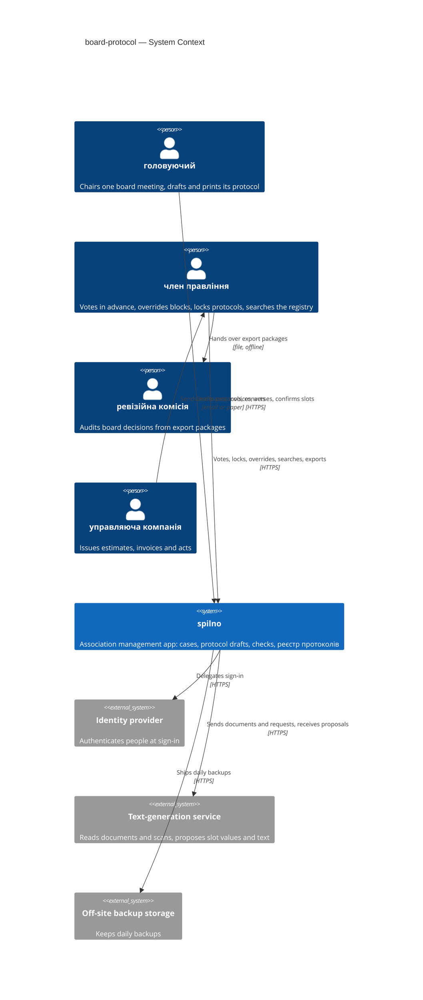
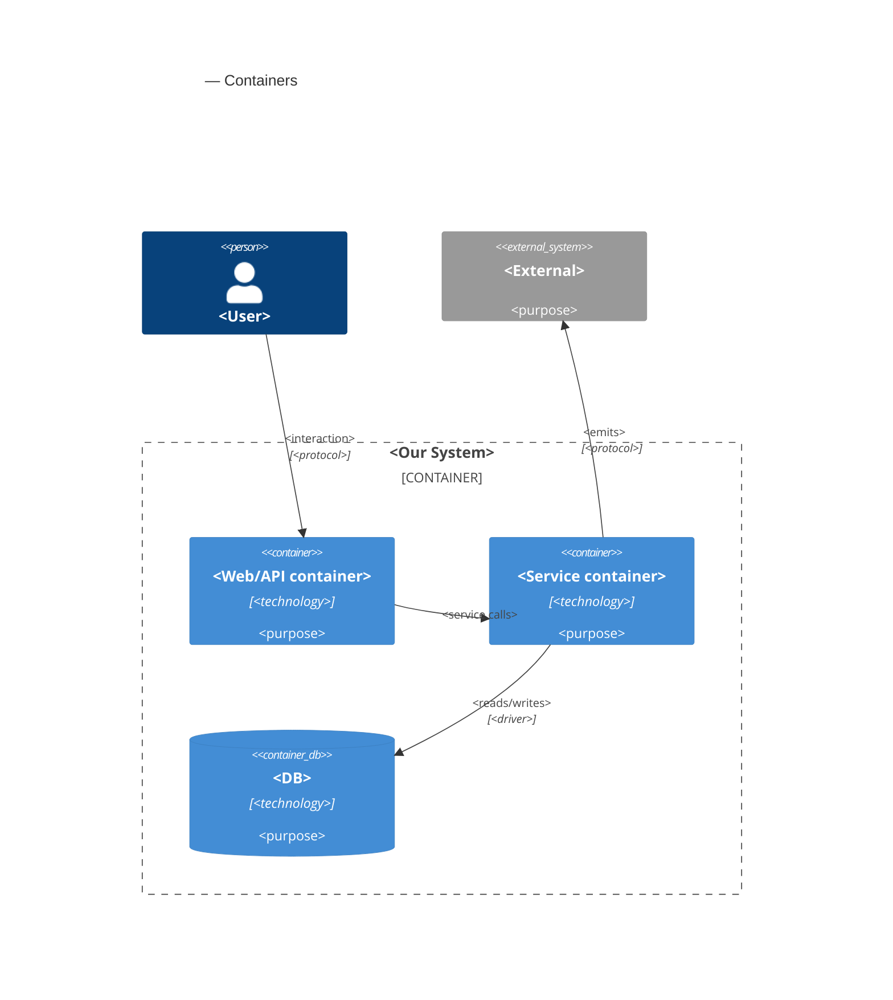
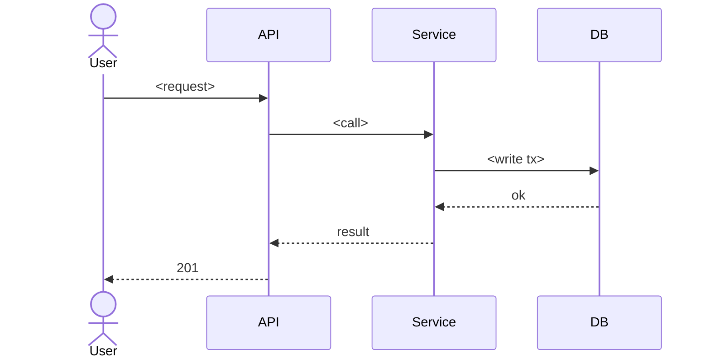

# Software Architecture Document — board-protocol

<!-- Stages 04-05 → see sdlc/plugin/skills/architecture-design/SKILL.md -->
<!-- 12 Arc42 sections. Empty sections — <!-- N/A: <one-line reason> -->. -->
<!-- C4 Context (L1) lives inline in §3. C4 Container (L2) lives inline in §5. -->
<!-- §6 Runtime view seeds the primary flow(s) here; complete-sequence-diagrams (stage 06) then -->
<!--    fills §6 with every critical flow / §5 AC — no cap. -->
<!-- Numbers in §10 come VERBATIM from PRD §6 NFR — no inventing, no rounding. -->

## 1. Introduction and goals

**Intent.** board-protocol lets the головуючий of a board meeting produce a протокол правління in which every amount, counterparty and джерело коштів is a слот рішення confirmed against a document of the справа, and in which the meeting quorum, each кворум пункту and each majority are computed from the board roster and the правила статуту in force on the meeting date (Stage 1). Every current член правління finds a past decision with its signed copy, votes, applied rules and cited documents in the реєстр протоколів instead of searching chats (Stage 1). In Stage 2 the головуючий describes in a conversation what the protocol should decide, attaches the case documents, and reviews a proposed draft whose numbers are pre-filled from those documents but count only once a person confirms them; попередження (required wording, possible personal interest, related чинні рішення) remind without judging. The binding vote and the signatures stay on paper: the system prepares the document, collects the попереднє голосування, gates printing on deterministic блокуючі перевірки, and locks the protocol once the signed scan is uploaded (PRD §1-§2).

**Top-3 quality goals (1-liners; full scenarios in §10):**

1. **Integrity of locked protocols** — nothing in a locked protocol (text, votes, signed copy, applied rule and document versions) changes after lock (PRD §6 "Integrity of locked protocols").
2. **Rule accuracy** — quorum and majority computed from the roster and правила статуту in force on the meeting date agree with hand calculation on the association's past protocols (PRD §6 "Quorum and rule accuracy").
3. **Confidentiality of the association's records** — only current члени правління see cases, drafts and the реєстр протоколів; anyone else learns nothing, not even whether a record exists (PRD §6.1, AC-19).

Responsiveness, durability and availability targets from PRD §6 are kept as additional scenarios in §10; they yield to the three goals above when they conflict.

**Stakeholders.**

| Role | Interest | Sign-off owner? |
|---|---|---|
| головуючий | Prepares the protocol draft, records attendance and неучасть у голосуванні, confirms слоти рішення, marks the draft готовий до голосування / готовий до підпису | No |
| член правління | Casts their own попереднє голосування, records обхід блокування, uploads the signed scan, maintains the roster and правила статуту, searches the реєстр протоколів | No |
| ревізійна комісія | Receives export packages of locked protocols; has no access to the system (PRD §3) | No |
| управляюча компанія | Issues the кошторис робіт, invoices and акт виконаних робіт that a справа holds; does not use the system | No |
| співвласник | Asks the board about past decisions; has no access to the system (PRD §3) | No |
| PM (Andrii Opryshko) | Consulted on §10 quality goals and §11 risk severities | No |
| Architect / Tech Lead (Andrii Opryshko) | SAD and ADR approval | Yes |

<!-- Decision overrides (¶4) — populated by the Step-7 critic resolution loop, empty otherwise. -->

## 2. Constraints

**Technical.**
- Go 1.27.3, chi v5, oapi-codegen v2.8 strict server over one OpenAPI 3.1 contract `services/core/api/openapi.yaml`; every operation has exactly one context tag and a `/<context>/` path (repo ADR 0001, 0003).
- Postgres 18.6, pgx/v5 + sqlc, goose migrations in `services/core/migrations/` applied on service start (repo ADR 0004). Next migration number: `00004`.
- Web: React 19.3, TypeScript 6.0, Vite 8, Tailwind v4, shadcn/ui, TanStack Router + Query, orval-generated hooks per tag, Storybook 10 (repo ADR 0001). The web app is a client-side SPA served on :5180 that proxies `/api/*` to the core API on :8080.
- Tests: testcontainers-go with `internal/platform/testdb.New(t)`, Vitest + Testing Library, Storybook stories as tests with a11y checks, Playwright e2e (`apps/web/e2e/`).
- Architecture convention: modular monolith, one Go module; a bounded context is `internal/<bc>/` with `domain/` (stdlib + uuid only), `app/`, `ports/`, `adapters/http{,/gen}/`, `adapters/postgres{,/queries,/sqlcgen}/` and `module.go` — the only package importable from outside; enforced by depguard `domain-pure` + `<bc>-private` rules (repo ADR 0002).
- Existing infrastructure (`infra/compose.yaml`): `postgres:18.6-alpine` and `grafana/otel-lgtm:0.37.0` only. The repo has **no** authentication, file/blob storage, background jobs, LLM client or PDF generation today — whatever this feature needs of those is introduced by an ADR in §4, not assumed here.
- Existing contexts this feature touches: `governance` (board `meetings`: kind, held date, optional end and location, quorum-required flag; validation reporting every broken field at once; `ErrMeetingNotFound`), `finance` (`contracts`: counterparty, amount in cents, currency, signed and end dates — no джерело коштів, no link to a decision).

**Organisational.**
- One developer (Andrii Opryshko) working with coding agents; capstone/pet project.
- Rollout: one association (the author's own) and its current board; charter rules kept as data so neighbouring associations can follow later (PRD §1).
- No deadline or effort budget is quoted in the PRD; delivery is staged — Stage 1 stories are useful on their own, Stage 2 follows (PRD §1 ¶4). Tracked in §11.

**Conventions.**
- [`CLAUDE.md`](../../../CLAUDE.md): `mise run gen` after spec/query/migration edits; "green" = `mise run lint` + `mise run test` + `mise run e2e`; generated files (`*.gen.go`, `sqlcgen/`, `apps/web/src/api/gen/`, `routeTree.gen.ts`) are never edited.
- A new context needs its tag in the spec, `adapters/http/gen/oapi-codegen.yaml`, an entry in `sqlc.yaml`, a `<bc>-private` depguard rule and a line in `cmd/api/main.go`; contexts register with `r.Group`, never `r.Mount`.
- Errors on the wire are RFC 9457 `application/problem+json` via `internal/platform/httpapi` (422 for validation).
- Validation reports every broken field at once (pattern of `governance/domain/meeting.go`) — carried to drafts, roster and rules (PRD reference module).
- List endpoints use opaque cursor pagination over `(created_at, id)`, newest first, page 20 / max 100.
- Web: generated hooks from `@/api/gen/endpoints/<bc>/<bc>`, pages under `src/routes/`, feature components under `src/features/<bc>/`, primitives from `src/components/ui`; stories next to components.

**Regulatory / external.**
- Law of Ukraine "On associations of co-owners of apartment buildings" and the association's charter: board competence, quorum and majority come from the charter, kept as правила статуту with effective dates; the signed paper protocol is the binding record and outranks the system (PRD §1, CONTEXT "попереднє голосування").
- Law of Ukraine "On personal data protection": data classification **confidential** — board members' names and terms; names, apartment numbers and payment details of co-owners and sole-proprietor contractors inside case documents; handwritten signatures on signed copies; conversation requests that may name people (PRD §6.1).
- Security review required before release — new authorization boundary and new personal data (PRD §6.1).
- Uploaded files: only document and image formats are accepted; files are served as downloads, never rendered as active content (PRD §6.1 abuse case "Malicious upload").
- Case documents and conversation requests may go to a text-generation service outside the association's own hosting only under an agreement that excludes training on the data (PRD §8 default; decided in §4).

## 3. Context and scope

spilno is the association's own management app; board-protocol adds the board's protocol workflow to it. The current члени правління prepare, check and lock board protocols and search the реєстр протоколів; the головуючий of a meeting drafts its protocol, in Stage 2 through a conversation that proposes slot values read from the case documents. The trust boundary is the spilno system: everything outside it — the identity provider, the text-generation service, the backup storage, and every uploaded document — is untrusted input that the system checks before use; nothing a document or the text-generation service says becomes a fact in a protocol until a person confirms it (PRD §6.1, AC-21, AC-28).

**External systems (in / out):**

| Actor or system | Type | Interaction |
|---|---|---|
| головуючий | Person | Opens a protocol draft from a справа, records attendance and неучасть у голосуванні, confirms слоти рішення, converses with the помічник протоколу, marks the draft готовий до голосування / готовий до підпису, prints the copy for signing |
| член правління | Person | Casts their own попереднє голосування, records обхід блокування, uploads the signed scan, maintains the roster and правила статуту, searches the реєстр протоколів, exports a locked protocol |
| ревізійна комісія | Person (outside the system) | Receives the export package of a locked protocol from a член правління; never signs in (PRD §3) |
| управляюча компанія | Organisation (outside the system) | Issues the кошторис робіт, invoices and акт виконаних робіт that a член правління uploads into a справа; no integration |
| Identity provider | System (external) | Authenticates a person at sign-in; spilno decides on its own whether that person is a current член правління (choice of provider in §4) |
| Text-generation service | System (external) | Receives case documents, signed scans and conversation requests; returns proposed slot values with quoted fragments, the protocol number and date read from a scan, and connecting text — proposals only (choice of service and data terms in §4) |
| Off-site backup storage | System (external) | Receives the daily backup of the registry and its files (PRD §6 RPO ≤ 24 h) |
| finance context (spilno) | System (internal) | Already holds contracts; gains each contract's джерело коштів and the decision that approved it, read for related-contract попередження (AC-25, PRD §8) |

<!-- brownfield: existing monolith — governance (meetings) and finance (contracts) contexts exist; no sign-in, file storage, jobs or AI integration yet (Step-3 explorer scan, 2026-10-24). -->

**C4 Context (L1):**



## 4. Solution strategy

<!-- 🎯 Навіщо: 3-4 СТРАТЕГІЧНІ СТОВПИ, з яких потім ростуть усі ADR. Без §4 кожен ADR    -->
<!--           виглядає випадковим — нема зонтика. ⭐ Найгустіша секція — тут ADR-gate    -->
<!--           спрацьовує майже завжди (рішення незворотні + мульти-модульні).            -->
<!-- 📋 Що писати: спершу Target surface(s), потім 3-4 стратегічні вибори.                -->
<!--           На кожен — заголовок + 2-3 речення rationale.                              -->
<!-- 📌 ПЕРШЕ рішення §4 — Target surface(s): ЩО САМЕ будуємо. Записується у frontmatter   -->
<!--           target_surfaces: [...] і гейтить §5 (один контейнер на поверхню) + усі       -->
<!--           наступні стадії. Деривиться з PRD §1 «для кого» + §4 ролей. → _shared/surfaces.md -->
<!-- 📌 Приклад: «Зберігати урок як таблицю блоків» — стовп, з якого виросло ADR-0001.    -->

**Target surface(s) (the first decision — what's being built):** `<e.g. [backend-service, web-frontend]>`
<!-- Mirror this list into the frontmatter `target_surfaces`. For each declared UI surface          -->
<!-- (web-frontend / mobile-app / desktop-app) add a UI-architecture choice below (web → SSR/SPA/   -->
<!-- hybrid; mobile → native/cross-platform). Multi-surface is usually an ADR (multi-module +       -->
<!-- irreversible). The UI reuses the repo's existing design system / components / tokens from       -->
<!-- architecture-map.md §Frontend — it does not design greenfield. → _shared/surfaces.md           -->

**Top strategic choices (the seeds for ADRs):**

1. **<e.g. Module isolation through events>** — <2-3 sentences rationale referencing Quality Goals and constraints>.
2. **<e.g. Single-store persistence (Postgres)>** — <2-3 sentences>.
3. **<e.g. UI-architecture: SPA consuming the backend API>** — <per declared UI surface; 2-3 sentences>.

Each tactical decision in later sections should be traceable to one of these strategic seeds. Tactical decisions that *contradict* a strategic choice are red flags — surface them in §11 Risks.

## 5. Building block view

<!-- 🎯 Навіщо: ВНУТРІШНЯ ДЕКОМПОЗИЦІЯ — модулі, контейнери, БД. Статична топологія:   -->
<!--           хто з ким може говорити. Без §5 §6 (сценарії) не має словника учасників. -->
<!-- 📋 Що писати: 1 абзац про стиль (шари/гексагональна/clean/на подіях) +            -->
<!--           дерево папок + Mermaid C4Container.                                       -->
<!-- 📌 ОДИН Container на кожну оголошену target_surface (frontmatter): fullstack        -->
<!--           [backend-service, web-frontend] = backend-API container + web/SPA container; -->
<!--           [backend-service, mobile-app] = API + mobile app. Container(web, …) нижче — -->
<!--           лише приклад однієї поверхні; додай/заміни під оголошене у §4. → _shared/surfaces.md -->
<!-- 📌 Приклад: «web-app, content-api, media-worker, postgres, s3, cdn».                -->

<One paragraph: layered / hexagonal / clean / event-driven. Why.>

**Internal decomposition:**

```
<e.g. internal/modules/goals/>
├── domain/       <entities + sentinel errors>
├── app/          <use cases / services>
├── infra/        <repository + outbox impl>
├── ports/        <HTTP handlers, DTOs, error mapping>
└── module.go     <self-wiring>
```

**C4 Container (L2):**



## 6. Runtime view

<!-- 🎯 Навіщо: ПОТІК У RUNTIME для 1-2 критичних сценаріїв. Хто з ким коли і у якому     -->
<!--           порядку говорить. Без §6 §5 — лише купа коробок без життя.                  -->
<!-- 📋 Що писати: Mermaid sequenceDiagram. Учасники — імена з §5 (не вигадуй нові!).      -->
<!--           Повідомлення семантичні («складає чорновик»), БЕЗ HTTP-методів/шляхів —     -->
<!--           ендпоінт-рівневі sequence-діаграми зʼявляться у stage 06 (api-forge).        -->
<!-- ⏳ RESERVED FOR SEQUENCES: architecture-design сіє лише primary flow(s) тут.          -->
<!--           complete-sequence-diagrams (stage 06) ДОПОВНЮЄ §6 кожним критичним flow /    -->
<!--           кожним §5 AC — без обмеження. Не намагайся покрити все тут.                  -->
<!-- 📌 Приклад: «methodist → web-app: складає чорновик → web-app → content-api: зберегти». -->

**Critical flow 1: <flow name>**



<!-- For XS/S: 1 flow above is enough. For M+: add 2-4 more (e.g. failure-mode flow, async flow). -->

**Critical flow 2: <e.g. async event propagation>** — <if applicable, otherwise N/A>.

## 7. Deployment view

<!-- 🎯 Навіщо: ТОПОЛОГІЯ, яку DevOps має знати без читання Helm-чартів — скільки реплік,  -->
<!--           де живе фоновий обробник, ПРИ ЯКИХ ЧИСЛАХ масштабуємось.                     -->
<!-- 📋 Що писати: 2-3 речення про топологію + метрики + алерти + конкретні числа-пороги.   -->
<!-- 📌 Приклад: «500 IC → партиціонування за кварталом» (не «при зростанні подумаємо»).    -->
<!-- 🎯 Можна N/A для XS/S функцій, що переюзають існуюче розгортання без змін.            -->

<Topology in 2-3 sentences. Where it runs (k8s / VM / serverless), replicas, scaling thresholds.>

**Monitoring:**
- <Metrics — e.g. Prometheus `<metric_name>`>
- <Alerts — e.g. "outbox lag > 10 min → page on-call">
- <Tracing — e.g. OpenTelemetry HTTP spans>

**Scaling thresholds:**
- <e.g. 500 IC × 5 goals × 26 checkpoints/Q = 65k rows/year — comfortable in one table>
- <e.g. partitioning by quarter at >500k rows/year>

<!-- For XS/S that doesn't change deployment: <!-- N/A: feature reuses existing deployment unit -->. -->

## 8. Crosscutting concepts

<!-- 🎯 Навіщо: НАСКРІЗНІ ПАТЕРНИ, які перетинають кілька модулів: логування, помилки,    -->
<!--           авторизація, ID strategy, outbox, кеш. ⭐ Друга найгустіша секція.          -->
<!--           Якщо патерн всередині одного модуля — він НЕ сюди. Якщо це конвенція        -->
<!--           проєкту в цілому — у CLAUDE.md.                                              -->
<!-- 📋 Що писати: таблиця концепт / конвенція / де визначено. Один рядок на концепт.      -->
<!-- 📌 Приклад: «UUID v7 (час+випадковий, сортується) у app-layer» — як default з CLAUDE.md. -->

| Concept | Convention | Where defined |
|---|---|---|
| Logging | <e.g. structured slog, fields `module=<name>`> | <CLAUDE.md §X or here> |
| Authentication | <e.g. JWT via session middleware> | <CLAUDE.md §X> |
| Error handling | <e.g. domain sentinel → ports/errors.go → apperr JSON> | <CLAUDE.md §X> |
| ID strategy | <e.g. UUID v7 in app layer> | <CLAUDE.md §X> |
| Internationalisation | <e.g. N/A, English only> | — |
| Observability | <e.g. OpenTelemetry on HTTP boundaries> | — |
| Outbox / events | <module-specific patterns, if any> | <here> |

## 9. Architecture decisions

<!-- 🎯 Навіщо: ЗВОРОТНИЙ ІНДЕКС на папку adr/. `ls adr/` дає файли, §9 дає семантику —    -->
<!--           чому вони існують, до якого зрізу SAD привʼязані, у якому статусі.           -->
<!-- 📋 Що писати: таблиця з 4 колонками. Один рядок на ADR. Mixed status — це OK.         -->
<!-- 📌 Приклад: «0001 | Зберігати урок як таблицю блоків | Accepted | §4».                -->

| # | Title | Status | Section |
|---|---|---|---|
| <NNNN> | <imperative — e.g. "Use sliding window for rate limiting"> | Accepted | §<N> |
| <NNNN> | <imperative — e.g. "Co-locate outbox worker in API process"> | Accepted | §<N> |

ADR files live under `docs/features/<slug>/adr/NNNN-<title>.md`.

## 10. Quality requirements

<!-- 🎯 Навіщо: ДЕРЕВО ЯКОСТЕЙ (Quality Tree) — беремо мету з §1 і розкладаємо на          -->
<!--           конкретні листя: тести, метрики, конфіги, drill-и. ⭐ Без §10 §1 — це       -->
<!--           маніфест. З §10 кожна декларація мапиться на щось, ЩО МОЖНА ДОВЕСТИ.        -->
<!-- 📋 Що писати: на кожну якість з §1 — When / Then / How verify. Числа з PRD §6 NFR     -->
<!--           ДОСЛІВНО (не округлюй p95 ≤250мс до ≤300мс — це F6-помилка критика).        -->
<!-- 📌 Приклад: «p95 ≤500 мс на UPDATE блоку, перевіримо k6 load test 100 req/s».        -->

Each top-3 goal from §1 expanded into a full scenario:

**QG-1. <quality attribute>**
- **When:** <trigger condition>
- **Then:** <expected behavior with numbers from PRD NFR>
- **How verify:** <test / chaos drill / load test / observability>

**QG-2. <quality attribute>**
- **When:** <trigger>
- **Then:** <expected>
- **How verify:** <how>

**QG-3. <quality attribute>**
- **When:** <trigger>
- **Then:** <expected>
- **How verify:** <how>

## 11. Risks and technical debt

<!-- 🎯 Навіщо: ⭐ збирає ВСЕ, що може зламатись — і не лише технічне. Без §11 ризики   -->
<!--           обговорюються на стендапах і губляться; борг лишається у голові того,    -->
<!--           хто його прийняв.                                                          -->
<!-- 📋 Що писати: таблиця ризик/борг — серйозність — мітигація — власник. Технічний    -->
<!--           борг окремою секцією.                                                      -->
<!-- 📌 Приклад: «EM не пушить — member не оновлює дані | High | …». Перший ризик —      -->
<!--           часто продуктовий, не технічний. Це нормально.                            -->

<!-- Severity column literals: Low / Medium / High for regular risks; "Open question" for rows
     created by Step-7 `Save as Open Question` resolutions (see references/socratic-loop.md). -->

| Risk / debt | Severity | Mitigation | Owner |
|---|---|---|---|
| <e.g. Outbox lag may reach hours during downstream outage> | Medium | <Alert >10 min, on-call playbook, retry backoff> | <DevOps> |
| <e.g. No event schema versioning in v1> | Medium | <ADR-NNNN planned for v2, graceful handling of unknown fields> | <Backend> |
| Open architectural decision: <decision-headline> | Open question | Resolve before <stage trigger or YYYY-MM-DD>; <inline rationale from Step-7 Save-as-OQ> | <owner> |

**Accepted debt (acceptable in v1, plan to fix later):**
- <e.g. Goal entity is not versioned (immutable) — OK for v1, may need audit versioning in v2>

## 12. Glossary

<!-- 🎯 Навіщо: ⭐ СЛОВНИК ДОМЕНУ, який припиняє суперечки через рік («checkpoint —      -->
<!--           weekly чи biweekly? Quarter — календарний чи фіскальний?»).                -->
<!-- 📋 Що писати: таблиця термін / значення. Бізнес-терміни + технічні вперемішку.       -->
<!--           Один термін може мати дві мови у заголовку: «Goal (Обʼєктив)».              -->
<!-- 📌 Приклад: «Lesson | урок усередині курсу, що складається з блоків (text, video)». -->

| Term | Meaning |
|---|---|
| <e.g. Goal> | <quarterly intent in statement form> |
| <e.g. KR> | <Key Result — measurable target linked to a Goal> |
| <e.g. Checkpoint> | <bi-weekly progress update on a KR> |
