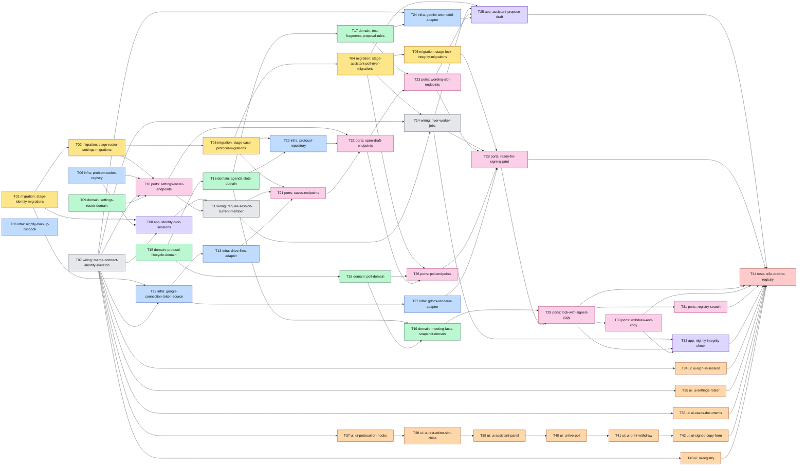

# Epic — board-protocol (Stage 1)

> **PRD:** [PRD.md](../PRD.md) · **Design:** [sad.md](../sad.md) · **Data model:** [data-model.md](../data-model.md) · **API:** [openapi.yaml](../contracts/openapi.yaml) · [events.md](../contracts/events.md) · **ADRs:** [adr/](../adr/) · **UI:** [design-spec](../../../design/design-spec.md)

## Goal

Ship Stage 1 of the protocol's life (PRD §1, §2): a член правління drafts a protocol with the помічник протоколу from case documents, every proposed number stays unconfirmed until a person confirms it and links to its source, the board may run an informal попереднє голосування, the print copy takes a never-reused number, and the signed scan with the meeting facts locks the protocol into a searchable, tamper-evident реєстр протоколів.

## Scope

- **In:** surfaces `[backend-service, web-frontend, worker]` (sad frontmatter, ADR-0001); contexts `governance` (extended) and `identity` (new) per ADR-0014; staged migrations 02–22 plus River's schema; the contract delta merged into `services/core/api/openapi.yaml`; the River worker and its five jobs; the SPA on generated hooks; nightly backup (ADR-0016).
- **Out:** everything in PRD §3 and the ACs under PRD §5 «Deferred to Stage 2» (effective-dated rules, quorum and majority, blocking checks and overrides, reading the scan, export for the ревізійна комісія, wording templates, warnings); `finance` stays untouched apart from the session guard.

## Task map

Same DAG as [tasks.json](./tasks.json). Colours = layer. Day-one parallel starts: T01 (migration lane), T06, T07, T09, T15, T33.

**Phases** (longest-path depth; `implement-tasks` runs each phase in parallel within its lanes):

| Phase | Tasks |
|---|---|
| 1 | T01, T06, T07, T09, T15, T33 |
| 2 | T02, T08, T12, T16, T18, T34, T35, T36, T37, T43 |
| 3 | T03, T10, T13, T17, T19, T27, T38 |
| 4 | T04, T11, T20, T24, T39 |
| 5 | T05, T14, T21, T40 |
| 6 | T22, T41 |
| 7 | T23, T26, T42 |
| 8 | T25, T28 |
| 9 | T29 |
| 10 | T30, T31 |
| 11 | T32 |
| 12 | T44 |

**Lanes:** T01→T05 are `layer: migration` and run in order. Tasks with overlapping `files_hint` serialize: `cmd/api/main.go` (T07, T11), `governance/module.go` (T10, T14), `.golangci.yml` (T07, T24), `protocol-screen.tsx` (T37→T42 chain), `transition-actions.tsx` (T40, T41). The web tasks T34–T36, T43 parallelize with the backend from T07 on; they build on generated hooks and Storybook stories while handlers are stubs.

## Tasks

See [tracker.md](./tracker.md) for status. Total 44 tasks, ~31.25 person-days.

| # | Task | Layer | Blocked by | ACs | Est. |
|---|---|---|---|---|---|
| [T01](./T01-stage-identity-migrations.md) | Promote the identity migrations: accounts, sessions, google_connections | migration | — | AC-19, AC-16 | S |
| [T02](./T02-stage-roster-settings-migrations.md) | Promote the roster, settings and meetings-chair migrations | migration | T01 | AC-42, AC-02 | S |
| [T03](./T03-stage-case-protocol-migrations.md) | Promote the case, protocol, agenda-item and decision-slot migrations | migration | T02 | AC-26, AC-03, AC-03c, AC-21, AC-29 | S |
| [T04](./T04-stage-assistant-poll-river-migrations.md) | Promote the assistant-turn and poll migrations and add the River schema | migration | T03 | AC-26, AC-30, AC-31 | M |
| [T05](./T05-stage-lock-integrity-migrations.md) | Promote the print-copy, meeting-facts, snapshot, trigger and integrity-run migrations | migration | T04 | AC-14c, AC-14, AC-15, AC-17 | M |
| [T06](./T06-problem-codes-registry.md) | Add problem `code` and `urn:problem:` types to httpapi with a governance error registry | infra | — | AC-02, AC-42 | M |
| [T07](./T07-merge-contract-identity-skeleton.md) | Merge the contract delta, add the identity context skeleton and regenerate server and client | wiring | — | — | L |
| [T08](./T08-identity-oidc-sessions.md) | Sign in with Google OIDC and keep sessions in Postgres | app | T01, T06, T07, T02, T09 | AC-19, AC-16, AC-02, AC-42 | L |
| [T09](./T09-settings-roster-domain.md) | Model association settings and roster entries with all-fields validation | domain | — | AC-42, AC-02 | M |
| [T10](./T10-settings-roster-endpoints.md) | Serve settings and roster: use cases, Postgres repositories, handlers and CurrentMember | ports | T02, T06, T07, T09 | AC-42, AC-02 | L |
| [T11](./T11-require-session-current-member.md) | Require a session and a current член правління on the governance and finance routes | wiring | T08, T10 | AC-19, AC-16 | M |
| [T12](./T12-google-connection-token-source.md) | Store the association's Google connection and expose GoogleTokenSource | infra | T01, T07 | AC-26, AC-14 | M |
| [T13](./T13-drive-files-adapter.md) | Implement the Drive Files adapter with sha256 checks and an in-memory fake | infra | T12 | AC-26, AC-14, AC-17 | M |
| [T14](./T14-river-worker-jobs.md) | Wire the River client, the cmd/worker binary and the job status endpoints | wiring | T04, T07, T11 | AC-26, AC-14c | L |
| [T15](./T15-protocol-lifecycle-domain.md) | Model the protocol lifecycle: states, revision, transitions and refusals | domain | — | AC-05d, AC-14b, AC-17, AC-32, AC-35, AC-36, AC-37, AC-38, AC-39, AC-40 | L |
| [T16](./T16-agenda-slots-domain.md) | Model agenda items and слоти рішення: confirm, correct, needs review and readiness | domain | T15 | AC-04, AC-21, AC-28b, AC-09, AC-29, AC-03c | M |
| [T17](./T17-text-fragments-proposal-rules.md) | Add text fragments, the fact validator and the amount recommendation rule | domain | T16 | AC-28, AC-22, AC-21, AC-28b | L |
| [T18](./T18-poll-domain.md) | Model poll rounds and the own-vote rule | domain | T15 | AC-30, AC-31, AC-05e, AC-32, AC-41, AC-05d | M |
| [T19](./T19-meeting-facts-snapshot-domain.md) | Model meeting facts and the canonical fingerprinted snapshot | domain | T16, T18 | AC-14, AC-34, AC-15, AC-17 | M |
| [T20](./T20-protocol-repository.md) | Persist the protocol aggregate with a revision guard | infra | T03, T16 | AC-29, AC-05d, AC-03 | L |
| [T21](./T21-cases-endpoints.md) | Serve cases: create, list, open, add document versions and download files | ports | T03, T11, T13 | AC-19, AC-26, AC-09 | L |
| [T22](./T22-open-draft-endpoints.md) | Open a draft for a meeting from a case, get and list protocols | ports | T10, T20, T21 | AC-42, AC-03, AC-03c, AC-04, AC-28, AC-29 | L |
| [T23](./T23-wording-slot-endpoints.md) | Edit wording and слоти рішення: save wording, add, confirm and correct slots | ports | T17, T22 | AC-29, AC-21, AC-28b, AC-09, AC-05d, AC-14b | L |
| [T24](./T24-gemini-textmodel-adapter.md) | Implement the Gemini TextModel adapter as the only importer of the SDK | infra | T07, T17 | AC-26, AC-21, AC-22 | M |
| [T25](./T25-assistant-propose-draft.md) | Take conversation turns and propose a draft in the propose_draft job | app | T04, T14, T23, T24 | AC-26, AC-21, AC-22, AC-28, AC-28b, AC-03c | L |
| [T26](./T26-poll-endpoints.md) | Start the попереднє голосування, cast own votes and return to draft | ports | T04, T18, T22 | AC-30, AC-31, AC-41, AC-05d, AC-05e, AC-32 | L |
| [T27](./T27-gdocs-renderer-adapter.md) | Render the print copy from a pinned Google Docs template, with a fake Renderer | infra | T12 | AC-14c, AC-41, AC-42 | M |
| [T28](./T28-ready-for-signing-print.md) | Mark ready for signing: reserve the number and render the print copy in a job | ports | T05, T14, T23, T26, T27 | AC-04, AC-21, AC-14c, AC-33, AC-14b, AC-41, AC-42 | L |
| [T29](./T29-lock-with-signed-copy.md) | Lock with the signed scan and meeting facts, and apply Drive restrictions | ports | T19, T28 | AC-14, AC-34, AC-15, AC-40, AC-16, AC-17, AC-41 | L |
| [T30](./T30-withdraw-and-copy.md) | Withdraw a protocol with a reason and copy a withdrawn draft | ports | T29 | AC-35, AC-36, AC-37, AC-38, AC-39 | M |
| [T31](./T31-registry-search.md) | Search the реєстр протоколів and open a signed protocol | ports | T29 | AC-18, AC-41, AC-15, AC-19 | L |
| [T32](./T32-nightly-integrity-check.md) | Run the nightly integrity check of snapshots and clean up orphan files | app | T14, T29, T30 | AC-17 | M |
| [T33](./T33-nightly-backup-runbook.md) | Back up Postgres nightly off the VM and write the restore-drill runbook | infra | — | — | M |
| [T34](./T34-ui-sign-in-session.md) | Add the sign-in page, the session guard and 401/403 handling | ui | T07 | AC-19, AC-16 | M |
| [T35](./T35-ui-settings-roster.md) | Build the association settings and roster screens | ui | T07 | AC-42, AC-02 | L |
| [T36](./T36-ui-cases-documents.md) | Move the cases list and case screen to generated hooks with document upload | ui | T07 | AC-26, AC-09 | M |
| [T37](./T37-ui-protocol-on-hooks.md) | Move the protocol screen to generated hooks: agenda, slots and revision conflicts | ui | T07 | AC-03, AC-03c, AC-21, AC-28b, AC-09, AC-29, AC-04, AC-22, AC-28 | L |
| [T38](./T38-ui-text-editor-slot-chips.md) | Build the decision text editor with slot chips and highlighted typed facts | ui | T37 | AC-29, AC-28 | L |
| [T39](./T39-ui-assistant-panel.md) | Add the помічник протоколу conversation panel with job polling | ui | T38 | AC-26, AC-03c | M |
| [T40](./T40-ui-live-poll.md) | Make the попереднє голосування live: start, own vote, tally, informal label, return to draft | ui | T39 | AC-30, AC-31, AC-41, AC-05d, AC-05e, AC-32 | M |
| [T41](./T41-ui-print-withdraw.md) | Wire printing and withdrawal: ready for signing, job polling, void warning, withdraw and copy | ui | T40 | AC-14c, AC-33, AC-14b, AC-04, AC-21, AC-35, AC-36, AC-37, AC-39, AC-38, AC-17 | L |
| [T42](./T42-ui-signed-copy-form.md) | Build the signed-scan upload with the meeting facts form | ui | T41 | AC-14, AC-34, AC-15, AC-40, AC-41 | M |
| [T43](./T43-ui-registry.md) | Build the реєстр протоколів search and the signed protocol view | ui | T07 | AC-18, AC-41, AC-15, AC-17 | M |
| [T44](./T44-e2e-draft-to-registry.md) | Prove the flow end to end: draft to registry through the UI with fake Google and Gemini | tests | T25, T28, T29, T30, T31, T32, T34, T35, T36, T42, T43 | AC-26, AC-30, AC-14c, AC-14, AC-18, AC-19, AC-35 | L |

**AC coverage:** all 34 Stage 1 ACs of PRD §5 are in at least one task's `acs`; the 29 deferred / dropped ACs are Stage 2 by PRD §5 and sad §6 Coverage. T07 and T33 carry no AC (contract merge and the backup NFR).

## Risks / Hard rules

- **Canonical inputs.** This breakdown reads `PRD.md`, `sad.md` and `adr/` (sad §11 asked to pick one SAD before break-tasks). `PRD.ao-prd.md`, `sad.ao-architecture.md` and `adr.ao-architecture/` are not inputs; `docs/design/design-spec.md` cites `PRD.ao-prd.md` AC numbers, which differ from `PRD.md` — the ui tasks use `PRD.md` ids.
- **Already live.** Staged 00–01 and the `association_id` part of 07–10 are already goose files `00004`–`00008`; T01/T02 promote only what is missing.
- **Size.** The skill's 8–20 task band is exceeded on purpose: size L across three surfaces with the ≤1 day / ≤500 LOC rule gives 44 tasks.
- **Contract first, handlers later (T07).** The whole delta is merged once with 501 stubs; each ports task removes its stubs. Accepted deviation from «contract and handler in the same PR» so the ui lane can start early.
- **The assistant only proposes** (PRD §6.1, ADR-0004): the Gemini SDK is imported only in `adapters/gemini` (depguard, T24); no number reaches a print copy unconfirmed (T16, T28).
- **Immutability** (ADR-0007): snapshot and no-delete triggers are the one documented trigger exception (T05); a locked protocol changes only through a new decision (T29).
- **Association scope** (ADR-0015): every new sqlc query filters on `association_id`; each repository task carries a second-association isolation test.
- **Generated code is never edited** (`*.gen.go`, `sqlcgen/`, `apps/web/src/api/gen/`, `routeTree.gen.ts`); run `mise run gen` after the contract, queries or migrations change.
- **No `r.Mount`** for a context; `r.Group` (CLAUDE.md gotcha) — T07, T11.
- **External Google and Gemini** are behind ports with fakes (T13, T24, T27); real-adapter tests run behind an env flag with a test Google account (sad §11).
- **No PII in fixtures:** `Test User`, `user-<uuid>@example.test`.
