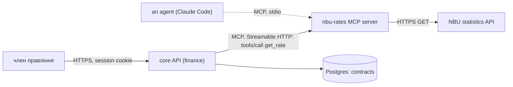
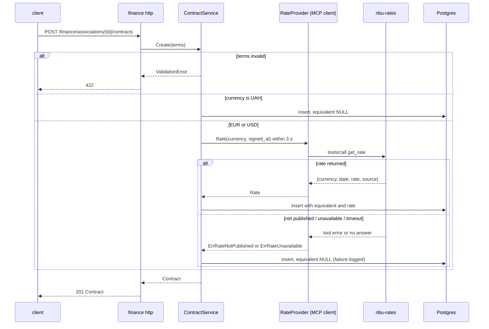
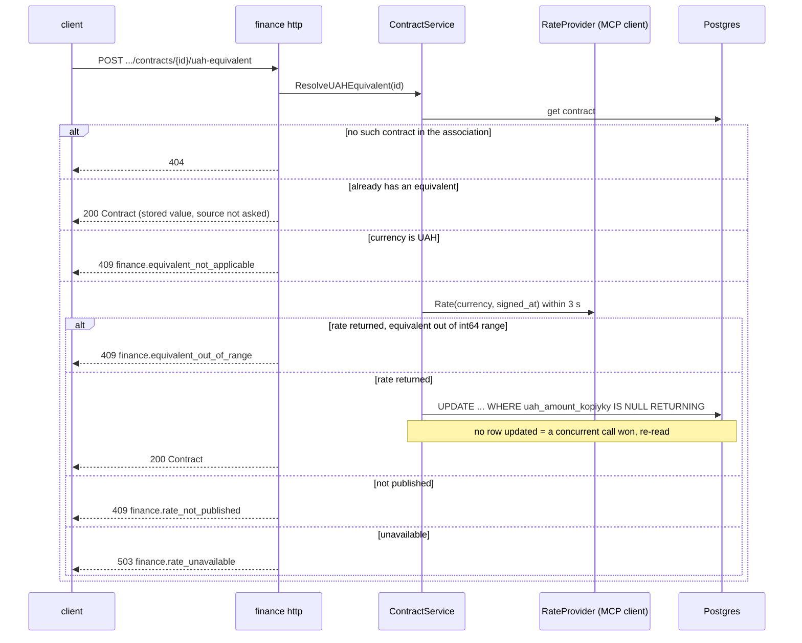

# Software Architecture Document — contract-uah-equivalent

> **Inputs:** [PRD](./PRD.md) (Approved 2026-11-20) · [CONTEXT](./CONTEXT.md) · repo ADRs [`docs/adr/`](../../adr/) ·
> [`mcp/nbu-rates`](../../../mcp/nbu-rates/README.md) · reference context `services/core/internal/finance`

## 1. Introduction and goals

Store the гривневий еквівалент of a EUR or USD contract with the contract, computed once from the офіційний
курс of the signing day, which the core API reads from the `nbu-rates` MCP server. Quality goals, in order:
(1) money is exact (PRD AC-02, AC-09); (2) the rate source can fail without breaking contracts (AC-04);
(3) the integration is replaceable behind one port (AC-10).

## 2. Constraints

- Repo ADR 0002: a bounded context owns its data and exposes only `module.go`; `domain/` is stdlib only.
- Repo ADR 0003: one OpenAPI contract, generated server and client; the feature ships a delta.
- Repo ADR 0004 and `.claude/rules/migrations.md`: goose, sqlc, no business `CHECK`, nullable additions to
  existing tables.
- `.claude/rules/openapi.md`: RFC 9457 problems with `<context>.<error_name>` codes; integer minor units.
- One developer; no new infrastructure beyond one more local process.

## 3. Context and scope

In scope: the finance context, one adapter, two columns. Out of scope: the MCP server itself (shipped
separately in `mcp/nbu-rates`), governance, the web app.

## 4. Solution strategy

1. **Surface:** `backend-service` only (PRD §3: no screen).
2. **Rate through a port.** `finance/ports.RateProvider` answers one question: the офіційний курс of a
   currency on a day. Its only production implementation is an MCP client (ADR-0001).
3. **Compute once, store with the contract.** The equivalent and the rate are columns of `contracts`; a
   stored equivalent is never recomputed (ADR-0002).
4. **Degrade at creation, be strict on request.** Creating a contract swallows a failed lookup (AC-04); the
   explicit «get it later» operation reports it (AC-07).

## 5. Building block view

| Block | Path | Responsibility |
|---|---|---|
| domain | `finance/domain/rate.go` | `Rate` (a decimal parsed into micros), `UAHEquivalent`, the half-up conversion; `ErrRateNotPublished`, `ErrRateUnavailable`, `ErrEquivalentOutOfRange` |
| domain | `finance/domain/errors.go` | the four `finance.*` codes of PRD §5.1 with their statuses |
| port | `finance/ports/rates.go` | `RateProvider.Rate(ctx, currency, day) (domain.Rate, error)` |
| adapter | `finance/adapters/mcprates/` | MCP client: connects to `NBU_RATES_MCP_URL`, calls `get_rate`, validates the answer, maps failures; a `Disabled` provider when the URL is empty |
| adapter | `finance/adapters/postgres/` | reads and writes the two columns; `SetUAHEquivalent` only where it is still `NULL` |
| app | `finance/app/contracts.go` | `Create` resolves the equivalent with a 3 s budget; `ResolveUAHEquivalent` is the «get it later» use case |
| http | `finance/adapters/http/handler.go` | `uah_equivalent` on every contract answer; the new operation and its problems |
| wiring | `finance/module.go`, `platform/config`, `cmd/api/main.go` | `finance.New(pool, finance.Config{RatesMCPURL})` |

Ownership: `contracts` stays owned by `finance`. No other context reads the equivalent.

## 6. Runtime view

### Flow 1 — create a foreign-currency contract (AC-01, AC-03, AC-04)

### Flow 2 — get the equivalent later (AC-05, AC-06, AC-07)

The rate lookup happens outside the database write: in Flow 1 before the insert, in Flow 2 between the read
and the conditional update. The request's scoped transaction (`platform/db.InAssociation`) stays open across
the lookup, bounded by the 3 s budget.

### Coverage: US/AC → flows

| US / AC | Flow |
|---|---|
| US-01: AC-01, AC-03, AC-04, AC-11 | 1 |
| US-01: AC-02 | domain, no flow |
| US-01: AC-10 | 1 and 2 (the `R → M` leg) |
| US-02: AC-09 | 1 and 2 (what is stored and returned) |
| US-03: AC-05, AC-06, AC-07, AC-08 | 2 |

## 7. Deployment view

One more process next to the core API: `nbu-rates -http 127.0.0.1:3336` (`mise run mcp:nbu`, a pane of
`mise run dev`). The core API reads `NBU_RATES_MCP_URL` (`http://127.0.0.1:3336/mcp` locally); unset means the
feature degrades as in AC-04 and AC-07. The MCP port is never published outside the host or private network.

## 8. Crosscutting concepts

- **Money:** a rate is `rate_micros` (hryvnia × 10⁶ per unit, `int64`); the equivalent is
  `round_half_up(amount_cents × rate_micros / 10⁶)` in `math/big`. Six fraction digits cover what the NBU
  publishes (four for EUR and USD); a longer or non-decimal rate is refused, never rounded.
- **Errors:** the four codes of PRD §5.1 live in `finance/domain/errors.go` (the shape of
  `governance/domain/errors.go`) and reach the wire as the `code` member of a problem.
- **Timeouts:** one `context.WithTimeout(3 s)` around the port call in the app layer; the adapter adds none.
- **Trust in the tool answer:** the adapter checks that the answer names the currency and the day it asked
  for, that `source` is `NBU` and that the rate parses; otherwise `ErrRateUnavailable` (AC-10).
- **Logging:** `slog.WarnContext` on a failed lookup with currency, day and error class; no amounts.

## 9. Architecture decisions

| ADR | Decision | Status |
|---|---|---|
| [0001](./adr/0001-read-the-nbu-rate-through-an-own-mcp-server-behind-a-finance-port.md) | Read the NBU rate through an own MCP server behind a finance port | accepted |
| [0002](./adr/0002-store-the-hryvnia-equivalent-on-the-contract-and-never-recompute-it.md) | Store the hryvnia equivalent on the contract and never recompute it | accepted |

## 10. Quality requirements

| Quality | Scenario | Measure |
|---|---|---|
| Correctness | the table of AC-02 | unit tests, exact integers |
| Resilience | the rate source hangs | creation answers within 3 s + normal time, 201 |
| Replaceability | swap MCP for another source | one new adapter of `RateProvider`, no change in `app` or `domain` |
| Isolation | another association's contract id | 404, covered by `isolation_test.go` |

## 11. Risks and technical debt

- The stub MCP server of the adapter tests can drift from the real `get_rate` contract → the end-to-end test
  of AC-11 runs the real binary.
- A contract created during an outage stays without an equivalent until someone asks → parked retry job
  (PRD §8).
- The scoped transaction is held during the lookup (≤ 3 s) → acceptable at this load; revisit if contracts
  are created in bulk.
- A new dependency in the core module (`modelcontextprotocol/go-sdk`), used only by one adapter package.

## 12. Glossary

See [CONTEXT](./CONTEXT.md): гривневий еквівалент, офіційний курс, дата курсу, джерело курсу.
