# Epic — contract-uah-equivalent

> **PRD:** [PRD.md](../PRD.md) · **Design:** [sad.md](../sad.md) · **Data model:** [data-model.md](../data-model.md) · **API:** [openapi.yaml](../contracts/openapi.yaml) · **ADRs:** [adr/](../adr/) · **Migrations:** [MANIFEST](../migrations/MANIFEST.md) · **MCP server:** [`mcp/nbu-rates`](../../../../mcp/nbu-rates/README.md)

## Goal

A contract signed in EUR or USD carries its гривневий еквівалент at the офіційний курс of the signing day, read by the finance context from the `nbu-rates` MCP server, stored once with the rate behind it; the rate source may fail without a contract being lost (PRD §2).

## Scope

- **In:** surface `[backend-service]`; context `finance` (domain, port, MCP adapter, storage, use cases, HTTP), `platform/config`, `cmd/api`; one staged migration; the contract delta.
- **Out:** the MCP server itself (already in `mcp/nbu-rates`), any web page, governance, a retry job (PRD §3, §8).

## Task map

Same DAG as [tasks.json](./tasks.json). T01–T12 are the original plan; T13–T29 are review follow-ups ([_review/](../_review/)). Day-one parallel starts: T01, T02, T03, T04. Longest chain: 7 (T02 → T05 → T07 → T08 → T09 → T10 → T11). Tasks sharing files (`app/contracts.go`, `handler.go`, `module.go`) are serialized by their `deps`.

```mermaid
flowchart LR
    T01["T01 migration: promote-uah-equivalent-migration"]:::mig
    T02["T02 domain: rate-and-equivalent-domain"]:::dom
    T03["T03 domain: finance-problem-codes"]:::dom
    T04["T04 wiring: merge-contract-delta"]:::wir
    T05["T05 infra: mcp-rate-provider"]:::inf
    T06["T06 infra: store-uah-equivalent"]:::inf
    T07["T07 app: resolve-equivalent-on-create"]:::app
    T08["T08 app: resolve-equivalent-later"]:::app
    T09["T09 ports: uah-equivalent-http"]:::prt
    T10["T10 wiring: wire-rates-config"]:::wir
    T11["T11 tests: end-to-end-real-mcp-server"]:::tst
    T12["T12 docs: docs-and-bruno"]:::doc
    T13["T13 wiring: live-problem-types"]:::wir
    T14["T14 domain: equivalent-out-of-range"]:::dom
    T15["T15 migration: migration-header"]:::mig
    T16["T16 wiring: redact-rate-url"]:::wir
    T17["T17 tests: nbu-limit-tests"]:::tst
    T18["T18 infra: keep-rate-url-out-of-errors"]:::inf
    T19["T19 docs: four-codes-in-docs"]:::doc
    T20["T20 docs: prd-change-note"]:::doc
    T21["T21 app: out-of-range-log-fields"]:::app
    T22["T22 docs: sad-flow1-out-of-range"]:::doc
    T23["T23 infra: refuse-rate-source-redirects"]:::inf
    T24["T24 tests: call-step-leak-test"]:::tst
    T25["T25 infra: bound-rate-http-requests"]:::inf
    T26["T26 docs: sad-adapter-deadline"]:::doc
    T27["T27 docs: epic-follow-up-coverage"]:::doc
    T28["T28 tests: hung-source-test-strength"]:::tst
    T29["T29 infra: structural-url-redaction"]:::inf
    T02 --> T05
    T01 --> T06
    T02 --> T06
    T05 --> T07
    T06 --> T07
    T03 --> T08
    T07 --> T08
    T04 --> T09
    T08 --> T09
    T09 --> T10
    T10 --> T11
    T09 --> T12
    T09 --> T13
    T13 --> T14
    T01 --> T15
    T10 --> T16
    T16 --> T18
    T14 --> T19
    T14 --> T20
    T14 --> T21
    T19 --> T22
    T18 --> T23
    T23 --> T24
    T23 --> T25
    T25 --> T26
    T26 --> T27
    T28 --> T27
    T29 --> T27
    T25 --> T28
    T23 --> T29
    classDef mig fill:#fde68a,stroke:#92400e,color:#111
    classDef dom fill:#bbf7d0,stroke:#166534,color:#111
    classDef inf fill:#bfdbfe,stroke:#1e40af,color:#111
    classDef app fill:#ddd6fe,stroke:#5b21b6,color:#111
    classDef prt fill:#fecaca,stroke:#991b1b,color:#111
    classDef wir fill:#e5e7eb,stroke:#374151,color:#111
    classDef tst fill:#fbcfe8,stroke:#9d174d,color:#111
    classDef doc fill:#f5f5f4,stroke:#57534e,color:#111
```

## AC coverage

| AC | Tasks |
|---|---|
| AC-01 | T01, T06, T07, T09, T11 |
| AC-02 | T02, T14, T20 |
| AC-03 | T07 |
| AC-04 | T07, T10, T14, T20, T21, T22, T25, T26, T28 |
| AC-05 | T04, T08, T09, T12 |
| AC-06 | T06, T08, T09 |
| AC-07 | T03, T08, T09, T13, T14, T19, T20, T22 |
| AC-08 | T09 |
| AC-09 | T02, T04, T09 |
| AC-10 | T05, T10, T11, T17, T25, T26, T28, T29 |
| AC-11 | T11 |
